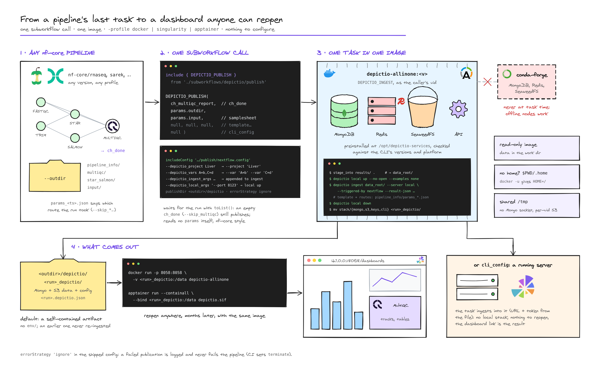

# <span style="color: #0dc09d;">:simple-nextflow:</span> Nextflow subworkflow <small>(v1.22.0+)</small>

The `depictio/publish` subworkflow publishes a run to Depictio from inside an nf-core pipeline, as its last task. Unlike the [trigger](nextflow-trigger.md), which runs outside the pipeline once it completes, it ships with the pipeline like any nf-core subworkflow.

<figure markdown="span">
  [](../images/guides/nextflow-publish/publish-flow.png){target=_blank}
</figure>

## What it does

- Waits for the run's published outputs, then hands its `depictio/ingest` module the whole `--outdir` and the samplesheet, which nf-core does not publish but templates read from `input/`.
- Detects the [template](../pipeline-templates/nf-core/index.md) from the run's `pipeline_info/`, at the closest bundled release, and sets its route variables from the run's params ([template variables](../usage/projects/templates.md#template-variables)). Nothing in it names a pipeline.
- The task starts a single-user Depictio, ingests the run, stops it and publishes the result into `<outdir>/depictio/`: an **artifact** anyone reopens later. Nothing outlives the task.
- A failed ingestion never fails the run (`errorStrategy 'ignore'`).

## Add it to a pipeline

Copy the subworkflow and its module into the pipeline:

```bash
NF="$(dirname "$(depictio config nextflow)")"
cp -r "$NF/subworkflows/depictio" subworkflows/local/
cp -r "$NF/modules/depictio" modules/local/
```

The subworkflow's `include` of `DEPICTIO_INGEST` follows the package layout: point it at `modules/local/depictio/ingest/main`. Then, in the pipeline's `main.nf`, after the main workflow, and in its `nextflow.config`:

```groovy
// main.nf
include { DEPICTIO_PUBLISH } from './subworkflows/local/depictio/publish/main'

if (params.depictio) {
    DEPICTIO_PUBLISH(
        NFCORE_RNASEQ.out.multiqc_report,   // published outputs: wait for them
        params.outdir,
        params.input,                       // the samplesheet, path or URL
        params.depictio_template,           // null: detected from pipeline_info/
        params.depictio_project_config,     // null: the template's project
        params.depictio_dashboards,         // null: the template's dashboards
        params.depictio_cli_config,         // null: build an artifact
    )
}

// nextflow.config
params {
    depictio                = true
    depictio_template       = null
    depictio_project_config = null
    depictio_dashboards     = null
    depictio_cli_config     = null
    depictio_project        = null   // project name (default: the template's)
    depictio_vars           = [:]    // e.g. [GROUP_COL: 'condition'], or 'K=V,K2=V2'
    depictio_ingest_args    = ''     // more `depictio ingest` options
    depictio_local_args     = ''     // `depictio local up` options, e.g. '--port 8123'
}
includeConfig 'subworkflows/local/depictio/publish/nextflow.config'
```

Declare the params in `nextflow_schema.json` too, or nf-schema rejects them. A run sets any of them with `--depictio_*`. An explicit `depictio_vars` entry wins over the run's params. Given an instance's `CLI.yaml` as `depictio_cli_config`, the task sends the run there instead of building an artifact (not the default, may change); keep its token in a Nextflow secret, `DEPICTIO_CLI_TOKEN`.

## Docker, Singularity and Apptainer

The `depictio/ingest` module now runs in `ghcr.io/depictio/depictio-allinone:<version>` instead of `ghcr.io/depictio/depictio-cli`: the CLI, the server, MongoDB, Redis and SeaweedFS, preinstalled. With `-profile docker`, `podman`, `singularity` or `apptainer`, the task downloads nothing and needs nothing configured: `depictio local up` reads the services the image sets in `DEPICTIO_SERVICES_PREFIX`, and a version mismatch fails the task rather than downloading. The image is about 2.9 GB (linux/amd64 and linux/arm64), pulled once per machine.

- **Docker / Podman**: run as the host's user (`docker.runOptions = '-u $(id -u):$(id -g)'`). A task with no writable `HOME` uses its work directory.
- **Singularity / Apptainer**: the read-only image is fine. The stack listens on 127.0.0.1 on free ports, so it runs on a shared node beside other users' stacks.
- **Conda** (`-profile conda`) installs `depictio[local]` instead and fetches the services from conda-forge, so the node needs network access.

## Reopen the artifact

```
results/depictio/
├── <run>.depictio.json    how the ingestion ended, project and dashboard links
└── <run>_depictio/        the artifact (about 100 MB for the rnaseq test profile)
```

=== "Docker"

    ```bash
    docker run --rm -p 127.0.0.1:8058:8058 \
      -v "$PWD/results/depictio/<run>_depictio:/data" \
      ghcr.io/depictio/depictio-allinone:<version>
    # -> http://localhost:8058/dashboards
    ```

=== "Apptainer"

    ```bash
    apptainer build depictio-allinone.sif docker://ghcr.io/depictio/depictio-allinone:<version>
    apptainer run --containall --bind "$PWD/results/depictio/<run>_depictio:/data" depictio-allinone.sif
    ```

=== "Python package"

    ```bash
    DEPICTIO_LOCAL_HOME=results/depictio/<run>_depictio depictio local up
    ```

Take `<version>` from the module's `versions.yml`. The artifact holds the stack's keys and admin token: share it as you would the data. An earlier run's artifact in the same `<outdir>/depictio/` is skipped, never ingested as data.
