# :material-hammer-wrench: Tool Studio <small>(v1.9.0+)</small>

**Depictio Tool Studio** contributes a tool to the
[Tools Catalog](../catalog/index.md) from the browser: drop a sample of one of the
tool's output files (or a raw file plus a short recipe), bind its columns in
depictio's own component builder, and the app opens the pull request against
`depictio/depictio` for you.

It runs entirely in the page, which is what makes it worth using: nothing to install, no
server to reach, and your file is parsed locally and only leaves the browser if you choose
to open the pull request.

From v1.23.0 the app wears depictio's own chrome (the same top bar, cards and step bar as
the viewer and the dashboards), keeps an entry panel beside every step showing the files
it will write and the checks it has run, and covers what it used to hand off to
hand-writing: recipes, several outputs per tool, and validation at parity with the CLI.

<div class="catalog-cta-wrap" markdown>
[Open Tool Studio :material-arrow-right:](https://depictio.github.io/depictio-tool-studio/){ .catalog-cta .catalog-cta--studio target=_blank }
</div>

<figure markdown="span">
  [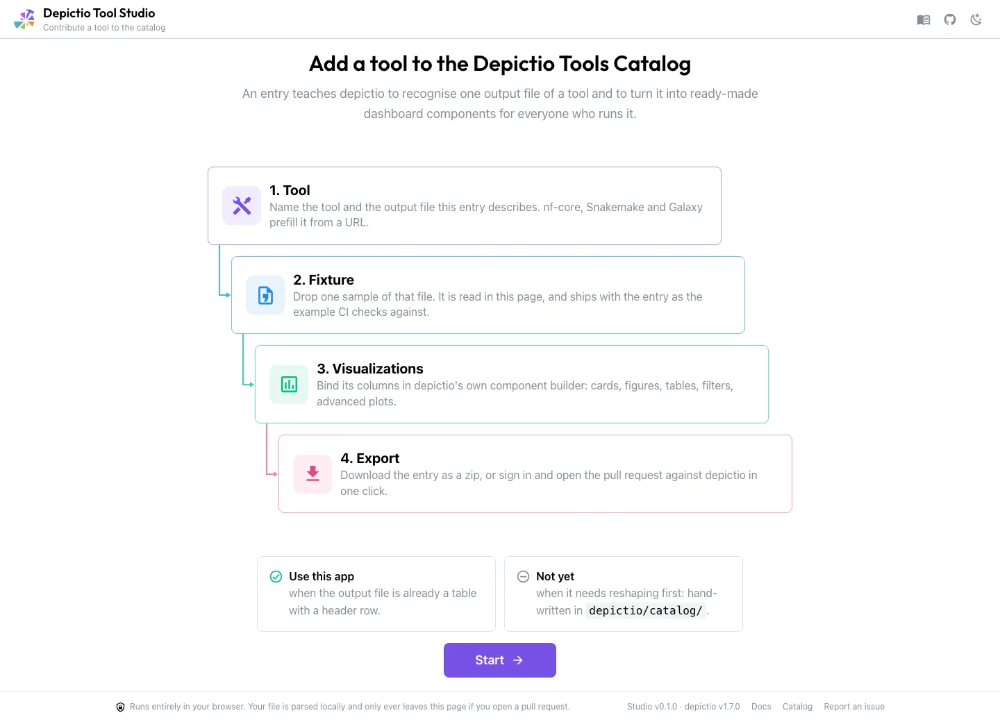](../images/tool-studio/00-start.webp){target=_blank}
  <figcaption>The start screen states what an entry is before any form field, and where the app stops. **Try an example** loads a committed entry to walk through; **Import an entry** reads an exported zip, a committed tool folder or a draft JSON back in.</figcaption>
</figure>

---

## Which route

A catalog entry is a folder: `module.yaml` (which tool), one `<output>.yaml` per output
file (how to find it, and what to render from it), the fixture each output grounds its
bindings with, and the recipe module when that file needs reshaping. What your output file
looks like decides how much of this the Studio writes for you.

<div class="module-flow module-flow--parallel" markdown>

<div class="module-flow__step module-flow__step--file" markdown>
:material-table-check:{ .lg } **Already a table** <span class="module-flow__opt">Tool Studio</span>

A header row and one record per line. Drop it, bind its columns, done: the file becomes the fixture.
</div>

<div class="module-flow__step module-flow__step--module" markdown>
:material-cog-transfer:{ .lg } **Needs reshaping** <span class="module-flow__opt">Tool Studio, with a recipe</span>

Any other shape or extension. Write the polars recipe on the Fixture step (from v1.23.0),
run it on a sample in your browser, and its result becomes the fixture and ships with the entry.
</div>

</div>

Half the committed catalog outputs are in the second case. The Studio says which of the
two you are in on its start screen, rather than three steps in with a file that will not
parse. The [hand-written path](contributing-a-tool.md) still works and produces the same
folder; the Studio is simply faster for both.

---

## 1. Tool

Identity on the left, the output this entry describes on the right.

<figure markdown="span">
  [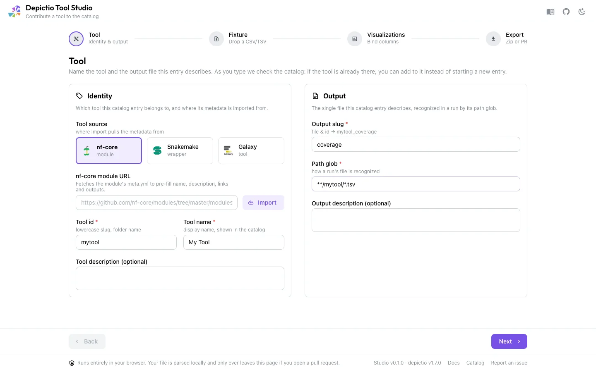](../images/tool-studio/01-tool.webp){target=_blank}
  <figcaption>The <code>path_glob</code> is the load-bearing field, since it is how depictio recognises the file in a real run. An exact file name can replace it.</figcaption>
</figure>

A new tool needs six fields before **Next** unlocks: the tool id and name, the tool
description and homepage, and the output slug and path glob (or an exact file name). The
description and the homepage are what the tool's catalog card shows, and
`catalog validate` rejects a module without them, so the Studio asks for them up front
rather than letting the pull request fail in CI.

**Tool source** imports metadata from an **nf-core module**, a **Snakemake wrapper** or a
**Galaxy tool**. Paste the URL and press **Import**.

<figure markdown="span">
  [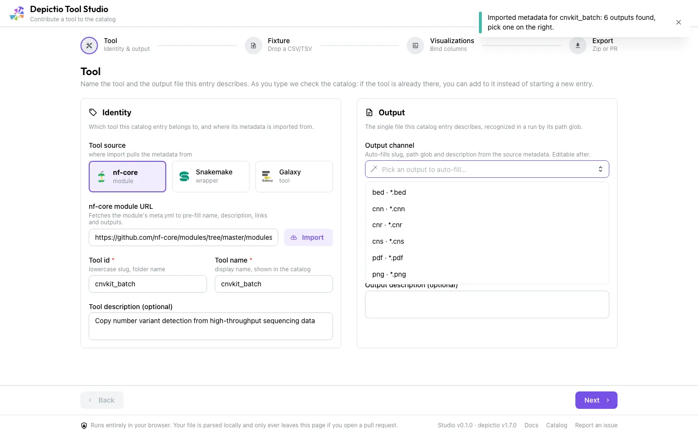](../images/tool-studio/01d-nfcore-import.webp){target=_blank}
  <figcaption>The app reads the module's <code>meta.yml</code> straight from raw.githubusercontent.com and offers every output channel it declares.</figcaption>
</figure>

An nf-core import also fills the tool's identity from `meta.yml`: the description, the
homepage (falling back to `tool_dev_url`, then `documentation`, when `meta.yml` leaves
`homepage` empty) and the bio.tools link from the `biotools:` identifier. Choosing an
output fills the **Output slug**, the **Path glob** and the output description; a
brace pattern in `meta.yml` becomes alternative globs, since the catalog matches globs
one at a time. Import is a convenience, not a requirement: typing the fields yourself
produces an equally valid entry.

Two collapsible panels hold the optional fields. **Classification** carries the `stage`
(what a composed dashboard tabs the tool's components under), EDAM topics and an entry
version. **More ways to recognise the file** carries alternative globs for runs that
name or place the file differently, and the exact file name for outputs that always have
the same one. If the output needs reshaping, turn on **The file needs reshaping first
(recipe)**: the Fixture step then walks the raw sample through a recipe instead of
committing the file directly.

Two checks run while you type, and either one may change what you do next.

### If the tool is already in the catalog

Recognition runs on every keystroke, against a build-time snapshot of the committed
catalog, matching on the nf-core module path first, then the id, then the display name.

<figure markdown="span">
  [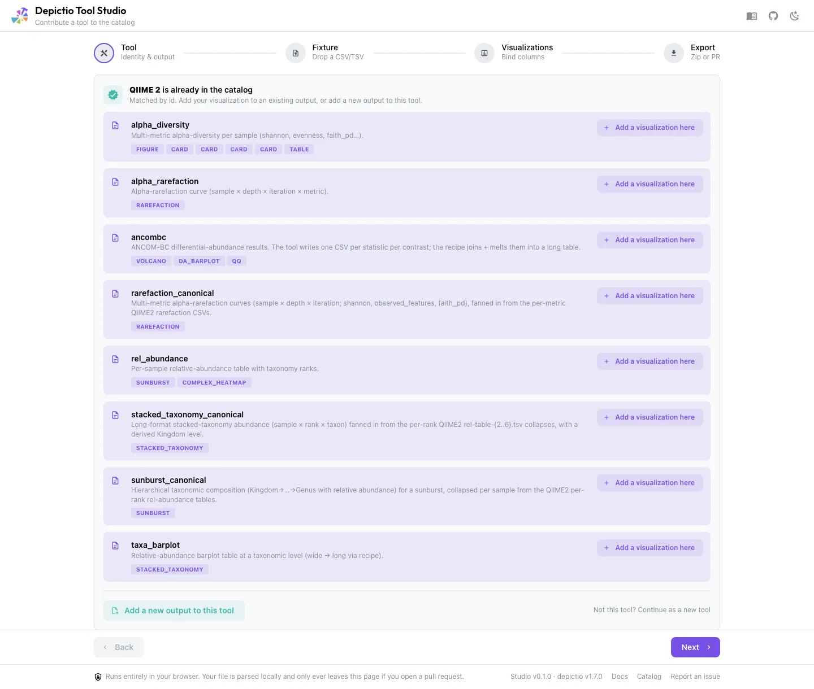](../images/tool-studio/01b-recognized.webp){target=_blank}
  <figcaption>QIIME 2 is the widest entry in the catalog: eight outputs carrying sixteen renders.</figcaption>
</figure>

Two routes open when it matches:

- **Add a visualization here** appends to that output's `renders_as`, rebased on the file
  as it exists on `main` right now, so a render merged since the last deploy is not
  reverted. Export becomes a single-file update.
- **Add a new output to this tool** reuses the identity and writes a fresh `<output>.yaml`,
  leaving `module.yaml` untouched.

A close relative that is already in the catalog (macs3 next to macs2) is flagged too, with
one click to add to that entry instead of writing a parallel one.

**Not this tool? Continue as a new tool** dismisses the match, and the dismissal sticks
across a Back and Next round trip.

### If MultiQC already parses it

<figure markdown="span">
  [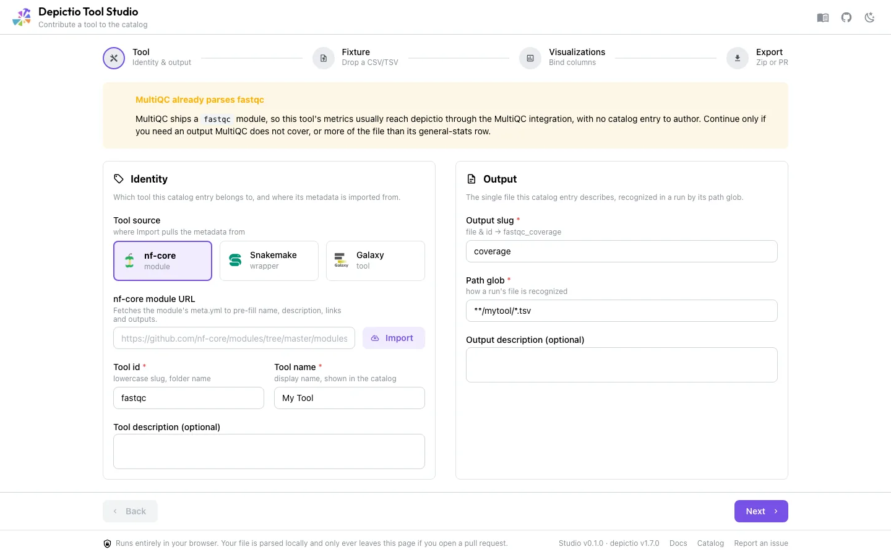](../images/tool-studio/01c-multiqc.webp){target=_blank}
  <figcaption>Advisory only. Nothing is blocked.</figcaption>
</figure>

depictio already ingests MultiQC, and the vendored index lists 181 MultiQC modules, so a
hand-authored entry for one of them is often work for metrics that would arrive anyway.
A bespoke entry is still a legitimate choice, for an output MultiQC skips or for more of
the file than its general-stats row.

### Several outputs for one tool

One entry can describe several outputs of the same tool (from v1.23.0). **Add output** in
the bar above every step adds another; each keeps its own fixture, recipe and renders,
and the steps always edit the highlighted one. The entry panel lists every file the
export will write, and export produces one `<output>.yaml`, fixture and recipe per
output, with `module.yaml` written once.

---

## 2. Fixture

Drop one sample of that output file.

<figure markdown="span">
  [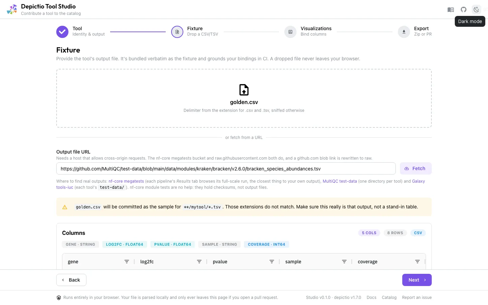](../images/tool-studio/02-fixture.webp){target=_blank}
  <figcaption>Columns and types are inferred from the sample, the same way the catalog reads them. The delimiter comes from the extension for <code>.csv</code> and <code>.tsv</code>, and is sniffed otherwise.</figcaption>
</figure>

The file is parsed in the page, never uploaded. It is **committed with the entry**, and it
is what CI reads to check that every column a render binds actually exists and has a
compatible type, so it has to be a real sample rather than a stand-in table. Fixtures are
capped at 5 MB, with a nudge above 1 MB, and the step warns when the dropped file does not
look like the output the path glob describes.

A file the fixture reader cannot take as is (an extension like `.narrowPeak` or `.bed`,
or a first line of data where the header should be) is not a dead end: the step offers
**Reshape it with a recipe** or **Use it as is**.

### Recipes: raw sample, recipe, fixture

For an output that needs reshaping, the Fixture step becomes a three-stage pipeline
(from v1.23.0):

1. **Raw sample**: the tool's own file, as it comes out of a run. Any extension,
   compressed or not, and you can add several to check the recipe across samples. Raw
   samples stay in your browser: they are not exported, not shared in links and not saved
   with the draft.
2. **Recipe**: the same Python module depictio runs at ingestion. It declares what to
   read (`SOURCES`), what columns it returns (`OUTPUT_SCHEMA`) and a `transform()` that
   reshapes the table. Edit it in the page and press **Run in the browser**: it runs on
   your raw sample in Python and polars in the browser (the first run downloads the
   engine). Pressing **Run this code** on a recipe that arrived from a link or an
   imported file is the consent that runs it.
3. **Fixture**: the recipe's result. Its columns are checked against the recipe's
   `OUTPUT_SCHEMA`, and it is exported as the committed sample CI checks the renders
   against. Dropping the expected output directly, instead of running the recipe, works
   too.

The recipe is exported as `<tool>/<slug>.py` next to the YAML, referenced by `recipe:`
in the output file. If you already have the recipe, importing a committed entry brings
its module in and you can run it from there.

### Fetching it from a URL

If you want to describe an output you do not have on disk, paste a link instead. A
`github.com` blob link is rewritten to `raw.githubusercontent.com`, so a URL copied
straight out of GitHub's file view works.

<figure markdown="span">
  [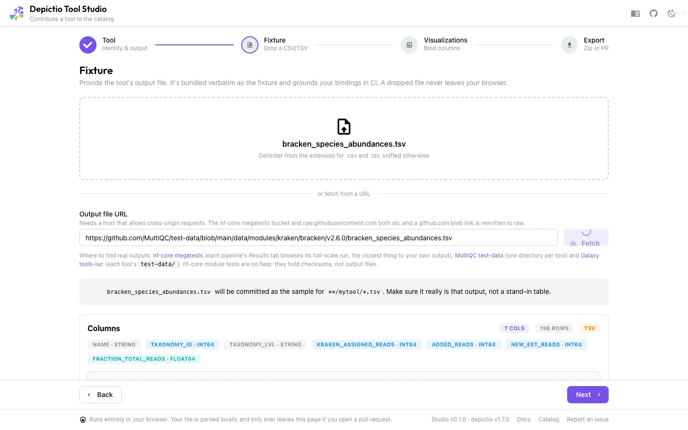](../images/tool-studio/02b-fetch-url.webp){target=_blank}
  <figcaption>The constraint is CORS, a browser rule the app cannot work around: the host has to answer cross-origin requests.</figcaption>
</figure>

Any host that answers cross-origin requests works, including your own. Four public
corpora are known to, and between them cover most tools: **nf-core megatests** (each
pipeline's full-scale run, the closest thing to your own output), **nf-core
test-datasets**, **MultiQC test-data** (one directory per tool), and **Galaxy tools-iuc**
(each tool's `test-data/`). nf-core's own module tests are no help, since they hold
checksums rather than output files.

---

## 3. Visualizations

**Add visualization** opens depictio's component-type grid.

<figure markdown="span">
  [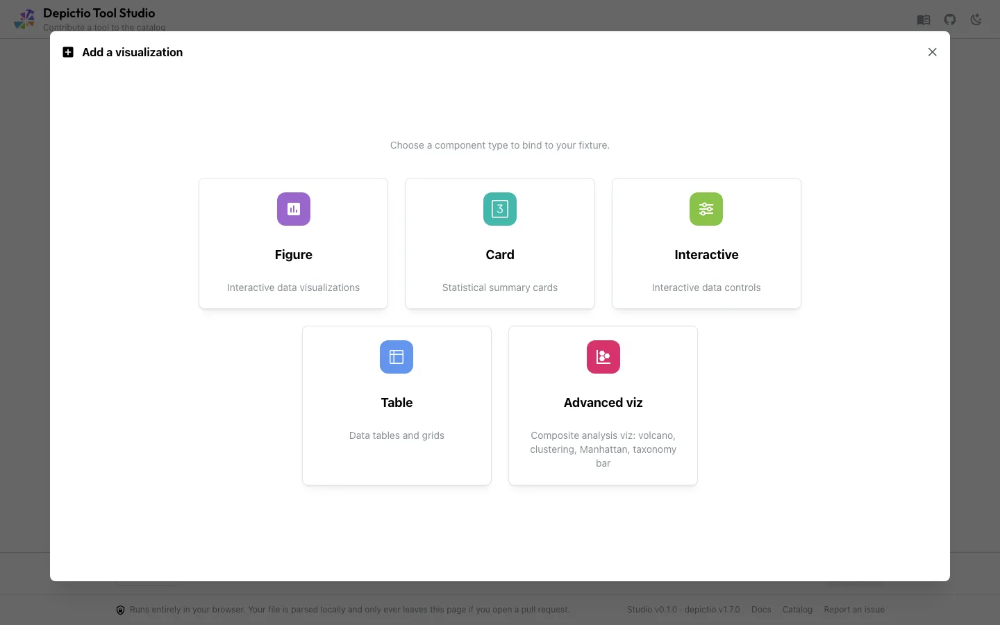](../images/tool-studio/03-component-types.webp){target=_blank}
  <figcaption>The same grid the dashboard editor shows.</figcaption>
</figure>

Picking one drops you into depictio's actual builder for that type, seeded from your
fixture instead of from the API: same controls, same live preview, same **UI Mode** /
**Code Mode** toggle. The coverage of the catalog format widened in v1.23.0: all 13
figure types, every interactive control including `TextInput`, and card headline and
priority. It is still the dashboard editor's interface on a narrower surface:
multi-file kinds such as maps and images are not offered.

<figure markdown="span">
  [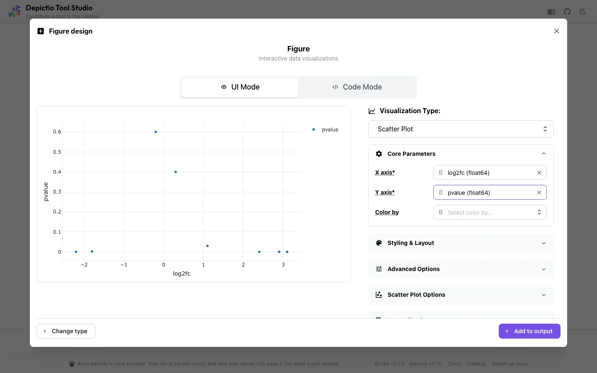](../images/tool-studio/04-figure-builder.webp){target=_blank}
  <figcaption>UI-mode figures are drawn by depictio's own figure code running in your browser, so facets, trendlines and templates look like they will in depictio. A quick approximation draws first and stays if the Python engine cannot load.</figcaption>
</figure>

Previews are computed the way depictio computes them: cards, tables and advanced-viz rows
run through the same code the exported dashboards use, and an interactive control you add
cross-filters the other previews, as it would on a dashboard. A banner lists the filters
in force; they affect the previews only, nothing is exported.

Each render lands as a card that mirrors how it will appear in the Catalog, with two tabs.

<figure markdown="span">
  [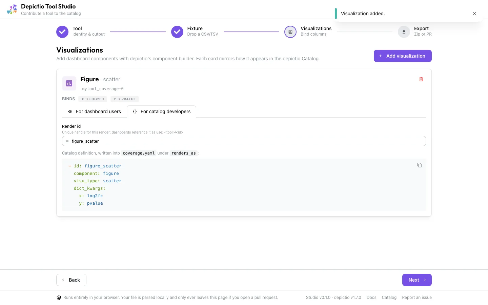](../images/tool-studio/05-render-card.webp){target=_blank}
  <figcaption><em>For dashboard users</em> shows the preview and the <code>use:</code> snippet; <em>For catalog developers</em> shows the render id and the exact <code>renders_as</code> entry that will be written.</figcaption>
</figure>

In Code Mode the snippet runs in your browser under Pyodide, where `df` is a pandas
DataFrame. depictio runs the same snippet server-side where `df` is Polars, so
`df.to_pandas()` is what makes both behave the same. A code figure that arrived from a
link or an imported file is shown with its code and runs only after you have read it and
press **Run this code**.

---

## 4. Export

<figure markdown="span">
  [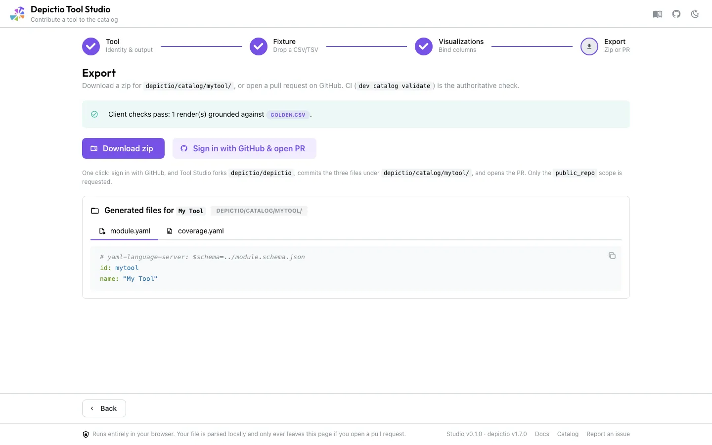](../images/tool-studio/06-export.webp){target=_blank}
  <figcaption>The generated files are shown inline, one tab each, before you commit to either route.</figcaption>
</figure>

While you worked, the entry panel and the Export step ran the same checks
`depictio dev catalog validate` runs (from v1.23.0): the generated YAML against the
catalog's JSON Schemas, identity rules and URLs, the nf-core and EDAM indices, fixture
sanity (including a fixture byte-identical to another tool's), render grounding and role
shapes, and recipes. Each finding carries its code and location and links to the step
that fixes it. CI proves the two agree: every case the Studio rejects must also fail the
CLI, or the check fails.

What that means for you:

- **Errors block export.** A checkbox, **Export anyway**, lets you get past a check
  you believe wrong, with the entry still subject to CI. An output with no fixture blocks
  export outright: there is nothing to write for it.
- **Download zip** gives you the folder to commit yourself: `module.yaml`, plus an
  output YAML, fixture and recipe module per output.
- **Sign in with GitHub & open PR** forks `depictio/depictio`, commits the files under
  `depictio/catalog/<tool>/` and opens the pull request. Only the `public_repo` scope is
  requested, and the token is held in memory only. Where OAuth is not configured, the
  button becomes **Contribute on GitHub** and walks you through the zip plus GitHub's own
  file uploader.
- **Copy a link to this draft** shares the work in progress as a `#draft=` link (the
  fixture trimmed to 200 rows). Opening a link over a draft that already has content
  keeps the old draft and offers **Restore previous draft**. **Download draft JSON** is
  the same draft as a file; both round-trip through **Import an entry**.

<figure markdown="span">
  [](../images/tool-studio/08-github-pr.webp){target=_blank}
  <figcaption>The body is generated by the app: a summary, a table of the files and what each is for, and the YAMLs inline.</figcaption>
</figure>

<!-- prettier-ignore -->
!!! info "The client checks are at parity, CI still decides"
    The Studio mirrors `depictio dev catalog validate` as closely as a browser can, but
    the CLI run by the `catalog` CI check on your pull request remains the authoritative
    one. Anything the Studio flags only as a warning (parse problems, globs with braces
    the catalog does not expand) is advice the CLI itself does not check.

---

## Driving it from a script

Everything the Studio does is reachable without clicking (from v1.23.0):
`window.toolStudio` loads a draft (`load`, `loadFiles`, `loadZip`), validates
(`validateAsync`, returning the same diagnostics as data), exports (`exportFiles`,
`exportZip`) and shares (`link`). A `#draft=` link carries the draft (its fixture trimmed to
200 rows); importing an exported zip or a committed entry is lossless. The interface and its
stable selectors are documented in the app's own
[agent guide](https://github.com/depictio/depictio/blob/main/packages/tool-studio/public/agent.md),
so an agent can author, check and export an entry end to end.

---

## What it generates

```yaml
# module.yaml
# yaml-language-server: $schema=../module.schema.json
id: mytool
name: My Tool
description: One or two sentences on what the tool does.
homepage: https://github.com/example/mytool
nf_core_url: https://github.com/nf-core/modules/tree/master/modules/nf-core/mytool
biotools_url: null  # no bio.tools entry for this tool
stage: qc  # optional; with edam_topics and version, from v1.23.0

# results.yaml
# yaml-language-server: $schema=../output.schema.json
id: mytool_results
find: {path_glob: "**/mytool/*.tsv"}
recipe: mytool/results.py  # only when the output needs reshaping (v1.23.0+)
fixture: results.tsv
renders_as:
  - { id: coverage_card, component: card, column: coverage, aggregation: average, headline: true }
  - { component: figure, visu_type: histogram, dict_kwargs: {x: log2fc, color: sample} }
  - { component: advanced_viz, kind: volcano, roles: {feature_id: gene, effect_size: log2fc, significance: pvalue} }
```

`biotools_url` is always written: the link when the import found a `biotools:` identifier,
an explicit `null` otherwise, which is what the catalog tests require of every
`module.yaml`.

Plus, per output: the fixture itself, byte-identical to what you dropped (or to what the
recipe returned), and the recipe's `results.py` when there is one. `columns:` is written
only for a recipe-free output that declares them (an imported entry); a new entry's
bindings are grounded by the fixture, and declaring both is rejected by the schema.

---

## What it cannot do yet

- **Five advanced-viz kinds are computed by the depictio server** (embedding,
  complex_heatmap, upset_plot, coverage_track, sankey). You can add and export
  them; the Studio shows a note where their preview would be.
- **A phylogenetic tree needs its second file** (the newick), which the Studio is never
  given, so its preview is a note too.
- A card or filter `filter_expr` (a Polars expression) is not applied in the previews.
- Multi-file outputs, maps and images are outside what a single fixture can express, so
  the component grid does not offer them.

---

## See also

- [Contributing a Tool](contributing-a-tool.md) for the hand-authored path and the full schema
- [Tools Catalog](../catalog/index.md) to browse what is already covered
- [Picking a component from the catalog](../usage/guides/catalog-picker.md) for what an entry becomes on a dashboard
- [Driving Tool Studio from a script](https://github.com/depictio/depictio/blob/main/packages/tool-studio/public/agent.md) for the agent API and draft format
