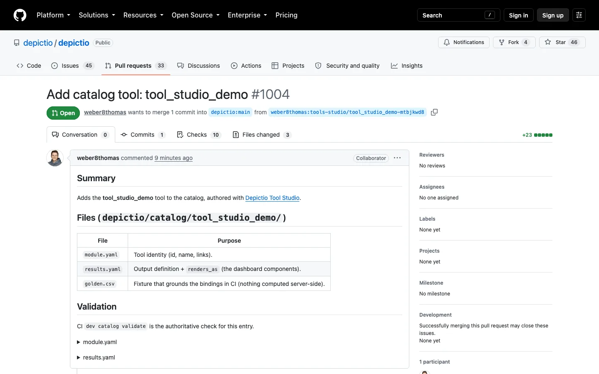

# :material-hammer-wrench: Tool Studio <small>(v1.9.0+)</small>

**Depictio Tool Studio** adds a tool to the [Tools Catalog](../catalog/index.md) from the
browser: drop a sample of one of its output files (or a raw file plus a recipe), bind its
columns in depictio's own component builder, and the app opens the pull request. Nothing to
install: your files are read in the page and only leave it with the pull request.

<div class="catalog-cta-wrap" markdown>
[Open Tool Studio :material-arrow-right:](https://depictio.github.io/depictio-tool-studio/){ .catalog-cta .catalog-cta--studio target=_blank }
</div>

[](../images/tool-studio/00-start_light.webp){target=_blank}
[](../images/tool-studio/00-start_dark.webp){target=_blank}

An entry is a folder: `module.yaml` (which tool), one `<output>.yaml` per output file, the
fixture each output binds against, and a recipe when the file is not already a table (half
the committed outputs). **Try an example** loads a committed entry; **Import an entry** reads
a zip, a tool folder or a draft JSON. The [hand-written path](contributing-a-tool.md)
produces the same folder.

<span class="ver-badge">v1.23.0+</span> The Studio wears depictio's own chrome, keeps an
**Entry** panel beside every step (the files to write, the checks run so far), and covers
[recipes](#recipes-raw-sample-recipe-fixture), several outputs and the CLI's checks.

## 1. Tool

[](../images/tool-studio/01-tool_light.webp){target=_blank}
[](../images/tool-studio/01-tool_dark.webp){target=_blank}

Identity on the left, the output on the right. **Next** unlocks with six fields: tool id and
name, description and homepage (what the catalog card shows), output slug and path glob (or
an exact file name). The path glob is how depictio recognises the file in a run.

??? note "Import from nf-core, Snakemake or Galaxy"
    [](../images/tool-studio/01d-nfcore-import_light.webp){target=_blank}
    [](../images/tool-studio/01d-nfcore-import_dark.webp){target=_blank}

    Paste a module, wrapper or tool URL and press **Import**: the app reads its metadata
    (`meta.yml` for nf-core) in the browser and fills the identity, homepage and bio.tools
    link. Picking an **Output channel** fills the slug, path glob and description.

??? note "If the tool is already in the catalog"
    [](../images/tool-studio/01b-recognized_light.webp){target=_blank}
    [](../images/tool-studio/01b-recognized_dark.webp){target=_blank}

    Recognition runs as you type (nf-core module path, then id, then name).
    **Add a visualization here** appends to that output's `renders_as`, rebased on `main`;
    **Add a new output to this tool** writes a fresh `<output>.yaml` and leaves
    `module.yaml` alone. A close relative (macs3 next to macs2) is flagged too.
    **Not this tool? Continue as a new tool** dismisses the match.

??? note "If MultiQC already parses it"
    [](../images/tool-studio/01c-multiqc_light.webp){target=_blank}
    [](../images/tool-studio/01c-multiqc_dark.webp){target=_blank}

    depictio already ingests MultiQC, so an entry for one of its 181 modules is often work
    for metrics that arrive anyway. Advisory only: an entry is still legitimate for an output
    MultiQC skips.

??? note "Optional fields"
    **Classification** holds the `stage` (the tab a composed dashboard puts the tool's
    components under), EDAM topics and an entry version. **More ways to recognise the file**
    holds alternative globs and an exact file name. **The file needs reshaping first
    (recipe)** turns the Fixture step into the recipe pipeline.

## 2. Fixture

[](../images/tool-studio/02-fixture_light.webp){target=_blank}
[](../images/tool-studio/02-fixture_dark.webp){target=_blank}

Drop one real sample of the output file, or fetch it from a URL (the host must allow
cross-origin requests, as the four linked corpora do; a `github.com` blob link is rewritten
to raw). The file is **committed with the entry**: CI checks every binding against it. A file
that is not a table (a `.narrowPeak`, no header row) offers **Reshape it with a recipe**.

### Recipes: raw sample, recipe, fixture

<span class="ver-badge">v1.23.0+</span>

[](../images/tool-studio/02c-recipe-raw_light.webp){target=_blank}
[](../images/tool-studio/02c-recipe-raw_dark.webp){target=_blank}

For an output that needs reshaping, the Fixture step is a three-stage pipeline. **① Raw
sample**: the tool's own files, any extension; add several to test across samples. They stay
in your browser (not exported, shared or saved).

[](../images/tool-studio/02d-recipe-run_light.webp){target=_blank}
[](../images/tool-studio/02d-recipe-run_dark.webp){target=_blank}

**② Recipe**: the Python module depictio runs at ingestion (`SOURCES`, `OUTPUT_SCHEMA`,
`transform()`), edited in the page. **Run in the browser** runs it on the raw samples with
Python and polars (the first run downloads them). **③ Fixture**: its result, exported as the
committed sample.

[](../images/tool-studio/02e-recipe-schema_light.webp){target=_blank}
[](../images/tool-studio/02e-recipe-schema_dark.webp){target=_blank}

The fixture is checked against `OUTPUT_SCHEMA`: a declared column it lacks means the fixture
is stale. The recipe is exported as `<tool>/<slug>.py`, referenced by `recipe:`. A recipe
from a link or an imported entry runs only once you press **Run this code**.

## Several outputs

<span class="ver-badge">v1.23.0+</span>

[](../images/tool-studio/07-outputs_light.webp){target=_blank}
[](../images/tool-studio/07-outputs_dark.webp){target=_blank}

**Add output** in the bar above every step adds another output of the same tool. Each keeps
its own fixture, recipe and renders; the steps edit the highlighted one. Export writes
`module.yaml` once, then one YAML, fixture and recipe per output.

## 3. Visualizations

[](../images/tool-studio/04-figure-builder_light.webp){target=_blank}
[](../images/tool-studio/04-figure-builder_dark.webp){target=_blank}

**Add visualization** opens the dashboard editor's component-type grid, then depictio's own
builder seeded from your fixture: same controls, same preview, same **UI Mode** / **Code
Mode**. Figures are drawn by depictio's figure code in your browser; in Code Mode `df` is
pandas there and Polars on the server, so use `df.to_pandas()`.

[](../images/tool-studio/05-render-card_light.webp){target=_blank}
[](../images/tool-studio/05-render-card_dark.webp){target=_blank}

Each render becomes a card with two tabs: **For dashboard users** (preview and `use:`
snippet) and **For catalog developers** (the exact `renders_as` entry).

## 4. Export

[](../images/tool-studio/06-export_light.webp){target=_blank}
[](../images/tool-studio/06-export_dark.webp){target=_blank}

- **Download zip**: the folder to commit yourself.
- **Sign in with GitHub & open PR**: forks `depictio/depictio`, commits under
  `depictio/catalog/<tool>/` and opens the pull request (`public_repo` scope, token kept in
  memory). Without OAuth, **Contribute on GitHub** walks you through the zip upload.
- **Copy a link to this draft** (`#draft=`, fixture trimmed to 200 rows) and **Download
  draft JSON** both round-trip through **Import an entry**.

[](../images/tool-studio/06b-export-checks_light.webp){target=_blank}
[](../images/tool-studio/06b-export-checks_dark.webp){target=_blank}

<span class="ver-badge">v1.23.0+</span> The Entry panel and the Export step run the checks of
`depictio dev catalog validate`: JSON Schemas, identity and URLs, the nf-core and EDAM
indices, fixtures, render bindings, recipes. Each finding links to the step that fixes it.
Errors block export unless you tick **Export anyway**; CI's `catalog` check stays the
authoritative one.

[](../images/tool-studio/08-github-pr.webp){target=_blank}

## Driving it from a script

<span class="ver-badge">v1.23.0+</span>

`window.toolStudio` loads (`load`, `loadFiles`, `loadZip`), validates (`validateAsync`),
exports (`exportFiles`, `exportZip`) and shares (`link`) without a click; the
[agent guide](https://github.com/depictio/depictio/blob/main/packages/tool-studio/public/agent.md)
documents it.

??? example "What it generates"
    ```yaml
    # module.yaml: id, name, description, homepage, nf_core_url, biotools_url (or null), stage
    # results.yaml
    id: mytool_results
    find: {path_glob: "**/mytool/*.tsv"}
    recipe: mytool/results.py  # only when the output needs reshaping
    fixture: results.tsv
    renders_as:
      - { component: card, column: coverage, aggregation: average, headline: true }
      - { component: advanced_viz, kind: volcano, roles: {feature_id: gene, effect_size: log2fc, significance: pvalue} }
    ```

    Plus the fixture (byte-identical to the dropped file or the recipe's result) and the
    recipe module, per output.

## What it cannot do yet

- No preview for the five server-computed advanced-viz kinds (embedding, complex_heatmap,
  upset_plot, coverage_track, sankey) or a phylogenetic tree (its newick is never given);
  they still export.
- `filter_expr` is not applied in the previews; multi-file outputs, maps and images are not
  offered.

## See also

- [Contributing a Tool](contributing-a-tool.md) for the hand-written path and the full schema
- [Tools Catalog](../catalog/index.md) to browse what is already covered
- [Picking a component from the catalog](../usage/guides/catalog-picker.md) for what an entry becomes on a dashboard
