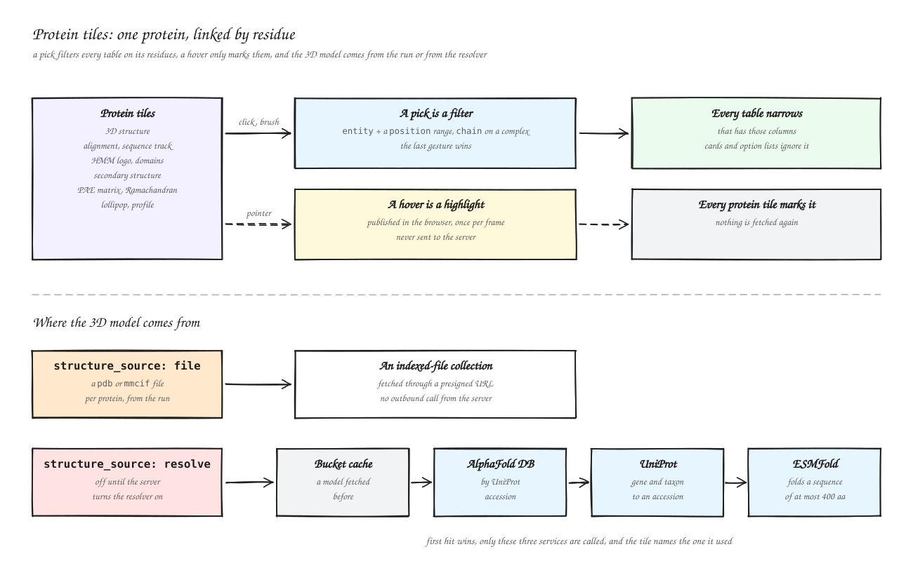

# :material-chart-multiline: Advanced visualizations

An advanced visualization is a domain chart that knows what its columns mean. A volcano
knows it needs a feature, an effect size and a significance; a genome view knows chromosome
and position. You bind your columns to those roles once, and the tile brings the domain logic:
thresholds, tiers, genomic axes, linked selections.

Pick one over a generic [Figure](components.md#figure-components) when your table matches a
known shape (the output of DESeq2, mosdepth, QIIME2, AlphaFold...). Pick a Figure for a plain
plot of any columns.

## :material-view-grid-outline: Catalog { #catalog }

Click a thumbnail to enlarge it, or its name to jump to the entry.

<p class="viz-grid__family">Differential analysis</p>

<div class="viz-grid" markdown>

<div markdown>
{ data-title="Volcano" loading=lazy }
{ data-title="Volcano" loading=lazy }
[Volcano](#volcano){ .viz-grid__name } <span class="ver-badge">v0.13.0+</span>
</div>

<div markdown>
{ data-title="DA barplot" loading=lazy }
{ data-title="DA barplot" loading=lazy }
[DA barplot](#da-barplot){ .viz-grid__name } <span class="ver-badge">v0.13.0+</span>
</div>

<div markdown>
{ data-title="GSEA running score" loading=lazy }
{ data-title="GSEA running score" loading=lazy }
[GSEA running score](#gsea-running-score){ .viz-grid__name } <span class="ver-badge">v1.11.0+</span>
</div>

<div markdown>
{ data-title="Group compare" loading=lazy }
{ data-title="Group compare" loading=lazy }
[Group compare](#group-compare){ .viz-grid__name } <span class="ver-badge">v1.13.0+</span>
</div>

</div>

<p class="viz-grid__family">Single cell & embeddings</p>

<div class="viz-grid" markdown>

<div markdown>
{ data-title="Embedding" loading=lazy }
{ data-title="Embedding" loading=lazy }
[Embedding](#embedding){ .viz-grid__name } <span class="ver-badge">v0.13.0+</span>
</div>

<div markdown>
{ data-title="Dot plot" loading=lazy }
{ data-title="Dot plot" loading=lazy }
[Dot plot](#dot-plot){ .viz-grid__name } <span class="ver-badge">v0.13.0+</span>
</div>

<div markdown>
{ data-title="Knee plot" loading=lazy }
{ data-title="Knee plot" loading=lazy }
[Knee plot](#knee-plot){ .viz-grid__name } <span class="ver-badge">v1.13.0+</span>
</div>

</div>

<p class="viz-grid__family">Genome tracks</p>

<div class="viz-grid" markdown>

<div markdown>
{ data-title="Coverage track" loading=lazy }
{ data-title="Coverage track" loading=lazy }
[Coverage track](#coverage-track){ .viz-grid__name } <span class="ver-badge">v0.13.0+</span>
</div>

<div markdown>
{ data-title="Genome view" loading=lazy }
{ data-title="Genome view" loading=lazy }
[Genome view](#genome-view){ .viz-grid__name } <span class="ver-badge">v1.13.0+</span>
</div>

<div markdown>
{ data-title="Copy-number profile" loading=lazy }
{ data-title="Copy-number profile" loading=lazy }
[Copy-number profile](#cnv-profile){ .viz-grid__name } <span class="ver-badge">v1.13.0+</span>
</div>

<div markdown>
{ data-title="Contact map" loading=lazy }
{ data-title="Contact map" loading=lazy }
[Contact map](#contact-map){ .viz-grid__name } <span class="ver-badge">v1.13.0+</span>
</div>

<div markdown>
{ data-title="Transcript structure" loading=lazy }
{ data-title="Transcript structure" loading=lazy }
[Transcript structure](#transcript-structure){ .viz-grid__name } <span class="ver-badge">v1.13.0+</span>
</div>

<div markdown>
{ data-title="Sashimi" loading=lazy }
{ data-title="Sashimi" loading=lazy }
[Sashimi](#sashimi){ .viz-grid__name } <span class="ver-badge">v1.11.0+</span>
</div>

<div markdown>
{ data-title="Gene arrow track" loading=lazy }
{ data-title="Gene arrow track" loading=lazy }
[Gene arrow track](#gene-arrow-track){ .viz-grid__name } <span class="ver-badge">v1.11.0+</span>
</div>

</div>

<p class="viz-grid__family">Variants & rearrangements</p>

<div class="viz-grid" markdown>

<div markdown>
{ data-title="Manhattan" loading=lazy }
{ data-title="Manhattan" loading=lazy }
[Manhattan](#manhattan){ .viz-grid__name } <span class="ver-badge">v0.13.0+</span>
</div>

<div markdown>
{ data-title="Lollipop" loading=lazy }
{ data-title="Lollipop" loading=lazy }
[Lollipop](#lollipop){ .viz-grid__name } <span class="ver-badge">v0.13.0+</span>
</div>

<div markdown>
{ data-title="Oncoplot" loading=lazy }
{ data-title="Oncoplot" loading=lazy }
[Oncoplot](#oncoplot){ .viz-grid__name } <span class="ver-badge">v0.13.0+</span>
</div>

<div markdown>
{ data-title="Genome chord" loading=lazy }
{ data-title="Genome chord" loading=lazy }
[Genome chord](#genome-chord){ .viz-grid__name } <span class="ver-badge">v1.13.0+</span>
</div>

<div markdown>
{ data-title="Fusion structure" loading=lazy }
{ data-title="Fusion structure" loading=lazy }
[Fusion structure](#fusion-structure){ .viz-grid__name } <span class="ver-badge">v1.11.0+</span>
</div>

</div>

<p class="viz-grid__family">Signal & read profiles</p>

<div class="viz-grid" markdown>

<div markdown>
{ data-title="Profile" loading=lazy }
{ data-title="Profile" loading=lazy }
[Profile](#profile){ .viz-grid__name } <span class="ver-badge">v1.11.0+</span>
</div>

<div markdown>
{ data-title="Signal matrix" loading=lazy }
{ data-title="Signal matrix" loading=lazy }
[Signal matrix](#signal-matrix){ .viz-grid__name } <span class="ver-badge">v1.11.0+</span>
</div>

<div markdown>
{ data-title="Damage profile" loading=lazy }
{ data-title="Damage profile" loading=lazy }
[Damage profile](#damage-profile){ .viz-grid__name } <span class="ver-badge">v1.13.0+</span>
</div>

</div>

<p class="viz-grid__family">Microbiome & ecology</p>

<div class="viz-grid" markdown>

<div markdown>
{ data-title="Stacked taxonomy" loading=lazy }
{ data-title="Stacked taxonomy" loading=lazy }
[Stacked taxonomy](#stacked-taxonomy){ .viz-grid__name } <span class="ver-badge">v0.13.0+</span>
</div>

<div markdown>
{ data-title="Sunburst" loading=lazy }
{ data-title="Sunburst" loading=lazy }
[Sunburst](#sunburst){ .viz-grid__name } <span class="ver-badge">v0.13.0+</span>
</div>

<div markdown>
{ data-title="Rarefaction" loading=lazy }
{ data-title="Rarefaction" loading=lazy }
[Rarefaction](#rarefaction){ .viz-grid__name } <span class="ver-badge">v0.13.0+</span>
</div>

<div markdown>
{ data-title="Phylogenetic tree" loading=lazy }
{ data-title="Phylogenetic tree" loading=lazy }
[Phylogenetic tree](#phylogenetic){ .viz-grid__name } <span class="ver-badge">v0.13.0+</span>
</div>

</div>

<p class="viz-grid__family">General purpose</p>

<div class="viz-grid" markdown>

<div markdown>
{ data-title="Scatter (X/Y)" loading=lazy }
{ data-title="Scatter (X/Y)" loading=lazy }
[Scatter (X/Y)](#scatter-xy){ .viz-grid__name } <span class="ver-badge">v1.11.0+</span>
</div>

<div markdown>
{ data-title="Hierarchical heatmap" loading=lazy }
{ data-title="Hierarchical heatmap" loading=lazy }
[Hierarchical heatmap](#hierarchical-heatmap){ .viz-grid__name } <span class="ver-badge">v0.13.0+</span>
</div>

<div markdown>
{ data-title="UpSet" loading=lazy }
{ data-title="UpSet" loading=lazy }
[UpSet](#upset){ .viz-grid__name } <span class="ver-badge">v0.13.0+</span>
</div>

<div markdown>
{ data-title="Sankey" loading=lazy }
{ data-title="Sankey" loading=lazy }
[Sankey](#sankey){ .viz-grid__name } <span class="ver-badge">v0.13.0+</span>
</div>

<div markdown>
{ data-title="Parallel coordinates" loading=lazy }
{ data-title="Parallel coordinates" loading=lazy }
[Parallel coordinates](#parallel-coordinates){ .viz-grid__name } <span class="ver-badge">v1.13.0+</span>
</div>

<div markdown>
{ data-title="Record card" loading=lazy }
{ data-title="Record card" loading=lazy }
[Record card](#record-card){ .viz-grid__name } <span class="ver-badge">v1.13.0+</span>
</div>

</div>

<p class="viz-grid__family">Benchmarking</p>

<div class="viz-grid" markdown>

<div markdown>
{ data-title="PR benchmark" loading=lazy }
{ data-title="PR benchmark" loading=lazy }
[PR benchmark](#pr-benchmark){ .viz-grid__name } <span class="ver-badge">v1.10.0+</span>
</div>

<div markdown>
{ data-title="Confusion matrix" loading=lazy }
{ data-title="Confusion matrix" loading=lazy }
[Confusion matrix](#confusion-matrix){ .viz-grid__name } <span class="ver-badge">v1.10.0+</span>
</div>

<div markdown>
{ data-title="Metric with CI" loading=lazy }
{ data-title="Metric with CI" loading=lazy }
[Metric with CI](#metric-ci-bars){ .viz-grid__name } <span class="ver-badge">v1.10.0+</span>
</div>

</div>

<p class="viz-grid__family">Proteins</p>

<div class="viz-grid" markdown>

<div markdown>
{ data-title="3D structure" loading=lazy }
{ data-title="3D structure" loading=lazy }
[3D structure](#molecule-3d){ .viz-grid__name } <span class="ver-badge">v1.19.0+</span>
</div>

<div markdown>
{ data-title="Alignment" loading=lazy }
{ data-title="Alignment" loading=lazy }
[Alignment](#msa){ .viz-grid__name } <span class="ver-badge">v1.19.0+</span>
</div>

<div markdown>
{ data-title="Sequence track" loading=lazy }
{ data-title="Sequence track" loading=lazy }
[Sequence track](#sequence-track){ .viz-grid__name } <span class="ver-badge">v1.19.0+</span>
</div>

<div markdown>
{ data-title="HMM logo" loading=lazy }
{ data-title="HMM logo" loading=lazy }
[HMM logo](#hmm-logo){ .viz-grid__name } <span class="ver-badge">v1.19.0+</span>
</div>

<div markdown>
{ data-title="Domain architecture" loading=lazy }
{ data-title="Domain architecture" loading=lazy }
[Domain architecture](#domain-architecture){ .viz-grid__name } <span class="ver-badge">v1.19.0+</span>
</div>

<div markdown>
{ data-title="Secondary structure" loading=lazy }
{ data-title="Secondary structure" loading=lazy }
[Secondary structure](#secondary-structure){ .viz-grid__name } <span class="ver-badge">v1.19.0+</span>
</div>

<div markdown>
{ data-title="Predicted aligned error" loading=lazy }
{ data-title="Predicted aligned error" loading=lazy }
[Predicted aligned error](#pae-matrix){ .viz-grid__name } <span class="ver-badge">v1.19.0+</span>
</div>

<div markdown>
{ data-title="Ramachandran" loading=lazy }
{ data-title="Ramachandran" loading=lazy }
[Ramachandran](#ramachandran){ .viz-grid__name } <span class="ver-badge">v1.19.0+</span>
</div>

</div>

---

## :material-cursor-default-click-outline: How to use one { #how-to-use }

1. In the dashboard editor, add a component, pick a data collection, then the **Advanced viz** type.
2. Pick a kind. The builder ranks the kinds by how well they fit the collection (see [the kind picker](#kind-picker)).
3. Bind each role to a column under **Column bindings**. Required roles must be bound; the builder checks the column types.
4. Optionally choose where the controls go under **Viz controls**, then add the tile.

In a [dashboard YAML file](yaml-sync.md), the same tile is a `component_type: advanced_viz`
entry. A role `x` binds through the `config` key `x_col`:

```yaml
- tag: viz-de
  component_type: advanced_viz
  workflow_tag: my_workflow
  data_collection_tag: de_results
  viz_kind: volcano
  config:
    viz_kind: volcano
    feature_id_col: gene_id
    effect_size_col: log2FoldChange
    significance_col: padj
```

Every entry below follows the same layout: a version badge (<span class="ver-badge">v1.19.0+</span>
means available since that release), a screenshot, its input table (one row per column:
the **Column** name as in its YAML example, the **Config key** that binds it, its **Need**
(required or optional), the **Type** checked and an **Example** value), the tools whose output
fits, its controls and a YAML example.

## :material-tune-variant: Shared settings { #shared-settings }

### Controls and where they go { #controls }

Each tile splits its controls in two tiers. **Primary** controls change what is shown: the
view switch, thresholds, colour by, a gene or sample picker. **Cosmetic** controls change how
it is drawn: marker sizes, palettes, labels, legend. The config key `controls_placement` sets
where they go <span class="ver-badge">v1.13.0+</span>:

| `controls_placement` | Where |
|----------------------|-------|
| `popover` (default) | Behind the settings icon, or docked beside or above the plot when the tile has room <span class="ver-badge">v1.14.0+</span> |
| `header` | Primary controls in a strip under the title, cosmetic ones in the popover |
| `rail` | All controls in a column right of the plot, no popover |

=== "popover"

    { data-title="Volcano tile with its controls in the settings popover" .viz-shot loading=lazy }
    { data-title="Volcano tile with its controls in the settings popover" .viz-shot loading=lazy }

=== "header"

    { data-title="Volcano tile with its primary controls under the title" .viz-shot loading=lazy }
    { data-title="Volcano tile with its primary controls under the title" .viz-shot loading=lazy }

=== "rail"

    { data-title="Volcano tile with its controls in a rail beside the plot" .viz-shot loading=lazy }
    { data-title="Volcano tile with its controls in a rail beside the plot" .viz-shot loading=lazy }

- A docked panel shows the first three controls and folds the rest under **More options**.
  The component-level `controls_placement` (`auto`, `right`, `top`, `popover`), the builder's
  **Viz controls** section, forces the dock side or keeps the icon.
- A reader can move the controls with the placement picker; the choice lasts the session.
- A dashboard sets a default for every tile with `advanced_viz_controls`. See
  [Tile height and control placement](yaml-sync.md#tile-height).
- Every tile also offers **Show underlying data**: the rows behind the plot.

### Switchable views { #views }

Some kinds draw the same rows several ways. `view` is the view the tile opens on, `views` the
views it offers. A view is only offered when its columns are bound.

| Kind | Views (default first) |
|------|-----------------------|
| [Volcano](#volcano) | `volcano`, `ma`, `qq` |
| [Dot plot](#dot-plot) | `dotplot`, `enrichment` |
| [PR benchmark](#pr-benchmark) | `pr`, `roc`, `both` |
| [Coverage track](#coverage-track) | `track`, `locus` |
| [Copy-number profile](#cnv-profile) | `plotly`, `locus` |
| [Sashimi](#sashimi) | `plotly`, `genomespy` |

!!! info "Retired kinds still load"
    `viz_kind: ma`, `qq`, `enrichment` and `roc_pr_curve` became views in v1.13.0. They still
    load and open on the matching view of `volcano`, `dot_plot` or `pr_benchmark`; the builder
    no longer offers them. `ancombc_differentials` loads as a [DA barplot](#da-barplot).

### The kind picker { #kind-picker }

The builder lists the tile's current kind first, then **Recommended** kinds, then the others,
folded. A badge says what a suggestion rests on:

| Badge | Meaning |
|-------|---------|
| **Named match** | Columns are named for the kind's roles (`log2FoldChange`, `padj`...) |
| **Shape match** | Columns have the right types and shape, without matching names |
| **Fits your selection** | Another tile on the tab emits a selection the kind can follow, as for a [Record card](#record-card) |
| **Weak** | Pickable, but a required role has no good column |

---

## :material-scale-unbalanced: Differential analysis { #differential-analysis }

### :material-chart-scatter-plot: Volcano { #volcano }

<span class="ver-badge">v0.13.0+</span> `viz_kind: volcano`

Effect size against significance for a differential test. The same table also reads as an MA plot and a QQ plot from the view switch.

{ data-title="Volcano" .viz-shot loading=lazy }
{ data-title="Volcano" .viz-shot loading=lazy }

**Input:** one row per gene.

| Column | Config key | Need | Type | Example |
|---|---|---|---|---|
| `gene_id` | `feature_id_col` | required | String | `ENSG00000141510` |
| `log2FoldChange` | `effect_size_col` | required | Float | `-1.84`, `2.47` |
| `padj` | `significance_col` | required | Float | `3.2e-08` |
| `log2_baseMean` | `avg_log_intensity_col` | optional, adds the MA view | Float | `11.2` |
| `pvalue` | `p_value_col` | optional, adds the QQ view | Float | `1.1e-09` |
| `gene_name` | `label_col` | optional, hover label | String | `TP53` |
| `contrast` | `category_col` | optional, point colour | String | `treated_vs_control` |

**Compatible inputs:** DESeq2, limma or edgeR results tables, as nf-core/differentialabundance publishes them.

**Controls**

- Primary: View (Volcano, MA, QQ), p / padj threshold, |effect| or |log2 FC| threshold, Top-N labels, Search
- Cosmetic: Show top-N labels; in the QQ view: identity line, 95% null band, point size

??? example "YAML"
    ```yaml
    - tag: viz-volcano
      component_type: advanced_viz
      workflow_tag: my_workflow
      data_collection_tag: de_results
      viz_kind: volcano
      config:
        viz_kind: volcano
        feature_id_col: gene_id
        effect_size_col: log2FoldChange
        significance_col: padj
        avg_log_intensity_col: log2_baseMean
        p_value_col: pvalue
        views: [volcano, ma, qq]
    ```

### :material-view-grid-plus-outline: DA barplot { #da-barplot }

<span class="ver-badge">v0.13.0+</span> `viz_kind: da_barplot`

Ranked signed log fold changes per feature, one panel per contrast or one contrast at a time.

{ data-title="DA barplot" .viz-shot loading=lazy }
{ data-title="DA barplot" .viz-shot loading=lazy }

**Input:** one row per taxon and contrast (long format).

| Column | Config key | Need | Type | Example |
|---|---|---|---|---|
| `taxon` | `feature_id_col` | required | String | `Bacteroides` |
| `contrast` | `contrast_col` | required | String | `treatment_vs_control` |
| `lfc` | `lfc_col` | required | Float | `1.92`, `-2.35` |
| `q_val` | `significance_col` | optional, significance threshold | Float | `0.003` |
| `label` | `label_col` | optional, display label | String | `B. fragilis` |

**Compatible inputs:** ANCOM-BC, ALDEx2 or MaAsLin2 differentials (nf-core/ampliseq).

**Controls**

- Primary: Contrast tabs (All or one contrast), Top-N per panel, Significance threshold
- Cosmetic: None

??? example "YAML"
    ```yaml
    - tag: viz-da-barplot
      component_type: advanced_viz
      workflow_tag: my_workflow
      data_collection_tag: ancombc_results
      viz_kind: da_barplot
      config:
        viz_kind: da_barplot
        feature_id_col: taxon
        contrast_col: contrast
        lfc_col: lfc
        significance_col: q_val
        contrast_view: all
    ```

### :material-chart-bell-curve-cumulative: GSEA running score { #gsea-running-score }

<span class="ver-badge">v1.11.0+</span> `viz_kind: gsea_running_score`

The running enrichment score along the ranked gene list, one curve per gene set, with the set members as a rug.

{ data-title="GSEA running score" .viz-shot loading=lazy }
{ data-title="GSEA running score" .viz-shot loading=lazy }

**Input:** one row per gene set and rank.

| Column | Config key | Need | Type | Example |
|---|---|---|---|---|
| `gene_set` | `gene_set_col` | required | String | `HALLMARK_E2F_TARGETS` |
| `rank` | `rank_col` | required | Numeric | `1`, `2` |
| `running_es` | `running_es_col` | required | Float | `0.012` |
| `member` | `member_col` | optional, the hit rug | Boolean or 0/1 | `true`, `false` |
| `metric` | `metric_col` | optional, ranked metric panel | Float | `3.21` |

**Compatible inputs:** GSEA output of nf-core/differentialabundance.

**Controls**

- Primary: Top-N gene sets, Layout
- Cosmetic: Shade the leading edge, Hit rug, Ranked metric

??? example "YAML"
    ```yaml
    - tag: viz-gsea-running-score
      component_type: advanced_viz
      workflow_tag: my_workflow
      data_collection_tag: gsea_running
      viz_kind: gsea_running_score
      config:
        viz_kind: gsea_running_score
        gene_set_col: gene_set
        rank_col: rank
        running_es_col: running_es
        member_col: member
        metric_col: metric
        top_n_sets: 5
    ```

### :material-compare-horizontal: Group compare { #group-compare }

<span class="ver-badge">v1.13.0+</span> `viz_kind: group_compare`

Two groups of rows tested feature by feature on demand, drawn as a volcano over a ranked table. The groups come from the dashboard's [selection groups](interactive-selection-filtering.md#selection-groups) or from `group` values.

{ data-title="Group compare" .viz-shot loading=lazy }
{ data-title="Group compare" .viz-shot loading=lazy }

**Input:** one row per cell or sample, one numeric column per feature (wide format).

| Column | Config key | Need | Type | Example |
|---|---|---|---|---|
| `cell_id` | `index_col` | required | String | `AAACCTGAGAAGGCCT-1` |
| `CD3E`, `MS4A1`, ... | none, every numeric column | required, each one is tested | Numeric | `2.31`, `0.0` |
| `cluster` | `group_col` | optional, groups when no selection group is picked | String | `cluster_1` |

**Compatible inputs:** Per-cell matrices from nf-core/scrnaseq, or per-sample normalised counts from nf-core/rnaseq.

**Controls**

- Primary: Group A, Group B, Test (Wilcoxon or t-test)
- Cosmetic: log1p before testing, FDR threshold, |log2FC| threshold, Top-N labels

??? example "YAML"
    ```yaml
    - tag: viz-group-compare
      component_type: advanced_viz
      workflow_tag: my_workflow
      data_collection_tag: cell_by_gene
      viz_kind: group_compare
      config:
        viz_kind: group_compare
        index_col: cell_id
        group_col: cluster
        test: wilcoxon
        default_group_a: cluster_1
        default_group_b: cluster_2
        auto_run: true
    ```

---

## :material-blur: Single cell & embeddings { #single-cell }

### :material-atom: Embedding { #embedding }

<span class="ver-badge">v0.13.0+</span> `viz_kind: embedding`

Samples or cells in 2D or 3D, from precomputed coordinates or a PCA, UMAP, t-SNE or PCoA computed live on the server.

{ data-title="Embedding" .viz-shot loading=lazy }
{ data-title="Embedding" .viz-shot loading=lazy }

The same kind on a sample PCA, with **Point size** at 25:

{ data-title="Embedding, sample PCA" .viz-shot loading=lazy }
{ data-title="Embedding, sample PCA" .viz-shot loading=lazy }

**Input:** one row per cell or sample.

| Column | Config key | Need | Type | Example |
|---|---|---|---|---|
| `cell_id` | `sample_id_col` | required | String | `AAACCTGAGAAGGCCT-1` |
| `umap_1` | `dim_1_col` | required | Float | `4.12` |
| `umap_2` | `dim_2_col` | required | Float | `-1.37` |
| `cluster` | `cluster_col` | optional | String | `T cells` |
| `umap_3` | `dim_3_col` | optional, adds the 3D view | Float | `0.58` |
| `CD3E` | `color_col` | optional, colour by metadata or expression | Numeric or String | `2.31` |

With `compute_method` set, the coordinates are computed from the numeric columns instead.

**Compatible inputs:** scanpy or Seurat coordinates (nf-core/scrnaseq), or any sample by feature matrix with `compute_method` set.

**Controls**

- Primary: Method (live mode), View (2D, 3D), Colour by
- Cosmetic: Method parameters, plot style, legend, hover columns, point size, outline, density overlay, centroids

??? example "YAML"
    ```yaml
    - tag: viz-embedding
      component_type: advanced_viz
      workflow_tag: my_workflow
      data_collection_tag: umap_coords
      viz_kind: embedding
      config:
        viz_kind: embedding
        sample_id_col: cell_id
        dim_1_col: umap_1
        dim_2_col: umap_2
        cluster_col: cluster
        selection_enabled: true
    ```

### :material-circle-multiple-outline: Dot plot { #dot-plot }

<span class="ver-badge">v0.13.0+</span> `viz_kind: dot_plot`

Marker genes by cluster: size is the fraction expressing, colour the mean expression. The `enrichment` view draws the same marks over a gene-set table.

{ data-title="Dot plot" .viz-shot loading=lazy }
{ data-title="Dot plot" .viz-shot loading=lazy }

**Input:** one row per cluster and gene (long format).

| Column | Config key | Need | Type | Example |
|---|---|---|---|---|
| `cluster` | `cluster_col` | required | String | `T cells`, `B cells` |
| `gene` | `gene_col` | required | String | `CD3E`, `MS4A1` |
| `mean_expression` | `mean_expression_col` | required | Float | `2.14` |
| `frac_expressing` | `frac_expressing_col` | required | Float | `0.87` |

**Enrichment view**, one row per term:

| Column | Config key | Need | Type | Example |
|---|---|---|---|---|
| `term` | `term_col` | required | String | `HALLMARK_E2F_TARGETS` |
| `nes` | `nes_col` | required | Float | `2.14` |
| `padj` | `padj_col` | optional | Float | `0.0012` |
| `gene_count` | `gene_count_col` | optional | Numeric | `196` |
| `source` | `source_col` | optional | String | `GO_BP` |

**Compatible inputs:** scanpy aggregates per cluster (`sc.get.aggregate`); clusterProfiler, GSEA or g:Profiler results for the enrichment view.

**Controls**

- Primary: View (Dot plot, Enrichment); dot plot: Sort genes, Sort clusters, Max genes; enrichment: Source, Top-N pathways, padj threshold, Colour by, Sort terms
- Cosmetic: Colourscale, reverse colourscale, max and min dot size, outline, labels

??? example "YAML"
    ```yaml
    - tag: viz-dot-plot
      component_type: advanced_viz
      workflow_tag: my_workflow
      data_collection_tag: marker_means
      viz_kind: dot_plot
      config:
        viz_kind: dot_plot
        cluster_col: cluster
        gene_col: gene
        mean_expression_col: mean_expression
        frac_expressing_col: frac_expressing
        views: [dotplot]
    ```

### :material-trending-down: Knee plot { #knee-plot }

<span class="ver-badge">v1.13.0+</span> `viz_kind: knee_plot`

Barcode rank against UMI count, one curve per library, with the cell-calling cutoff.

{ data-title="Knee plot" .viz-shot loading=lazy }
{ data-title="Knee plot" .viz-shot loading=lazy }

**Input:** one row per library and barcode rank.

| Column | Config key | Need | Type | Example |
|---|---|---|---|---|
| `sample` | `sample_col` | required | String | `pbmc_1k` |
| `rank` | `rank_col` | required | Numeric | `1`, `1250` |
| `umi_count` | `umi_count_col` | required | Numeric | `48213`, `312` |
| `is_cell` | `is_cell_col` | optional, the cell-calling cutoff | Boolean or 0/1 | `true`, `false` |

**Compatible inputs:** STARsolo, alevin-fry or Cell Ranger barcode counts (nf-core/scrnaseq).

**Controls**

- Primary: Log rank (x), Log UMI count (y)
- Cosmetic: Show cell-calling cutoff

??? example "YAML"
    ```yaml
    - tag: viz-knee-plot
      component_type: advanced_viz
      workflow_tag: my_workflow
      data_collection_tag: barcode_ranks
      viz_kind: knee_plot
      config:
        viz_kind: knee_plot
        sample_col: sample
        rank_col: rank
        umi_count_col: umi_count
        is_cell_col: is_cell
    ```

---

## :material-dna: Genome tracks { #genome-tracks }

### :material-chart-areaspline: Coverage track { #coverage-track }

<span class="ver-badge">v0.13.0+</span> `viz_kind: coverage_track`

Depth or signal along a chromosome, per sample or as a cohort median. The `locus` view redraws it as a zoomable GenomeSpy track.

{ data-title="Coverage track" .viz-shot loading=lazy }
{ data-title="Coverage track" .viz-shot loading=lazy }

**Input:** one row per sample and bin (or base).

| Column | Config key | Need | Type | Example |
|---|---|---|---|---|
| `chrom` | `chromosome_col` | required | String | `MN908947.3` |
| `start` | `position_col` | required | Integer | `0`, `100` |
| `depth` | `value_col` | required | Numeric | `812` |
| `end` | `end_col` | optional, bins as intervals | Integer | `100`, `200` |
| `sample` | `sample_col` | optional | String | `SAMPLE_01` |
| `amplicon` | `category_col` | optional, colour by | String | `nCoV-2019_1` |

**Compatible inputs:** mosdepth per-base or per-bin depth (nf-core/viralrecon, sarek, rnaseq), bigWig-derived bins.

**Controls**

- Primary: View (Track, Locus), Sample layout, Y scale, Smoothing, Chromosomes, Samples
- Cosmetic: Mark, Colour by, Show individual traces, gene strip

??? example "YAML"
    ```yaml
    - tag: viz-coverage-track
      component_type: advanced_viz
      workflow_tag: my_workflow
      data_collection_tag: depth_bins
      viz_kind: coverage_track
      config:
        viz_kind: coverage_track
        chromosome_col: chrom
        position_col: start
        end_col: end
        value_col: depth
        sample_col: sample
        views: [track, locus]
    ```

### :material-chart-timeline: Genome view { #genome-view }

<span class="ver-badge">v1.13.0+</span> `viz_kind: genome_view`

A [GenomeSpy](https://genomespy.app/){ target="_blank" } track on a chromosome axis: scroll to zoom, drag to pan, brush or type a locus to filter the dashboard by region.

{ data-title="Genome view" .viz-shot loading=lazy }
{ data-title="Genome view" .viz-shot loading=lazy }

**Input:** one row per position, or per interval with `end`.

| Column | Config key | Need | Type | Example |
|---|---|---|---|---|
| `chrom` | `chr_col` | required | String | `chr8` |
| `start` | `pos_col` | required | Integer | `127735800` |
| `score` | `score_col` | required | Float | `42.7` |
| `end` | `end_col` | optional, rows as intervals | Integer | `127736600` |
| `peak_class` | `category_col` | optional, mark colour | String | `promoter`, `enhancer` |
| `feature` | `feature_col` | optional, hover name | String | `peak_00412` |
| `sample` | `sample_col` | optional, one lane per sample | String | `H3K27ac_rep1` |

**Compatible inputs:** Any chr / pos / score table: peaks, depth bins, association scores.

**Controls**

- Primary: Chromosome, Locus or gene
- Cosmetic: Mark, point size, opacity, threshold rule, one lane per sample, max lanes, assembly, gene annotation lane, zoom to an incoming region

??? example "YAML"
    ```yaml
    - tag: viz-genome-view
      component_type: advanced_viz
      workflow_tag: my_workflow
      data_collection_tag: peaks
      viz_kind: genome_view
      config:
        viz_kind: genome_view
        chr_col: chrom
        pos_col: start
        end_col: end
        score_col: score
        category_col: peak_class
        mark: bar
        assembly: hg38
        default_region: "chr8:127,400,000-128,100,000"
    ```

### :material-chart-scatter-plot-hexbin: Copy-number profile { #cnv-profile }

<span class="ver-badge">v1.13.0+</span> `viz_kind: cnv_profile`

Log2 ratio per bin with the called segments over it and the B-allele frequency underneath. The `locus` view draws the allele-specific layout.

{ data-title="Copy-number profile" .viz-shot loading=lazy }
{ data-title="Copy-number profile" .viz-shot loading=lazy }

**Input:** one row per bin or called segment, both in one table.

| Column | Config key | Need | Type | Example |
|---|---|---|---|---|
| `sample` | `sample_col` | required | String | `TUMOUR_A` |
| `chrom` | `chrom_col` | required | String | `chr1` |
| `start` | `start_col` | required | Numeric | `1000000` |
| `end` | `end_col` | required | Numeric | `1100000` |
| `log2` | `log2_col` | required | Numeric | `0.14`, `0.06` |
| `baf` | `baf_col` | optional, the BAF panel | Float | `0.48` |
| `segment` | `segment_col` | optional, `segment` rows draw as segments, the rest as bins | String | `bin`, `segment` |
| `copy_number` | `copy_number_col` | optional | Numeric | `2` |
| `label` | `label_col` | optional, hover label | String | `TP53` |

**Compatible inputs:** CNVkit, ASCAT or Control-FREEC bins and segments (nf-core/sarek).

**Controls**

- Primary: View (Plotly, Locus), Sample, Chromosome
- Cosmetic: log2 axis limit, bin marker size, Show BAF panel, gene lane

??? example "YAML"
    ```yaml
    - tag: viz-cnv-profile
      component_type: advanced_viz
      workflow_tag: my_workflow
      data_collection_tag: cnv_bins_segments
      viz_kind: cnv_profile
      config:
        viz_kind: cnv_profile
        sample_col: sample
        chrom_col: chrom
        start_col: start
        end_col: end
        log2_col: log2
        baf_col: baf
        segment_col: segment
        views: [plotly, locus]
    ```

### :material-triangle-outline: Contact map { #contact-map }

<span class="ver-badge">v1.13.0+</span> `viz_kind: contact_map`

A binned Hi-C matrix, square or as a triangle under a genome track. Zooming re-reads the best resolution for the window.

{ data-title="Contact map" .viz-shot loading=lazy }
{ data-title="Contact map" .viz-shot loading=lazy }

**Input:** one row per pair of bins.

| Column | Config key | Need | Type | Example |
|---|---|---|---|---|
| `chrom` | `chrom1_col` | required | String | `chr1` |
| `start` | `start1_col` | required | Numeric | `0` |
| `chrom2` | `chrom2_col` | required | String | `chr1` |
| `start2` | `start2_col` | required | Numeric | `100000` |
| `count` | `count_col` | required | Numeric | `2841`, `932` |
| `resolution` | `resolution_col` | optional, one matrix per resolution | Numeric | `100000`, `500000` |
| `end` | `end1_col` | optional | Numeric | `100000` |
| `end2` | `end2_col` | optional | Numeric | `200000` |
| `sample` | `sample_col` | optional | String | `HeLa_rep1` |

**Compatible inputs:** cooler `.mcool` pixels dumped per resolution (nf-core/hic).

**Controls**

- Primary: Chromosome, Display (square, triangle), Resolution
- Cosmetic: Colour scale, log colour scale, row/column balance, separation drawn

??? example "YAML"
    ```yaml
    - tag: viz-contact-map
      component_type: advanced_viz
      workflow_tag: my_workflow
      data_collection_tag: hic_pixels
      viz_kind: contact_map
      config:
        viz_kind: contact_map
        chrom1_col: chrom
        start1_col: start
        chrom2_col: chrom2
        start2_col: start2
        count_col: count
        resolution_col: resolution
        display: triangle
    ```

### :material-reorder-horizontal: Transcript structure { #transcript-structure }

<span class="ver-badge">v1.13.0+</span> `viz_kind: transcript_structure`

The isoforms of one gene, one lane per transcript, exons as blocks and coding parts taller.

{ data-title="Transcript structure" .viz-shot loading=lazy }
{ data-title="Transcript structure" .viz-shot loading=lazy }

**Input:** one row per exon or CDS block.

| Column | Config key | Need | Type | Example |
|---|---|---|---|---|
| `transcript_id` | `transcript_id_col` | required | String | `ENST00000269305` |
| `gene_id` | `gene_id_col` | required | String | `ENSG00000141510` |
| `chrom` | `chrom_col` | required | String | `chr17` |
| `start` | `start_col` | required | Numeric | `7661779` |
| `end` | `end_col` | required | Numeric | `7662014` |
| `feature` | `feature_col` | required | String | `exon`, `CDS` |
| `strand` | `strand_col` | required | String | `-` |
| `transcript_class` | `transcript_class_col` | optional, lane colour | String | `known`, `novel` |
| `sample` | `sample_col` | optional | String | `WT_REP1` |
| `gene_name` | `gene_name_col` | optional | String | `TP53` |
| `expression` | `expression_col` | optional, bar beside each lane | Numeric | `12.4` |

**Compatible inputs:** StringTie or bambu GTF exon and CDS rows (nf-core/nanoseq, rnaseq).

**Controls**

- Primary: Gene, Sample, Colour lanes by
- Cosmetic: Colour scale, bar beside each lane, isoforms drawn

??? example "YAML"
    ```yaml
    - tag: viz-transcript-structure
      component_type: advanced_viz
      workflow_tag: my_workflow
      data_collection_tag: transcript_blocks
      viz_kind: transcript_structure
      config:
        viz_kind: transcript_structure
        transcript_id_col: transcript_id
        gene_id_col: gene_id
        chrom_col: chrom
        start_col: start
        end_col: end
        feature_col: feature
        strand_col: strand
        transcript_class_col: transcript_class
    ```

### :material-vector-curve: Sashimi { #sashimi }

<span class="ver-badge">v1.11.0+</span> `viz_kind: sashimi`

Splice junctions as arcs over a region, weighted by read support, with coverage and an exon model underneath.

{ data-title="Sashimi" .viz-shot loading=lazy }
{ data-title="Sashimi" .viz-shot loading=lazy }

**Input:** one row per junction and sample.

| Column | Config key | Need | Type | Example |
|---|---|---|---|---|
| `chrom` | `chr_col` | required | String | `chr17` |
| `start` | `start_col` | required | Numeric | `7670715` |
| `end` | `end_col` | required | Numeric | `7673534` |
| `count` | `count_col` | required | Numeric | `412`, `23` |
| `sample` | `sample_col` | optional | String | `WT_REP1` |
| `annotation` | `annotation_col` | optional | String | `known`, `novel` |

**Coverage** (`coverage_dc_tag`, optional), one row per bin:

| Column | Config key | Need | Type | Example |
|---|---|---|---|---|
| `chrom` | `coverage_chr_col` | required | String | `chr17` |
| `start` | `coverage_position_col` | required | Numeric | `7670700` |
| `depth` | `coverage_value_col` | required | Numeric | `388` |
| `end` | `coverage_end_col` | optional | Numeric | `7670750` |
| `sample` | `coverage_sample_col` | optional, matches the junction `sample` | String | `WT_REP1` |

**Compatible inputs:** STAR `SJ.out.tab` junctions plus binned coverage (nf-core/rnaseq, rnafusion, nanoseq).

**Controls**

- Primary: View (Plotly, GenomeSpy), Locus
- Cosmetic: Junctions kept, zoom, read depth under the arcs, log depth axis, exon support, exon model lane, arc width and colour

??? example "YAML"
    ```yaml
    - tag: viz-sashimi
      component_type: advanced_viz
      workflow_tag: my_workflow
      data_collection_tag: junctions
      viz_kind: sashimi
      config:
        viz_kind: sashimi
        chr_col: chrom
        start_col: start
        end_col: end
        count_col: count
        sample_col: sample
        annotation_col: annotation
        coverage_dc_tag: binned_coverage
        coverage_chr_col: chrom
        coverage_position_col: start
        coverage_end_col: end
        coverage_value_col: depth
        coverage_sample_col: sample
        views: [genomespy, plotly]
    ```

### :material-arrow-right-bold-outline: Gene arrow track { #gene-arrow-track }

<span class="ver-badge">v1.11.0+</span> `viz_kind: gene_arrow_track`

One arrow per coding sequence along a contig, the way a gene cluster or a resistance cassette is read.

{ data-title="Gene arrow track" .viz-shot loading=lazy }
{ data-title="Gene arrow track" .viz-shot loading=lazy }

**Input:** one row per gene.

| Column | Config key | Need | Type | Example |
|---|---|---|---|---|
| `contig` | `contig_col` | required | String | `NODE_12_length_84211` |
| `feature_id` | `feature_id_col` | required | String | `PROKKA_01234` |
| `start` | `start_col` | required | Numeric | `1200` |
| `end` | `end_col` | required | Numeric | `2850` |
| `strand` | `strand_col` | required | String | `+`, `-` |
| `gene_class` | `class_col` | optional, arrow colour | String | `biosynthetic` |
| `label` | `label_col` | optional, text above the arrow | String | `ermB` |
| `region_start` | `region_start_col` | optional, the lane window | Numeric | `1000` |
| `region_end` | `region_end_col` | optional, the lane window | Numeric | `25000` |

**Compatible inputs:** antiSMASH or nf-core/funcscan BGC calls, Prokka or Bakta annotations (nf-core/mag, bacass).

**Controls**

- Primary: Lanes shown, Lane order, Align lanes
- Cosmetic: Highlight region, feature labels, arrow height

??? example "YAML"
    ```yaml
    - tag: viz-gene-arrow-track
      component_type: advanced_viz
      workflow_tag: my_workflow
      data_collection_tag: bgc_genes
      viz_kind: gene_arrow_track
      config:
        viz_kind: gene_arrow_track
        contig_col: contig
        feature_id_col: feature_id
        start_col: start
        end_col: end
        strand_col: strand
        class_col: gene_class
        label_col: label
    ```

---

## :material-swap-horizontal-variant: Variants & rearrangements { #variants }

### :material-chart-histogram: Manhattan { #manhattan }

<span class="ver-badge">v0.13.0+</span> `viz_kind: manhattan`

A score along the genome, chromosomes end to end. `mode: rainfall` plots the distance between variants instead, so mutation clusters sink.

{ data-title="Manhattan" .viz-shot loading=lazy }
{ data-title="Manhattan" .viz-shot loading=lazy }

**Input:** one row per variant.

| Column | Config key | Need | Type | Example |
|---|---|---|---|---|
| `chr` | `chr_col` | required | String | `chr1`, `chr19` |
| `pos` | `pos_col` | required | Integer | `109274968` |
| `score` | `score_col` | required, usually -log10(p) | Float | `12.4` |
| `feature` | `feature_col` | optional | String | `rs12740374` |
| `beta` | `effect_col` | optional | Float | `0.21` |

**Compatible inputs:** PLINK `.assoc`, GWAS or QTL summary statistics, somatic VCFs (nf-core/sarek).

**Controls**

- Primary: Figure (Score, Rainfall), Colour by, Chromosomes, Threshold, Highlight
- Cosmetic: Top-N labels, marker size

??? example "YAML"
    ```yaml
    - tag: viz-manhattan
      component_type: advanced_viz
      workflow_tag: my_workflow
      data_collection_tag: gwas_hits
      viz_kind: manhattan
      config:
        viz_kind: manhattan
        chr_col: chr
        pos_col: pos
        score_col: score
        feature_col: feature
        score_threshold: 5.0
        selection_enabled: true
        selection_column: feature
    ```

### :material-chart-timeline-variant: Lollipop { #lollipop }

<span class="ver-badge">v0.13.0+</span> `viz_kind: lollipop`

Variants as stems along a gene or protein, coloured by consequence. With `selection_enabled` a click also picks the residue for the [protein tiles](#residue-selection).

{ data-title="Lollipop" .viz-shot loading=lazy }
{ data-title="Lollipop" .viz-shot loading=lazy }

**Input:** one row per variant.

| Column | Config key | Need | Type | Example |
|---|---|---|---|---|
| `Hugo_Symbol` | `feature_id_col` | required | String | `TP53`, `KRAS` |
| `Protein_position` | `position_col` | required | Integer | `175` |
| `Variant_Classification` | `category_col` | required | String | `Missense_Mutation` |
| `VAF` | `effect_col` | optional | Float | `0.42` |
| `HGVSp_Short` | `label_col` | optional, names the stem | String | `p.R175H` |

**Compatible inputs:** Mutation Annotation Format tables (maftools, vcf2maf) or VEP / snpEff annotated VCFs (nf-core/sarek).

**Controls**

- Primary: Gene, Sort genes
- Cosmetic: Point size, stem width, scale points by |effect|, show stems, marker outline, palette, label top-N

??? example "YAML"
    ```yaml
    - tag: viz-lollipop
      component_type: advanced_viz
      workflow_tag: my_workflow
      data_collection_tag: variants
      viz_kind: lollipop
      config:
        viz_kind: lollipop
        feature_id_col: Hugo_Symbol
        position_col: Protein_position
        category_col: Variant_Classification
        effect_col: VAF
        label_col: HGVSp_Short
    ```

### :material-grid-large: Oncoplot { #oncoplot }

<span class="ver-badge">v0.13.0+</span> `viz_kind: oncoplot`

A sample by gene mutation matrix, cells coloured by mutation type, with frequency strips.

{ data-title="Oncoplot" .viz-shot loading=lazy }
{ data-title="Oncoplot" .viz-shot loading=lazy }

**Input:** one row per mutation (sample and gene).

| Column | Config key | Need | Type | Example |
|---|---|---|---|---|
| `Tumor_Sample_Barcode` | `sample_id_col` | required | String | `TCGA-A1-A0SB-01` |
| `Hugo_Symbol` | `gene_col` | required | String | `TP53`, `PIK3CA` |
| `Variant_Classification` | `mutation_type_col` | required | String | `Missense_Mutation` |

**Compatible inputs:** Mutation Annotation Format tables: `Tumor_Sample_Barcode`, `Hugo_Symbol`, `Variant_Classification` (nf-core/sarek).

**Controls**

- Primary: Sort by mutation frequency
- Cosmetic: None

??? example "YAML"
    ```yaml
    - tag: viz-oncoplot
      component_type: advanced_viz
      workflow_tag: my_workflow
      data_collection_tag: somatic_maf
      viz_kind: oncoplot
      config:
        viz_kind: oncoplot
        sample_id_col: Tumor_Sample_Barcode
        gene_col: Hugo_Symbol
        mutation_type_col: Variant_Classification
    ```

### :material-circle-double: Genome chord { #genome-chord }

<span class="ver-badge">v1.13.0+</span> `viz_kind: genome_chord`

Chromosomes on a ring, one chord per link between two loci: fusions, breakends, translocations.

{ data-title="Genome chord" .viz-shot loading=lazy }
{ data-title="Genome chord" .viz-shot loading=lazy }

**Input:** one row per link between two loci.

| Column | Config key | Need | Type | Example |
|---|---|---|---|---|
| `chrom_a` | `chrom_a_col` | required | String | `chr9` |
| `pos_a` | `pos_a_col` | required | Numeric | `130714000` |
| `chrom_b` | `chrom_b_col` | required | String | `chr22` |
| `pos_b` | `pos_b_col` | required | Numeric | `23290000` |
| `support` | `weight_col` | optional, link weight | Numeric | `54` |
| `sv_type` | `category_col` | optional, colour by | String | `BND`, `INV` |
| `label` | `label_col` | optional | String | `BCR::ABL1` |
| `sample` | `sample_col` | optional | String | `TUMOUR_A` |

**Compatible inputs:** Manta, TIDDIT or SvABA breakends (nf-core/sarek), arriba or STAR-Fusion fusions (nf-core/rnafusion).

**Controls**

- Primary: Assembly, Colour by
- Cosmetic: Links drawn, minimum weight, intra-chromosomal links, chromosome labels

??? example "YAML"
    ```yaml
    - tag: viz-genome-chord
      component_type: advanced_viz
      workflow_tag: my_workflow
      data_collection_tag: sv_links
      viz_kind: genome_chord
      config:
        viz_kind: genome_chord
        chrom_a_col: chrom_a
        pos_a_col: pos_a
        chrom_b_col: chrom_b
        pos_b_col: pos_b
        weight_col: support
        category_col: sv_type
        assembly: hg38
    ```

### :material-call-merge: Fusion structure { #fusion-structure }

<span class="ver-badge">v1.11.0+</span> `viz_kind: fusion_structure`

A fusion drawn as its two partners, with the protein domains kept or lost at the breakpoint.

{ data-title="Fusion structure" .viz-shot loading=lazy }
{ data-title="Fusion structure" .viz-shot loading=lazy }

**Input:** one row per domain of each partner.

| Column | Config key | Need | Type | Example |
|---|---|---|---|---|
| `fusion_id` | `fusion_id_col` | required | String | `BCR::ABL1` |
| `partner` | `partner_col` | required | String | `BCR`, `ABL1` |
| `feature` | `feature_col` | required | String | `SH3` |
| `start` | `start_col` | required | Numeric | `61` |
| `end` | `end_col` | required | Numeric | `121` |
| `breakpoint` | `breakpoint_col` | optional | Numeric | `426` |
| `retained` | `retained_col` | optional, fraction kept, 0 to 1 | Numeric | `1.0`, `0.4` |
| `source` | `colour_by_col` | optional, domain colour | String | `Pfam` |

**Compatible inputs:** Arriba or STAR-Fusion calls (nf-core/rnafusion).

**Controls**

- Primary: Fusions (how many)
- Cosmetic: Bar height, mark the breakpoint, name each domain, position axis

??? example "YAML"
    ```yaml
    - tag: viz-fusion-structure
      component_type: advanced_viz
      workflow_tag: my_workflow
      data_collection_tag: fusion_domains
      viz_kind: fusion_structure
      config:
        viz_kind: fusion_structure
        fusion_id_col: fusion_id
        partner_col: partner
        feature_col: feature
        start_col: start
        end_col: end
        breakpoint_col: breakpoint
        retained_col: retained
    ```

---

## :material-chart-bell-curve-cumulative: Signal & read profiles { #profiles }

### :material-chart-bell-curve: Profile { #profile }

<span class="ver-badge">v1.11.0+</span> `viz_kind: profile`

One curve per series over an ordered numeric axis, with an optional band. A TSS profile, a fragment-length ladder or a per-residue pLDDT curve.

{ data-title="Profile" .viz-shot loading=lazy }
{ data-title="Profile" .viz-shot loading=lazy }

**Input:** one row per series and x value (long format).

| Column | Config key | Need | Type | Example |
|---|---|---|---|---|
| `sample` | `series_col` | required | String | `H3K4me3_rep1` |
| `distance` | `x_col` | required | Numeric | `-1000`, `0` |
| `signal` | `y_col` | required | Numeric | `6.41` |
| `lower` | `lower_col` | optional, the band | Float | `5.90` |
| `upper` | `upper_col` | optional, the band | Float | `6.92` |

**Compatible inputs:** deepTools profiles (nf-core/atacseq, chipseq), riboWaltz, crisprseq.

**Controls**

- Primary: Log x, Log y, Local log-log slope panel
- Cosmetic: Line width, band opacity, legend

??? example "YAML"
    ```yaml
    - tag: viz-profile
      component_type: advanced_viz
      workflow_tag: my_workflow
      data_collection_tag: tss_profile
      viz_kind: profile
      config:
        viz_kind: profile
        series_col: sample
        x_col: distance
        y_col: signal
        reference_x: 0
        reference_label: TSS
    ```

### :material-view-grid-outline: Signal matrix { #signal-matrix }

<span class="ver-badge">v1.11.0+</span> `viz_kind: signal_matrix`

The heatmap under a profile: one row per region, one column per offset, rows ordered by signal.

{ data-title="Signal matrix" .viz-shot loading=lazy }
{ data-title="Signal matrix" .viz-shot loading=lazy }

**Input:** one row per region and offset (long format).

| Column | Config key | Need | Type | Example |
|---|---|---|---|---|
| `region_id` | `region_id_col` | required | String | `peak_00412` |
| `position` | `position_col` | required | Numeric | `-500`, `0` |
| `value` | `value_col` | required | Numeric | `8.7` |
| `group` | `group_col` | optional | String | `H3K27ac` |

**Compatible inputs:** deepTools `computeMatrix` output in long form (nf-core/atacseq, chipseq, cutandrun).

**Controls**

- Primary: Row order, Max rows
- Cosmetic: Colour scale, mean profile above the matrix

??? example "YAML"
    ```yaml
    - tag: viz-signal-matrix
      component_type: advanced_viz
      workflow_tag: my_workflow
      data_collection_tag: peak_matrix
      viz_kind: signal_matrix
      config:
        viz_kind: signal_matrix
        region_id_col: region_id
        position_col: position
        value_col: value
        group_col: group
        reference_label: Peak summit
    ```

### :material-dna: Damage profile { #damage-profile }

<span class="ver-badge">v1.13.0+</span> `viz_kind: damage_profile`

Ancient-DNA misincorporation by distance from the read end. C>T at 5' and G>A at 3' are highlighted.

{ data-title="Damage profile" .viz-shot loading=lazy }
{ data-title="Damage profile" .viz-shot loading=lazy }

**Input:** one row per sample, read end, position and substitution.

| Column | Config key | Need | Type | Example |
|---|---|---|---|---|
| `sample` | `sample_col` | required | String | `Lib_01` |
| `end` | `end_col` | required | String | `5p`, `3p` |
| `position` | `position_col` | required | Numeric | `1` |
| `base_change` | `base_change_col` | required | String | `C>T`, `G>A` |
| `frequency` | `frequency_col` | required | Numeric | `0.231` |
| `length_bin` | `length_bin_col` | optional, one lane per bin with `facet_by: length_bin` | String | `30-49` |

**Compatible inputs:** DamageProfiler or mapDamage substitution tables (nf-core/eager).

**Controls**

- Primary: Ends, Highlight, One lane per read-length bin
- Cosmetic: Max position

??? example "YAML"
    ```yaml
    - tag: viz-damage-profile
      component_type: advanced_viz
      workflow_tag: my_workflow
      data_collection_tag: misincorporation
      viz_kind: damage_profile
      config:
        viz_kind: damage_profile
        sample_col: sample
        end_col: end
        position_col: position
        base_change_col: base_change
        frequency_col: frequency
    ```

---

## :material-bacteria-outline: Microbiome & ecology { #microbiome }

### :material-chart-bar-stacked: Stacked taxonomy { #stacked-taxonomy }

<span class="ver-badge">v0.13.0+</span> `viz_kind: stacked_taxonomy`

Per-sample composition at one taxonomic rank, the tail folded into `Other`, with optional metadata strips.

{ data-title="Stacked taxonomy" .viz-shot loading=lazy }
{ data-title="Stacked taxonomy" .viz-shot loading=lazy }

**Input:** one row per sample, taxon and rank (long format).

| Column | Config key | Need | Type | Example |
|---|---|---|---|---|
| `sample_id` | `sample_id_col` | required | String | `S01` |
| `taxon` | `taxon_col` | required | String | `Bacteroidota` |
| `rank` | `rank_col` | required | String | `Phylum`, `Genus` |
| `abundance` | `abundance_col` | required | Numeric | `0.42` |

**Compatible inputs:** QIIME2 `taxa-collapse` tables (nf-core/ampliseq), taxprofiler or mag abundance tables.

**Controls**

- Primary: Rank, Top-N taxa, Sort samples, Normalise
- Cosmetic: Legend, log y

??? example "YAML"
    ```yaml
    - tag: viz-stacked-taxonomy
      component_type: advanced_viz
      workflow_tag: my_workflow
      data_collection_tag: taxa_long
      viz_kind: stacked_taxonomy
      config:
        viz_kind: stacked_taxonomy
        sample_id_col: sample_id
        taxon_col: taxon
        rank_col: rank
        abundance_col: abundance
        default_rank: Phylum
        top_n: 12
    ```

### :material-sun-wireless: Sunburst { #sunburst }

<span class="ver-badge">v0.13.0+</span> `viz_kind: sunburst`

A taxonomy or pathway hierarchy as rings from root to leaf, each ring a shade of its lineage.

{ data-title="Sunburst" .viz-shot loading=lazy }
{ data-title="Sunburst" .viz-shot loading=lazy }

**Input:** one row per leaf, one column per rank (wide format), root first.

| Column | Config key | Need | Type | Example |
|---|---|---|---|---|
| `Kingdom`, `Phylum`, `Class`, `Order`, `Family`, `Genus` | `rank_cols` | required, root first | String | `Bacteria`, `Bacteroides` |
| `abundance` | `abundance_col` | required | Numeric | `1520` |

**Compatible inputs:** Kraken2 `.kreport` pivoted to rank columns, nf-core/ampliseq or taxprofiler classifications.

**Controls**

- Primary: Start from rank, Max depth, Colour by rank
- Cosmetic: Palette, min arc (% of root), show % on arcs

??? example "YAML"
    ```yaml
    - tag: viz-sunburst
      component_type: advanced_viz
      workflow_tag: my_workflow
      data_collection_tag: taxa_wide
      viz_kind: sunburst
      config:
        viz_kind: sunburst
        rank_cols: [Kingdom, Phylum, Class, Order, Family, Genus]
        abundance_col: abundance
    ```

### :material-chart-line: Rarefaction { #rarefaction }

<span class="ver-badge">v0.13.0+</span> `viz_kind: rarefaction`

Alpha diversity against sequencing depth, one curve per sample, mean and SE over iterations.

{ data-title="Rarefaction" .viz-shot loading=lazy }
{ data-title="Rarefaction" .viz-shot loading=lazy }

**Input:** one row per sample, depth and iteration, one column per metric.

| Column | Config key | Need | Type | Example |
|---|---|---|---|---|
| `sample_id` | `sample_id_col` | required | String | `S01` |
| `depth` | `depth_col` | required | Numeric | `1000` |
| `shannon` | `metric_col` | required, the metric shown first | Numeric | `3.82` |
| `observed_features`, `faith_pd` | `metric_options` | optional, the metric tabs | Numeric | `212` |
| `iter` | `iter_col` | optional | Numeric | `1`, `2` |
| `habitat` | `group_col` | optional, group by | String | `soil`, `marine` |

**Compatible inputs:** QIIME2 `alpha-rarefaction` tables (nf-core/ampliseq).

**Controls**

- Primary: Metric tabs, Group by, Top-N samples
- Cosmetic: Error bars (±SE)

??? example "YAML"
    ```yaml
    - tag: viz-rarefaction
      component_type: advanced_viz
      workflow_tag: my_workflow
      data_collection_tag: rarefaction_long
      viz_kind: rarefaction
      config:
        viz_kind: rarefaction
        sample_id_col: sample_id
        depth_col: depth
        metric_col: shannon
        metric_options: [shannon, observed_features, faith_pd]
        iter_col: iter
        group_col: habitat
    ```

### :material-family-tree: Phylogenetic tree { #phylogenetic }

<span class="ver-badge">v0.13.0+</span> `viz_kind: phylogenetic`

A Newick tree with tip metadata, five layouts, clade selection, filter and collapse. `collapse_rank` turns it into a summary by rank.

{ data-title="Phylogenetic tree" .viz-shot loading=lazy }
{ data-title="Phylogenetic tree" .viz-shot loading=lazy }

Summary by rank (**View**: Summary by rank, **Collapse to**: Genus, **Top N**: 12):

{ data-title="Phylogenetic tree, summary by rank" .viz-shot loading=lazy }
{ data-title="Phylogenetic tree, summary by rank" .viz-shot loading=lazy }

**Input:** a Newick tree (a `phylogeny` collection, `tree_dc_tag`) plus a tip table (`metadata_dc_tag`), one row per tip.

| Column | Config key | Need | Type | Example |
|---|---|---|---|---|
| `taxon` | `taxon_col` | required, matches the tree's tip labels | String | `ASV_0001` |
| `Phylum` | `color_col` | optional, tip colour | Numeric or String | `Bacteroidota` |
| `Genus` | `label_col` | optional, shown beside the tip label | String | `Bacteroides` |
| `Class`, `Order` | `extra_color_cols` | optional, more **Colour by** choices | String | `Bacteroidia` |

An abundance table (`abundance_dc_tag`, `abundance_col`, `abundance_sample_col`) can size a summary by reads.

**Compatible inputs:** IQ-TREE or FastTree Newick plus a tip metadata table (nf-core/bactmap, pathogensurveillance, ampliseq).

**Controls**

- Primary: View (Full tree, Summary by rank), Colour by, Search tip, Layout, Ladderise; summary: Collapse to, Top N
- Cosmetic: Label by, metadata strips, legend, support values, scale bar; toolbar: undo, redo, zoom and pan, reset, focus mode

??? example "YAML"
    ```yaml
    - tag: viz-phylogenetic
      component_type: advanced_viz
      workflow_tag: my_workflow
      data_collection_tag: tree_metadata
      viz_kind: phylogenetic
      config:
        viz_kind: phylogenetic
        tree_wf_id: 646b0f3c1e4a2d7f8e5b8ca3   # placeholder ids, rewritten
        tree_dc_id: 646b0f3c1e4a2d7f8e5b8cdb   # from tree_dc_tag at import
        tree_dc_tag: phylogenetic_tree
        metadata_dc_tag: tree_metadata
        taxon_col: taxon
        color_col: Phylum
    ```

---

## :material-chart-box-outline: General purpose { #general }

### :material-scatter-plot: Scatter (X/Y) { #scatter-xy }

<span class="ver-badge">v1.11.0+</span> `viz_kind: scatter_xy`

Numeric against numeric, with a size column, a reference line, log axes and a selection key.

{ data-title="Scatter (X/Y)" .viz-shot loading=lazy }
{ data-title="Scatter (X/Y)" .viz-shot loading=lazy }

**Input:** one row per point.

| Column | Config key | Need | Type | Example |
|---|---|---|---|---|
| `rep_a` | `x_col` | required | Numeric | `812.4`, `15.2` |
| `rep_b` | `y_col` | required | Numeric | `790.1`, `22.8` |
| `gene` | `label_col` | optional, hover and selection label | String | `GAPDH` |
| `mean_expression` | `size_col` | optional, marker size | Numeric | `801.3` |
| `biotype` | `color_col` | optional, marker colour | String | `protein_coding` |

**Compatible inputs:** Any table with two numeric columns: replicate concordance, QC metric pairs.

**Controls**

- Primary: Cloud (Points, Density), Log x, Log y, Reference line, Reference value, Highlight
- Cosmetic: Marker size, opacity, marker outline, top-N labels, colourscale, legend

??? example "YAML"
    ```yaml
    - tag: viz-scatter-xy
      component_type: advanced_viz
      workflow_tag: my_workflow
      data_collection_tag: normalised_counts
      viz_kind: scatter_xy
      config:
        viz_kind: scatter_xy
        x_col: rep_a
        y_col: rep_b
        label_col: gene
        size_col: mean_expression
        reference_line: diagonal
        log_x: true
        log_y: true
    ```

### :material-grid: Hierarchical heatmap { #hierarchical-heatmap }

<span class="ver-badge">v0.13.0+</span> `viz_kind: complex_heatmap`

A clustered matrix with dendrograms and annotation tracks, computed on the server.

{ data-title="Hierarchical heatmap" .viz-shot loading=lazy }
{ data-title="Hierarchical heatmap" .viz-shot loading=lazy }

**Input:** one row per sample, one numeric column per gene (wide format).

| Column | Config key | Need | Type | Example |
|---|---|---|---|---|
| `sample_id` | `index_column` | required | String | `ctrl_1`, `treat_1` |
| `TP53`, `EGFR`, ... | `value_columns` | required, every numeric column when unset | Numeric | `9.81`, `7.42` |
| `condition` | `row_annotation_cols` | optional, annotation strip | String | `control`, `treated` |

**Compatible inputs:** A normalised count matrix such as DESeq2 `vst()` (nf-core/rnaseq, differentialabundance).

**Controls**

- Primary: Normalisation, Clustering method, Cluster rows, Cluster columns
- Cosmetic: Row annotations, column annotations

??? example "YAML"
    ```yaml
    - tag: viz-complex-heatmap
      component_type: advanced_viz
      workflow_tag: my_workflow
      data_collection_tag: vst_matrix
      viz_kind: complex_heatmap
      config:
        viz_kind: complex_heatmap
        index_column: sample_id
        row_annotation_cols: [condition]
        normalize: row_z
        cluster_method: ward
    ```

### :material-set-center: UpSet { #upset }

<span class="ver-badge">v0.13.0+</span> `viz_kind: upset_plot`

Set intersections as bars over a dot matrix: the readable alternative to a Venn diagram.

{ data-title="UpSet" .viz-shot loading=lazy }
{ data-title="UpSet" .viz-shot loading=lazy }

**Input:** one row per item, one 0/1 column per set.

| Column | Config key | Need | Type | Example |
|---|---|---|---|---|
| `contrastA`, `contrastB`, `contrastC` | `set_columns` | required, the 0/1 columns when unset | Integer (0/1) | `1`, `0` |

**Compatible inputs:** Any binary membership table: features called per contrast, taxa per site.

**Controls**

- Primary: Sort by, Order, Min intersection size, Colour intersections by
- Cosmetic: Show annotations, set-size bars, intersection count labels, annotation tracks

??? example "YAML"
    ```yaml
    - tag: viz-upset-plot
      component_type: advanced_viz
      workflow_tag: my_workflow
      data_collection_tag: membership
      viz_kind: upset_plot
      config:
        viz_kind: upset_plot
        set_columns: [contrastA, contrastB, contrastC]
        sort_by: cardinality
        min_size: 1
    ```

### :material-chart-sankey: Sankey { #sankey }

<span class="ver-badge">v0.13.0+</span> `viz_kind: sankey`

Categorical flow across ordered levels, such as sample to lineage to clade.

{ data-title="Sankey" .viz-shot loading=lazy }
{ data-title="Sankey" .viz-shot loading=lazy }

**Input:** one row per item, one categorical column per level, in order.

| Column | Config key | Need | Type | Example |
|---|---|---|---|---|
| `qc_status`, `lineage`, `clade` | `step_cols` | required, 2 or more, in order | String | `pass`, `XBB.1.5` |
| `count` | `value_col` | optional, link weight; unset counts rows | Numeric | `12` |

**Compatible inputs:** Any tidy table with ordered categorical columns (nf-core/viralrecon QC, Pangolin and Nextclade).

**Controls**

- Primary: Depth, Colour links by, Sort nodes
- Cosmetic: Link opacity, node labels, min link value

??? example "YAML"
    ```yaml
    - tag: viz-sankey
      component_type: advanced_viz
      workflow_tag: my_workflow
      data_collection_tag: lineage_calls
      viz_kind: sankey
      config:
        viz_kind: sankey
        step_cols: [qc_status, lineage, clade]
    ```

### :material-chart-line-variant: Parallel coordinates { #parallel-coordinates }

<span class="ver-badge">v1.13.0+</span> `viz_kind: parallel_coordinates`

One polyline per sample across many metric axes. A brush on an axis becomes a range filter.

{ data-title="Parallel coordinates" .viz-shot loading=lazy }
{ data-title="Parallel coordinates" .viz-shot loading=lazy }

**Input:** one row per sample.

| Column | Config key | Need | Type | Example |
|---|---|---|---|---|
| `sample` | `sample_col` | required | String | `WT_REP1` |
| `total_reads`, `percent_duplicates`, `percent_gc`, `percent_aligned` | `metric_cols` | required, every numeric column when unset | Numeric | `24813402`, `18.2` |
| `group` | `group_col` | optional, line colour | String | `WT`, `KO` |

**Compatible inputs:** Any per-sample QC table, such as MultiQC general statistics.

**Controls**

- Primary: Axis scale, Colour by, Reset brushes
- Cosmetic: Colourscale, line opacity

??? example "YAML"
    ```yaml
    - tag: viz-parallel-coordinates
      component_type: advanced_viz
      workflow_tag: my_workflow
      data_collection_tag: qc_metrics
      viz_kind: parallel_coordinates
      config:
        viz_kind: parallel_coordinates
        sample_col: sample
        group_col: group
        metric_cols: [total_reads, percent_duplicates, percent_gc, percent_aligned]
    ```

### :material-card-account-details-outline: Record card { #record-card }

<span class="ver-badge">v1.13.0+</span> `viz_kind: record_card`

One row of a collection as labelled fields and links, following a selection made in another tile.

{ data-title="Record card" .viz-shot loading=lazy }
{ data-title="Record card" .viz-shot loading=lazy }

**Input:** one row per record.

| Column | Config key | Need | Type | Example |
|---|---|---|---|---|
| `feature_id` | `id_col` | required, matched against the selection | String | `ENSG00000141510` |
| `gene_symbol` | `title_col` | optional, card heading | String | `TP53` |

Every other column (`biotype`, `chromosome`, `start`, `end`) is a field; `sections` groups them, `link_templates` turns one into a link.

**Compatible inputs:** Any table with an identifier column.

**Controls**

- Primary: Record picker (when a selection holds several records)
- Cosmetic: Fields per card

??? example "YAML"
    ```yaml
    - tag: viz-record-card
      component_type: advanced_viz
      workflow_tag: my_workflow
      data_collection_tag: gene_summary
      viz_kind: record_card
      config:
        viz_kind: record_card
        id_col: feature_id
        title_col: gene_symbol
        linked_component: viz-scatter-xy
        sections:
          Identity: [gene_symbol, biotype]
          Location: [chromosome, start, end]
        link_templates:
          feature_id: "https://www.ensembl.org/id/{value}"
    ```

---

## :material-bullseye-arrow: Benchmarking { #benchmarking }

### :material-target: PR benchmark { #pr-benchmark }

<span class="ver-badge">v1.10.0+</span> `viz_kind: pr_benchmark`

Each callset at its precision and recall, with F1 contours. The `roc` view sweeps a threshold into curves.

{ data-title="PR benchmark" .viz-shot loading=lazy }
{ data-title="PR benchmark" .viz-shot loading=lazy }

**Input:** one row per callset.

| Column | Config key | Need | Type | Example |
|---|---|---|---|---|
| `tool` | `label_col` | required | String | `DeepVariant` |
| `recall` | `recall_col` | required | Float | `0.9962` |
| `precision` | `precision_col` | required | Float | `0.9978` |
| `f1` | `f1_col` | required | Float | `0.9970` |
| `tp` | `support_col` | optional, point size | Numeric | `3891204` |
| `variant_type` | `category_col` | optional | String | `SNP`, `INDEL` |
| `threshold` | `threshold_col` | optional, the `roc` and `both` views (one row per callset and threshold) | Numeric | `0.5` |
| `fpr` | `fpr_col` | optional, ROC x axis | Float | `0.002` |
| `sample` | `group_col` | optional, one curve per group | String | `HG002` |

**Compatible inputs:** hap.py or RTG vcfeval summaries (nf-core/variantbenchmarking, sarek).

**Controls**

- Primary: View (PR, ROC, both), Size, Colour scale
- Cosmetic: F1 iso-contours, y = x diagonal, fixed 0-1 axes, marker size, colour bar, point labels; curves: legend, markers, shade area, show AUC

??? example "YAML"
    ```yaml
    - tag: viz-pr-benchmark
      component_type: advanced_viz
      workflow_tag: my_workflow
      data_collection_tag: benchmark_summary
      viz_kind: pr_benchmark
      config:
        viz_kind: pr_benchmark
        label_col: tool
        recall_col: recall
        precision_col: precision
        f1_col: f1
        support_col: tp
    ```

### :material-table-large: Confusion matrix { #confusion-matrix }

<span class="ver-badge">v1.10.0+</span> `viz_kind: confusion_matrix`

True positives, false positives and false negatives per callset as a heatmap.

{ data-title="Confusion matrix" .viz-shot loading=lazy }
{ data-title="Confusion matrix" .viz-shot loading=lazy }

**Input:** one row per callset.

| Column | Config key | Need | Type | Example |
|---|---|---|---|---|
| `tool` | `label_col` | required | String | `DeepVariant` |
| `tp` | `tp_col` | required | Numeric | `3891204` |
| `fp` | `fp_col` | required | Numeric | `8592` |
| `fn` | `fn_col` | required | Numeric | `14810` |
| `tn` | `tn_col` | optional | Numeric | `120533` |

**Compatible inputs:** Benchmark counts as nf-core/variantbenchmarking reports them.

**Controls**

- Primary: Normalise
- Cosmetic: Colour scale, colour bar, show fractions, font size

??? example "YAML"
    ```yaml
    - tag: viz-confusion-matrix
      component_type: advanced_viz
      workflow_tag: my_workflow
      data_collection_tag: benchmark_summary
      viz_kind: confusion_matrix
      config:
        viz_kind: confusion_matrix
        label_col: tool
        tp_col: tp
        fp_col: fp
        fn_col: fn
    ```

### :material-chart-gantt: Metric with CI { #metric-ci-bars }

<span class="ver-badge">v1.10.0+</span> `viz_kind: metric_ci_bars`

One metric per callset with its 95% confidence interval, as a forest plot.

{ data-title="Metric with CI" .viz-shot loading=lazy }
{ data-title="Metric with CI" .viz-shot loading=lazy }

**Input:** one row per callset.

| Column | Config key | Need | Type | Example |
|---|---|---|---|---|
| `tool` | `label_col` | required | String | `DeepVariant` |
| `precision` | `value_col` | required | Float | `0.9978` |
| `precision_lower` | `lower_col` | required | Float | `0.9976` |
| `precision_upper` | `upper_col` | required | Float | `0.9980` |

**Compatible inputs:** Precision or recall intervals from hap.py, som.py or vcfeval counts (nf-core/variantbenchmarking).

**Controls**

- Primary: Sort by value
- Cosmetic: Value labels, colour scale, point size

??? example "YAML"
    ```yaml
    - tag: viz-metric-ci-bars
      component_type: advanced_viz
      workflow_tag: my_workflow
      data_collection_tag: benchmark_summary
      viz_kind: metric_ci_bars
      config:
        viz_kind: metric_ci_bars
        label_col: tool
        value_col: precision
        lower_col: precision_lower
        upper_col: precision_upper
        metric_name: Precision
    ```

---

## :material-molecule: Proteins { #proteins }

Structure prediction, protein annotation and protein family runs publish a model, the
alignment behind it and per-residue facts. Eight kinds draw them and stay
[linked by residue](#residue-selection). The nf-core
[proteinfold](../pipeline-templates/nf-core/proteinfold.md),
[proteinannotator](../pipeline-templates/nf-core/proteinannotator.md) and
[proteinfamilies](../pipeline-templates/nf-core/proteinfamilies.md) templates are built on them.

### :material-molecule: 3D structure { #molecule-3d }

<span class="ver-badge">v1.19.0+</span> `viz_kind: molecule_3d`

The model in [3Dmol.js](https://3dmol.csb.pitt.edu/){ target="_blank" }, coloured by confidence, chain or a value, variants as spheres. A click picks a residue, shift-click a range.

{ data-title="3D structure" .viz-shot loading=lazy }
{ data-title="3D structure" .viz-shot loading=lazy }

**Input:** one PDB or mmCIF file per protein (`structure_dc_tag`, pLDDT in the B-factor column), plus a residue table, one row per residue.

| Column | Config key | Need | Type | Example |
|---|---|---|---|---|
| `position` | `position_col` | required | Numeric | `175`, `858` |
| `entity` | `entity_col` | optional, the protein of the row | String | `P04637` |
| `chain` | `chain_col` | optional | String | `A` |
| `conservation` | `value_col` | optional, `color_mode: value` | Numeric | `0.82` |
| `domain` | `category_col` | optional, `color_mode: category` | String | `DNA-binding` |
| `ref_aa` | `ref_aa_col` | optional, variant spheres | String | `R` |
| `alt_aa` | `alt_aa_col` | optional, variant spheres | String | `H` |
| `label` | `label_col` | optional | String | `p.R175H` |
| `uniprot` | `uniprot_col` | optional, `structure_source: resolve`, no file needed | String | `P04637` |
| `gene` | `gene_col` | optional, `structure_source: resolve` | String | `TP53` |
| `sequence` | `sequence_col` | optional, `structure_source: resolve` (ESMFold) | String | `MEEPQSDPSV` |

See [The data](#the-data).

**Compatible inputs:** AlphaFold, ColabFold or ESMFold PDB / mmCIF (nf-core/proteinfold), or a model from AlphaFold DB.

**Controls**

- Primary: Protein, Colour by, Style, Layout (structure alone, with sequence, alignment or text)
- Cosmetic: Colour scale, variants, labels, follow selection, spin

??? example "YAML"
    ```yaml
    - tag: viz-molecule-3d
      component_type: advanced_viz
      workflow_tag: my_workflow
      data_collection_tag: residues
      viz_kind: molecule_3d
      config:
        viz_kind: molecule_3d
        structure_dc_tag: structures
        entity_col: entity
        position_col: position
        color_mode: plddt
        layout: structure_sequence
        selection_enabled: true
    ```

### :material-text-box-outline: Alignment { #msa }

<span class="ver-badge">v1.19.0+</span> `viz_kind: msa`

A multiple sequence alignment with consensus and conservation rows. A row click selects a sequence, a column brush picks residues.

{ data-title="Alignment" .viz-shot loading=lazy }
{ data-title="Alignment" .viz-shot loading=lazy }

**Input:** one row per aligned sequence; rows of one `msa_id` have the same length.

| Column | Config key | Need | Type | Example |
|---|---|---|---|---|
| `msa_id` | `msa_id_col` | required | String | `P04637` |
| `seq_id` | `seq_id_col` | required | String | `query`, `UniRef90_P02340` |
| `aligned_sequence` | `sequence_col` | required | String | `MEEPQSDLSVEPPLSQETFS-LWKLL` |
| `rank` | `rank_col` | optional, 0 is the query | Numeric | `0`, `1` |
| `identity` | `identity_col` | optional | Numeric | `0.92` |

**Compatible inputs:** proteinfold MSAs, A3M, Stockholm or aligned FASTA.

**Controls**

- Primary: Alignment, Colour scheme, Sort rows
- Cosmetic: Column width, consensus row, conservation bars, max rows

??? example "YAML"
    ```yaml
    - tag: viz-msa
      component_type: advanced_viz
      workflow_tag: my_workflow
      data_collection_tag: alignments
      viz_kind: msa
      config:
        viz_kind: msa
        msa_id_col: msa_id
        seq_id_col: seq_id
        sequence_col: aligned_sequence
        rank_col: rank
        selection_enabled: true
    ```

### :material-format-letter-matches: Sequence track { #sequence-track }

<span class="ver-badge">v1.19.0+</span> `viz_kind: sequence_track`

The sequence on a ruler with a value lane, secondary structure, domains and variants. One strip per chain on a complex.

{ data-title="Sequence track" .viz-shot loading=lazy }
{ data-title="Sequence track" .viz-shot loading=lazy }

**Input:** a residue table, one row per residue.

| Column | Config key | Need | Type | Example |
|---|---|---|---|---|
| `position` | `position_col` | required | Numeric | `1`, `2` |
| `entity` | `entity_col` | optional | String | `P04637` |
| `residue` | `residue_col` | optional, the letters | String | `M`, `E` |
| `plddt` | `value_col` | optional, the value lane | Numeric | `41.2` |
| `region` | `category_col` | optional | String | `disordered` |

A domains table (`domains_dc_tag`: `start`, `end`, `label`) and a variants table (`variants_dc_tag`: `position`, `label`, `category`) add their lanes, as in [The data](#the-data).

**Compatible inputs:** Per-residue tables built from a structure (pLDDT), S4PRED or domain hits.

**Controls**

- Primary: Entity, Chain
- Cosmetic: Residue width, letters, value colours

??? example "YAML"
    ```yaml
    - tag: viz-sequence-track
      component_type: advanced_viz
      workflow_tag: my_workflow
      data_collection_tag: residues
      viz_kind: sequence_track
      config:
        viz_kind: sequence_track
        entity_col: entity
        position_col: position
        residue_col: residue
        value_col: plddt
        value_label: pLDDT
        domains_dc_tag: domains
        selection_enabled: true
    ```

### :material-format-letter-case: HMM logo { #hmm-logo }

<span class="ver-badge">v1.19.0+</span> `viz_kind: hmm_logo`

The logo of a profile HMM with insert and occupancy lanes, and where `hmmsearch` hits land on it. `profile_source: msa` computes it from an alignment instead.

{ data-title="HMM logo" .viz-shot loading=lazy }
{ data-title="HMM logo" .viz-shot loading=lazy }

**Input:** one row per match state and letter (long format).

| Column | Config key | Need | Type | Example |
|---|---|---|---|---|
| `hmm_position` | `state_col` | required | Numeric | `1`, `2` |
| `hmm_letter` | `letter_col` | required | String | `A`, `C` |
| `emission` | `emission_col` | required | Float | `0.031` |
| `hmm_name` | `model_col` | optional, one logo per model | String | `Pkinase` |
| `entity` | `entity_col` | optional | String | `P00533` |
| `position` | `position_col` | optional, residue on the reference | Numeric | `712` |
| `insert_prob` | `insert_prob_col` | optional, read when present | Float | `0.02` |
| `insert_length` | `insert_length_col` | optional, read when present | Float | `1.4` |
| `occupancy` | `occupancy_col` | optional, read when present | Float | `0.98` |
| `consensus` | `consensus_col` | optional, read when present | String | `l` |
| `rf` | `rf_col` | optional, read when present | String | `x` |
| `cs` | `cs_col` | optional, read when present | String | `E` |

The hits (`hits_dc_tag`) are a [domain hit table](#domain-architecture) with `hmm_from` and `hmm_to`. `profile_source: msa` reads an [alignment table](#msa) instead.

**Compatible inputs:** HMMER `hmmbuild` profiles and `hmmsearch` domain tables (`hits_dc_tag`), nf-core/proteinfamilies.

**Controls**

- Primary: Heights, Colour scheme
- Cosmetic: State width, consensus and insert rows, shown tracks, state window, fold below (bits), hits E-value, max hits

??? example "YAML"
    ```yaml
    - tag: viz-hmm-logo
      component_type: advanced_viz
      workflow_tag: my_workflow
      data_collection_tag: hmm_profile
      viz_kind: hmm_logo
      config:
        viz_kind: hmm_logo
        state_col: hmm_position
        letter_col: hmm_letter
        emission_col: emission
        model_col: hmm_name
        hits_dc_tag: domain_hits
    ```

### :material-view-sequential-outline: Domain architecture { #domain-architecture }

<span class="ver-badge">v1.19.0+</span> `viz_kind: domain_architecture`

The domains of many proteins, one row each, or grouped by architecture. A partial match has a zigzag edge.

{ data-title="Domain architecture" .viz-shot loading=lazy }
{ data-title="Domain architecture" .viz-shot loading=lazy }

**Input:** one row per domain hit.

| Column | Config key | Need | Type | Example |
|---|---|---|---|---|
| `entity` | `entity_col` | required | String | `P00533` |
| `start` | `start_col` | required | Numeric | `712` |
| `end` | `end_col` | required | Numeric | `968` |
| `label` | `label_col` | required | String | `Pkinase_Tyr` |
| `protein_length` | `protein_length_col` | optional, backbone to scale | Numeric | `1210` |
| `hmm_from` | `hmm_from_col` | optional, partial-match edge | Numeric | `1` |
| `hmm_to` | `hmm_to_col` | optional, partial-match edge | Numeric | `259` |
| `hmm_length` | `hmm_length_col` | optional | Numeric | `259` |
| `hmm_coverage` | `hmm_coverage_col` | optional | Float | `0.96` |
| `i_evalue` | `evalue_col` | optional, tooltip | Float | `3.1e-45` |
| `source` | `source_col` | optional, `color_by: source` | String | `Pfam` |
| `description` | `description_col` | optional, tooltip | String | `Protein tyrosine kinase` |
| `accession` | `accession_col` | optional | String | `PF07714` |

Every optional column is read when present.

**Compatible inputs:** InterProScan or `hmmsearch` domain hits (nf-core/proteinannotator, proteinfamilies).

**Controls**

- Primary: View (Proteins, Architectures), Colour by
- Cosmetic: Sources, scale, residue width, architectures, max proteins

??? example "YAML"
    ```yaml
    - tag: viz-domain-architecture
      component_type: advanced_viz
      workflow_tag: my_workflow
      data_collection_tag: domain_hits
      viz_kind: domain_architecture
      config:
        viz_kind: domain_architecture
        entity_col: entity
        start_col: start
        end_col: end
        label_col: label
        protein_length_col: protein_length
        view: proteins
    ```

### :material-cosine-wave: Secondary structure { #secondary-structure }

<span class="ver-badge">v1.19.0+</span> `viz_kind: secondary_structure`

Helices, strands and coil as a ribbon, with the probabilities behind the call and the agreement between sources.

{ data-title="Secondary structure" .viz-shot loading=lazy }
{ data-title="Secondary structure" .viz-shot loading=lazy }

**Input:** one row per residue, and per source when several are compared.

| Column | Config key | Need | Type | Example |
|---|---|---|---|---|
| `position` | `position_col` | required | Numeric | `110`, `111` |
| `ss_code` | `state_col` | required, a DSSP or S4PRED code | String | `C`, `E` |
| `entity` | `entity_col` | optional | String | `P04637` |
| `ss_source` | `source_col` | optional, one ribbon per source | String | `S4PRED` |
| `residue` | `residue_col` | optional | String | `S` |
| `p_helix` | `p_helix_col` | optional | Float | `0.08` |
| `p_strand` | `p_strand_col` | optional | Float | `0.83` |
| `p_coil` | `p_coil_col` | optional | Float | `0.13` |
| `confidence` | `confidence_col` | optional, ribbon shading | Float | `0.71` |

**Compatible inputs:** S4PRED `.ss2` predictions.

**Controls**

- Primary: Entity, Reference
- Cosmetic: Residue width, ribbon height, letters, confidence shading, coil segments, min segment, colours

??? example "YAML"
    ```yaml
    - tag: viz-secondary-structure
      component_type: advanced_viz
      workflow_tag: my_workflow
      data_collection_tag: ss_calls
      viz_kind: secondary_structure
      config:
        viz_kind: secondary_structure
        entity_col: entity
        position_col: position
        state_col: ss_code
        source_col: ss_source
        reference_source: S4PRED
        p_helix_col: p_helix
        p_strand_col: p_strand
        p_coil_col: p_coil
    ```

### :material-grid: Predicted aligned error { #pae-matrix }

<span class="ver-badge">v1.19.0+</span> `viz_kind: pae_matrix`

A model's PAE matrix with pLDDT strips. A low-error block on the diagonal is a confident domain. A brush picks the scored range.

{ data-title="Predicted aligned error" .viz-shot loading=lazy }
{ data-title="Predicted aligned error" .viz-shot loading=lazy }

**Input:** one PAE file per protein (a `pae` file collection, `pae_dc_tag`), plus a residue table, one row per residue.

| Column | Config key | Need | Type | Example |
|---|---|---|---|---|
| `position` | `position_col` | required | Numeric | `1`, `2` |
| `entity` | `entity_col` | optional, picks the PAE file | String | `P04637` |
| `plddt` | `value_col` | optional, the pLDDT strips | Numeric | `41.2` |
| `chain` | `chain_col` | optional, chain boundaries | String | `A` |

See [The data](#the-data).

**Compatible inputs:** proteinfold PAE TSV, AlphaFold DB or ColabFold JSON.

**Controls**

- Primary: Entity, Colours
- Cosmetic: pLDDT strips, brush (diagonal, rectangle)

??? example "YAML"
    ```yaml
    - tag: viz-pae-matrix
      component_type: advanced_viz
      workflow_tag: my_workflow
      data_collection_tag: residues
      viz_kind: pae_matrix
      config:
        viz_kind: pae_matrix
        pae_dc_tag: pae_files
        entity_col: entity
        position_col: position
        value_col: plddt
    ```

### :material-scatter-plot-outline: Ramachandran { #ramachandran }

<span class="ver-badge">v1.19.0+</span> `viz_kind: ramachandran`

Backbone phi and psi of the model, computed in the browser from the 3D tile's file. The favoured regions are a guide, not MolProbity contours.

{ data-title="Ramachandran" .viz-shot loading=lazy }
{ data-title="Ramachandran" .viz-shot loading=lazy }

**Input:** the structure file of the [3D structure](#molecule-3d) tile, plus a residue table, one row per residue.

| Column | Config key | Need | Type | Example |
|---|---|---|---|---|
| `position` | `position_col` | required | Numeric | `175`, `858` |
| `entity` | `entity_col` | optional | String | `P04637` |
| `chain` | `chain_col` | optional | String | `A` |
| `conservation` | `value_col` | optional, point colour | Numeric | `0.82` |
| `domain` | `category_col` | optional, point colour | String | `DNA-binding` |
| `uniprot` | `uniprot_col` | optional, `structure_source: resolve` | String | `P04637` |
| `gene` | `gene_col` | optional, `structure_source: resolve` | String | `TP53` |
| `sequence` | `sequence_col` | optional, `structure_source: resolve` | String | `MEEPQSDPSV` |

**Compatible inputs:** The structure file the 3D tile reads.

**Controls**

- Primary: Protein, Colour by, Residue classes
- Cosmetic: Approximate favoured regions, marker size, follow selection

??? example "YAML"
    ```yaml
    - tag: viz-ramachandran
      component_type: advanced_viz
      workflow_tag: my_workflow
      data_collection_tag: residues
      viz_kind: ramachandran
      config:
        viz_kind: ramachandran
        structure_dc_tag: structures
        entity_col: entity
        position_col: position
        color_mode: plddt
    ```

### The data { #the-data }

Every protein tile reads tables joined on two column names: `entity` (which protein) and
`position` (the 1-based residue number in the structure's numbering). A tile shows one entity
at a time: the one the filters name, else the reader's pick, else the first.

| Input | Shape |
|-------|-------|
| Structure files | `indexed_file` collection, `format: pdb` or `mmcif`, one file per entity, the sample id equal to the `entity` value. Predictors write pLDDT in the B-factor column |
| Residue table | `entity`, `position`, optionally `chain`, `residue`, `value`, `category` |
| Variants | `entity`, `position`, `ref_aa`, `alt_aa`, a consequence and a label |
| Domains | `entity`, `start`, `end`, `label`, optionally `source` |
| Alignment | `msa_id` (the `entity` it aligns), `seq_id`, `rank` (0 is the query), `aligned_sequence` |
| PAE files | `indexed_file` collection, `format: pae`: proteinfold TSV, AlphaFold DB or ColabFold JSON |

The helpers in `depictio/recipes/lib/` (`protein_structure`, `msa`, `hmm`,
`secondary_structure`, `pae`) build these tables. See [Recipes](../usage/projects/recipes.md).

### Linked by residue { #residue-selection }

{ .viz-shot loading=lazy }

- **A pick is a filter.** A click or brush emits a `residue_selection`: the entity, a
  `position` range and, on a complex, the chain. Every table with those columns narrows, and
  every protein tile shows the range. The last gesture wins.
- **A hover is not.** Pointing at a residue marks it in every protein tile, in the browser only.
- A [lollipop](#lollipop) joins with `selection_enabled: true`, a [profile](#profile) with
  `residue_axis: true`. Cards and figures that do not draw the position column ignore the range.

### Where the structure comes from { #structure-resolver }

`structure_source: file` reads the run's own files and makes no outbound call.
`structure_source: resolve` asks the server for a model by UniProt accession, by gene and
taxon, or by sequence. The resolver is off until `DEPICTIO_STRUCTURE_RESOLVER_ENABLED=true`,
and tries, first hit wins:

1. its cache in the instance bucket;
2. AlphaFold DB, by accession;
3. UniProt, gene and taxon to an accession, then AlphaFold DB;
4. ESMFold, for a sequence of at most 400 residues.

The tile credits the service it used. A `pae_matrix` has no resolver path. See
[External structure services](security.md#structure-resolver) for what leaves the server and
the [environment reference](../installation/env-reference.md#structure-resolver) for the settings.

### Numbering mismatch { #numbering-mismatch }

A variant table and a model do not always number residues alike (a construct, an isoform, an
off-by-one). A variant whose `ref_aa` disagrees with the model is listed under a *numbering
mismatch* badge instead of being drawn on the wrong residue; one past the end of the model is
counted under *outside the model*.
