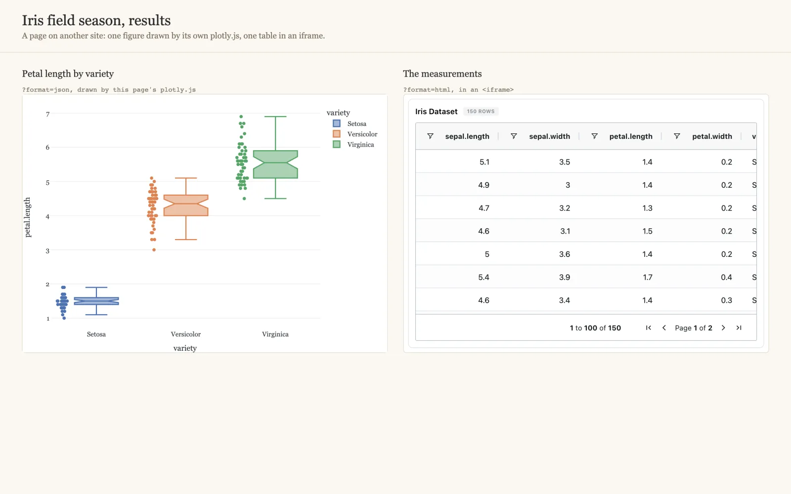

# :material-code-json: Component export and embedding <small>(v1.17.0+)</small>

A component of a dashboard can be served to another website, live, in one of two formats:

- **Plotly spec (JSON)**: `{data, layout, config, meta}`, drawn by the site's own
  plotly.js and styled like the rest of its page.
- **Embeddable page (HTML)**: one self-contained page running Depictio's own renderer,
  for an `<iframe>` or to keep as a file. It makes no network call once loaded.

Both read the dashboard as it is now, with its latest data: the link always returns the
current state of the component.

[](../images/guides/component-export/host_page.webp){target=_blank}

| You want to | Where |
|-------------|-------|
| Get the link, `curl` or snippet for one component | The tile's **Export / embed** action |
| Know which components export in which format | `GET …/export/dashboards/{id}/components` |
| Turn the feature on, or let a site frame the pages | [`DEPICTIO_FASTAPI_EMBED_*`](../installation/env-reference.md#component-export) |

---

## :material-toggle-switch-outline: Turning it on { #turning-it-on }

The export API is **off by default**: serving embeds relaxes the framing protections on
its path, and lets callers without a token read public projects. An administrator turns
it on in the server's environment:

| Variable | Default | |
|----------|---------|---|
| `DEPICTIO_FASTAPI_EMBED_ENABLED` | `false` | Serve the export routes and show **Export / embed** on the tiles. Off, every route answers `404` with `code: embed_disabled` |
| `DEPICTIO_FASTAPI_EMBED_ALLOWED_ORIGINS` | empty | Sites allowed to frame an exported page, comma-separated (`https://lab.example.org`). They become the page's CSP `frame-ancestors` and may also fetch the JSON format from a browser. Empty: the pages open on their own but no site can frame them. `*` is refused |
| `DEPICTIO_FASTAPI_EMBED_CSP_UNSAFE_INLINE` | `false` | Allow inline scripts in the exported page instead of listing the hashes of its scripts. Only for a bundled script that cannot be hashed ahead of time |

The Helm chart (`backend.env`), both compose files and `.env.example` carry the first
two, and `depictio local up` passes them on from the shell that starts it:

```bash
DEPICTIO_FASTAPI_EMBED_ENABLED=true depictio local up
```

!!! warning "The HTML format needs the embed bundle"
    The page is built from a prebuilt bundle, `depictio/viewer/dist-embed/embed.html`.
    The Docker images include it. The Python package does not yet, so on a server
    installed with `pip` or `uv tool` (`depictio local` included), `format=html` answers
    `503` with `code: bundle_unavailable` while the JSON format works. From a checkout,
    `cd depictio/viewer && pnpm run build:embed` builds it.

---

## :material-cursor-default-click-outline: From a tile

While the API is on, every tile of the viewer has an **Export / embed** action, among the
actions shown when the pointer is over it.

[](../images/guides/component-export/tile_action_light.webp){target=_blank}
[](../images/guides/component-export/tile_action_dark.webp){target=_blank}

The action opens a dialog that names the component and its type, then offers:

- **Mode**: *Plotly spec (JSON)* or *Embeddable page (HTML)*. A mode the component does
  not have is greyed out, and its tooltip says why. The dialog opens on JSON when the
  component has it.
- **Theme**: light or dark.
- **Include the current filters (N)**: the filters active on the dashboard, carried in the
  link. Without it, the export draws the component unfiltered.
- **Snippets**: the URL, a `curl` command, and a `plotly.js` snippet for JSON or an
  `<iframe>` for HTML, with **Open** and **Copy**. Past 2000 characters, the `curl`
  command switches to the `POST` form.

[](../images/guides/component-export/dialog_json_light.webp){target=_blank}
[](../images/guides/component-export/dialog_json_dark.webp){target=_blank}

=== "HTML mode"

    [](../images/guides/component-export/dialog_html_light.webp){target=_blank}
    [](../images/guides/component-export/dialog_html_dark.webp){target=_blank}

=== "A card: HTML only"

    [](../images/guides/component-export/dialog_card_light.webp){target=_blank}
    [](../images/guides/component-export/dialog_card_dark.webp){target=_blank}

The dialog warns when a link will not work as is:

- **Private project**: the link answers `403` without a token. The snippets send
  `Authorization: Bearer $DEPICTIO_TOKEN`, to be replaced with a long-lived token from
  **Account settings → CLI agents**. Your own session token never goes into a snippet.
  An `<iframe>` cannot send a token, so embed a page from a public project.
- **No site may frame this page yet**: `DEPICTIO_FASTAPI_EMBED_ALLOWED_ORIGINS` is empty.

There is no **Export / embed** on filter controls, on JBrowse tiles, or while a past
[version](versioning.md) is shown, since the export always serves the current dashboard.
A tile of a [section shown on every tab](dashboards.md#persistent-sections) exports from
the tab that owns it.

---

## :material-format-list-checks: What exports how

| Component | JSON | HTML |
|-----------|:----:|:----:|
| Figure, map | :material-check: | :material-check: |
| MultiQC | :material-check: | :material-check: |
| Advanced visualization | some kinds, see below | all but three kinds |
| Table, card, image, text, filter control | | :material-check: |
| JBrowse | | |
| Highlight | | |

- **JSON** needs a figure the server can build in Python. For advanced visualizations
  that is the complex heatmap, UpSet plot and Sankey, and the volcano (with its MA and QQ
  views), embedding, Manhattan, stacked taxonomy, differential abundance bar plot,
  sunburst, the dot plot's enrichment view and the four benchmarking kinds. The other
  kinds answer `501`, with the URL of their HTML page in `html_url`.
- **HTML** runs the viewer's renderer, so every component it draws in the browser renders
  the same way. Three advanced visualizations have no offline page: the genome view, the
  contact map and group comparison, which fetch or compute data as you zoom or select,
  and neither has a tile saved on a GenomeSpy view.
- **JBrowse** is a frame onto a live JBrowse server, and a **highlight** draws another
  tab's component: export that one instead.

The manifest says the same for a given dashboard, per component, with the reason for any
missing format. Read it rather than hardcoding the table.

---

## :material-api: The API { #the-api }

All routes are under `/depictio/api/v1/export`:

| Route | Returns |
|-------|---------|
| `GET /dashboards/{dashboard_id}/components` | The manifest: every component with its `component_id`, type, `viz_kind`, title, `formats`, and `json_unavailable_reason` or `html_unavailable_reason` |
| `GET /dashboards/{dashboard_id}/components/{component_id}` | The component in one format |
| `POST /dashboards/{dashboard_id}/components/{component_id}` | The same, with `filters`, `theme` and `controls` in a JSON body, for filters too long for a URL |

Parameters of the `GET`:

| Parameter | |
|-----------|---|
| `format` | `json` (default) or `html` |
| `theme` | `light` (default) or `dark` |
| `filters` | A URL-encoded JSON array of filters, see below |
| `controls` | A URL-encoded JSON object of the component's own controls, such as `{"view": "ma"}` for a volcano saved on another view. Without it, the component draws as it was saved |
| `expect_revision` | The revision this caller was built against. If the component or its data has changed since, `409` instead of a different result |

```bash
BASE=https://depictio.example.org/depictio/api/v1/export/dashboards/$DASH

# What this dashboard can export
curl -s "$BASE/components" | jq '.[] | {component_id, component_type, formats}'

# One figure as a Plotly spec, one table as a page
curl -s "$BASE/components/$FIGURE?format=json" | jq '.meta'
curl -s "$BASE/components/$TABLE?format=html" > table.html
```

```html
<iframe src="https://depictio.example.org/depictio/api/v1/export/dashboards/DASH/components/CID?format=html"
        width="100%" height="420" style="border: 0" loading="lazy"></iframe>
```

### Filters { #filters }

Each filter control of a dashboard is in the manifest with a `filter` entry: the column it
filters, its type and the kind of control. With `?include_filter_options=true`, the entry
also carries the values the control offers, distinct values or a min and max, so a host
page can build its own control. This option reads every filtered column, which is why it
is off by default.

```json
{
  "component_id": "ce2962ed-…",
  "component_type": "interactive",
  "title": "Variety",
  "formats": ["html"],
  "filter": {
    "interactive_component_type": "MultiSelect",
    "column_name": "variety",
    "column_type": "object",
    "options": {"kind": "categorical", "values": ["Setosa", "Versicolor", "Virginica"]}
  }
}
```

A filter sent to the export is that entry with a `value`: a list of values for a select,
`[min, max]` for a range.

```bash
curl -sG "$BASE/components/$FIGURE" --data-urlencode format=json \
  --data-urlencode 'filters=[{"column_name": "variety", "interactive_component_type": "MultiSelect", "value": ["Setosa"]}]'
```

`meta.filter_applied` in the JSON says whether filters were sent.

### Caching and pinning

Every response carries a weak `ETag` and an `X-Depictio-Revision` header, both readable
from JavaScript on another site, and the JSON repeats the revision in `meta.revision`. The
revision changes when the dashboard's content changes or when a collection the component
reads is ingested again.

- Send `If-None-Match` with the `ETag` to get a `304` while nothing changed.
- Send `?expect_revision=` with a `meta.revision` to get a `409` (`code:
  revision_mismatch`) instead of a component that has moved on.

### Access

The export applies the dashboard's [permissions](dashboards.md#permissions), in every
[authentication mode](../usage/guides/authentication-modes.md):

- a **public** project's components export without a token;
- a **private** project's need a bearer token of a user who can view it. Without one, the
  caller is always an anonymous non-admin, even on a single-user server, so only public
  projects are readable.

### Errors

| Status | When |
|--------|------|
| `400` | `filters`, `controls` or `theme` is not valid |
| `403` | A private project without a valid token |
| `404` | The export API is off (`embed_disabled`), or no such dashboard or component |
| `409` | `expect_revision` no longer matches (`revision_mismatch`) |
| `422` | The component has no such format (`unsupported_export`) |
| `501` | JSON for an advanced visualization drawn only in the browser. `html_url` points to its page |
| `503` | The HTML bundle is missing (`bundle_unavailable`), or a MultiQC figure is still being prepared |

---

## :material-alert-circle-outline: Limits

- **Live only.** The export serves the current dashboard and its latest data, and takes no
  version. The action is hidden while a past version is shown.
- **Saved controls.** An advanced visualization's thresholds, top-N or view are read from
  its saved settings, not from what a viewer has changed in their browser. Pass `controls`
  for another state.
- **Linked filters.** Without a token, a filter on one data collection does not reach
  components of another collection through a [cross-DC link](cross-dc-filtering.md).
  Authenticated exports follow the links.

---

## :material-server-network: Behind your own reverse proxy

The exported page sets its own `Content-Security-Policy` and leaves out
`X-Frame-Options`, so that the listed sites can frame it. A proxy that adds either header
to every response defeats that: browsers enforce every CSP they receive, so a site-wide
`frame-ancestors 'self'` blocks the embed. The nginx configuration of the Docker images has
a separate `location` for `/depictio/api/v1/export/` for this reason. A proxy of your own
needs the same exception.
