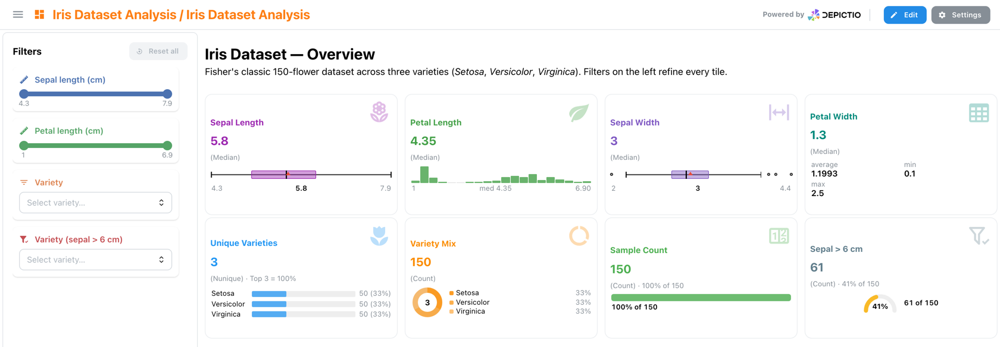
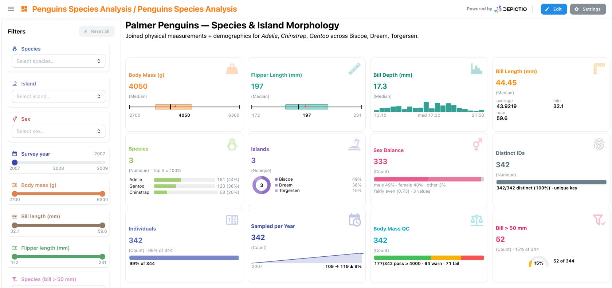
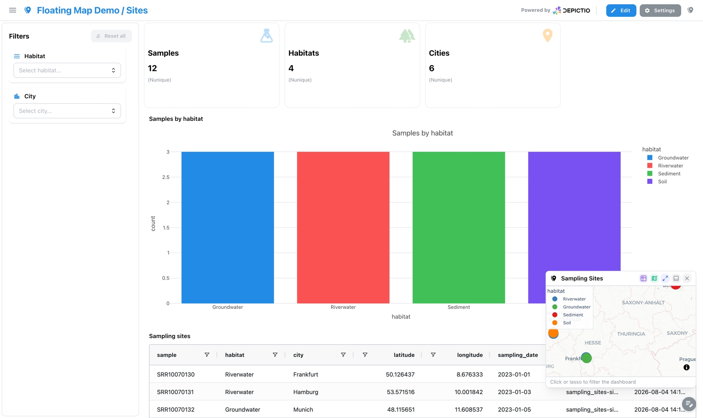
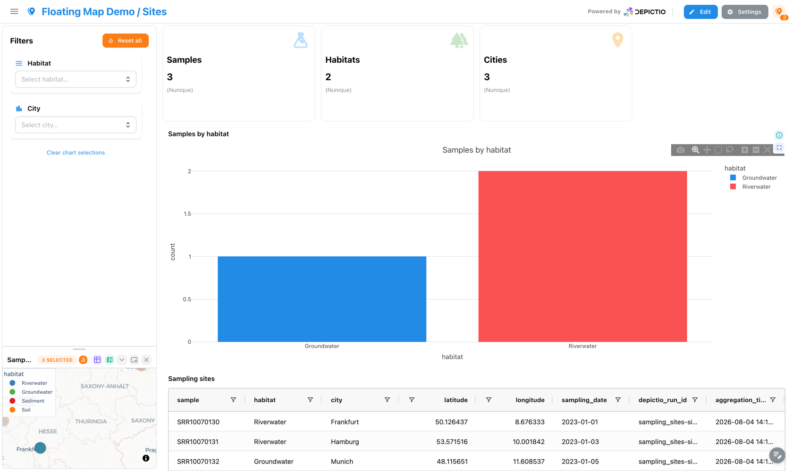
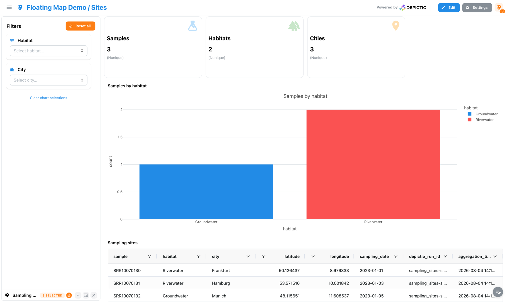
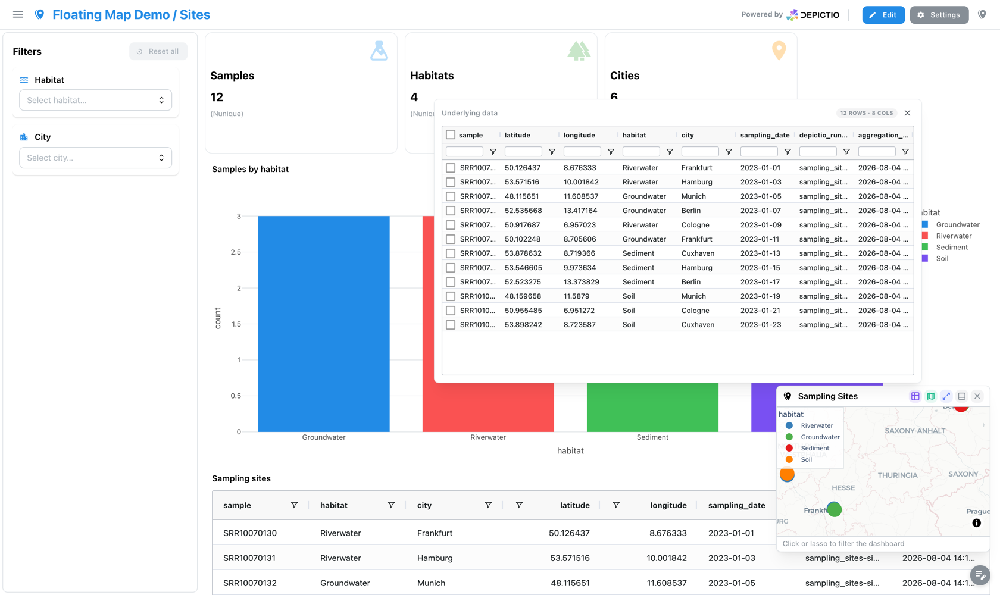

# :material-puzzle: Dashboard Components

Depictio provides a variety of component types for building interactive dashboards. This guide covers each component type, when to use it, and how to configure it.

!!! tip "Browse the live catalog"
    To see which bioinformatics tool outputs map to these components, explore the
    [:material-hammer-wrench: Depictio Tools Catalog](../catalog/index.md): every
    recognised tool, the data collections it emits, and the renders they offer,
    previewed on real fixture data.

## :material-format-list-bulleted: Component Overview

<div class="grid cards" markdown>

-   :material-chart-scatter-plot:{ .lg .middle } **[Figure](#figure-components)**

    ---

    Charts and plots (scatter, bar, histogram, line, box, pie, and more)

-   :material-table:{ .lg .middle } **[Table](#table-components)**

    ---

    Interactive data tables with filtering and sorting

-   :material-card-text:{ .lg .middle } **[Card](#card-components)**

    ---

    Metric display with aggregations

-   :material-format-header-1:{ .lg .middle } **[Text](#text-components)**

    ---

    Headings and prose, with block markdown and links to tabs since v1.14.0

-   :material-star-four-points-outline:{ .lg .middle } **[Highlight](#highlight-components)**

    ---

    Another tab's figure, redrawn on this one (v1.14.0+)

-   :material-tune:{ .lg .middle } **[Interactive](#interactive-components)**

    ---

    User input components for filtering (slider, dropdown, date picker)

-   :material-microscope:{ .lg .middle } **[MultiQC](#multiqc-components)**

    ---

    Quality control report visualizations

-   :material-image-multiple:{ .lg .middle } **[Image](#image-components)**

    ---

    Image galleries with S3/MinIO storage integration

-   :material-map-marker-multiple:{ .lg .middle } **[Map](#map-components)**

    ---

    Geospatial map visualization with markers

-   :material-chart-timeline:{ .lg .middle } **[Genome browser](#genome-browser-components)**

    ---

    Embedded genome browser over a track manifest, with two-way cross-filtering (v1.20.0+)

-   :material-chart-multiline:{ .lg .middle } **[Advanced Visualizations](advanced-visualizations.md)**

    ---

    Domain-specific scientific viz (volcano, MA, manhattan, ComplexHeatmap, UpSet, sankey, …) backed by canonical column schemas

</div>

### Building under active filters <small>(v1.5.2+)</small> { #building-under-filters }

With filters applied, the builder previews the **filtered** data. An **Apply to
preview** toggle switches back to the full dataset. Applies to every type except
Text and MultiQC, which have no row filtering. See
[Dashboard creation](../usage/guides/dashboard_creation.md#previewing-with-active-filters-v152).

---

## :material-chart-scatter-plot: Figure Components <small>(v0.0.1+)</small> { #figure-components }

Figure components display data visualizations using Plotly charts. They support both **UI Mode** (drag-and-drop configuration) and **Code Mode** (Python code for custom plots).

### Supported Chart Types

**UI Mode** provides a curated selection of chart types through the visual interface:

<!-- TODO: update when more UI types are re-enabled -->

| Category | Chart Types |
|----------|-------------|
| :material-chart-scatter-plot: **Basic Charts** | Scatter, Bar, Line |
| :material-chart-box: **Statistical** | Histogram, Box |
| :material-grid-large: **Matrix** | ComplexHeatmap (via [:material-open-in-new: plotly-complexheatmap](https://github.com/weber8thomas/plotly-complexheatmap){ target="_blank" }) |
<!-- | :material-chart-bell-curve: **Distribution** | Density Heatmap, Density Contour |
| :material-chart-tree: **Hierarchical** | Treemap, Sunburst | -->

<!-- | Category | Chart Types |
|----------|-------------|
| :material-chart-scatter-plot: **Basic Charts** | Scatter, Bar, Line, Area, Pie, Donut |
| :material-chart-box: **Statistical** | Histogram, Box, Violin, Strip |
| :material-chart-bell-curve: **Distribution** | Density Heatmap, Density Contour |
| :material-chart-tree: **Hierarchical** | Treemap, Sunburst | -->

!!! tip "Unlimited Charts with Code Mode :material-code-tags:"
    **Code Mode** supports the entire Plotly library, giving you access to all chart types including 3D plots, maps, financial charts, and more. See the [:material-open-in-new: Plotly Python documentation](https://plotly.com/python/){ target="_blank" } for the complete reference.

### UI Mode

In UI Mode, configure charts through the visual interface:

1. Select a **Data Collection** as your data source
2. Choose the **Chart Type** (scatter, bar, histogram, etc.)
3. Map data columns to **X-axis**, **Y-axis**, and optional **Color** dimension
4. Customize appearance (title, axis labels, colors)

### Code Mode

Code Mode allows custom Python code for advanced visualizations:

```python
import plotly.express as px

# df is your data collection as a pandas DataFrame
fig = px.scatter(
    df,
    x="coverage",
    y="quality_score",
    color="sample_type",
    title="Coverage vs Quality by Sample Type"
)

# Return the figure object
fig
```

Since **v1.14.0** a code figure that sets no colours of its own is drawn in the
dashboard's [category colours](dashboards.md#category-colors) when every trace name,
*Other* aside, is a value of one coloured column; the map itself is
`depictio_category_colors`. A template's
`color_discrete_map=depictio_group_kwargs.get("color_discrete_map", {})` counts as setting
none while no analysis group is active.

!!! warning "Security Note :material-shield-lock:"
    Code Mode uses [RestrictedPython](https://restrictedpython.readthedocs.io/en/latest/) for security. Only approved libraries (pandas, plotly) are available. See [Security](security.md) for details.

### Configuration Options

| Option | Description | Default |
|--------|-------------|---------|
| Title | Chart title displayed at top | Auto-generated |
| X-axis label | Label for horizontal axis | Column name |
| Y-axis label | Label for vertical axis | Column name |
| Color | Column for color encoding | None |
| Hover data | Additional columns shown on hover | None |
| `max_points` | Point cap for scatter-family figures before downsampling (v1.3.0+) | Global default (10,000) |
| `font_scale` | Font-size multiplier for the whole figure layout font: axis labels, ticks and legend. Set from the tile's edit menu, 0.7× to 2×, with a full lite-YAML round trip (v1.8.0+) | Unset (1×) |
| Theme | Plotly template for this figure. `mantine_light` / `mantine_dark` mean *follow the UI colour scheme*. Unset falls back to the dashboard default, then to [instance branding](../usage/administration/branding.md) (v1.8.0+) | Unset |

### Figure style <small>(v1.14.0+)</small> { #figure-style }

`figure_style: minimal` gives a figure the landing-page look: the title in the card
header beside an icon badge with the subtitle inline, a transparent plot with faint
dashed grid lines and no axis lines, the legend in one line under the plot, large
unoutlined markers, tight margins and the toolbar only on hover. Bars end in a slight
round, stacked segments are parted by a hairline, and grouped bars get a coloured
underline naming each group instead of facet titles. Plots in this style are set in Inter
unless the figure or the brand sets a font. Unset, a figure takes the `figure_style` of
its [grid section](dashboards.md#landing-tabs), else `default`. In the builder these keys
are the **Card header & style** section.

| Option | Description |
|--------|-------------|
| `figure_style` | `default` or `minimal` |
| `subtitle` | A few dimmed words after the title (`minimal`) |
| `icon_name` / `icon_color` | Iconify id and colour of the header badge (`minimal`). The colour defaults to the brand's primary |
| `hide_legend` | Draw the figure without its legend, for a small tile |
| `caption` | A line or two under the plot saying how to read it, in any style |
| `link` | `tab:<name>`: the tab this figure summarises, linked from the end of the header (`minimal`) or from the tile's actions |

An advanced visualization takes `figure_style`, `subtitle`, `icon_name`, `icon_color` and
`link` for its card only: `minimal` draws the header and the frame, not the plot overlay,
and `link` shows in that header alone. `hide_legend` is honoured by the
[phylogeny summary](advanced-visualizations.md#phylogenetic), and `caption` is not drawn. Its component-level
`controls_placement` says where its controls dock; see
[Controls and where they go](advanced-visualizations.md#controls).

```yaml
- tag: pcoa-overview
  component_type: figure
  visu_type: scatter
  figure_style: minimal
  title: Communities by city
  subtitle: PCoA, Bray-Curtis
  icon_name: mdi:scatter-plot
  caption: Each point is one sample; the closer two points, the more alike their plankton.
  link: "tab:Ordination & Clustering"
  # workflow_tag, data_collection_tag, dict_kwargs...
```

!!! tip "Clustered heatmaps moved"
    The ComplexHeatmap viz is now the [Hierarchical heatmap](advanced-visualizations.md#hierarchical-heatmap) advanced visualization.

### Selection Filtering (Scatter Plots)

Scatter plots can act as interactive filters. Enable selection to let users lasso, box-select, or click points to filter other components.

| Option | Description |
|--------|-------------|
| `selection_enabled` | Enable selection filtering (`true`/`false`) |
| `selection_column` | Column to extract from selected points |

See [Interactive Selection Filtering](interactive-selection-filtering.md) for details.

---

## :material-table: Table Components <small>(v0.0.2+)</small> { #table-components }

Table components display data in interactive tables with built-in filtering and sorting.

### Features

| Feature | Description |
|---------|-------------|
| :material-page-next: **Server-Side Pagination** | Efficiently handles large datasets by loading data in pages |
| :material-arrow-vertical-lock: **Server-Side Scrolling** | Virtual scrolling for smooth navigation through large tables |
| :material-sort: **Column Sorting** | Click headers to sort ascending/descending |
| :material-filter: **Column Filtering** | Filter by column values |
| :material-download: **Export** (v0.6.0+) | Download data as CSV |

### Configuration

| Option | Description | Default |
|--------|-------------|---------|
| Data Collection | Source data for the table | Required |
| Visible Columns | Allowlist of columns to display; omit to show all | All columns |
| Page Size | Rows per page (`10`, `25`, `50` or `100`) | `100` |
| Compact (v1.2.2+) | Tighter row and header heights | Off |
| Style | Column width, text alignment | Auto |
| Title | Header text above the table | Auto (from DC tag) |
| Description | Subtitle text below the title | None |
| Title Size | Header level: `h1`, `h2`, `h3`, or `sm` | `sm` |
| Title Align | Text alignment: `left`, `center`, or `right` | `left` |

### Row Selection Filtering

Tables can act as interactive filters. Enable row selection to let users click rows to filter other components.

| Option | Description |
|--------|-------------|
| `row_selection_enabled` | Enable row selection filtering (`true`/`false`) |
| `row_selection_column` | Column to extract from selected rows |

See [Interactive Selection Filtering](interactive-selection-filtering.md) for details.

---

## :material-chart-multiline: Advanced Visualizations { #advanced-visualizations }

Domain charts that know their column roles: a volcano binds a feature, an effect size and a
significance, a genome view a chromosome and a position. Over forty kinds cover differential
analysis, single cell, genome tracks, variants, microbiome, benchmarking and proteins.
See [Advanced visualizations](advanced-visualizations.md) for every kind with a screenshot,
the data it reads, its controls and a YAML example.

---


## :material-card-text: Card Components <small>(v0.0.1+)</small> { #card-components }

Card components display metrics with aggregations. A card shows a **hero metric** (primary value) and can optionally display **secondary metrics** below it for at-a-glance summaries.

### Aggregation Types

| Aggregation | Description | Example |
|-------------|-------------|---------|
| :material-counter: **count** | Number of rows | Total samples |
| :material-sigma: **sum** | Sum of values | Total reads |
| :material-chart-line-variant: **average** | Average value | Average coverage |
| :material-format-vertical-align-center: **median** | Median value | Median quality score |
| :material-arrow-down: **min** | Minimum value | Minimum mapping rate |
| :material-arrow-up: **max** | Maximum value | Maximum duplication rate |
| :material-tag-multiple: **nunique** | Count of unique values | Unique sample types |
| :material-chart-bell-curve-cumulative: **std_dev** | Standard deviation | Coverage spread |
| :material-chart-bell-curve: **variance** | Variance | Expression variability |
| :material-arrow-expand-horizontal: **range** | Max − Min | Read length range |
| :material-wave: **skewness** | Distribution skew | Quality score symmetry |
| :material-sine-wave: **kurtosis** | Distribution tailedness | Outlier tendency |
| :material-percent: **percentile** | 50th percentile | Median coverage |
| :material-poll: **mode** | Most frequent value | Dominant sample type |
| :material-chart-bell-curve: **q1** | 25th percentile | Lower-quartile coverage |
| :material-chart-bell-curve: **q3** | 75th percentile | Upper-quartile coverage |
| :material-chart-box-outline: **box_plot_stats** | Tukey 5-number summary (min, Q1, median, Q3, max) | Required by `secondary_layout: box_plot` |

!!! note "Which aggregations a column accepts"
    Validity depends on `column_type`; the compatibility table lives in [YAML Sync](yaml-sync.md#card-component). As of **v1.4.0** `percentile` is accepted on `int64` as well as `float64` — quantiles are well defined on integers, and the compute path already recorded them.

    A distinct count is spelled **`nunique`**. The builder wrote `unique` before v1.4.0, which rendered correctly but failed every validating path (YAML export, CLI, catalog) with *"Invalid aggregation 'unique'"*. Collections ingested under the old spelling still resolve, so no re-ingest is needed.

### Configuration

1. Select a **Data Collection**
2. Choose a **Column** to aggregate
3. Select an **Aggregation** type (hero metric)
4. Optionally add **Secondary Metrics** (`aggregations`) for a multi-metric summary
5. Optionally add a **Filter Expression** (`filter_expr`) for conditional aggregation
6. Customize the **Title**, **Icon**, and **Styling**

### Multi-Metric Summary Cards

Cards can display multiple aggregation results in a single component. The primary `aggregation` is shown as the large hero value, and `aggregations` are displayed as compact secondary rows below it.

```text
┌─────────────────────────────────┐
│ Petal Length              [Icon]│
├─────────────────────────────────┤
│           4.5 cm                │
│          (Average)              │
├─────────────────────────────────┤
│ Median:       4.35              │
│ Std Dev:      0.82              │
│ Min:          1.00              │
│ Max:          6.90              │
└─────────────────────────────────┘
```

### Secondary Layout Modes <small>(v0.13.0+)</small> { #secondary-layout-modes }

The default layout above stacks `aggregations` as a vertical list under the hero metric. Set `secondary_layout` on the card to switch to a richer one. Each is tuned for a specific summary intent, and most read a companion field naming the column or cut-off they work from.

**From the `aggregations` list**

| `secondary_layout` | Renders | Companion fields required |
|--------------------|---------|---------------------------|
| `vertical` (default) | Stacked rows from `aggregations` list | `aggregations` |
| `compact` | Horizontal strip from `aggregations` | `aggregations` |
| `grid` <small>(v1.4.0+)</small> | Two-column grid of `aggregations` | `aggregations` |
| `box_plot` | Tukey box-and-whisker (min / Q1 / median / Q3 / max) | `aggregations: [box_plot_stats]` |

**Distribution and quality** <small>(v1.4.0+)</small>

| `secondary_layout` | Renders | Companion fields required |
|--------------------|---------|---------------------------|
| `histogram` | Binned sparkline of the column's distribution | _(none)_ |
| `threshold` | Pass / warn / fail bar against a QC cut-off | `threshold_value`, optionally `threshold_warn`, `threshold_direction` |
| `completeness` | Filled versus missing share of the column | _(none)_ |
| `uniqueness` | Distinct versus repeated share of the column | _(none)_ |
| `trend` | Sparkline of the hero aggregation across buckets of an ordered column | `trend_col` |
| `attrition` | Retention across successive pipeline stages | `attrition_cols` |

A `box_plot` summarises a distribution by its quartiles, which says nothing about
modality — a bimodal column and a flat one can share the same five numbers. `histogram`
is the layout that shows the shape.

**Breakdown by a categorical column**

| `secondary_layout` | Renders | Companion fields required |
|--------------------|---------|---------------------------|
| `top_n` | Mini bar chart of top-N most frequent `breakdown_col` values | `breakdown_col`, `top_n_count` (1–5) |
| `concentration` | Top-N share (%) by `breakdown_col` | `breakdown_col`, `top_n_count` (1–5) |
| `composition` <small>(v1.4.0+)</small> | One 100%-wide bar split into top-N segments plus a muted *Other*, captioned with Pielou evenness | `breakdown_col`, `top_n_count` (1–5) |
| `donut` <small>(v1.4.0+)</small> | Same breakdown drawn as a ring | `breakdown_col`, `top_n_count` (1–5) |

What each group's bar measures follows the card's own `aggregation` <small>(v1.13.0+)</small>.
A `count` or `sum` card splits its total, so each group shows its share of it. A card whose
hero is a `max`, `min`, `average`, `median`, `range`, `variance` or `std_dev` ranks the groups
by that same aggregation in the column's unit, the highest first (the lowest first under
`min`), with no percentages: a group's maximum is not a share of anything. Before v1.13.0
those cards counted rows per group.

**Progress toward a maximum**

| `secondary_layout` | Renders | Companion fields required |
|--------------------|---------|---------------------------|
| `coverage` | Fill bar showing `value / coverage_max` | `coverage_max` |
| `gauge` <small>(v1.4.0+)</small> | Same ratio drawn as an arc | `coverage_max` |

**YAML field reference (multi-metric extras)**

| Field | Type | Default | Description |
|-------|------|---------|-------------|
| `secondary_layout` | enum (see tables above) | `vertical` | Layout mode for the secondary block. |
| `aggregations` | list[str] \| null | `null` | Secondary aggregation functions (e.g. `[median, std_dev, min, max]` or `[box_plot_stats]`). Required by `vertical`, `compact`, `grid`, `box_plot`. |
| `breakdown_col` | str \| null | `null` | Group-by column for `top_n` / `concentration` / `composition` / `donut`. |
| `top_n_count` | int (1–5) | `3` | Number of top values rendered by `top_n`, `concentration`, `composition` and `donut`. Capped at 5, past which the strip is illegible at a typical card size. |
| `coverage_max` | float \| null | `null` | Denominator for `coverage` and `gauge`. Falls back to `vertical` if missing. |
| `threshold_value` | float \| null | `null` | QC cut-off for `threshold`. Without it the strip is not drawn. |
| `threshold_direction` | `min` \| `max` | `min` | Which side passes. `min` is at-least (coverage, %Q30), `max` is at-most (duplication, contamination). Explicit, because inferring it would silently invert a QC verdict. |
| `threshold_warn` | float \| null | `null` | Softer cut-off between pass and fail. It must lie on the failing side of `threshold_value` (below it under `min`, above it under `max`) and needs `threshold_value`. Since v1.13.0 a warn value on the passing side fails validation; earlier versions dropped it without a word. |
| `trend_col` | str \| null | `null` | Ordered column the `trend` sparkline is bucketed along — a date, a timestamp, or any sortable number. The card's own column is what is aggregated inside each bucket. |
| `attrition_cols` | list[str] | `[]` | Ordered stage columns for `attrition`, following the card's own column as the first stage. The order is the pipeline's order and is the content of the chart, so stages are never sorted by value. |

**Examples** — the first three are from `depictio/projects/init/iris/dashboards/overview.yaml`; the rest are illustrative.

=== "box_plot"

    ```yaml
    - tag: sepal-length-summary
      component_type: card
      workflow_tag: python/iris_workflow
      data_collection_tag: iris_table
      aggregation: median
      aggregations: [box_plot_stats]
      secondary_layout: box_plot
      column_name: sepal.length
      column_type: float64
      title: "Sepal Length"
    ```

=== "top_n"

    ```yaml
    - tag: variety-breakdown
      component_type: card
      aggregation: nunique
      secondary_layout: top_n
      breakdown_col: variety
      top_n_count: 3
      column_name: variety
      column_type: object
    ```

=== "coverage"

    ```yaml
    - tag: sample-coverage
      component_type: card
      aggregation: count
      secondary_layout: coverage
      coverage_max: 150
      column_name: variety
      column_type: object
    ```

=== "threshold"

    ```yaml
    - tag: mean-coverage
      component_type: card
      aggregation: average
      secondary_layout: threshold
      threshold_value: 30       # pass at 30x or better
      threshold_warn: 20        # warn band between 20x and 30x
      threshold_direction: min  # higher is better
      column_name: coverage
      column_type: float64
      title: "Mean Coverage"
    ```

=== "composition"

    ```yaml
    - tag: variety-composition
      component_type: card
      aggregation: nunique
      secondary_layout: composition
      breakdown_col: variety
      top_n_count: 3
      column_name: variety
      column_type: object
    ```

=== "trend"

    ```yaml
    - tag: reads-over-time
      component_type: card
      aggregation: average
      secondary_layout: trend
      trend_col: sampling_date  # ordered column the sparkline walks
      column_name: read_count
      column_type: int64
    ```

The seeded iris and penguins showcase dashboards exercise most of these at once:





### Conditional Aggregation (filter_expr)

Cards support a `filter_expr` field — a Polars expression that pre-filters the data **before** computing the aggregation. This enables conditional metrics like "count of samples with coverage > 30x" without creating a separate data collection.

`filter_expr` works **on top of** interactive filters (dual-layer filtering): interactive filters narrow the dataset first, then `filter_expr` applies an additional condition before aggregation.

See [Filter Expressions](filter-expressions.md) for the complete expression reference.

### Styling Options

| Option | Description | Example |
|--------|-------------|---------|
| Title | Metric label | "Total Samples" |
| Description | Shown in the tooltip on the card's title | "Across all batches" |
| Icon | Iconify icon name | `mdi:chart-line` |
| Icon Color | Icon accent color | `#2196F3` |
| Title Color | Title text color | `#333333` |
| Title Font Size | Title font size | `sm` |
| Value Font Size | Hero value font size | `xl` |

### Display options <small>(v1.14.0+)</small> { #card-display-options }

| Option | Description |
|--------|-------------|
| `variant` | How the card is drawn. `default`; `headline`, a key figure with a large value and a faint resting icon; `compact`, title and value on one line; `minimal`, headline type with no frame; `accent`, headline type with a coloured rail on the left; `split`, the icon in a tinted block beside the figure. Unset takes the section's `card_variant`, else `default` |
| `icon_style` | `watermark` (default), a large faint icon on the right, or `badge`, a small icon on a tint of `icon_color` before the title. `badge` applies to the `default` style only; the other styles place the icon themselves. YAML only |
| `caption` | One line under the value, in place of the aggregation label, which moves to a tooltip on the header |
| `decimals` | Decimal places of a fractional value, 0 to 6, trailing zeros kept so a row lines up; the card's strip follows. Unset, the places shrink as the value grows (0.0123, 12.35, 907.1, 3,641) |
| `link` | Where clicking the card goes: `tab:<name>` for a sibling tab, a URL (opened beside the dashboard) or a `/` path. A tab the dashboard lacks leaves the card unlinked |

Hovering the title shows the card's `description` and, when a `caption` takes the
aggregation line, how the value is computed, for example *Median shannon*. In the
builder, *Style*, *Caption* and *Decimals* are the **Display** block, and *Link to a tab*
and *Description* are **Link & help**. In a section with a `card_variant`, *Style* shows
the section's style with a hint; leaving it there stores nothing, so the card keeps
following its section, and `variant: default` opts a card out.

```yaml
- tag: shannon-median
  component_type: card
  aggregation: median
  column_name: shannon
  title: Shannon diversity
  variant: headline
  icon_name: mdi:chart-bell-curve
  caption: median per sample
  decimals: 2
  link: "tab:Alpha Diversity"
  # workflow_tag, data_collection_tag, column_type...
```

---

## :material-format-header-1: Text Components <small>(v0.2.0+)</small> { #text-components }

Text components are presentational tiles for section delimiters, narrative intros, and small inline annotations. They have no data binding — they just render a heading + optional paragraph at the position they occupy in the grid.

### YAML fields

| Field | Type | Default | Description |
|-------|------|---------|-------------|
| `component_type` | `"text"` | — | Discriminator |
| `title` | str | `""` | Heading text |
| `order` | int (1–6) | `1` | Heading level — renders as `<h1>` through `<h6>` (values outside 1–6 are clamped) |
| `alignment` | `left` \| `center` \| `right` | `left` | Horizontal alignment for both title and body |
| `vertical_alignment` <small>(v1.4.0+)</small> | `top` \| `center` \| `bottom` | `center` | Where the text block sits vertically within its tile |
| `body` | str | `""` | Optional paragraph rendered below the title. Block markdown since v1.14.0, see below |
| `surface` <small>(v1.14.0+)</small> | `none` \| `card` \| `tinted` | `none` | `none`: bare prose. `card`: framed like a metric card. `tinted`: on a tint of `accent`, grey without one. On either frame, a leading heading that holds a number (`# 41%`) is set as a headline figure with the line under it as its caption, and a fact list becomes a two-column table |
| `accent` <small>(v1.14.0+)</small> | str \| null | `null` | Mantine palette name, CSS colour, or `tab:<name>` to borrow a sibling tab's colour. Colours a `tinted` tile and the marks of a `::: steps` flow; a `tab:` accent on a `card` also rests that tab's icon in its corner. Ignored without a frame |

!!! note "`vertical_alignment` defaults to `center` as of v1.4.0"
    The grid sizes a tile in whole row units, so a text tile is almost never the height of
    its own text. Top-aligned, a one-line heading in an `h: 2` tile spent the remainder as
    dead space beneath itself. Set `vertical_alignment: top` to restore the earlier
    rendering.

### Markdown

The title is plain text. The body supports inline markdown: `**bold**`, `*italic*`,
`` `code` `` and links. No markdown library is loaded and HTML is never rendered; the
parsing is done client-side by the viewer.

Since **v1.14.0** the body also supports block markdown and a few link schemes. A body
with none of this syntax renders as before, as one paragraph that keeps its line breaks.

| Syntax | Renders as |
|--------|------------|
| `#`, `##`, `###` | Headings, drawn as H3, H4 and H5 whatever the title's level. `####` stays text |
| `- item`, `1. item` | Bullet and numbered lists |
| Pipe tables | Tables; a `:` in the separator row aligns the column |
| `---` | A divider |
| `[label](https://…)` | A web link, opened beside the dashboard; a path such as `/dashboards` opens in place. Other schemes stay text |
| `[label](tab:Tab name)` | A link to a sibling tab by its displayed name, case-insensitive, wearing that tab's icon and colour. An unknown name renders as plain text |
| `[label](params:)`, `[label](params:primer)` | Opens the **Run parameters** dialog, its search filled with the text after `params:` (letters, digits, `_ . -`) |
| `` | An inline Iconify icon |
| `` | A colour dot, the legend key of the category named beside it; a palette name such as `color:teal` works too |

Some lists are drawn as layouts:

| Pattern | Renders as |
|---------|------------|
| Every item of a bullet list `**Label** value`, optionally led by `` | A fact list: one wrapping line of facts (grey label, bold value), or a two-column table on a framed tile. A numbered list stays a list |
| A list inside `::: steps` … `:::` | A step flow, across the tile when it is wide, down it when narrow. Each item: an icon (else its number), a bold label, what was done; only the last is needed. Trailing `· [label](params:…)` or `· [label](tab:…)` links become small icons beside the step's name, the label on hover. On a framed tile the marks take its `accent`. Quarto's `::: {.steps}` works too |
| Every item `**41%** claim — context [Tab](tab:…)`: a bold figure holding a digit, then a context, a closing link or both | Result rows, the figure in the linked tab's colour, the link on the right |
| Every item `[Label](tab:Name)`, optionally followed by `: what it answers` | Tab tiles: the tab's icon, the link's label and the text after it, else the tab's subtitle. A numbered list numbers them 01, 02… as a reading order. Tabs the dashboard lacks are left out, so a template's landing page adapts to the run |
| `**See also** · [A](tab:A) · [B](tab:B)`, or two links or more | A link row; links to tabs the dashboard lacks are dropped. On a framed tile, a closing paragraph of links alone, with no bold label, sits on its bottom edge |

```yaml
- tag: reading-path
  component_type: text
  title: From reads to communities
  surface: card
  body: |
    ::: steps
    1.  **Amplicon** V4–V5 · 515F-Y / 926R
    2.  **Denoise** DADA2 to ASVs · [Settings](params:dada2) · [QC](tab:Sequencing QC)
    3.  **Classify** SILVA 138.2 + PR2 5.0.0
    :::

    [All parameters](params:) · [Sequencing QC](tab:Sequencing QC)
```

The closing paragraph is links alone, so on this framed tile it sits on the bottom edge.

The editor's text builder sets these in **Frame & accent**: **Frame** (`surface`) and, on
a framed tile, **Accent**, a palette colour or a tab's. Its preview resolves `tab:` links,
accents and tiles, and a collapsible **Markdown help** under the body has a copyable
example of each syntax above except the colour dot, plus the headline figure.

### Example (from `depictio/projects/init/iris/dashboards/overview.yaml`)

```yaml
- tag: text-overview-intro
  component_type: text
  title: "Iris Dataset — Overview"
  order: 2
  alignment: left
  body: "Fisher's classic 150-flower dataset across three varieties (*Setosa*, *Versicolor*, *Virginica*). Filters on the left refine every tile."
  layout: {x: 0, y: 0, w: 8, h: 1}
```

### Use Cases

- :material-format-title: Dashboard section headers
- :material-view-grid: Visual organization of content
- :material-label: Labeling groups of related components
- :material-text-long: Short narrative intros above an analytical section
- :material-view-dashboard-outline: A [landing tab](dashboards.md#landing-tabs): a study recap, a reading path through the tabs, findings that link to the tab showing each one

---

## :material-star-four-points-outline: Highlight Components <small>(v1.14.0+)</small> { #highlight-components }

A highlight draws a figure that lives on another tab of the dashboard, without copying
it. The figure is rendered from its own definition, so an edit on its tab shows here
too; the highlight only says how to draw it. It takes this tab's filters, as any figure
here does, and links back to the tab it comes from: in its header for a figure, among
the tile's actions for an advanced visualization. It does not filter in turn: its
figure's selection is off.

The source can be a figure, restyled here (`minimal` unless `figure_style` says
otherwise), or an advanced visualization, drawn as it is on its tab.

| Field | Description |
|-------|-------------|
| `source_tab` | The tab the figure lives on, by its displayed name (the main tab also by the dashboard title). Survives an export to another instance, which writes it in place of the id |
| `source_dashboard_id` | The tab's id, which the editor writes. Tried first; `source_tab` takes over when it is unknown |
| `source_component` | The figure: its `index`, else its title, ignoring case and spacing. A figure made in the editor is best named by its title, since a re-import replaces its id |
| `title`, `subtitle`, `icon_name`, `icon_color`, `hide_legend`, `caption` | As on a [figure](#figure-style). Unset, each takes the source's value |
| `figure_style` | Style a figure is drawn in here; unset is `minimal`, whatever its tab draws it in. An advanced visualization keeps its own |

```yaml
- component_type: highlight
  title: Faith PD per locality
  subtitle: at the deepest rarefaction depth
  source_tab: Alpha Diversity
  source_component: trec-fig-alpha-plateau
  icon_name: mdi:chart-scatter-plot
  layout: {x: 0, y: 0, w: 6, h: 7}
```

A highlight binds to no data collection of its own, so it carries no `workflow_tag` or
`data_collection_tag`.

In the editor, a figure's or advanced visualization's ⋮ menu offers **Highlight on…**,
which lists the other tabs; the highlight lands on the chosen tab at the source's size,
above its sections if it has any. Its **Edit** opens **Figure shown** (the tab and the figure) and **Card
header & style**. A missing tab or figure draws a placeholder saying so.

---

## :material-tune: Interactive Components <small>(v0.0.1+)</small> { #interactive-components }

Interactive components let users filter data across the dashboard. These components affect all linked visualization components.

### Component Types

| Component | Input Type | Best For |
|-----------|------------|----------|
| :material-ray-start-end: **RangeSlider** | Numeric range | Coverage: 0-100x |
| :material-ray-vertex: **Slider** | Numeric threshold | Minimum depth: 10x |
| :material-format-list-checks: **MultiSelect** | Multiple choices | Sample types |
| :material-calendar: **DatePicker** | Date range | Run dates |
| :material-toggle-switch: **SegmentedControl** | Single choice | Condition A/B |
| :material-form-textbox: **TextInput** | Free text | Sample ID search |

### RangeSlider

Filter data by numeric range:

| Option | Description |
|--------|-------------|
| Column | Numeric column to filter |
| Min/Max | Range bounds |
| Step | Increment value |
| Default | Initial range values (`default_range` in YAML) |
| Histogram <small>(v1.13.0+)</small> | `show_histogram: true` draws the column's distribution above the track |

### Slider

Filter by a single numeric value. Since v1.13.0 a slider is a threshold: it keeps the rows
at or above its value. `slider_mode` changes the comparison (`gt`, `lte`, `lt`, `eq`, `ne`);
`eq` restores the exact-match filter earlier versions applied. See
[Initial values and slider options](yaml-sync.md#interactive-defaults).

### MultiSelect

Filter by selecting multiple values:

| Option | Description |
|--------|-------------|
| Column | Categorical column to filter |
| Options | Available values (auto-populated) |
| Default | Initially selected values |
| Placeholder | Hint text when empty |

### TextInput <small>(v1.21.0+)</small> { #text-input }

Keeps the rows of a string column whose text matches what is typed. The text is read as a
**regular expression**, so `^CCA` keeps values that start with `CCA`, `GG$` those that end
with `GG`, and a plain word is a substring match. Case is ignored.

| Option | Description |
|--------|-------------|
| Column | String column to match |
| `placeholder` | Hint shown in the empty box, e.g. `e.g. ^CCA or GG$` |
| `case_sensitive` | `true` matches letter case exactly. Off by default |
| `match_mode` | `regex` (default) or `contains`, which reads the text as literal characters, so `A+` finds the two characters `A+` |
| `default_value` | A pattern the box starts with, and returns to on **Reset all** |

An empty box is no filter. A pattern that does not compile is flagged under the box and
filters nothing, so a half-typed `(` never empties the dashboard.

Under the box, a line says what the pattern caught: *24 of 122 values match*. Counting is
done on the column's distinct values in the whole collection, with the same matcher the
filter applies, so a pattern that keeps nothing says so (*No guide value matches*) instead
of leaving an empty dashboard. **show** opens the matching values with the caught part
marked, a box to narrow the list, and **Copy** (one value per line). The list is capped at
100 values; the filter still keeps every match.

The matcher is the server's regular-expression engine, not the browser's, so exotic syntax
(lookbehind, named groups) can differ from what a JavaScript console accepts. Leading
inline flags such as `(?i)` are accepted by the server and ignored by the browser check.

```yaml
- tag: guide-pattern
  component_type: interactive
  workflow_tag: nf-core/crisprseq
  data_collection_tag: guide_summary
  interactive_component_type: TextInput
  column_name: guide
  placeholder: 'e.g. ^CCA or GG$'
```

### DatePicker

Filter by date range:

| Option | Description |
|--------|-------------|
| Column | Date/datetime column to filter |
| Format | Date display format |
| Default | Initial date range |

### SegmentedControl

Single-selection toggle:

| Option | Description |
|--------|-------------|
| Column | Column to filter |
| Options | Available choices |
| Default | Initially selected option |

#### Option cards { #option-cards }

<span class="ver-badge">v1.19.2+</span> `option_cards`

Draws each option of a SegmentedControl as a card, for a choice that changes the whole tab.

{ .viz-shot loading=lazy }
{ .viz-shot loading=lazy }

```yaml
- component_type: interactive
  interactive_component_type: SegmentedControl
  column_name: database
  placement: top               # above the grid, stays in view
  option_cards:                # keyed by value; label, icon, description all optional
    pfam: {label: Pfam, icon: "mdi:dna", description: Curated families}
    funfam: {label: FunFam, icon: "mdi:family-tree", description: CATH functional families}
```

An `always_selected` Select takes `option_cards` too, for its [scope banner](dashboards.md#scope-banner). YAML only for now.

### In a filter bar <small>(v1.14.0+)</small> { #filter-bar-keys }

An interactive component placed in a grid section with `display: strip` or
`filter_bar: true` is drawn in that section's [filter bar](dashboards.md#filter-bars)
instead of the left panel. Two keys apply there only:

| Option | Description |
|--------|-------------|
| `strip_label` | Short label shown in the bar instead of the title |
| `strip_icon` | `false` hides the icon badge before the label. Unset: shown |

In the interactive builder these are the **In a filter bar** block: *Short label in the
bar* (up to 40 characters) and *Show icon badge*. Hovering a short label shows the full
title.

### Scoped Filters (filter_expr)

Interactive components support a `filter_expr` field that **pre-filters the underlying data before computing component options**. Instead of showing all possible values, the component shows only values that exist in the filtered subset.

**Example**: A MultiSelect with `filter_expr: "col('petal.length') > 4"` only shows variety options that appear in rows where petal length exceeds 4 cm.

This is useful for:

- :material-filter-variant: **Cascading filters** — show only relevant options based on data conditions
- :material-microscope: **Domain-specific scoping** — e.g., only show taxa above an abundance threshold
- :material-target: **Focused analysis** — restrict a slider's range to a meaningful subset

See [Filter Expressions](filter-expressions.md) for the complete expression reference.

---

## :material-microscope: MultiQC Components <small>(v0.5.0+)</small> { #multiqc-components }

MultiQC components display quality control reports generated by [:material-open-in-new: MultiQC](https://multiqc.info/){ target="_blank" }.

### Features

| Feature | Description |
|---------|-------------|
| :material-application-brackets: **Report Embedding** | Display MultiQC HTML reports inline |
| :material-navigation: **Interactive Navigation** | Navigate between MultiQC sections |
| :material-tools: **Tool Integration** | Support for various QC tools (FastQC, Samtools, STAR, etc.) |

### Configuration

| Option | Description |
|--------|-------------|
| Report Path | Path to MultiQC report HTML file |
| Display Mode | Full report or specific sections |

!!! note "Data Requirements"
    MultiQC components require pre-generated MultiQC reports. The report HTML files should be accessible via the configured data source. See [Managing Data Collections from the viewer](../usage/projects/guide.md#managing-data-collections-from-the-viewer-v0120) for the create / append / replace / clear lifecycle.

---

## :material-image-multiple: Image Components <small>(v0.7.0+)</small> { #image-components }

Image components display image galleries from S3/MinIO storage, with metadata filtering and thumbnail previews.

### Features

| Feature | Description |
|---------|-------------|
| :material-grid: **Grid Layout** | Configurable column layout for image thumbnails |
| :material-image-search: **Thumbnail Previews** | Auto-generated thumbnails with configurable size |
| :material-filter: **Metadata Filtering** | Filter images using interactive components |
| :material-cloud-download: **S3 Integration** | Serve images directly from S3/MinIO buckets |
| :material-gesture-tap: **Click to Expand** | View full-size images in a modal |

### Configuration

| Option | Description | Default |
|--------|-------------|---------|
| Data Collection | Source table with image metadata | Required |
| Image Column | Column containing image paths | Required |
| S3 Base Folder | S3/MinIO bucket path prefix | Required |
| Thumbnail Size | Thumbnail height in pixels | 150 |
| Columns | Number of columns in grid | 4 |
| Max Images | Maximum images to display | 20 |

### Data Collection Setup

Image components require a **Table-type Data Collection** with:

1. A column containing relative image paths (e.g., `image_path`)
2. Optional metadata columns for filtering (e.g., `category`, `quality_score`)

Example CSV structure:

```csv
sample_id,image_path,category,quality_score
sample_001,images/sample_001.png,A,0.95
sample_002,images/sample_002.png,B,0.87
sample_003,images/sample_003.jpg,A,0.92
```

### Project YAML Configuration

Configure the Image data collection in your `project.yaml`:

```yaml
data_collections:
  - id: "650a1b2c3d4e5f6a7b8c9d10"
    data_collection_tag: "sample_images"
    description: "Sample images with metadata"
    config:
      type: "Image"
      metatype: "Images"
      scan:
        mode: single
        scan_parameters:
          filename: images_data.csv
      dc_specific_properties:
        # Table fields (required for delta table)
        format: "csv"
        columns_description:
          sample_id: "Unique sample identifier"
          image_path: "Relative path to image file"
          category: "Sample category"
          quality_score: "Quality score 0-1"
        # Image-specific fields (mandatory)
        image_column: "image_path"
        # Image display properties (optional)
        s3_base_folder: "s3://bucket-name/images/"
        local_images_path: ./images
        supported_formats: [".png", ".jpg", ".jpeg"]
        thumbnail_size: 150
```

### Dashboard YAML Configuration

Add an image component in your `dashboard_lite.yaml`:

```yaml
components:
  - tag: sample-gallery
    component_type: image
    workflow_tag: python/image_workflow
    data_collection_tag: sample_images
    image_column: image_path
    s3_base_folder: "s3://bucket-name/images/"
    thumbnail_size: 150
    columns: 3
    max_images: 9
```

### Image Storage

Images can be stored and accessed in two ways:

**Option 1: Images already on S3/MinIO**

If your images are already uploaded to S3/MinIO, specify the location in your project configuration:

```yaml
# In project.yaml - dc_specific_properties
s3_base_folder: "s3://bucket-name/images/"
```

**Option 2: Upload local images with the CLI (Recommended)**

Use the `depictio ingest` command to upload images from a local directory to S3 as part of the ingestion:

```yaml
# In project.yaml - dc_specific_properties
s3_base_folder: "s3://bucket-name/project/images/"  # Where the images go
local_images_path: ./images  # Local directory, relative to where you run the CLI
```

```bash
# Sync the project, process its data and upload the images
depictio ingest --project-config-path /path/to/project.yaml
```

The CLI will:

1. Read the `local_images_path` from your project configuration
2. Upload the images to `s3_base_folder`, skipping those already there
3. Check that every image the table references is in storage

`s3_base_folder` is required with `local_images_path`, and must be in the bucket
the server uses. To upload a directory by hand, use
`depictio data push-images <directory> <s3_base_folder>` (formerly `images push`).

!!! tip "Cross-DC Filtering"
    Image components support filtering via interactive components on the same Data Collection. Select samples using a MultiSelect filter, and the image gallery updates automatically.

---

## :material-map-marker-multiple: Map Components <small>(v0.8.0+)</small> { #map-components }

Map components display geospatial data on interactive tile-based maps using Plotly Express (no API key required).

!!! tip "Declaring coordinates at the DC level"
    `lat_column` / `lon_column` can be set per-figure (below) **or** at the Data Collection level so every Map figure on that DC inherits them. Map is the first example of [type-specific DC configuration](../usage/projects/guide.md#type-specific-data-collection-configuration); more visualization types will follow.

### Coordinates Data Collection <small>(v0.12.0+)</small> { #coordinates-dc }

Map components require a Table DC that explicitly declares its latitude and longitude columns. The `DCTableCoordinatesConfig` variant — defined at `depictio/models/models/data_collections_types/table_coordinates.py:6` — extends the standard Table DC with three fields:

| Field | Required | Type | Default | Description |
|-------|:--------:|------|---------|-------------|
| `lat_column` | ✓ | str | — | Column holding latitude values |
| `lon_column` | ✓ | str | — | Column holding longitude values |
| `crs` | — | str | `EPSG:4326` | Coordinate reference system |

It inherits every standard Table DC capability (CSV / TSV / Parquet format, `polars_kwargs`, `keep_columns`, `columns_description`). The `dc_type` stays `"table"` — the variant is materialised at deserialisation when `lat_column` / `lon_column` are present. A model validator enforces that the two columns must differ.

### Map Types

| Type | Function | Best For |
|------|----------|----------|
| :material-map-marker: `scatter_map` | Point markers at lat/lon coordinates | Sample locations, site maps |
| :material-heat-wave: `density_map` | Heatmap overlay from point density | Concentration hotspots |
| :material-map-legend: `choropleth_map` | Colored polygon regions from GeoJSON | Per-country/region statistics |

### Configuration Options

| Option | Applies To | Description |
|--------|------------|-------------|
| `lat_column` / `lon_column` | scatter, density | Columns with GPS coordinates (required) |
| `color_column` | scatter, choropleth | Column for color encoding |
| `size_column` | scatter | Column for marker size encoding |
| `hover_columns` | scatter, choropleth | Columns shown on hover tooltip |
| `map_style` | all | Tile style: `open-street-map`, `carto-positron`, `carto-darkmatter` |
| `opacity` | all | Marker/region opacity (0.0–1.0) |
| `default_zoom` / `default_center` | all | Override auto-computed viewport |

### Choropleth GeoJSON Sources

Choropleth maps require a GeoJSON FeatureCollection to define region boundaries. Three sources are supported:

| Source | Field | Description |
|--------|-------|-------------|
| URL | `geojson_url` | Public URL to a GeoJSON file |
| Data Collection | `geojson_dc_tag` | Tag of a `geojson`-type Data Collection in the same project |
| Inline | `geojson_data` | Embedded GeoJSON dict (large — prefer URL or DC) |

### Selection Filtering

Scatter maps support the same lasso/box/click selection as scatter plots. Enable with `selection_enabled: true` and `selection_column`. See [Interactive Selection Filtering](interactive-selection-filtering.md) for details.

!!! note "Choropleth Limitation"
    Choropleth maps do not support selection filtering (Plotly does not expose click/lasso on choropleth traces).

### Dashboard-wide map panel <small>(v1.4.0+)</small> { #dashboard-wide-map-panel }

A map is often the thing every tab of a dashboard filters on, but a map in the grid belongs to one tab. Set `placement: floating` and the map leaves the grid entirely: it claims no cell, belongs to the whole tab family, and stays reachable from every tab of it.

```yaml
- tag: sampling-sites
  component_type: map
  workflow_tag: python/my_workflow
  data_collection_tag: sample_metadata
  lat_column: latitude
  lon_column: longitude
  color_column: habitat
  selection_enabled: true
  selection_column: sample
  placement: floating             # grid (default) or floating
  floating_initial_state: docked  # compact (default), expanded, docked, hidden
```

`floating_initial_state` sets the state the panel opens in. Once a viewer moves, resizes or folds it, their own choice is remembered for that dashboard family.

=== "Floating"

    A draggable card over the dashboard: `compact` is the small footprint shown here, `expanded` the larger one. The basemap credit stays folded into the ⓘ in its corner.

    

=== "Docked"

    A column pinned under the filter panel, resized by dragging its top edge. Three sites are selected here, so the panel header carries a `3 SELECTED` badge and its reset, the header control repeats the count, and the cards and the bar chart have all followed the selection.

    

=== "Docked and folded"

    Folding is something the viewer does, not a state you can author. The dock collapses to its title bar. The selection and its reset stay reachable, and the map gives its height back to the filter list.

    

=== "Hidden"

    Nothing but the header control, which keeps showing how many values the map is filtering on.

    

!!! warning "A custom CSP must allow the basemap"
    Maps fetch their style document, glyphs, sprite and vector tiles over `fetch`/XHR, so `connect-src` governs them and `img-src` does not. The shipped policy allows the basemap CDNs; if you override it at a proxy or ingress, see [Security](security.md#content-security-policy).

#### The rows behind a map

A map shows where the data sits, not which rows are behind it. Open the underlying data from the grid tile's chrome or the panel header to see those rows, with the map's own columns ordered first and a notice when the list is truncated.



Ticking rows selects them on the map. Lasso, click and row-ticking all build the same filter, so they replace one another rather than compounding, and opening the table after a lasso shows those rows already ticked.

### YAML Examples

**Scatter map:**

```yaml
- tag: sampling-map
  component_type: map
  workflow_tag: python/my_workflow
  data_collection_tag: sample_metadata
  lat_column: latitude
  lon_column: longitude
  color_column: biome
  size_column: read_count
  hover_columns: [sample_id, site_name, country]
  map_style: carto-positron
  selection_enabled: true
  selection_column: sample_id
```

**Choropleth map:**

```yaml
- tag: country-choropleth
  component_type: map
  workflow_tag: python/my_workflow
  data_collection_tag: sample_metadata
  map_type: choropleth_map
  locations_column: country_name
  featureidkey: properties.NAME
  color_column: sample_id
  choropleth_aggregation: count
  color_continuous_scale: Viridis
  geojson_url: "https://raw.githubusercontent.com/nvkelso/natural-earth-vector/master/geojson/ne_110m_admin_0_countries.geojson"
```

---

## :material-chart-timeline: Genome Browser Components <small>(v1.20.0+)</small> { #genome-browser-components }

The `jbrowse` component embeds a genome browser in the dashboard. It is bound to a
[`genomic_tracks` data collection](../usage/projects/guide.md#example-genomic-tracks-dcs),
a manifest with one row per track file, and shows the tracks whose rows pass the
dashboard's filters. There is no separate browser server to run: the track files are read
by byte range through the API.

| Option | Description | Default |
|--------|-------------|---------|
| `assembly` | Assembly preset, overriding the data collection's | the DC's |
| `location` | Initial locus, such as `chr1:1-1,000,000` or a gene name | none |
| `locus_from` | Regions of another collection the view frames when the dashboard narrows them | none |
| `max_tracks` / `initial_tracks` | Tracks opened at most, and tracks opened when no filter is active | `20` / `5` |
| `track_mode` | `filtered` shows the tracks matching the filters, `all` keeps every track loaded | `filtered` |
| `selection_enabled` | Emit a filter on `selection_column` when a feature or a track is picked | `false` |
| `selection_mode` | `feature_click` (the clicked feature's track) or `visible_tracks` (every open track) | `feature_click` |
| `color_by` | Manifest column whose value colours and groups the tracks | none |
| `placement` | `grid` (a normal tile) or `floating` (a panel reachable from every tab) | `grid` |

```yaml
- tag: browser
  component_type: jbrowse
  workflow_tag: my_workflow
  data_collection_tag: tracks
  max_tracks: 12
  selection_enabled: true
```

Filtering works both ways. A table or interactive selection that reaches the track
collection through a [link](cross-dc-filtering.md#supported-target-types) changes which
tracks are shown, and a click in the browser filters the rest of the dashboard.

The genome browser has its own page: see [Genome browser](genome-browser/index.md).

---

## :material-link-variant: Cross-DC Filtering

Interactive components can filter across **linked Data Collections** using the Links system. See [Cross-DC Filtering](cross-dc-filtering.md) for details.

```text
┌─────────────────┐         ┌─────────────────┐
│  Filter: Status │  link   │  Table: Samples │
│  [MultiSelect]  │────────▶│  [auto-filters] │
└─────────────────┘         └─────────────────┘
```

---

## :material-creation: Component Creation

### Using the Stepper Wizard

The component builder guides you through creation:

1. :material-database: **Select Data Collection** - Choose your data source
2. :material-shape: **Choose Component Type** - Figure, Table, Card, Interactive, Text, MultiQC, or Map
3. :material-cog: **Configure Settings** - Type-specific options
4. :material-eye: **Preview** - See the component before adding
5. :material-plus-circle: **Add to Dashboard** - Place on the canvas

### Positioning Components

- :material-drag: **Drag and drop** components in Edit Mode
- :material-grid: Components snap to a **grid layout**
- :material-resize: Resize by dragging corner handles
