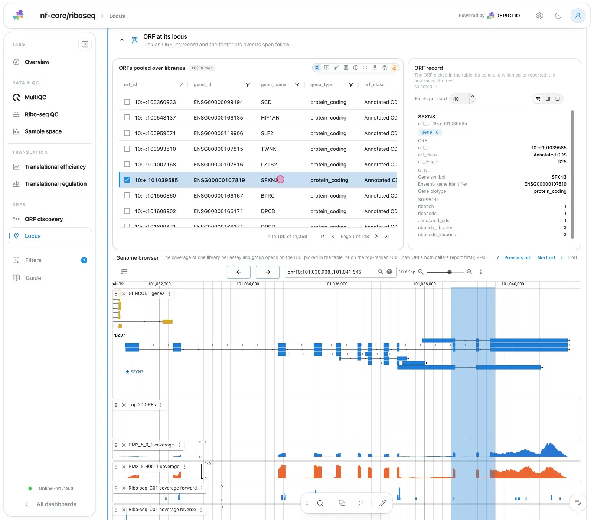
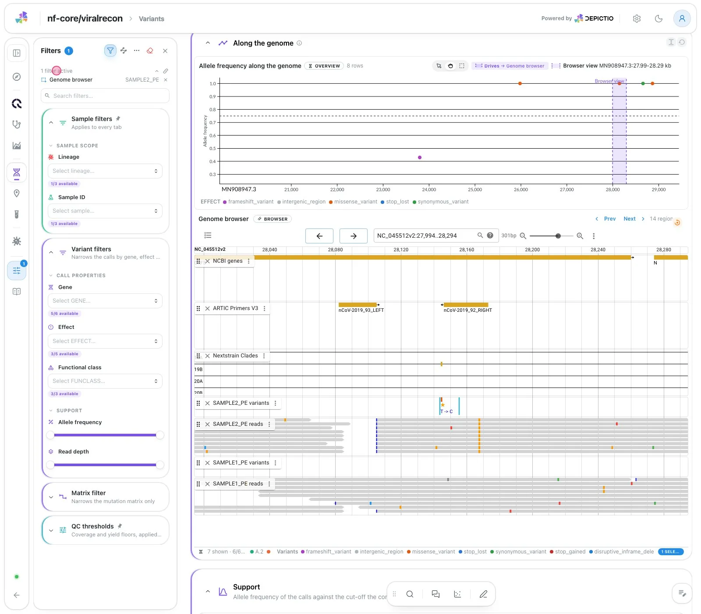
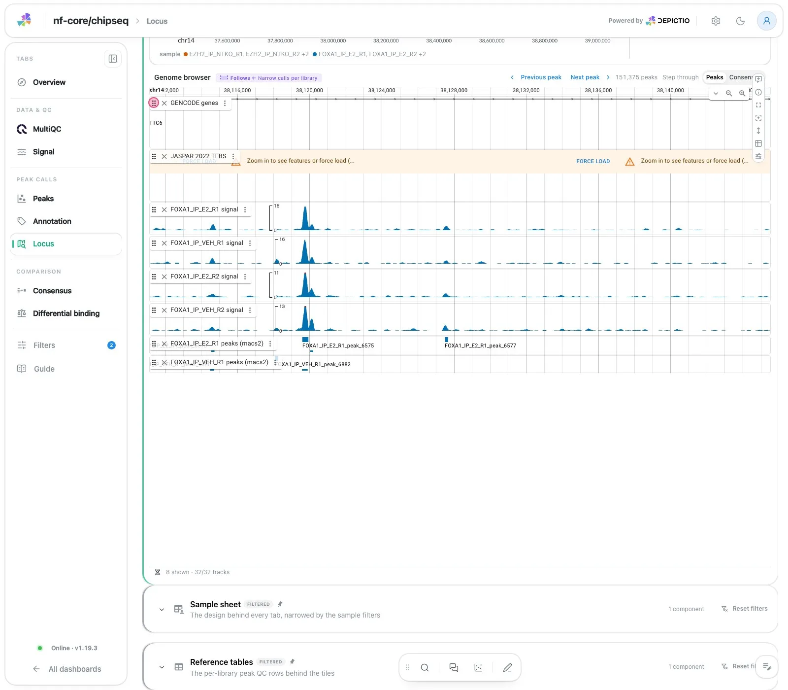
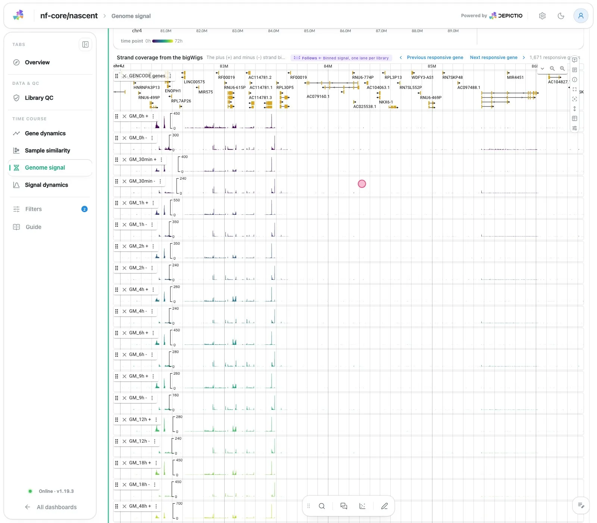
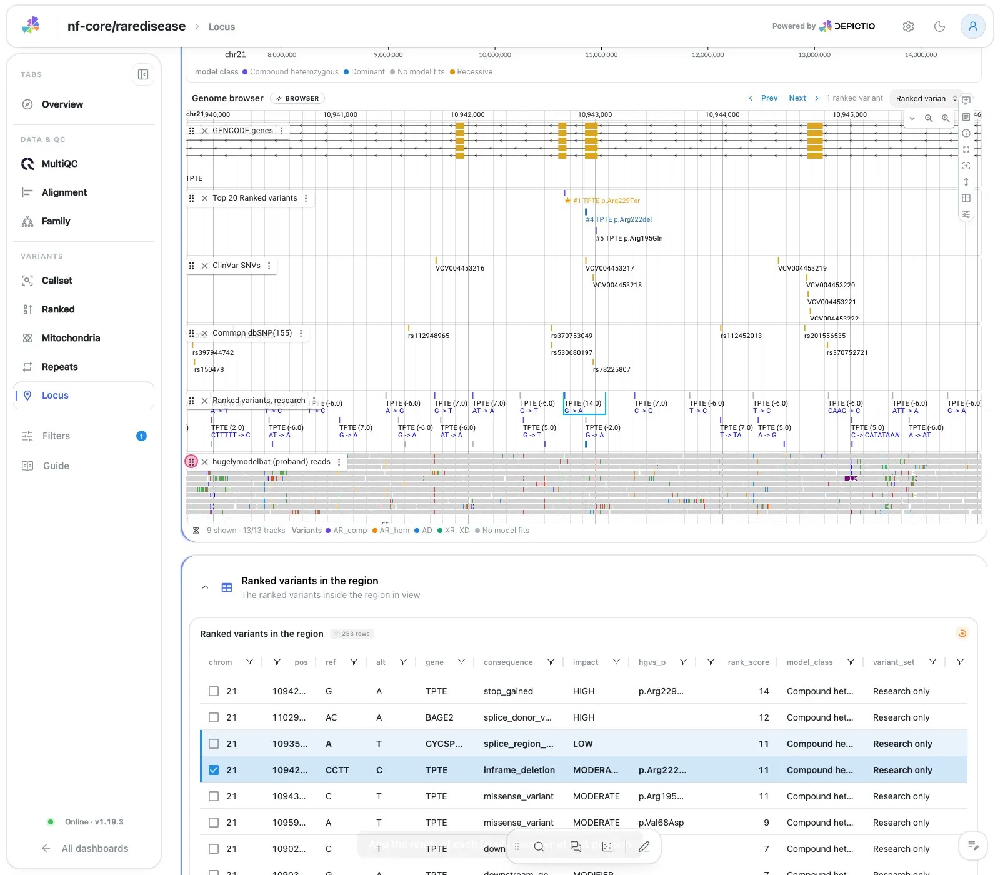
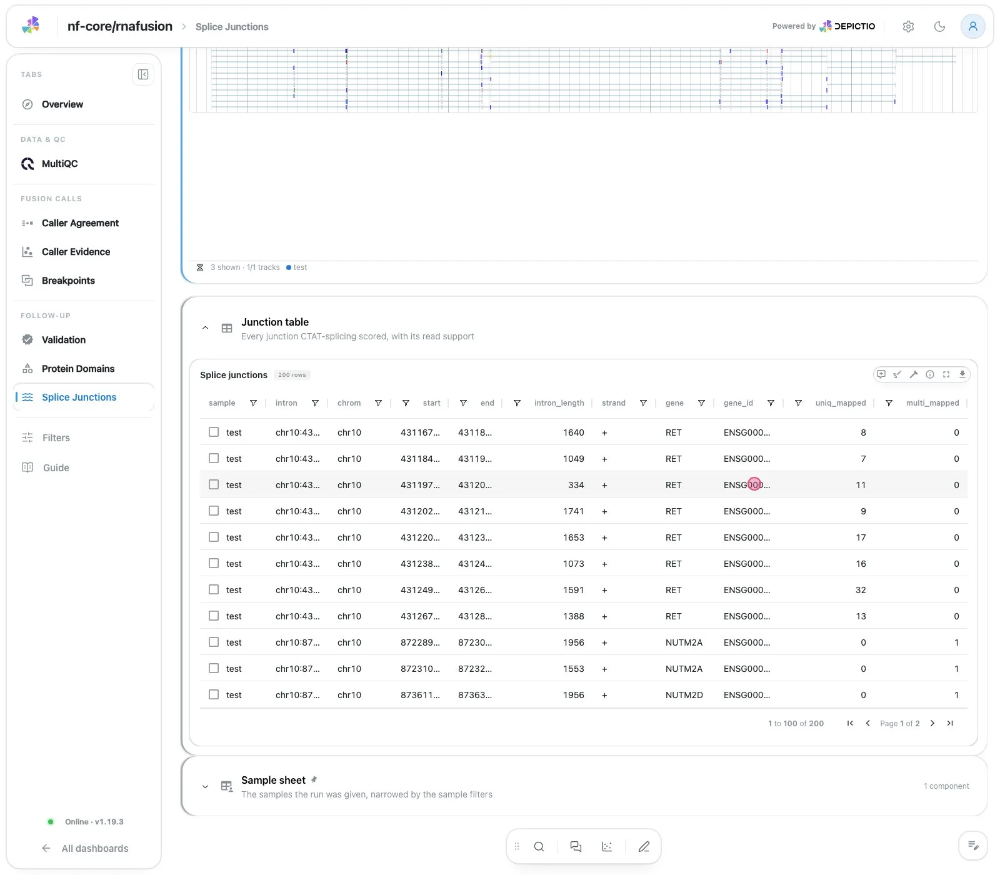
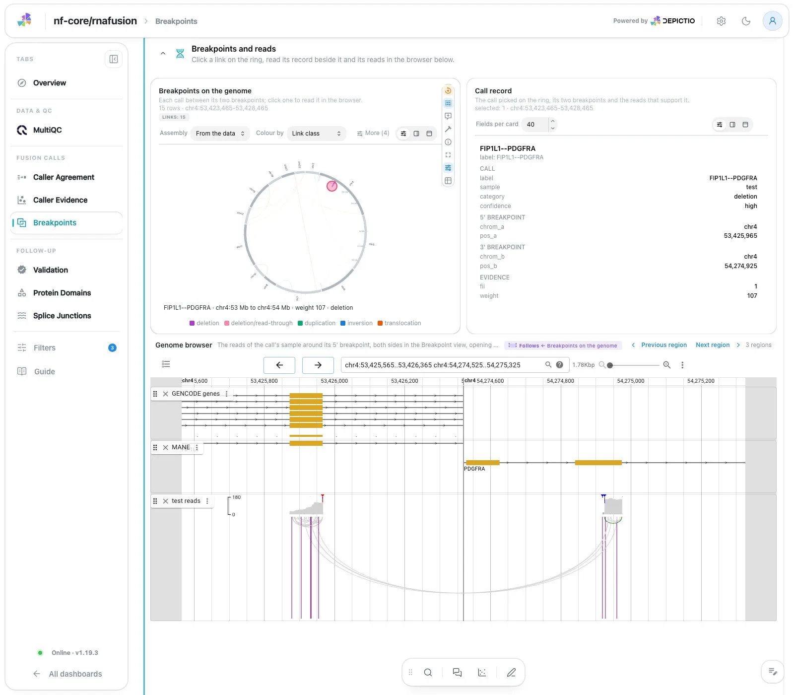
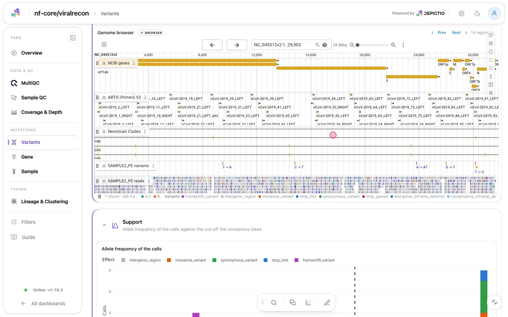

# :material-dna: Genome browser <small>(v1.20.0+)</small>

<figure markdown="span">
  <video autoplay controls muted loop playsinline poster="../../images/guides/genome-browser/table_to_browser.webp" src="../../images/guides/genome-browser/table_to_browser.mp4"></video>
  <figcaption>A row picked in a table: its record card and the genome browser follow (nf-core/riboseq dashboard template).</figcaption>
</figure>

The `jbrowse` component shows a run's coverage, peaks, variants and alignments in an embedded
[JBrowse 2](https://jbrowse.org) view. Dashboard filters pick the tracks and move the browser
to a picked row; a click on a feature filters the dashboard back. Nothing else has to run: the
track bytes come through the API, in `depictio local up`, Docker Compose and Kubernetes alike.

## GenomeSpy and JBrowse together

{ loading=lazy }
{ loading=lazy }

nf-core/chipseq, Locus tab: the lanes above are a `genome_view` tile (GenomeSpy), one dot per call on chr14:37.0-39.5 Mb, with the browser's window as a band. The `jbrowse` component below is open on that band.

{ loading=lazy }
{ loading=lazy }

The lanes show every library's calls along the chromosome; the browser shows the tracks of one region. Each drives the other:

- **Lanes to browser**: brush a region on the lanes and the browser opens on it. The browser does not filter on the region, so every track stays open ([Navigator](navigator.md)).
- **Browser to lanes**: the browser's window is drawn as a band on every lane.
- **Browser to dashboard**: a click on a feature filters the dashboard on its track's sample, and the lanes keep that sample's calls ([Browser to dashboard](browser-to-dashboard.md)).
- **Dashboard to browser**: filters pick the tracks, and a picked row moves the browser ([Table to browser](table-to-browser.md)).

Both can share one colour ramp, so a time course reads the same on the lanes and on the tracks ([Time course](time-course.md)).

## Examples

Each example opens its own page: the clip, what it shows, and the few lines of YAML behind it.

<div class="grid cards" markdown>

-   [{ .off-glb }](table-to-browser.md)

    **[Table to browser](table-to-browser.md)**

    A row picked in a table frames the browser on it.

-   [{ .off-glb }](browser-to-dashboard.md)

    **[Browser to dashboard](browser-to-dashboard.md)**

    A click on a feature filters the dashboard on its sample.

-   [{ .off-glb }](navigator.md)

    **[Navigator](navigator.md)**

    Brush a region on GenomeSpy lanes; the browser opens on it.

-   [{ .off-glb }](time-course.md)

    **[Time course](time-course.md)**

    One colour ramp from the earliest library to the latest.

-   [{ .off-glb }](ranked-calls.md)

    **[Ranked calls](ranked-calls.md)**

    A numbered track of the best calls, picked and zoomed.

-   [{ .off-glb }](sashimi.md)

    **[Sashimi](sashimi.md)**

    Splice junctions as arcs over RNA coverage.

-   [{ .off-glb }](breakpoints.md)

    **[Breakpoints](breakpoints.md)**

    Both sides of a call, the breakpoint view and the circular view.

-   [{ .off-glb }](ucsc-tracks.md)

    **[UCSC tracks](ucsc-tracks.md)**

    Tracks of the UCSC catalogue next to the run's own.

-   :material-palette:{ .lg .middle }

    **[Variant colours](variant-colours.md)**

    Variants coloured by a category of the dashboard.

-   :material-code-braces:{ .lg .middle }

    **[Raw JBrowse configuration](raw-jbrowse.md)**

    Any JBrowse setting or track, merged last.

</div>

---

## How it works

<figure markdown="span">
  
  <figcaption><strong>Two inputs.</strong> The collection's rows say which tracks open; the files reach the browser through the API.</figcaption>
</figure>

---

## Quick start

A tracks manifest, one row per file, declared as a `genomic_tracks` collection of the
project, and a `jbrowse` component on the dashboard:

=== "tracks.tsv"

    ```text
    track_id    sample  format  uri
    S1.cov      S1      bigwig  coverage/S1.bigWig
    S1.reads    S1      bam     bam/S1.sorted.bam
    S2.cov      S2      bigwig  coverage/S2.bigWig
    ```

=== "project.yaml"

    ```yaml
    - data_collection_tag: tracks
      config:
        type: genomic_tracks
        metatype: Metadata
        scan: {mode: single, scan_parameters: {filename: tracks.tsv}}
        dc_specific_properties:
          format: TSV
          polars_kwargs: {separator: "\t"}
          sample_column: sample
          assembly: hg38
    ```

=== "dashboard.yaml"

    ```yaml
    - component_type: jbrowse
      workflow_tag: my_workflow
      data_collection_tag: tracks
      title: Genome browser
    ```

The manifest is found like any table: by the collection's `scan`, in the workflow's data
location, next to the run's results. Its relative paths are read from the manifest's own folder
(`tracks_base_path` sets another one). In the nf-core dashboard templates, a recipe writes the
manifest from the files the run published, so there is no file to write.

---

## The `genomic_tracks` collection

| Key | Default | Meaning |
|-----|---------|---------|
| `uri_column` | `uri` | A relative path, or an `s3://` or `https://` URI |
| `sample_column` | | The column tracks are filtered and selected on |
| `format_column` | `format` | The format, else inferred from the extension |
| `index_column` | `index_uri` | The index, else the `.tbi`, `.csi`, `.bai` or `.crai` next to the file |
| `track_id_column`, `name_column`, `color_column`, `category_column`, `order_column` | | Track id, label, colour, folder, opening order |
| `assembly` | `hg38` | A [built-in assembly](#assemblies) or a custom one |
| `tracks_base_path` | the manifest's folder | Where relative paths are uploaded from |
| `remote_base_uri` | | Where relative paths are read in place instead |
| `direct_access` | `false` | Let the browser fetch `https://` tracks itself |
| `display_defaults`, `presets` | | JBrowse configuration per format, and named fragments for `preset` |

**Formats:** `bigwig`, `bedgraph`, `bed`, `bigbed`, `narrowpeak`, `broadpeak`, `vcf`, `bam`,
`cram`, `gff3`, `gtf`, `hic`, `fasta`. Tabix formats need a `.tbi` or `.csi` index.

### Internal and external tracks

| Track | Manifest `uri` | Collection key | Read by |
|-------|----------------|----------------|---------|
| Internal | relative path | | the API, from depictio's storage, after an upload at ingestion |
| External, in place | relative path, or absolute `s3://` / `https://` | `remote_base_uri` for relative paths | the API, from an allow-listed host or bucket |
| External, from the browser | `https://` | `direct_access: true` | the browser (the host must send CORS headers) |

=== "Internal"

    Nothing to set: at ingestion each file is uploaded with its index under the collection's
    `genomic_tracks/<dc_id>/` folder, and removed with the collection or the project.

=== "External, in place"

    ```yaml
    dc_specific_properties:
      remote_base_uri: s3://my-results/run-42/   # or https://data.example.org/run-42/
    ```

    The server reads only what the administrator allows:

    ```bash
    DEPICTIO_JBROWSE_REMOTE_S3_BUCKETS=my-results
    DEPICTIO_JBROWSE_REMOTE_HTTPS_HOSTS=data.example.org
    # a private bucket, or one outside AWS
    DEPICTIO_JBROWSE_REMOTE_S3_ENDPOINT_URL=https://s3.example.org
    DEPICTIO_JBROWSE_REMOTE_S3_ACCESS_KEY=...
    DEPICTIO_JBROWSE_REMOTE_S3_SECRET_KEY=...
    ```

    The nf-core templates take the run's results folder as a variable:
    `depictio run --var TRACKS_URI=s3://<bucket>/<run>/results/`.

=== "External, from the browser"

    ```yaml
    dc_specific_properties:
      remote_base_uri: https://data.example.org/run-42/
      direct_access: true
    ```

    The host must answer cross-origin range requests, and the instance's Content Security
    Policy must allow it (by default only depictio itself and UCSC's download server).

### Assemblies

| Assembly | Organism | Aliases | Gene track |
|----------|----------|---------|------------|
| `hg38` | Human | `GRCh38` | GENCODE |
| `hg19` | Human | `GRCh37` | GENCODE |
| `hs1` | Human T2T | `T2T-CHM13v2.0`, `CHM13` | NCBI RefSeq |
| `mm10` | Mouse | `GRCm38` | GENCODE |
| `mm39` | Mouse | `GRCm39` | NCBI RefSeq |
| `danRer11` | Zebrafish | `GRCz11` | NCBI RefSeq |
| `dm6` | Fly | `BDGP6` | NCBI RefSeq |
| `ce11` | Worm | `WBcel235` | NCBI RefSeq |
| `sacCer3` | Yeast | `R64`, `R64-1-1` | NCBI RefSeq |
| `TAIR10` | Arabidopsis | `araTha1` | NCBI RefSeq |
| `wuhCor1` | SARS-CoV-2 | `MN908947.3`, `NC_045512.2` | NCBI genes |

These are presets: the sequence, chromosome sizes, chromosome aliases and gene track of each
are already wired to UCSC's files, and gene search works on them. The list covers the genomes
of the nf-core test datasets; it is not a limit. Any other genome is a custom assembly of three
URLs, and UCSC's [GenArk](https://hgdownload.soe.ucsc.edu/hubs/) hubs publish them for
thousands of assemblies:

```yaml
assembly:
  name: MN908947.3
  aliases: [NC_045512.2]
  twobit_uri: https://hgdownload.soe.ucsc.edu/goldenPath/wuhCor1/bigZips/wuhCor1.2bit
  chrom_sizes_uri: https://hgdownload.soe.ucsc.edu/goldenPath/wuhCor1/bigZips/wuhCor1.chrom.sizes
  refname_aliases_uri: https://hgdownload.soe.ucsc.edu/goldenPath/wuhCor1/bigZips/wuhCor1.chromAlias.txt
```

A custom assembly has no gene search; type a locus instead.

---

## The `jbrowse` component

| Key | What it does |
|-----|--------------|
| `track_mode`, `max_tracks`, `initial_tracks` | Open the filtered tracks (or `all`), and how many |
| `initial_categories`, `default_tracks` | Open on these track categories, or always show these tracks |
| `location` | The opening locus, or a gene name |
| `locus_from` | Follow the filtered rows of another collection |
| `selection_enabled`, `selection_column`, `selection_mode` | Filter the dashboard from the browser |
| `color_by`, `color_scale`, `variant_color_by` | Colour tracks by a column, along a ramp, or variants by a category |
| `ucsc_tracks`, `show_annotation` | UCSC Genome Browser tracks, the assembly's gene track |
| `show_junctions`, `read_pairs_display` | Sashimi arcs; DNA reads as pileup, arcs or cloud |
| `views` | `breakpoint` and `circular` views |
| `display`, `preset`, `config_overrides` | Display defaults, a configuration preset, raw JBrowse configuration |
| `fetch_size_limit_mb`, `force_load` | The per-track download limit, lifted or not |
| `placement` | `grid`, or `floating` to keep the browser on screen across tabs |

The component builder has a *Genome browser* type with the same settings.

---

## Versions and security

- A [version](../versioning.md) preview or a dataset pin reads the manifest at its pinned commit.
  The track files are not versioned.
- The browser never receives a storage URL or credentials: tracks come through signed proxy
  URLs (6 hours), the proxy re-checks read access, and clients name tracks by id, never by URL.
- External files are read only from allow-listed hosts and buckets; `http://` is refused and
  redirects are not followed.
- `DEPICTIO_JBROWSE_ENABLED=false` turns the browser off. Every `DEPICTIO_JBROWSE_*` variable
  is in the [environment reference](../../installation/env-reference.md).

---

## Templates with a genome browser

| Dashboard template | Tab |
|--------------------|-----|
| [nf-core/atacseq](../../pipeline-templates/nf-core/atacseq.md) 1.2.2, 2.1.2 | Locus |
| [nf-core/chipseq](../../pipeline-templates/nf-core/chipseq.md) 1.2.0, 2.1.0 | Locus |
| [nf-core/cutandrun](../../pipeline-templates/nf-core/cutandrun.md) 3.1, 3.2.2 | Locus |
| nf-core/drop 1.0.0 | Locus |
| [nf-core/nanoseq](../../pipeline-templates/nf-core/nanoseq.md) 3.0.0 | Locus |
| nf-core/nascent 2.3.0 | Genome signal |
| [nf-core/oncoanalyser](../../pipeline-templates/nf-core/oncoanalyser.md) 3.0.0 | Small variants, Structural variants |
| nf-core/raredisease 3.1.2 | Locus |
| [nf-core/riboseq](../../pipeline-templates/nf-core/riboseq.md) 2.0.0 | Locus |
| [nf-core/rnafusion](../../pipeline-templates/nf-core/rnafusion.md) 4.1.3 | Breakpoints, Splice Junctions |
| [nf-core/rnaseq](../../pipeline-templates/nf-core/rnaseq.md) 3.26.0 | Gene Explorer |
| [nf-core/rnasplice](../../pipeline-templates/nf-core/rnasplice.md) 1.0.4 | Splicing Events |
| nf-core/rnavar 1.3.0 | Genome |
| [nf-core/sarek](../../pipeline-templates/nf-core/sarek.md) 3.10.0, 3.11.0 | Locus |
| [nf-core/variantbenchmarking](../../pipeline-templates/nf-core/variantbenchmarking.md) 1.4.0 | Germline, Structural & CNV |
| [nf-core/viralrecon](../../pipeline-templates/nf-core/viralrecon.md) 3.0.0 | Variants |

## Limits

- Track data is parsed on the page's main thread: fine for tens of open tracks. A view carries
  at most 500.
- Large unindexed BED and bedGraph files are refused: `bgzip` and `tabix` them.
- No browser in the nf-core/methylseq template (unindexed bedGraphs) or nf-core/hic (a `.hic`
  map needs a Hi-C display).
