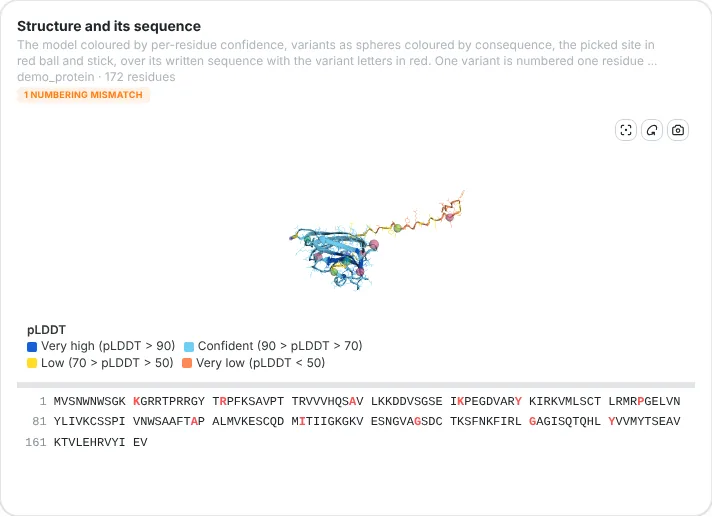
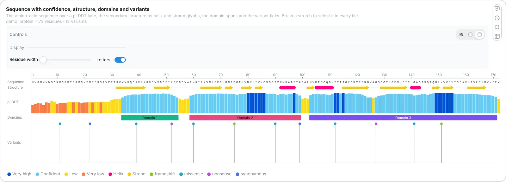
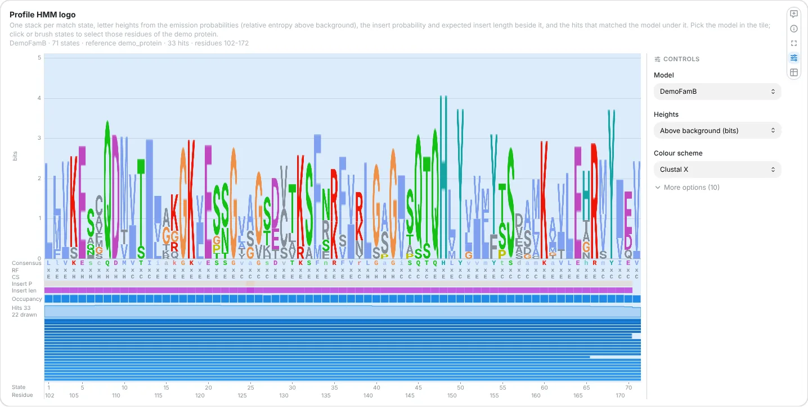
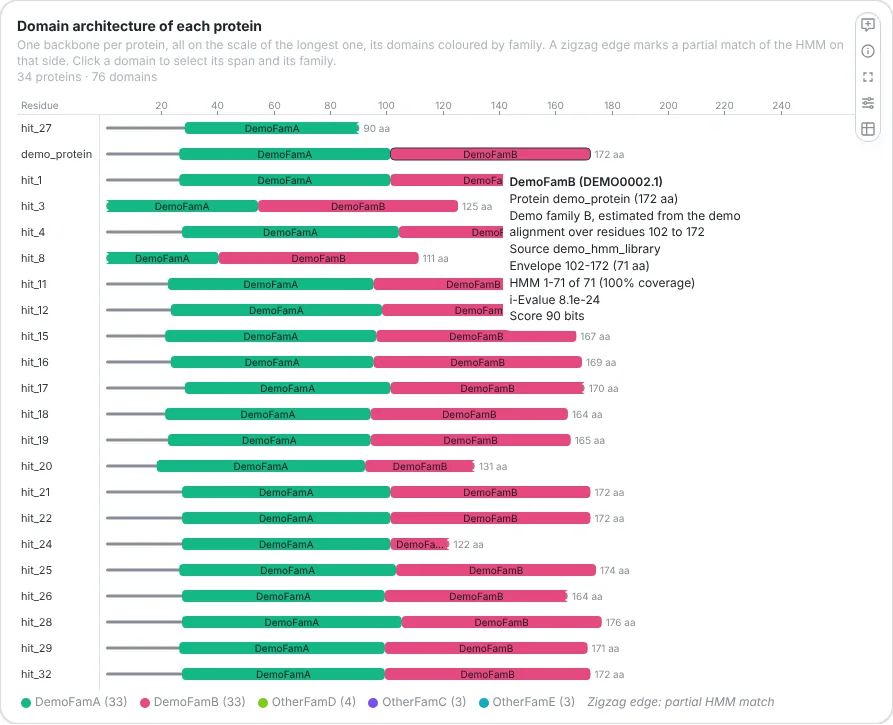
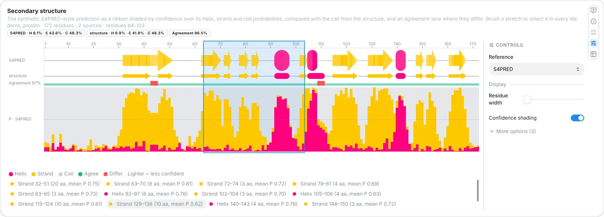
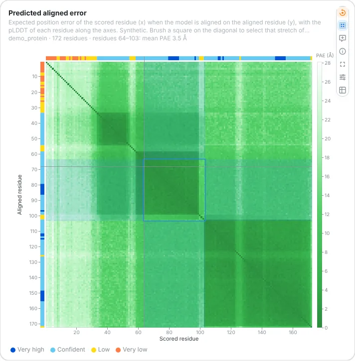
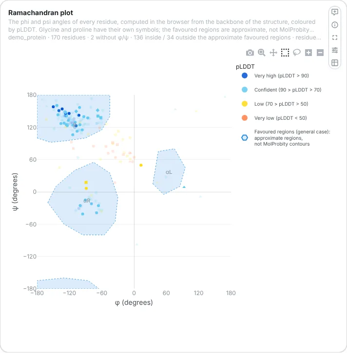
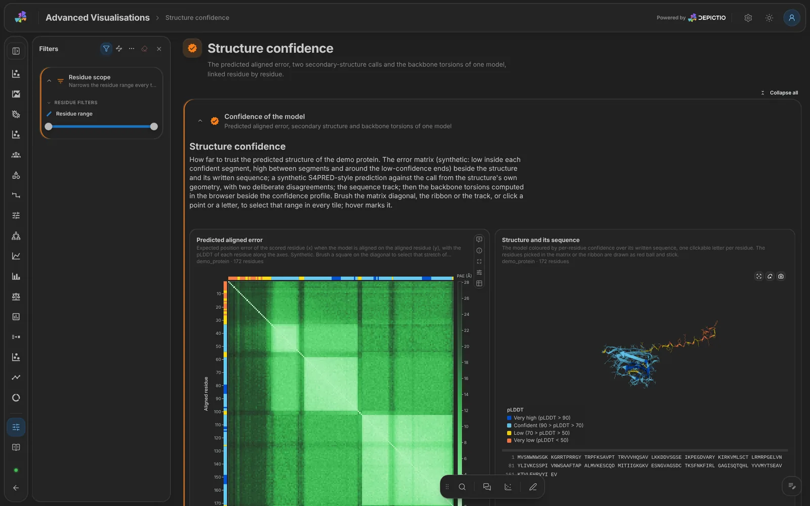

# :material-molecule: Protein tiles <small>(v1.19.0+)</small>

Structure prediction, protein annotation and protein family pipelines publish a 3D model, the
alignment behind it and per-residue facts (confidence, secondary structure, domains,
variants). Eight [advanced visualization](components.md#advanced-visualizations) kinds draw
them, and stay linked: pick a residue in any of them and every tile moves to it, point at a
residue and every tile marks it.

| Kind | Shows |
|------|-------|
| [`molecule_3d`](#molecule-3d) | The 3D model, coloured by confidence, chain, value or structure, with variants as spheres |
| [`msa`](#msa) | A multiple sequence alignment with consensus and conservation |
| [`sequence_track`](#sequence-track) | The sequence on a ruler, with a value lane, secondary structure, domains and variants |
| [`hmm_logo`](#hmm-logo) | The logo of a profile HMM, and where the hits of a search land on it |
| [`domain_architecture`](#domain-architecture) | The domains of many proteins, one row each, or grouped by architecture |
| [`secondary_structure`](#secondary-structure) | Helices, strands and coil with the probabilities behind them, sources compared |
| [`pae_matrix`](#pae-matrix) | The predicted aligned error of a model, as AlphaFold DB draws it |
| [`ramachandran`](#ramachandran) | The backbone torsions of the model, a quality check computed in the browser |

The nf-core [proteinfamilies](../pipeline-templates/nf-core/proteinfamilies.md),
[proteinannotator](../pipeline-templates/nf-core/proteinannotator.md) and
[proteinfold](../pipeline-templates/nf-core/proteinfold.md) templates are built on them, and
[sarek](../pipeline-templates/nf-core/sarek.md) and
[oncoanalyser](../pipeline-templates/nf-core/oncoanalyser.md) draw coding variants on a
predicted structure.

<figure markdown="span">
  {target=_blank}
  <figcaption><strong>Linked by residue.</strong> A pick is a filter, a hover is not. The model is read from the run, or fetched by the resolver when a server turns it on.</figcaption>
</figure>

---

## The data

Every tile reads tables joined on two column names, `entity` (which protein) and `position`
(the 1-based residue number in the structure's numbering). Nothing else links them: a pick
travels between tiles because their collections carry those names.

| Input | Shape |
|-------|-------|
| Structure files | An `indexed_file` collection with `format: pdb` or `mmcif` (`.pdb`, `.ent`, `.cif`, `.mmcif`, gzipped or not), one file per entity, named so that the scan's sample id equals the `entity` value. Predictors write pLDDT into the B-factor column |
| Residue table | `entity`, `position`, and optionally `chain`, `residue`, `value` (pLDDT, conservation), `category` |
| Variants | `entity`, `position`, `ref_aa`, `alt_aa`, a consequence and a label column |
| Domains | `entity`, `start`, `end`, `label`, optionally `source` |
| Alignment | `msa_id` (equal to the `entity` it aligns), `seq_id`, `rank` (0 is the query), `aligned_sequence` |
| PAE files | An `indexed_file` collection with `format: pae` (`.pae.tsv`, `.pae.json`): proteinfold's TSV, AlphaFold DB or ColabFold JSON |

The recipe helpers in `depictio/recipes/lib/` (`protein_structure`, `msa`, `hmm`,
`secondary_structure`, `pae`) build these tables from PDB, A3M, Stockholm, HMMER and S4PRED
outputs. See [Recipes](../usage/projects/recipes.md).

---

## The tiles

Each tile shows one entity at a time: the one the dashboard's filters name, else the reader's
pick in the tile, else the first. Every setting below is a key of the component's `config`.

### 3D structure { #molecule-3d }

A [3Dmol.js](https://3dmol.csb.pitt.edu/){ target="_blank" } view of the model, loaded only
when a 3D tile is on the page. A click picks a residue, shift-click a range.

{target=_blank}

| Setting | Default | What it does |
|---------|---------|--------------|
| `structure_source` | `file` | `file` reads `structure_dc_tag`; `resolve` asks the [resolver](#structure-resolver) with `uniprot_col`, `gene_col` (and `taxon`) or `sequence_col` |
| `color_mode` | `plddt` | Also `chain`, `spectrum`, `value`, `category`, `secondary_structure`, `residue_type`, `hydrophobicity`, `uniform` |
| `representations` | cartoon | Any of `cartoon`, `trace`, `stick`, `sphere`, `surface`, combined |
| `layout` | `structure` | `structure_sequence`, `structure_msa` (needs `msa_dc_tag`) or `structure_text`: a second panel in the same tile |
| `show_variants` | `true` | Variants of the bound table as spheres. A variant whose `ref_aa` disagrees with the model is listed, not drawn ([numbering mismatch](#numbering-mismatch)) |

### Alignment { #msa }

One alignment at a time, with consensus and conservation rows. A row click selects that
sequence; a column brush picks residues in the query's numbering.
Settings: `color_scheme` (`clustal`, `zappo`, `hydrophobicity`, `identity`, `none`),
`max_rows` (200), `sort_by` (`rank`, `identity`, `input`).

### Sequence track { #sequence-track }

The sequence on a ruler, with a value lane (pLDDT in AlphaFold's confidence bands when the
label says so), secondary-structure glyphs, domain spans (`domains_dc_tag`) and variant
lollipops (`variants_dc_tag`). A complex gets one strip per chain, *All chains* by default.
**Residue width** sets the zoom; Ctrl or Cmd and the wheel too.

{target=_blank}

### HMM logo { #hmm-logo }

The logo of a profile HMM, with HMMER and Skylign semantics: a stack of letters per match
state, the insert and occupancy lanes under it and, with `hits_dc_tag`, where the hits of an
`hmmsearch` land on the model. A brush on states picks the reference's residues; a click on a
hit picks its residues on its own protein.

{target=_blank}

| Setting | Default | What it does |
|---------|---------|--------------|
| `height_mode` | `relent_abovebg` | Also `relent_all` or `probability` |
| `window_start`, `window_end` | none | Opens on a window of states |
| `collapse_below_ic` | none | Folds runs of at least `collapse_min_run` (4) states below that information, in bits |
| `hidden_tracks`, `collapsed_tracks` | `[]` | Any of `consensus`, `insert`, `occupancy`, `hits`, `ruler` |
| `hits_evalue_max`, `max_hits` | `0.01`, `200` | Which hits are drawn |

### Domain architecture { #domain-architecture }

One row per protein, its length as a backbone and its domains as shapes coloured by family. A
partial match has a zigzag edge, as Pfam draws it. `view: architectures` groups the proteins
by their ordered set of domains. A click on a domain picks its span and selects its family.

{target=_blank}

Settings: `view` (`proteins`, `architectures`), `color_by` (`label`, `source`),
`scale` (`shared`, `per_protein`), `residue_width`, `evalue_threshold`, `sources`,
`partial_coverage` (0.9), `selection_column`. The label column can be resized by dragging.

### Secondary structure { #secondary-structure }

Helices, strands and coil as a topology ribbon, the S4PRED probabilities behind the call, the
agreement between several sources (`source_col`, `reference_source`), the composition and the
list of segments.

{target=_blank}

Settings: `show_probabilities`, `show_agreement`, `show_segments`, `show_composition`,
`shade_confidence`, `show_coil_segments`, `ribbon_height`, `min_segment_length`,
`state_colors`, `residue_width`.

### Predicted aligned error { #pae-matrix }

The N × N matrix of a model's predicted aligned error, with pLDDT strips. A low-error block on
the diagonal is a confident domain; off the diagonal, a confident placement of two domains or
chains. The matrix is a file, bound with `pae_dc_tag`. A diagonal or rectangle brush
(`brush`) picks the scored range.

{target=_blank}

### Ramachandran { #ramachandran }

The phi and psi torsions of the model, computed in the browser from its backbone, from the
same file as the 3D tile. The favoured regions are drawn as a guide, not as MolProbity
contours. Settings: `structure_source` as on the 3D tile, `color_mode` (`plddt`,
`residue_class`, `secondary_structure`, `value`, `category`, `chain`), `show_regions`,
`residue_classes`, `marker_size`. A click, a box or a lasso picks residues.

{target=_blank}

---

## Linked by residue { #residue-selection }

**A pick is a filter.** A click or brush in any protein tile emits a `residue_selection`: the
entity, a `position` range and, on a complex, the chain. They are ordinary column filters, so
every table with those columns narrows, and every protein tile shows the range: the 3D tile
rings it and zooms to it (`follow_selection`), the alignment shades its columns, the logo its
states, the PAE matrix its band. The **last gesture wins**: a new pick replaces the previous
one, whichever tile made it, with the selection that came with it.

A [lollipop](components.md#lollipop) joins with `selection_enabled: true`, and a `profile`
with `residue_axis` shades the range and marks the hovered residue. Cards, figures that do not
draw the position column and the option lists of filters ignore a residue range, as they
ignore a [genome region](interactive-selection-filtering.md#region-scope); a card opts in
with `follow_region_filter: true`.

**A hover is not.** Pointing at a residue publishes it in the browser, once per frame, and
every protein tile marks it. Nothing is fetched again.

---

## Where the structure comes from { #structure-resolver }

`structure_source: file` reads the run's own structure files and needs no outbound call.

`structure_source: resolve` asks the server for a model when the run published none, by
UniProt accession, by gene and taxon, or by sequence. The **structure resolver** is off until
`DEPICTIO_STRUCTURE_RESOLVER_ENABLED=true`. It tries, first hit wins:

1. its cache in the instance bucket;
2. AlphaFold DB, by accession;
3. UniProt, gene and taxon to an accession, then AlphaFold DB;
4. ESMFold, which folds a sequence of at most 400 residues.

AlphaFold DB has no model for proteins longer than about 2,700 residues. The tile names the
service it used, with a *Technical details* section, and credits the model
(*AlphaFold DB, CC-BY 4.0* or *ESMFold*). See
[External structure services](security.md#structure-resolver) for what leaves the server,
and the [environment reference](../installation/env-reference.md#structure-resolver) for the
settings. `depictio local up` passes the `DEPICTIO_STRUCTURE_RESOLVER_*` variables of your
shell through.

A `pae_matrix` has no resolver path: a model fetched by the resolver comes without its error
matrix.

---

## Numbering mismatch { #numbering-mismatch }

A variant table and a structure do not always number residues alike (a construct, an
isoform, an off-by-one). A variant whose `ref_aa` disagrees with the model's residue is not
drawn but listed under a *numbering mismatch* badge, with the residue the model has there; a
variant past the end of a truncated model is counted under *outside the model*. Drawing a
variant on the wrong residue would be worse than not drawing it.

{target=_blank}

<small>The *Structure confidence* tab of the advanced visualization showcase, dark mode.</small>
