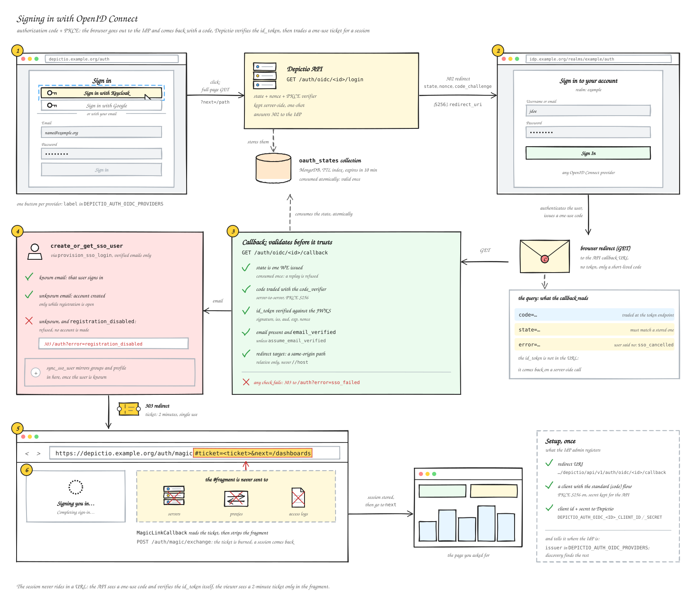
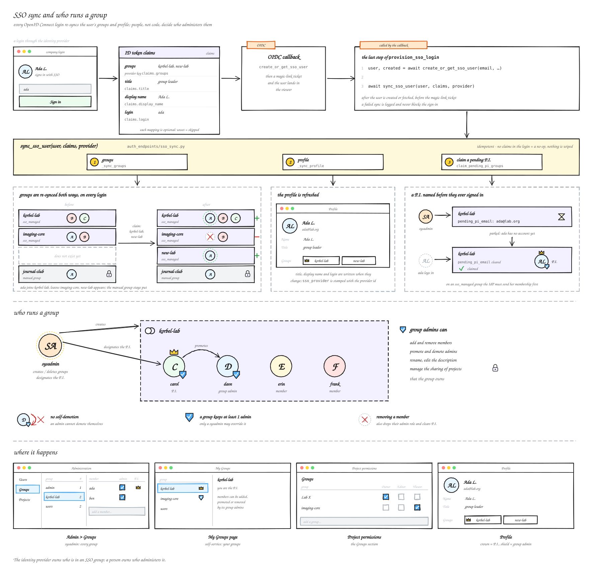

# :material-shield-key-outline: Single sign-on (OpenID Connect)

Depictio can send its users to an identity provider (IdP) and take them back signed in.
It speaks **OpenID Connect (OIDC)**, so any compliant provider works: Keycloak, Google,
Microsoft Entra ID, Authentik, Okta, GitLab and so on. You can declare several providers at
once; the sign-in page then shows one button per provider, next to password sign-in.

OIDC is off until you declare a provider in `DEPICTIO_AUTH_OIDC_PROVIDERS`.

!!! info "Replaces SAML and the Google-specific sign-in"
    OpenID Connect replaces both the SAML 2.0 sign-in and the dedicated Google OAuth sign-in
    ([depictio#1336](https://github.com/depictio/depictio/issues/1336)). Existing users keep
    their accounts. Coming from either one? Jump to
    [From SAML to OIDC](#from-saml-to-oidc) or
    [From Google OAuth to OIDC](#from-google-oauth-to-oidc).

<figure markdown="span">
  [](../images/guides/sso/schema_oidc_login.svg){target=_blank}
  <figcaption><strong>Signing in with OpenID Connect.</strong> The IdP's answer is checked against a login this instance started, then traded for a single-use ticket: no token ever travels in a query string.</figcaption>
</figure>

---

## How it works { #how-it-works }

Depictio uses the **authorization code flow with PKCE**:

1. The sign-in page lists the enabled providers (`GET /depictio/api/v1/auth/oidc/providers`).
   A click is a full-page navigation to `/depictio/api/v1/auth/oidc/<id>/login`.
2. The API creates a random `state`, a `nonce` and a PKCE `code_verifier`, stores them
   **server-side** in the `oauth_states` collection (valid for 10 minutes), and answers
   `302` to the IdP's authorization endpoint with the `state`, the `nonce` and the
   `S256` code challenge.
3. The user authenticates at the IdP, which redirects the browser to the API callback,
   `/depictio/api/v1/auth/oidc/<id>/callback?code=…&state=…`.
4. The API **consumes the state atomically** (a replayed callback finds nothing), exchanges
   the code at the token endpoint together with the `code_verifier`, and verifies the
   returned `id_token`.
5. The browser is redirected to the viewer with a single-use ticket in the URL fragment
   (`/auth/magic#ticket=…`), which the viewer redeems for a session.

### What is verified { #what-is-verified }

| Check | Detail |
|-------|--------|
| `state` | Issued by this instance for this provider, used once, not expired |
| Signature | The `id_token` is checked against the IdP's JWKS, discovered from its metadata. Keys are cached and re-fetched when the IdP rotates them |
| `iss` | Equals the issuer of the discovery document, which in turn must equal the configured `issuer` |
| `aud` | Contains this provider's `client_id` |
| `exp` / `iat` | Valid, with 60 seconds of clock-skew leeway |
| `nonce` | Equals the one stored for this login |
| Email | Present in the configured claim, and trusted only when `email_verified` is `true` (see [below](#email-and-accounts)) |
| Redirect target | The `next` path must be a same-origin path; anything else is replaced by the default landing page |

The redirect URI is **never** taken from the request: it comes from the configuration.

### One provisioning path { #provisioning }

Every OIDC login, whatever the provider, runs the same steps: the verified claims resolve
to an account, then groups and profile are mirrored from the claims
([group and profile sync](#group-and-profile-sync)), then the user gets a ticket for the
viewer. There is no provider-specific code path.

### Email and accounts { #email-and-accounts }

Accounts are matched **by email**. A user who signed in before through SAML, Google or a
password, with the same address, lands on the same account, with the same projects and
permissions. A new address creates an account, unless
[registration is closed](../usage/guides/authentication-modes.md#registration). A new
account has no project access until someone grants it.

The email is **trusted only when the provider says it is verified**: the `id_token` (or
userinfo) must carry `email_verified: true`. Otherwise anyone who could type your address
into a self-service IdP could take over your Depictio account. A login without a verified
email is refused with the error `email_not_verified`.

Some IdPs assert only verified emails but never send the claim. For those,
set `assume_email_verified: true` on the provider. Use it only when you control the IdP's
user directory and know it never holds unverified addresses (see the
[Entra ID recipe](#recipe-entra) for a typical case).

---

## Set it up { #set-it-up }

1. **Register Depictio at the IdP** as an OpenID Connect client (a "confidential" client
   using the authorization-code flow). Register this **redirect URI**:

    ```text
    https://<api-host>/depictio/api/v1/auth/oidc/<id>/callback
    ```

    `<api-host>` is the public host of the API (for example `depictio.example.org`), and
    `<id>` is the provider id you choose below. If you set a custom `redirect_uri` on the
    provider, register that value instead.

2. **Declare the provider** as a JSON list in `DEPICTIO_AUTH_OIDC_PROVIDERS`, and keep the
   credentials in their own variables:

    ```bash
    DEPICTIO_AUTH_OIDC_PROVIDERS='[
      {
        "id": "keycloak",
        "label": "Sign in with your institution",
        "issuer": "https://idp.example.org/realms/example"
      }
    ]'
    DEPICTIO_AUTH_OIDC_KEYCLOAK_CLIENT_ID=depictio
    DEPICTIO_AUTH_OIDC_KEYCLOAK_CLIENT_SECRET=change-me
    ```

3. **Restart the API.** The button appears on the sign-in page. A provider that is enabled
   but lacks an issuer (or discovery URL) or a client id or secret is logged as an error at
   startup and its button stays hidden.

!!! tip "Keep secrets out of the JSON"
    `client_id` and `client_secret` may sit in the provider object, but the variables
    `DEPICTIO_AUTH_OIDC_<ID>_CLIENT_ID` and `DEPICTIO_AUTH_OIDC_<ID>_CLIENT_SECRET` override
    them and are what you should use with Docker or Kubernetes secrets. `<ID>` is the
    provider id in upper case with `-` replaced by `_` (`my-idp` gives `MY_IDP`).

---

## Configuration reference { #configuration-reference }

### Environment variables { #environment-variables }

| Variable | Default | Description |
|----------|---------|-------------|
| `DEPICTIO_AUTH_OIDC_PROVIDERS` | _(empty)_ | JSON list of provider objects, see [provider keys](#provider-keys) |
| `DEPICTIO_AUTH_OIDC_<ID>_CLIENT_ID` | - | Client id of provider `<ID>`. Overrides `client_id` in the list |
| `DEPICTIO_AUTH_OIDC_<ID>_CLIENT_SECRET` | - | Client secret of provider `<ID>`. Overrides `client_secret` in the list |
| `DEPICTIO_AUTH_REGISTRATION_DISABLED` | `false` | SSO becomes login-only: see [Closed registration](#registration-closed) |
| `DEPICTIO_AUTH_PASSWORD_LOGIN_DISABLED` | `false` | SSO becomes the only way in: see [SSO-only mode](#sso-only) |
| `DEPICTIO_VIEWER_PUBLIC_URL` | - | Public URL of the viewer, where the ticket hand-off and error redirects land |

The deprecated `DEPICTIO_AUTH_GOOGLE_OAUTH_*` variables are described in
[From Google OAuth to OIDC](#from-google-oauth-to-oidc). The full variable list is in the
[Environment Reference](env-reference.md#authentication).

### Provider keys { #provider-keys }

Each object of `DEPICTIO_AUTH_OIDC_PROVIDERS` accepts these keys. Unknown keys are rejected.

| Key | Default | Description |
|-----|---------|-------------|
| `id` | _(required)_ | Stable identifier, used in URLs and in the credential variable names. Lower case, `[a-z0-9][a-z0-9_-]{0,31}` |
| `label` | `Sign in with <id>` | Text of the sign-in button |
| `enabled` | `true` | Set `false` to hide a provider without deleting it |
| `issuer` | - | Expected issuer, for example `https://idp.example.org/realms/example`. Discovery defaults to `<issuer>/.well-known/openid-configuration`, and the document's `issuer` must equal this value |
| `discovery_url` | - | Explicit discovery document URL, overriding the default derived from `issuer` |
| `client_id` | - | Client id. Prefer `DEPICTIO_AUTH_OIDC_<ID>_CLIENT_ID` |
| `client_secret` | - | Client secret. Prefer `DEPICTIO_AUTH_OIDC_<ID>_CLIENT_SECRET` |
| `scopes` | `["openid", "email", "profile"]` | A list or a space-separated string. `openid` is always added |
| `redirect_uri` | `<API external URL>/depictio/api/v1/auth/oidc/<id>/callback` | Callback registered at the IdP. Never read from the request |
| `claims` | see [Claim mapping](#claim-mapping) | Which claims feed the account |
| `sso_provider` | the `id` | Value stored on the user as `sso_provider` |
| `assume_email_verified` | `false` | Trust the email even without `email_verified: true`. See [Email and accounts](#email-and-accounts) |
| `token_endpoint_auth_method` | `client_secret_basic` | How the client authenticates at the token endpoint: `client_secret_basic`, `client_secret_post`, or `none` for a public client protected by PKCE alone |
| `authorize_params` | `{}` | Extra parameters added to the authorization request, for example `{"prompt": "select_account", "hd": "example.org"}` |
| `fetch_userinfo` | `true` | Also call the userinfo endpoint and merge its claims **under** the `id_token` claims, only when its `sub` matches |

At least one of `issuer` or `discovery_url` is required, plus a client id and, unless
`token_endpoint_auth_method` is `none`, a client secret.

### Claim mapping { #claim-mapping }

`claims` maps Depictio's fields to the **names of claims** the IdP sends:

| Key | Default | Feeds |
|-----|---------|-------|
| `email` | `email` | The account email (the matching key) |
| `groups` | _(unset)_ | SSO-managed [groups](../usage/administration/groups.md) |
| `display_name` | _(unset)_ | The display name, for example `name` |
| `login` | _(unset)_ | The login, for example `preferred_username` |
| `title` | _(unset)_ | The title shown in Account settings |
| `picture` | `picture` | The profile picture (an `https://` URL), unless the user uploaded one |

- A claim value can be a string or a list of strings: IdPs disagree on whether a single
  group is `"lab"` or `["lab"]`, and Depictio accepts both.
- Names are matched exactly first, then ignoring case.
- A **dotted name** is read as a path into nested objects when no top-level claim carries
  the whole name: `realm_access.roles` reads `{"realm_access": {"roles": [...]}}`.
- A mapping left unset skips that part of the sync.

### Redirect URI { #redirect-uri }

The default callback is `<API external URL>/depictio/api/v1/auth/oidc/<id>/callback`, built
from the API's external URL setting. Register exactly that value at the IdP: a mismatch is
refused by the IdP before the user ever reaches Depictio. Behind a proxy, or on a public
host other than the one Depictio knows, set `redirect_uri` explicitly. Most providers only
allow `https` redirect URIs outside `localhost`, so the API must be served over TLS.

### On Kubernetes { #on-kubernetes }

With the Helm chart, the provider list goes under `oidc.providers` (rendered into
`DEPICTIO_AUTH_OIDC_PROVIDERS`) and the credentials under `secrets.oidcClients.<id>`
(rendered into the chart's Secret as `DEPICTIO_AUTH_OIDC_<ID>_CLIENT_ID` and
`DEPICTIO_AUTH_OIDC_<ID>_CLIENT_SECRET`):

```yaml
oidc:
  providers:
    - id: keycloak
      label: Sign in with your institution
      issuer: https://idp.example.org/realms/example
      claims:
        groups: groups
secrets:
  oidcClients:
    keycloak:
      clientId: depictio
      clientSecret: change-me
```

Keep `secrets.oidcClients` in your environment's secrets values rather than in the
repository. The backend ConfigMap also exports `DEPICTIO_VIEWER_PUBLIC_URL`, which the
hand-off back to the viewer needs.

---

## Provider recipes { #provider-recipes }

All values are placeholders: replace `idp.example.org`, the realm, tenant and client
credentials with your own. In every recipe the redirect URI to register is
`https://depictio.example.org/depictio/api/v1/auth/oidc/<id>/callback`, with the `<id>` of
that recipe.

### Keycloak { #recipe-keycloak }

1. In the realm, create a client: **Client type** OpenID Connect, **Client ID** `depictio`,
   **Client authentication** on, **Standard flow** on (direct access grants and implicit
   flow off).
2. **Valid redirect URIs**:
   `https://depictio.example.org/depictio/api/v1/auth/oidc/keycloak/callback`.
3. In the client's **Advanced** settings, set **Proof Key for Code Exchange Code Challenge
   Method** to `S256`.
4. Copy the secret from the **Credentials** tab.
5. For groups, add a **Group Membership** mapper to the client's dedicated scope with
   **Token Claim Name** `groups`, **Full group path** off (to get `lab` rather than
   `/lab`), and **Add to ID token** on. To use realm roles instead, read the built-in
   dotted claim `realm_access.roles`.

```bash
DEPICTIO_AUTH_OIDC_PROVIDERS='[
  {
    "id": "keycloak",
    "label": "Sign in with your institution",
    "issuer": "https://idp.example.org/realms/example",
    "claims": {
      "groups": "groups",
      "display_name": "name",
      "login": "preferred_username"
    }
  }
]'
DEPICTIO_AUTH_OIDC_KEYCLOAK_CLIENT_ID=depictio
DEPICTIO_AUTH_OIDC_KEYCLOAK_CLIENT_SECRET=change-me
```

For realm roles, use `"groups": "realm_access.roles"`. Keycloak also lists its built-in
roles (such as `offline_access`) in that claim, and they would become groups.

### Google { #recipe-google }

1. In the [Google Cloud Console](https://console.cloud.google.com/), under **APIs &
   Services** > **Credentials**, create an **OAuth client ID** of type **Web application**.
2. **Authorized redirect URIs**:
   `https://depictio.example.org/depictio/api/v1/auth/oidc/google/callback`.
3. Configure the consent screen. Choose **Internal** to restrict sign-in to your Google
   Workspace organization.

```bash
DEPICTIO_AUTH_OIDC_PROVIDERS='[
  {
    "id": "google",
    "label": "Sign in with Google",
    "discovery_url": "https://accounts.google.com/.well-known/openid-configuration",
    "claims": { "display_name": "name" },
    "authorize_params": { "hd": "example.org", "prompt": "select_account" }
  }
]'
DEPICTIO_AUTH_OIDC_GOOGLE_CLIENT_ID=1234567890-example.apps.googleusercontent.com
DEPICTIO_AUTH_OIDC_GOOGLE_CLIENT_SECRET=change-me
```

- `hd` in `authorize_params` only **hints** the Workspace domain to the account chooser; it
  is not enforced on its own. To restrict sign-in for real, use an **Internal** consent
  screen, or close registration so that only pre-provisioned accounts can sign in.
- Google sends **no groups claim**, so there is no group sync. Leave `claims.groups` unset.
- Google sends `email_verified`, so `assume_email_verified` is not needed.

### Microsoft Entra ID { #recipe-entra }

1. In the Entra admin center, under **App registrations**, register a new application
   (single tenant, unless you know you need more).
2. **Redirect URI**, platform **Web**:
   `https://depictio.example.org/depictio/api/v1/auth/oidc/entra/callback`.
3. Under **Certificates & secrets**, create a client secret.
4. Use the **tenant-specific** issuer, `https://login.microsoftonline.com/<tenant-id>/v2.0`.
   The generic `common` or `organizations` endpoints return tokens whose issuer contains
   the signing-in user's own tenant id, which can never match a fixed configured issuer.
5. For groups, under **Token configuration** > **Add groups claim**, choose the group types
   you need, and emit the `groups` claim in the ID token.

```bash
DEPICTIO_AUTH_OIDC_PROVIDERS='[
  {
    "id": "entra",
    "label": "Sign in with Microsoft",
    "issuer": "https://login.microsoftonline.com/<tenant-id>/v2.0",
    "claims": { "groups": "groups", "display_name": "name" }
  }
]'
DEPICTIO_AUTH_OIDC_ENTRA_CLIENT_ID=00000000-0000-0000-0000-000000000000
DEPICTIO_AUTH_OIDC_ENTRA_CLIENT_SECRET=change-me
```

Two Entra specifics:

- **Group claim values are object ids** (GUIDs) by default, not names. Depictio takes group
  names verbatim, so groups would be named after GUIDs. Configure the groups claim to emit
  group names where Entra supports it (groups synchronized from on-premises Active
  Directory), or keep the GUIDs. A user in too many groups (more than 200 in a JWT) gets an
  **overage**: the token carries no `groups` claim, only a pointer to Microsoft Graph, which
  Depictio does not follow. Because an absent claim removes the user from every SSO-managed
  group (see [below](#group-claim-semantics)), restrict the claim to the groups assigned to
  the application to avoid it.
- **`email` may be absent**, for accounts without a mailbox, and Entra never sends
  `email_verified`. If your users' sign-in names are their email addresses, you can map the
  email to `preferred_username`:

    ```json
    "claims": { "email": "preferred_username" },
    "assume_email_verified": true
    ```

    !!! warning "Only with a directory you control"
        `assume_email_verified` tells Depictio to trust the address without any proof from
        the IdP, and `preferred_username` is a display-oriented claim. This is safe only for
        a single-tenant app whose directory you administer, where users cannot choose their
        own sign-in name; never with a multi-tenant or external-guest configuration.

### Authentik and other providers { #recipe-generic }

Any compliant provider works the same way. In **Authentik**, create an **OAuth2/OpenID
Provider** with client type *Confidential*, the redirect URI
`https://depictio.example.org/depictio/api/v1/auth/oidc/authentik/callback` (strict
matching), and the scopes `openid email profile`. Attach it to an application; the issuer
is `https://idp.example.org/application/o/<application-slug>/`. For groups, add a scope
mapping that returns a `groups` claim.

```bash
DEPICTIO_AUTH_OIDC_PROVIDERS='[
  {
    "id": "authentik",
    "label": "Sign in with Authentik",
    "issuer": "https://idp.example.org/application/o/depictio/",
    "claims": { "groups": "groups", "display_name": "name", "login": "preferred_username" }
  }
]'
DEPICTIO_AUTH_OIDC_AUTHENTIK_CLIENT_ID=change-me
DEPICTIO_AUTH_OIDC_AUTHENTIK_CLIENT_SECRET=change-me
```

For another provider: open its **discovery document**
(`/.well-known/openid-configuration`), use its `issuer` value verbatim, and add to `scopes`
any extra scope it needs to release groups.

---

## Group and profile sync { #group-and-profile-sync }

Four optional claim mappings are read at every OIDC sign-in. An unset mapping skips its
step, so nothing changes until a deployment sets them.

| Claim mapping | What it does |
|---------------|--------------|
| `claims.groups` | Mirrors the listed groups as **SSO-managed** [groups](../usage/administration/groups.md): created when first seen, membership re-synced both ways at every sign-in |
| `claims.title` | The user's title, shown in Account settings |
| `claims.display_name` | The user's display name |
| `claims.login` | The user's login |

The provider's `id` (or `sso_provider`) is stamped on the user as `sso_provider`, and a
profile picture is taken from `claims.picture` when the provider sends one.

### Group claim semantics { #group-claim-semantics }

- The claim's values are taken verbatim as group names (whitespace stripped, empty values
  dropped); no parsing is attempted.
- Each listed group is created if missing, marked SSO-managed, and the user is added.
- The user is then **removed from every SSO-managed group that the claim does not list**,
  including as a group admin or P.I.
- **An absent claim counts as an empty list.** With `claims.groups` configured, a login
  whose token carries no such claim removes the user from all SSO-managed groups: the IdP
  is the source of truth for SSO-managed membership. Check that your IdP puts the claim in
  the ID token, or in userinfo (which Depictio merges in).
- **Groups created by hand (manual groups) are never touched** by the sync.
- A failed sync is logged and never blocks the sign-in; the next sign-in syncs again.
- A [P.I. named in advance](../usage/administration/groups.md#pi) is claimed at the
  sign-in that first sends their group.

<figure markdown="span">
  [](../images/guides/sso/schema_oidc_sync.svg){target=_blank}
  <figcaption><strong>Group and profile sync.</strong> Names and values are illustrative.</figcaption>
</figure>

---

## Registration and SSO-only mode { #access-control }

### Closed registration { #registration-closed }

With `DEPICTIO_AUTH_REGISTRATION_DISABLED=true`, SSO is **login-only**: a known email signs
in, an unknown one is refused (`registration_disabled`) instead of being provisioned an
account. Administrators create the accounts. See
[Registration](../usage/guides/authentication-modes.md#registration).

### SSO-only mode { #sso-only }

`DEPICTIO_AUTH_PASSWORD_LOGIN_DISABLED=true` closes email and password sign-in, so single
sign-on is the only way in. It takes effect **only when at least one OIDC provider is
enabled and fully configured**, so a typo in the provider list gives you the password form
back instead of a locked instance. See
[Password sign-in](../usage/guides/authentication-modes.md#password-login).

---

## Migration { #migration }

Existing accounts are matched by email, so nobody loses their projects, dashboards or group
memberships when you switch. SSO-managed groups already created through SAML keep working:
the next OIDC sign-in re-syncs them from `claims.groups`.

### From SAML to OIDC { #from-saml-to-oidc }

SAML support is **removed**. The `DEPICTIO_AUTH_SAML_*` variables are ignored, and the API
logs an **error at startup** listing each one it found with its replacement, so a forgotten
variable does not silently remove your sign-in button.

Most SAML IdPs (Keycloak, Entra ID, Authentik, Okta, ...) offer OIDC as well. In the IdP,
create an OIDC client next to the SAML one (see the [recipes](#provider-recipes)), then map
the settings:

| Old variable | New setting |
|--------------|-------------|
| `DEPICTIO_AUTH_SAML_ENABLED` | the provider entry's `enabled` |
| `DEPICTIO_AUTH_SAML_IDP_ENTITY_ID` | `issuer` |
| `DEPICTIO_AUTH_SAML_IDP_SSO_URL` | `issuer` (discovery finds the endpoints), or `discovery_url` |
| `DEPICTIO_AUTH_SAML_IDP_CERT` | nothing: signing keys come from the IdP's JWKS |
| `DEPICTIO_AUTH_SAML_SP_ENTITY_ID` | `client_id` |
| `DEPICTIO_AUTH_SAML_SP_BASE_URL` | `redirect_uri` (the default is built from the API external URL) |
| `DEPICTIO_AUTH_SAML_NAME_ID_FORMAT` | nothing |
| `DEPICTIO_AUTH_SAML_ATTRIBUTE_EMAIL` | `claims.email` |
| `DEPICTIO_AUTH_SAML_ATTRIBUTE_USERNAME` | `claims.login` |
| `DEPICTIO_AUTH_SAML_LOGIN_LABEL` | `label` |
| `DEPICTIO_AUTH_SAML_ATTRIBUTE_GROUPS` | `claims.groups` |
| `DEPICTIO_AUTH_SAML_ATTRIBUTE_TITLE` | `claims.title` |
| `DEPICTIO_AUTH_SAML_ATTRIBUTE_DISPLAY_NAME` | `claims.display_name` |
| `DEPICTIO_AUTH_SAML_ATTRIBUTE_LOGIN` | `claims.login` |

Also needed:

- A **client secret** (`DEPICTIO_AUTH_OIDC_<ID>_CLIENT_SECRET`): SAML had none.
- The **redirect URI** registered at the IdP changes from the SAML ACS
  (`…/auth/saml/callback`) to `…/auth/oidc/<id>/callback`. The SAML metadata endpoint no
  longer exists.
- Group values: a SAML attribute and the matching OIDC claim often carry the same names,
  but check once. Names that differ create new groups, and the old ones lose their SSO
  members.
- The `saml` Python extra (`pip install "depictio[server,saml]"`) is gone: the plain
  `server` extra is enough.

For example, a Keycloak SAML setup becomes:

```bash
# before
DEPICTIO_AUTH_SAML_ENABLED=true
DEPICTIO_AUTH_SAML_IDP_ENTITY_ID=https://idp.example.org/realms/example
DEPICTIO_AUTH_SAML_IDP_SSO_URL=https://idp.example.org/realms/example/protocol/saml
DEPICTIO_AUTH_SAML_IDP_CERT=/run/secrets/idp.pem
DEPICTIO_AUTH_SAML_SP_ENTITY_ID=depictio
DEPICTIO_AUTH_SAML_LOGIN_LABEL="Sign in with your institution"
DEPICTIO_AUTH_SAML_ATTRIBUTE_GROUPS=groups

# after
DEPICTIO_AUTH_OIDC_PROVIDERS='[{
  "id": "keycloak",
  "label": "Sign in with your institution",
  "issuer": "https://idp.example.org/realms/example",
  "claims": {"groups": "groups"}
}]'
DEPICTIO_AUTH_OIDC_KEYCLOAK_CLIENT_ID=depictio
DEPICTIO_AUTH_OIDC_KEYCLOAK_CLIENT_SECRET=change-me
```

On Kubernetes, move the SAML values under `auth:` to `oidc.providers` and
`secrets.oidcClients`, as in [On Kubernetes](#on-kubernetes).

### From Google OAuth to OIDC { #from-google-oauth-to-oidc }

Google is now a plain OIDC provider: the dedicated Google sign-in code is gone. The old
variables **keep working for one release** and are mapped onto a provider with the id
`google`, the label *Sign in with Google* and the Google discovery URL. The API logs a
deprecation warning at startup while they are set, and an explicit `google` entry in
`DEPICTIO_AUTH_OIDC_PROVIDERS` wins over them.

| Old variable | New setting |
|--------------|-------------|
| `DEPICTIO_AUTH_GOOGLE_OAUTH_ENABLED` | declare the provider (`enabled`) |
| `DEPICTIO_AUTH_GOOGLE_OAUTH_CLIENT_ID` | `DEPICTIO_AUTH_OIDC_GOOGLE_CLIENT_ID` |
| `DEPICTIO_AUTH_GOOGLE_OAUTH_CLIENT_SECRET` | `DEPICTIO_AUTH_OIDC_GOOGLE_CLIENT_SECRET` |
| `DEPICTIO_AUTH_GOOGLE_OAUTH_REDIRECT_URI` | `redirect_uri` (or drop it, see below) |

The redirect URI registered in Google can stay as it was: the old value is the viewer URL
`https://<host>/auth/google/callback`, and that viewer path now forwards the browser, with
its query string, to the API callback `/depictio/api/v1/auth/oidc/google/callback`. To move
to the new default, add `https://<api-host>/depictio/api/v1/auth/oidc/google/callback` to
the authorized redirect URIs in the Google Cloud Console, remove the `redirect_uri`
override, and delete the old URI once nothing uses it.

Move to the [Google recipe](#recipe-google) before the legacy variables are removed. Google
accounts keep working unchanged: they are matched by email.

---

## Troubleshooting { #troubleshooting }

A failed sign-in always ends at `/auth?error=<code>` with a short code, to keep details out
of the browser. **The reason is in the API logs** (`docker logs depictio-backend`, or
`kubectl logs` on the backend pod): search for `OIDC`.

| Code | Meaning | Where to look |
|------|---------|---------------|
| `sso_failed` | The login could not be completed: unknown or reused `state`, token exchange refused, invalid `id_token`, no usable email claim, or an unexpected error | The warning `OIDC login with '<id>' failed: …` names the reason |
| `sso_cancelled` | The user denied access or cancelled at the IdP (`access_denied`) | Nothing to fix; the IdP may also deny by policy |
| `sso_unavailable` | The provider is unknown or disabled, or its discovery document could not be fetched | `OIDC provider '<id>' discovery failed: …`, or an unknown provider id in the URL |
| `registration_disabled` | The email has no account and `DEPICTIO_AUTH_REGISTRATION_DISABLED` is on | Create the account first, or reopen registration |
| `email_not_verified` | The IdP did not assert `email_verified: true` | `provider '<id>' did not verify …`: fix the IdP, or set `assume_email_verified` if appropriate |

Common causes:

- **Issuer mismatch.** The `issuer` you configured must equal the `issuer` field of the
  discovery document, and the `iss` of the tokens, character for character (scheme, host,
  path, realm). Open `<issuer>/.well-known/openid-configuration` and copy the value. For
  Entra ID, use the tenant-specific issuer.
- **Redirect URI mismatch.** The IdP rejects the authorization request, before Depictio is
  involved, when the callback differs from the registered one. Compare it with
  `https://<api-host>/depictio/api/v1/auth/oidc/<id>/callback`, mind the scheme (`https`
  behind a TLS-terminating proxy) and set `redirect_uri` if Depictio builds a different
  host than the public one.
- **Clock skew.** `exp` and `iat` are checked with 60 seconds of leeway. A larger drift
  between the API host and the IdP makes the `id_token` look expired or not yet valid:
  synchronize clocks (NTP).
- **No button.** The provider is disabled, or lacks an issuer or client id or secret: the
  startup log has `OIDC provider '<id>' is enabled but lacks …`.
  `GET /depictio/api/v1/auth/oidc/providers` lists what is shown.
- **Groups disappear.** The groups claim is missing from the token; see
  [Group claim semantics](#group-claim-semantics).
- **Startup error about SAML.** A line starting `SAML SSO has been removed and these
  variables are IGNORED` lists each `DEPICTIO_AUTH_SAML_*` variable found and the OIDC
  setting that replaces it: see [From SAML to OIDC](#from-saml-to-oidc).
- **`sso_failed` after a long pause at the IdP.** The `state` lives 10 minutes; start again.

---

## Security { #security }

- A callback is accepted only if it answers a login this instance started, and only once:
  the `state` is consumed atomically, so a replay finds nothing.
- Authorization-code interception is covered by PKCE (`S256`), and ID-token replay by the
  `nonce`. Tokens are verified against the IdP's JWKS, which is re-fetched when the IdP
  rotates keys.
- The redirect URI comes from the configuration, never from the request, and a `next` path
  stays on this site.
- The browser is handed a single-use ticket in the URL fragment, redeemed by the viewer.

See [OpenID Connect sign-in](../features/security.md#oidc-sign-in) on the Security page.
