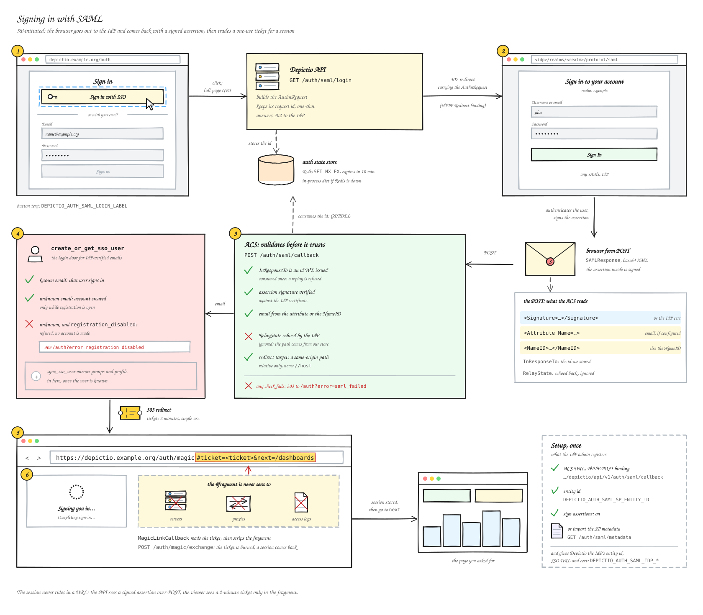
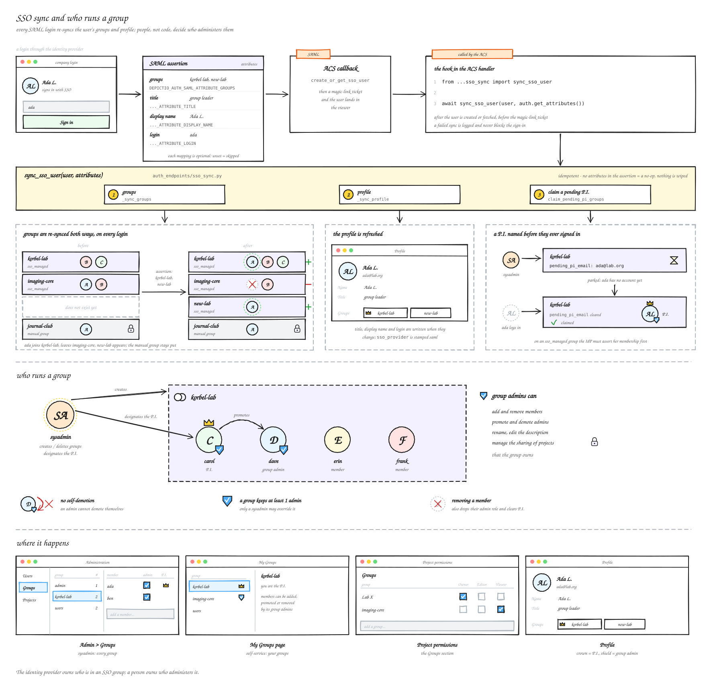

# :material-shield-key-outline: Single sign-on (SAML) <small>(v1.18.0+)</small>

Depictio can send its users to their institution's identity provider (IdP) and take them
back signed in. The flow is SP-initiated SAML 2.0: the sign-in page shows an SSO button,
the browser goes to the IdP and comes back with a signed assertion. It was validated
against a Keycloak realm, but nothing in it is specific to Keycloak.

SAML is off until `DEPICTIO_AUTH_SAML_ENABLED` turns it on, and sits beside
[Google OAuth](configuration.md#google-oauth-integration) and password sign-in.

!!! warning "Use v1.18.1 or later"
    Every SAML route answered 500 on the 1.18.0 API image (an `lxml` / `xmlsec` mismatch).

<figure markdown="span">
  [](../images/guides/sso/schema_saml_login.svg){target=_blank}
  <figcaption><strong>Signing in with SAML.</strong> The IdP's answer is checked against a request this instance made, then traded for a single-use ticket: no token ever travels in a query string.</figcaption>
</figure>

---

## Set it up

1. **Register Depictio with the IdP.** Import the service-provider metadata from
   `GET /depictio/api/v1/auth/saml/metadata`, or enter the Client ID (the SP entity ID)
   and the ACS URL, `<API URL>/depictio/api/v1/auth/saml/callback`.
2. **Give Depictio the IdP side**: its entity ID, its SSO URL (HTTP-Redirect binding) and
   its signing certificate.
3. **Turn it on** and restart the API.

```bash
DEPICTIO_AUTH_SAML_ENABLED=true
DEPICTIO_AUTH_SAML_IDP_ENTITY_ID=https://sso.example.org/realms/myrealm
DEPICTIO_AUTH_SAML_IDP_SSO_URL=https://sso.example.org/realms/myrealm/protocol/saml
DEPICTIO_AUTH_SAML_IDP_CERT=/run/secrets/idp.pem     # inline PEM or a path
DEPICTIO_AUTH_SAML_SP_ENTITY_ID=depictio
DEPICTIO_AUTH_SAML_LOGIN_LABEL="Sign in with your institution"
```

The other settings (`SP_BASE_URL`, `NAME_ID_FORMAT`, `ATTRIBUTE_EMAIL`, …) are in the
[Environment Reference](env-reference.md#authentication). The email comes from the NameID
unless `DEPICTIO_AUTH_SAML_ATTRIBUTE_EMAIL` names an attribute.

A first SAML sign-in creates the account, unless
[registration is closed](../usage/guides/authentication-modes.md#registration). A new
account has no project access until someone grants it.

!!! info "The image and the package"
    The API Docker image ships the native `xmlsec` / `libxml2` libraries. A Python install
    needs the `saml` extra: `pip install "depictio[server,saml]"`.

### On Kubernetes

`DEPICTIO_AUTH_SAML_ENABLED` goes under `backend.env`; the IdP and SP values go under the
top-level `auth:` block. Keep the IdP side (entity ID, SSO URL, certificate) in the
environment's secrets values rather than in the repository. The backend ConfigMap also
exports `DEPICTIO_VIEWER_PUBLIC_URL`, which the hand-off back to the viewer needs.

```yaml
backend:
  env:
    DEPICTIO_AUTH_SAML_ENABLED: "true"
auth:
  DEPICTIO_AUTH_SAML_SP_ENTITY_ID: depictio
  DEPICTIO_AUTH_SAML_LOGIN_LABEL: Sign in with your institution
  DEPICTIO_AUTH_SAML_ATTRIBUTE_GROUPS: groups   # optional, see below
```

---

## Group and profile sync { #group-and-profile-sync }

Four optional settings name the assertion attributes Depictio reads at every SAML sign-in.
An unset one skips its step, so nothing changes until a deployment sets them.

| Variable | What it does |
|----------|--------------|
| `DEPICTIO_AUTH_SAML_ATTRIBUTE_GROUPS` | Mirrors the listed groups as **SSO-managed** [groups](../usage/administration/groups.md): created when first seen, membership re-synced both ways at every sign-in |
| `DEPICTIO_AUTH_SAML_ATTRIBUTE_TITLE` | The user's title, shown in Account settings |
| `DEPICTIO_AUTH_SAML_ATTRIBUTE_DISPLAY_NAME` | The user's display name |
| `DEPICTIO_AUTH_SAML_ATTRIBUTE_LOGIN` | The user's login |

- Groups created by hand are never touched by the sync.
- Attribute names are matched exactly first, then ignoring case, so `Groups` and `groups`
  both work.
- A failed sync is logged and never blocks the sign-in; the next sign-in syncs again.
- A [P.I. named in advance](../usage/administration/groups.md#pi) is claimed at the
  sign-in that first asserts their group.

<figure markdown="span">
  [](../images/guides/sso/schema_saml_sync.svg){target=_blank}
  <figcaption><strong>Group and profile sync.</strong> Names and values are illustrative.</figcaption>
</figure>

---

## Security

- A response is accepted only if it answers a request this instance made, and only once:
  the request IDs live in a one-shot store shared by the API workers (Redis, with an
  in-process fallback).
- The return path the IdP echoes back is never trusted; a redirect stays on this site.
- The browser is handed a single-use ticket in the URL fragment, redeemed by the viewer.

See [SAML sign-in](../features/security.md#saml-sign-in) on the Security page.
