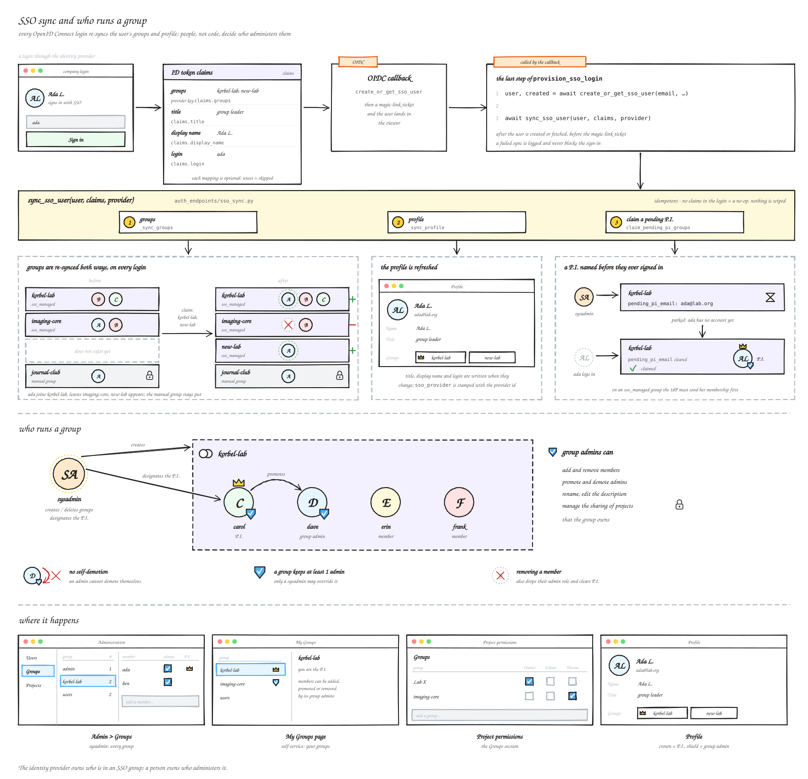

# :material-account-group-outline: Groups and access

What an OpenID Connect sign-in changes on the account, and how to restrict who gets in.
The claim names are set in the [claim mapping](configuration.md#claim-mapping).

---

## :material-account-sync-outline: Group and profile sync { #group-and-profile-sync }

Four optional claim mappings are read at every OIDC sign-in. An unset mapping skips its
step, so nothing changes until a deployment sets them.

| Claim mapping | What it does |
|---------------|--------------|
| `claims.groups` | Mirrors the listed groups as **SSO-managed** [groups](../../usage/administration/groups.md): created when first seen, membership re-synced both ways at every sign-in |
| `claims.title` | The user's title, shown in Account settings |
| `claims.display_name` | The user's display name |
| `claims.login` | The user's login |

The provider's `id` (or `sso_provider`) is stamped on the user as `sso_provider`, and a
profile picture is taken from `claims.picture` when the provider sends one.

---

## :material-account-multiple-outline: Group claim semantics { #group-claim-semantics }

- The claim's values are taken verbatim as group names (whitespace stripped, empty values
  dropped); no parsing is attempted.
- Each listed group is created if missing, marked SSO-managed, and the user is added.
- The user is then **removed from every SSO-managed group that the claim does not list**,
  including as a group admin or P.I.
- **An absent claim counts as an empty list.** With `claims.groups` configured, a login
  whose token carries no such claim removes the user from all SSO-managed groups: the IdP
  is the source of truth for SSO-managed membership. Check that your IdP puts the claim in
  the ID token, or in userinfo (which Depictio merges in).
- **Groups created by hand (manual groups) are never touched** by the sync.
- A failed sync is logged and never blocks the sign-in; the next sign-in syncs again.
- A [P.I. named in advance](../../usage/administration/groups.md#pi) is claimed at the
  sign-in that first sends their group.

<figure markdown="span">
  {target=_blank}
  <figcaption><strong>Group and profile sync.</strong> Names and values are illustrative.</figcaption>
</figure>

---

## :material-account-lock-outline: Registration and SSO-only mode { #access-control }

### Closed registration { #registration-closed }

With `DEPICTIO_AUTH_REGISTRATION_DISABLED=true`, SSO is **login-only**: a known email signs
in, an unknown one is refused (`registration_disabled`) instead of being provisioned an
account. Administrators create the accounts. See
[Registration](../../usage/guides/authentication-modes.md#registration).

### SSO-only mode { #sso-only }

`DEPICTIO_AUTH_PASSWORD_LOGIN_DISABLED=true` closes email and password sign-in, so single
sign-on is the only way in. It takes effect **only when at least one OIDC provider is
enabled and fully configured**, so a typo in the provider list gives you the password form
back instead of a locked instance. See
[Password sign-in](../../usage/guides/authentication-modes.md#password-login).
