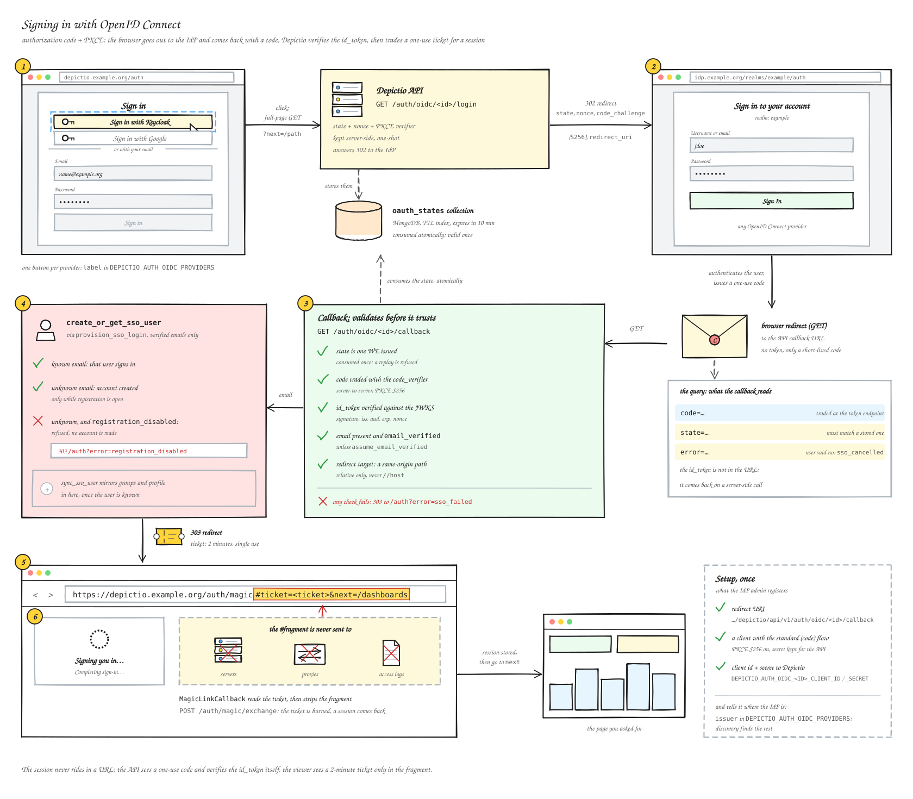

# :material-shield-key-outline: Single sign-on (OpenID Connect)

Depictio can send its users to an identity provider (IdP) and take them back signed in.
It speaks **OpenID Connect (OIDC)**, so any compliant provider works: Keycloak, Google,
Authentik, Okta, GitLab and so on. You can declare several providers at
once; the sign-in page then shows one button per provider, next to password sign-in.

OIDC is off until you declare a provider in `DEPICTIO_AUTH_OIDC_PROVIDERS`.

!!! info "Replaces the Google-specific sign-in"
    OpenID Connect replaces the dedicated Google OAuth sign-in
    ([depictio#1336](https://github.com/depictio/depictio/issues/1336)). Existing users keep
    their accounts. Coming from it? See
    [From Google OAuth to OIDC](migration.md#from-google-oauth-to-oidc).

<figure markdown="span">
  [](../../images/guides/sso/schema_oidc_login.svg){target=_blank}
  <figcaption><strong>Signing in with OpenID Connect.</strong> The IdP's answer is checked against a login this instance started, then traded for a single-use ticket: no token ever travels in a query string.</figcaption>
</figure>

---

## :material-routes: How it works { #how-it-works }

Depictio uses the **authorization code flow with PKCE**:

1. The sign-in page lists the enabled providers (`GET /depictio/api/v1/auth/oidc/providers`).
   A click is a full-page navigation to `/depictio/api/v1/auth/oidc/<id>/login`.
2. The API creates a random `state`, a `nonce` and a PKCE `code_verifier`, stores them
   **server-side** in the `oauth_states` collection (valid for 10 minutes), and answers
   `302` to the IdP's authorization endpoint with the `state`, the `nonce` and the
   `S256` code challenge.
3. The user authenticates at the IdP, which redirects the browser to the API callback,
   `/depictio/api/v1/auth/oidc/<id>/callback?code=…&state=…`.
4. The API **consumes the state atomically** (a replayed callback finds nothing), exchanges
   the code at the token endpoint together with the `code_verifier`, and verifies the
   returned `id_token`.
5. The browser is redirected to the viewer with a single-use ticket in the URL fragment
   (`/auth/magic#ticket=…`), which the viewer redeems for a session.

### What is verified { #what-is-verified }

| Check | Detail |
|-------|--------|
| `state` | Issued by this instance for this provider, used once, not expired |
| Signature | The `id_token` is checked against the IdP's JWKS, discovered from its metadata. Keys are cached and re-fetched when the IdP rotates them |
| `iss` | Equals the issuer of the discovery document, which in turn must equal the configured `issuer` |
| `aud` | Contains this provider's `client_id` |
| `exp` / `iat` | Valid, with 60 seconds of clock-skew leeway |
| `nonce` | Equals the one stored for this login |
| Email | Present in the configured claim, and trusted only when `email_verified` is `true` (see [below](#email-and-accounts)) |
| Redirect target | The `next` path must be a same-origin path; anything else is replaced by the default landing page |

The redirect URI is **never** taken from the request: it comes from the configuration.

### One provisioning path { #provisioning }

Every OIDC login, whatever the provider, runs the same steps: the verified claims resolve
to an account, then groups and profile are mirrored from the claims
([group and profile sync](groups-and-access.md#group-and-profile-sync)), then the user gets a ticket for the
viewer. There is no provider-specific code path.

### Email and accounts { #email-and-accounts }

Accounts are matched **by email**. A user who signed in before through Google or a
password, with the same address, lands on the same account, with the same projects and
permissions. A new address creates an account, unless
[registration is closed](../../usage/guides/authentication-modes.md#registration). A new
account has no project access until someone grants it.

The email is **trusted only when the provider says it is verified**: the `id_token` (or
userinfo) must carry `email_verified: true`. Otherwise anyone who could type your address
into a self-service IdP could take over your Depictio account. A login without a verified
email is refused with the error `email_not_verified`.

Some IdPs assert only verified emails but never send the claim. For those,
set `assume_email_verified: true` on the provider. Use it only when you control the IdP's
user directory and know it never holds unverified addresses.

---

## :material-rocket-launch: Set it up { #set-it-up }

1. **Register Depictio at the IdP** as an OpenID Connect client (a "confidential" client
   using the authorization-code flow). Register this **redirect URI**:

    ```text
    https://<api-host>/depictio/api/v1/auth/oidc/<id>/callback
    ```

    `<api-host>` is the public host of the API (for example `depictio.example.org`), and
    `<id>` is the provider id you choose below. If you set a custom `redirect_uri` on the
    provider, register that value instead.

2. **Declare the provider** as a JSON list in `DEPICTIO_AUTH_OIDC_PROVIDERS`, and keep the
   credentials in their own variables:

    ```bash
    DEPICTIO_AUTH_OIDC_PROVIDERS='[
      {
        "id": "keycloak",
        "label": "Sign in with your institution",
        "issuer": "https://idp.example.org/realms/example"
      }
    ]'
    DEPICTIO_AUTH_OIDC_KEYCLOAK_CLIENT_ID=depictio
    DEPICTIO_AUTH_OIDC_KEYCLOAK_CLIENT_SECRET=change-me
    ```

3. **Restart the API.** The button appears on the sign-in page. A provider that is enabled
   but lacks an issuer (or discovery URL) or a client id or secret is logged as an error at
   startup and its button stays hidden.

!!! tip "Keep secrets out of the JSON"
    `client_id` and `client_secret` may sit in the provider object, but the variables
    `DEPICTIO_AUTH_OIDC_<ID>_CLIENT_ID` and `DEPICTIO_AUTH_OIDC_<ID>_CLIENT_SECRET` override
    them and are what you should use with Docker or Kubernetes secrets. `<ID>` is the
    provider id in upper case with `-` replaced by `_` (`my-idp` gives `MY_IDP`).

---

## :material-map-outline: In this section { #in-this-section }

<div class="grid cards" markdown>

-   :material-tune-variant:{ .lg .middle } **[Configuration reference](configuration.md)**

    ---

    Environment variables, provider keys, claim mapping, redirect URI, Helm values.

-   :material-puzzle-outline:{ .lg .middle } **[Provider recipes](providers.md)**

    ---

    Keycloak, Google, Authentik and any other provider.

-   :material-account-group-outline:{ .lg .middle } **[Groups and access](groups-and-access.md)**

    ---

    Group and profile sync, closed registration, SSO-only mode.

-   :material-swap-horizontal:{ .lg .middle } **[Migration](migration.md)**

    ---

    From the Google OAuth sign-in.

-   :material-stethoscope:{ .lg .middle } **[Troubleshooting and security](troubleshooting.md)**

    ---

    Error codes, common causes, what the flow protects against.

</div>
