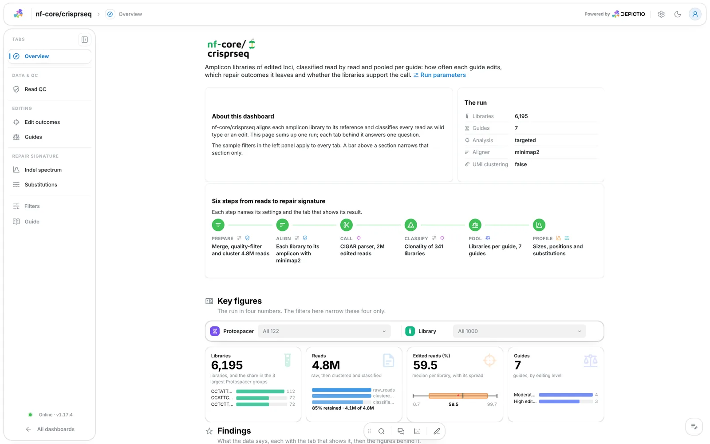

<div class="template-banner">
  <a class="template-banner-logo" href="https://nf-co.re/crisprseq" target="_blank" title="nf-core/crisprseq on nf-co.re">
    
    
  </a>
  <div class="template-banner-body">
    <h1 class="template-title">Gene Editing</h1>
    <p class="template-subtitle">Targeted gene editing from amplicon libraries: read accounting, edit outcomes per library and per guide, and the repair signature around the cut site as indel sizes, positions and substitutions.</p>
    <p class="template-links">
      <a href="https://nf-co.re/crisprseq" target="_blank"><i class="mdi mdi-open-in-new"></i> nf-co.re</a>
      <a href="https://github.com/nf-core/crisprseq" target="_blank"><i class="mdi mdi-github"></i> GitHub</a>
    </p>
  </div>
  <span class="template-status-draft template-banner-badge" data-tooltip="Draft: generated and not yet reviewed. Expect it to need fixes before it is usable."><i class="mdi mdi-pencil-outline"></i> Draft</span>
</div>

<div class="tpl-version-pick" data-latest="2.3.0">
  <span class="tpl-version-icon"><i class="mdi mdi-source-branch"></i></span>
  <span class="tpl-version-label">Template version</span>
  <select id="tpl-version" class="tpl-version-select" aria-label="Template version">
    <option value="2.3.0" selected>2.3.0</option>
  </select>
  <span class="tpl-version-badge">latest</span>
</div>

The crisprseq template follows the targeted analysis of nf-core/crisprseq. The
pipeline aligns each amplicon library to its reference, the CIGAR parser calls
every read wild type, template-based (HDR) or an indel, and the template pools
the libraries per guide:

- :material-compass-outline: **Overview**: the run in four key figures, live findings and four figures, each linked to the tab that explains it
- :material-shield-check-outline: **Data & QC**: raw, clustered and aligned reads per library, so no editing rate rests on a handful of reads
- :material-target: **Edit outcomes**: edited, frameshift and in-frame reads per library, and the clonality call
- :material-scale-balance: **Guides**: editing and frameshift share per guide, and the repair outcomes each one leaves
- :material-chart-bell-curve: **Indel spectrum**: the size distribution and the deletion and insertion positions around the cut site of one guide
- :material-waves: **Substitutions**: substitution and gap rates by offset from the cut site, for every guide and for the picked one

!!! warning "The targeted analysis only"
    The template reads `--analysis targeted`. The screening analysis (count
    tables, MAGeCK, BAGEL2) writes different outputs and is not covered. The
    pipeline writes no MultiQC report, so there is no MultiQC tab either.

!!! note "A library is a sample, a guide is a protospacer"
    A library is a samplesheet `sample`. Its guide is the `protospacer` column,
    upper-cased. A run that set one protospacer for all libraries with
    `--protospacer` gets a single guide named `run protospacer`.

---

## :material-rocket-launch-outline: Quick start

=== "Point at a finished run"

    ```bash
    depictio ingest /path/to/crisprseq_results \
      --template nf-core/crisprseq/latest
    ```

    The results directory (`cigar/`, `clonality/`, `pipeline_info/`) is what you
    pass. crisprseq does not publish the samplesheet it ran on, so the template
    reads `input/samplesheet.csv` under that directory by default. Copy your
    `--input` sheet there, or name it. A sheet you name needs the grouping column
    pinned, because the CLI otherwise takes the first column after the id, which
    is `fastq_1` in a pipeline samplesheet:

    ```bash
    depictio ingest /path/to/crisprseq_results \
      --template nf-core/crisprseq/latest \
      --var METADATA_FILE=/path/to/samplesheet.csv \
      --var GROUP_COL=protospacer
    ```

    | Variable | Default | Role |
    |---|---|---|
    | `METADATA_FILE` | `{DATA_ROOT}/input/samplesheet.csv` | The samplesheet the run started with |
    | `GROUP_COL` | `protospacer` | Sheet column the dashboard groups and filters libraries by |
    | `GROUP_COL_DISPLAY` | `Protospacer` | The label of `GROUP_COL` in filter and card titles |
    | `SKIP_CLONALITY` | unset | Set it to `true` for a run with `--skip_clonality` |

=== "From the pipeline itself (v1.10.0+)"

    ```bash
    depictio config nextflow --install     # once per machine
    nextflow run nf-core/crisprseq -r 2.3.0 -profile docker \
      --analysis targeted --input samplesheet.csv --outdir results
    ```

    No `depictio ingest`, and no template named: the pipeline ingests its own
    output directory when it finishes and resolves this template from its own
    manifest. See [Nextflow trigger](../../depictio-cli/nextflow-trigger.md). The
    trigger passes no `--var`, so put a copy of the samplesheet at
    `results/input/samplesheet.csv` before the run, and ingest by hand for a
    `--skip_clonality` run.

---

## :material-book-open-variant: Reference

The CIGAR parser writes one small file per library under `cigar/` (reads summary,
edit counts, indel QC, per-read indels, substitution rates and the cut site), and
the clonality classifier one under `clonality/`. The recipes read them by glob, so
a run of thousands of libraries stays a handful of tables. Profiles along the
amplicon (indel sizes, deletion and insertion position, substitution and gap
rates) are summarised per guide: the mean library, with the median and the first
and third quartile beside it. That is about 24,500 rows per profile on the
reference run, against 250,000 to 1.1 million per library and position. The
per-library indel alleles stay a collection, because the guide tables and the
allele table read them.

Three definitions the tiles share:

- **Edited reads** are the classified reads that are not wild type, and every rate uses the classified reads as its denominator. A **frameshift** is an insertion or deletion whose length is not a multiple of 3.
- **Offset** is the position minus the cut site the pipeline reports. If its convention does not match the strand of a guide, the signature shifts by a constant and the shape still reads correctly.
- **A per-guide profile** is drawn as the mean library, with a band from the first to the third quartile of the guide's libraries. The mean, not the median, is the curve, because at most sizes and offsets most libraries carry no indel and the median sits on zero.

<div class="tpl-version-block" data-version="2.3.0" markdown>

--8<-- "pipeline-templates/nf-core/_generated/crisprseq-latest.md"

</div>

---

## :material-view-dashboard-outline: Dashboard tabs

One dashboard: the **Overview**, then five child tabs in three groups, read as a
funnel from the reads to the repair each guide leaves. Each tab below carries the
**same icon and colour the dashboard gives it**, so the page and the app read alike.

| Group | Tabs |
|---|---|
| Data & QC | Read QC |
| Editing | Edit outcomes, Guides |
| Repair signature | Indel spectrum, Substitutions |

Each child tab opens with a short intro and a strip of four cards, then at most
three open sections; tables and record cards follow, collapsed. The persistent
*Sample filters* (protospacer, library, donor template) sit in the left panel and
narrow every tab through the samplesheet links. Guide-level tiles follow them
through the `guide` link, so they show the guides of the selected libraries (a
guide's means stay over all of its libraries). The *Sample sheet* and the
per-library summary are pinned, collapsed, to the bottom of every child tab.

=== ":material-compass-outline: Overview"

    *Targeted gene editing, from amplicon reads to the repair each guide leaves.*

    [{ loading=lazy }](../../images/pipeline-templates/nf-core/crisprseq/overview_light.webp){ .tpl-shot target="_blank" rel="noopener" }

    A short hero links the run parameters. *About this dashboard* says how the two
    filter levels work, *The run* lists the libraries, guides, analysis, aligner
    and UMI clustering, and *Pipeline* walks six steps (prepare, align, call,
    classify, pool, profile), each linked to its settings and its tab. The
    findings are live values and follow the filters: the median frameshift share of
    the indel reads, the guides that edit half of their reads or more, the indel
    size most guides repair to, and the most substituted offset. A run with
    `--skip_clonality` loses the Classify step.

    ??? abstract ":material-tune-variant: Filters and components"

        **Filters** · the left panel starts collapsed. *Key figures* and
        *Findings* each have their own filter bar (protospacer and library): each
        narrows its own section only.

        | Section | What it holds |
        |---|---|
        | Top | Hero, *About this dashboard*, *The run*, *Pipeline* |
        | Key figures | 4 headline cards: libraries, reads, edited reads, guides |
        | Findings | Live result rows, then 4 figures: frameshift share against editing per library, editing against frameshift share per guide, the indel allele map and the guide by offset substitution matrix |
        | How to read this dashboard | The tabs by group, each with its question |

=== ":material-shield-check-outline:{ .mc-blue } Read QC"

    **Data & QC** · *Did each library have enough reads and alignment to call editing?*

    Raw reads per library, the clustered reads with the share the CIGAR parser
    classified, the aligned share and the indel reads the filters dropped. Then raw
    reads against the aligned share per library, one point each; a lasso on it
    narrows the other tiles. A library with few classified reads or a low aligned
    share gives an editing rate that rests on a handful of reads, so read this tab
    before the outcome tabs.

    ??? abstract ":material-tune-variant: Filters and components"

        **Filters** · `Raw reads` and `Aligned reads (%)` ranges on
        `crisprseq_edit_summary`.

        | Section | What it holds |
        |---|---|
        | Reads at a glance | 4 cards |
        | Depth and alignment | 1 advanced visualization |

=== ":material-target:{ .mc-grape } Edit outcomes"

    **Editing** · *Which libraries carry disruptive edits, and how were they called?*

    Edited reads, the frameshift share of the indels, in-frame reads and the reads
    by outcome. A knockout needs edits that shift the reading frame, so the
    frameshift share against editing per library is the main figure: the upper
    right holds the likely knockouts, and a click on a library opens its record
    beside it. The Clonality section shows the classifier's zygosity class and
    clonality label per library, its confidence and the indel peaks per library.
    The clonality and outcome tables are collapsed.

    ??? abstract ":material-tune-variant: Filters and components"

        **Filters** · a `Frameshift share of indels (%)` range on
        `crisprseq_edit_summary`, and `Zygosity class` and `Clonality` on
        `crisprseq_clonality`.

        | Section | What it holds |
        |---|---|
        | Outcomes at a glance | 4 cards |
        | Library detail | *Frameshift share against editing*, *Library record* |
        | Clonality | 4 cards |
        | Outcome tables (collapsed) | *Clonality call per library*, *Reads per outcome class* |

    !!! info "Without clonality"
        A run with `--skip_clonality` needs `SKIP_CLONALITY=true`. The clonality
        collection goes, and with it the Clonality section, its filters and its
        table.

=== ":material-scale-balance:{ .mc-indigo } Guides"

    **Editing** · *Which guides edit well, and which edits disrupt the reading frame?*

    Each guide is summarised by the median over its libraries, so one failed
    library does not move it. Guide editing, frameshift share, libraries per guide
    and the share of the dominant indel size (how predictable the repair is). Then
    editing against frameshift share per guide, coloured by editing level and
    sized by its libraries, and the repair outcomes of every guide as stacked
    bars. The editing level is High from 50 percent, Moderate from 10, Low from 1,
    else Unedited. The guide table and the guide record are collapsed.

    ??? abstract ":material-tune-variant: Filters and components"

        **Filters** · `Editing level` and `Libraries per guide` on `guide_summary`.

        | Section | What it holds |
        |---|---|
        | Guides at a glance | 4 cards |
        | Guide comparison | 1 advanced visualization |
        | Outcome composition | *Repair outcomes per guide* |
        | Guide detail (collapsed) | *Guides*, *Guide record* |

=== ":material-chart-bell-curve:{ .mc-orange } Indel spectrum"

    **Repair signature** · *What is the repair signature of one guide's cut?*

    The tab reads one guide: the first of the list until another is picked, and
    the pick cannot be cleared. The dominant indel size, its share, the frameshift
    share and the alleles by type. Then the indel size distribution (deletions
    negative, insertions positive) and the deletion coverage and insertion
    position around the cut site, each as the mean library with its band. The
    deletion profile should peak near offset 0; a peak far from it points at a
    misplaced cut site, a second site in the amplicon or an amplicon-end artefact.
    The allele map (start against size) and the allele tables are collapsed.

    ??? abstract ":material-tune-variant: Filters and components"

        **Filters** · `Guide` on the samplesheet, so it narrows every collection
        of the tab, then `Indel type`, `Frame` and `Main indel peak` on
        `guide_alleles` and an `Indel size (bp)` range on `guide_indel_sizes`.

        | Section | What it holds |
        |---|---|
        | Signature at a glance | 4 cards |
        | Size signature | 1 advanced visualization |
        | Position around the cut site | 2 advanced visualizations: deletion coverage and insertion position |
        | Allele map (collapsed) | 1 advanced visualization |
        | Indel tables (collapsed) | *Indel alleles of the guide*, *Indel alleles per library* |

=== ":material-waves:{ .mc-cyan } Substitutions"

    **Repair signature** · *Where around the cut do bases change or drop out?*

    The peak substitution rate and the peak gap rate (each with the offsets that
    carry the most), the background rate and the libraries behind an offset. Then
    the guide by offset substitution matrix over every guide in scope (rows
    clustered, offsets in order, log(1 + rate) colour scale), and the substitution
    and gap profiles of the picked guide. A base editor leaves a band of
    substitutions a few bases upstream of the cut, while a nuclease leaves the
    matrix flat with a gap peak at the cut. A substitution rate is the share of
    reads at a position that carry a base other than the dominant one, which
    stands in for the reference. The per-offset table is collapsed.

    ??? abstract ":material-tune-variant: Filters and components"

        **Filters** · `Guide` and an `Offset from the cut site (bp)` range on
        `guide_substitution_profile`. The `Guide` pick narrows the cards and the
        profiles, not the matrix, which stays at the scope of the sample filters.

        | Section | What it holds |
        |---|---|
        | Substitutions at a glance | 4 cards |
        | Substitutions per guide | 1 advanced visualization: the matrix |
        | Guide profile | 2 advanced visualizations: substitution and gap rate |
        | Substitution tables (collapsed) | *Substitution and gap rate per offset* |

---

## :material-play-circle-outline: Running the pipeline

Depictio reads the **output** of nf-core/crisprseq, it does not run the pipeline.
Run the targeted analysis first; its `--input` sheet needs only `sample`, and the
`protospacer` column is what keys every guide:

```bash
nextflow run nf-core/crisprseq -r 2.3.0 \
  --analysis targeted \
  --input samplesheet.csv \
  --outdir results -profile docker
```

Then point Depictio at the results, with the samplesheet the run started with:

```bash
depictio ingest results/ \
  --template nf-core/crisprseq/latest \
  --var METADATA_FILE=samplesheet.csv \
  --var GROUP_COL=protospacer
```

See [nf-co.re/crisprseq/usage](https://nf-co.re/crisprseq/2.3.0/docs/usage) for full pipeline documentation.

---

## :material-folder-open-outline: Required data structure

Point `depictio ingest` at the output directory of one run. Depictio scans
recursively and matches on file name; the library is the prefix of every file.

```text
<DATA_ROOT>/
├── input/samplesheet.csv                          # not published by the pipeline: copy it here, or --var METADATA_FILE
├── pipeline_info/
│   ├── params*.json
│   └── *software*versions*.yml
├── cigar/                                         # one set of files per library
│   ├── <sample>_reads-summary.csv
│   ├── <sample>_edits.csv
│   ├── <sample>_QC-indels.csv
│   ├── <sample>_indels.csv                        # one row per indel read, the heavy input
│   ├── <sample>_subs-perc.csv
│   └── <sample>_cutSite.json
└── clonality/<sample>_edits_classified.csv        # optional, absent with --skip_clonality
```

---

## :material-flask-outline: Validation runs

The template was validated against the AWS megatest of the 2.3.0 release,
`results-0e9f915c4a3c89d02a66ec58e2decbc832323c8b`, on its `test_full` profile:
6,195 single-end amplicon libraries, 122 protospacers over 223 amplicons, no
donor template. `megatest.yaml` lists the tables-only subset the template needs,
about 2.3 GB over some 43,000 small files, so the fetch takes a while. The script
copies the samplesheet under `input/`. The live check used a subset of that run,
341 libraries over 7 guides:

```bash
bash depictio/projects/nf-core/crisprseq/2.3.0/download_test_data.sh /tmp/crisprseq_test
depictio ingest /tmp/crisprseq_test --template nf-core/crisprseq/latest
```

Do not pass `--project` when ingesting: the dashboard is attached to the
project by name, so renaming it breaks a later `depictio dashboard import`.
Re-ingesting accumulates dashboards, so delete the project before repeating a run.

---

## :material-link-variant: Additional resources

- [nf-co.re/crisprseq](https://nf-co.re/crisprseq): official pipeline documentation
- [nf-co.re/crisprseq/2.3.0/results](https://nf-co.re/crisprseq/2.3.0/results): AWS test results
- [Template System Reference](../../usage/projects/templates.md): YAML format, variables, conditionals
- [Recipes](../../usage/projects/recipes.md): how to read, test, and write recipes

---

## :material-account-group-outline: Authorship

<div class="tpl-credits">
  <div class="tpl-credit">
    <span class="tpl-credit-role"><i class="mdi mdi-code-braces"></i> Developers</span>
    <span class="tpl-credit-note">Wrote the template, its recipes and its dashboards.</span>
    <a class="tpl-person" href="https://github.com/weber8thomas" target="_blank" rel="noopener">
       weber8thomas
    </a>
  </div>
  <div class="tpl-credit">
    <span class="tpl-credit-role"><i class="mdi mdi-eye-check-outline"></i> Reviewers</span>
    <span class="tpl-credit-note">Nobody has run it on their own data and signed it off yet, which is what keeps it a Draft.</span>
    <span class="tpl-person"><i class="mdi mdi-account-plus-outline"></i> Open</span>
  </div>
  <div class="tpl-credit">
    <span class="tpl-credit-role"><i class="mdi mdi-wrench-outline"></i> Maintainers</span>
    <span class="tpl-credit-note">Keep it working as nf-core/crisprseq releases.</span>
    <a class="tpl-person" href="https://github.com/weber8thomas" target="_blank" rel="noopener">
       weber8thomas
    </a>
  </div>
</div>

Reviewing a template on your own data, or taking over a role here, is a
contribution in itself: the [contributing guide](../../developer/contributing-templates.md)
says what each one involves.
