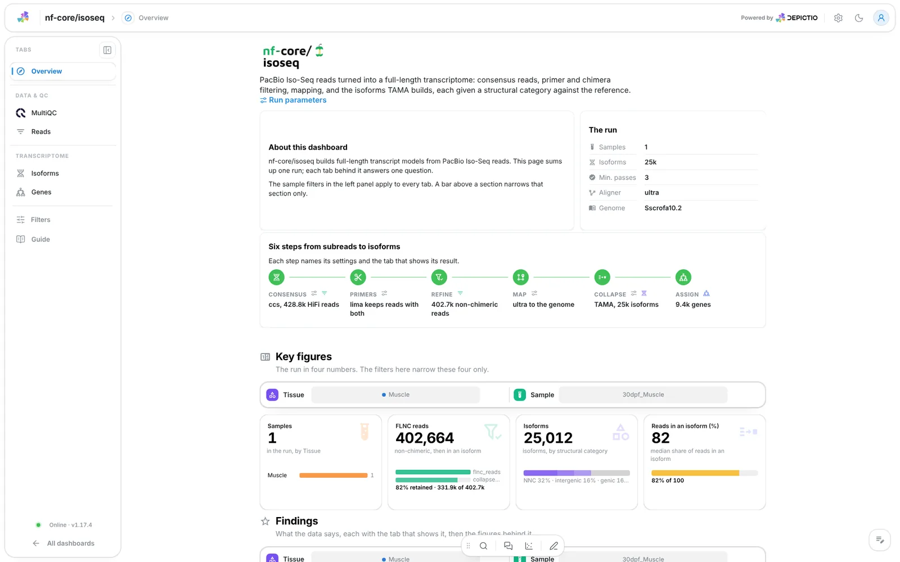

<div class="template-banner">
  <a class="template-banner-logo" href="https://nf-co.re/isoseq" target="_blank" title="nf-core/isoseq on nf-co.re">
    
    
  </a>
  <div class="template-banner-body">
    <h1 class="template-title">Iso-Seq Transcriptomes</h1>
    <p class="template-subtitle">PacBio Iso-Seq reads followed from circular consensus to the isoforms TAMA builds: CCS and primer QC, the full-length read funnel, insert and poly(A) lengths, structural categories against the reference and isoform structures per gene.</p>
    <p class="template-links">
      <a href="https://nf-co.re/isoseq" target="_blank"><i class="mdi mdi-open-in-new"></i> nf-co.re</a>
      <a href="https://github.com/nf-core/isoseq" target="_blank"><i class="mdi mdi-github"></i> GitHub</a>
    </p>
  </div>
  <span class="template-status-draft template-banner-badge" data-tooltip="Draft: generated and not yet reviewed. Expect it to need fixes before it is usable."><i class="mdi mdi-pencil-outline"></i> Draft</span>
</div>

<div class="tpl-version-pick" data-latest="3.0.1">
  <span class="tpl-version-icon"><i class="mdi mdi-source-branch"></i></span>
  <span class="tpl-version-label">Template version</span>
  <select id="tpl-version" class="tpl-version-select" aria-label="Template version">
    <option value="3.0.1" selected>3.0.1</option>
  </select>
  <span class="tpl-version-badge">latest</span>
</div>

The isoseq template follows a PacBio Iso-Seq run from the raw consensus reads to
the transcriptome TAMA merges, and classifies every isoform against the reference
annotation:

- :material-compass-outline: **Overview**: the run in four key figures, live findings and four figures, each linked to the tab that explains it
- :material-chart-box-outline: **Data & QC**: the CCS and primer reports of every chunk from MultiQC, the read funnel from ZMWs to non-chimeric reads, and the insert and poly(A) tail length curves
- :material-dna: **Isoforms**: structural categories (FSM, ISM, NIC, NNC and the rest) by isoform and by read, and the length against read support of every isoform
- :material-family-tree: **Genes**: the genes that carry the isoform diversity, and the isoform structures of one gene beside its reference transcripts

!!! info "Reference annotation and design table"
    Structural categories compare each isoform with `REFERENCE_GTF`, which
    defaults to the GTF uLTRA indexed (`ULTRA_INDEX/genome.gtf`). A minimap2 run
    does not publish it: pass the GTF the run used, or every isoform is
    `unclassified`. The pipeline has no design column either, so the design is an
    optional table (`METADATA_FILE`); without it the hub carries one constant group.

---

## :material-rocket-launch-outline: Quick start

=== "Point at a finished run"

    ```bash
    depictio ingest /path/to/isoseq_results \
      --template nf-core/isoseq/latest
    ```

    The results directory is the only thing you have to pass. The recipes sum
    the per-chunk files (`<sample>_<N>.chunk<X>.*`) back into libraries, one per
    samplesheet row, and the libraries into samples.

=== "With a design table and a reference"

    ```bash
    depictio ingest /path/to/isoseq_results \
      --template nf-core/isoseq/latest \
      --var METADATA_FILE=design.tsv \
      --var GROUP_COL=tissue \
      --var REFERENCE_GTF=/path/to/genes.gtf
    ```

    `METADATA_FILE` takes the sample id in its first column (or a `sample`
    column) and one column per factor; `GROUP_COL` picks the factor the filters and
    colours use. A run with `--skip_multiqc` needs `--var SKIP_MULTIQC=true`, which
    drops the MultiQC tab.

=== "From the pipeline itself (v1.10.0+)"

    ```bash
    depictio config nextflow --install     # once per machine
    nextflow run nf-core/isoseq -r 3.0.1 -profile docker --outdir results
    ```

    No `depictio ingest`, and no template named: the pipeline ingests its own
    output directory when it finishes and resolves this template from its own
    manifest. See [Nextflow trigger](../../depictio-cli/nextflow-trigger.md).

---

## :material-book-open-variant: Reference

The template reads the per-chunk reports of every step (CCS, isoseq refine, TAMA
poly(A) clean-up and collapse), the TAMA merge annotation of each sample, the
reference annotation and the MultiQC report. Recipes reshape them into a sample
hub, one row per isoform with its read support and structural category, one row
per gene, and the exon blocks the structure view draws. The pooled `all_samples`
annotation of `--tama_merge_all` is left out so no isoform is counted twice.

!!! info "Self-adapting layout"
    The dashboard adapts to whatever the run actually produced: components bound
    to pruned or unparsed data collections are hidden, tabs left with no real
    visualizations are dropped entirely, and the remaining components are
    re-packed so there are no empty rows. A run started from `lima`, `refine` or
    `mapping` has no CCS or refine reports, so the Reads tab keeps what the run
    wrote and the Overview lines that cite them go.

<div class="tpl-version-block" data-version="3.0.1" markdown>

--8<-- "pipeline-templates/nf-core/_generated/isoseq-latest.md"

</div>

---

## :material-view-dashboard-outline: Dashboard tabs

One dashboard: the **Overview**, then four child tabs in two groups, read as a
funnel from the consensus reads to the isoforms and the genes they belong to.
Each tab below carries the **same icon and colour the dashboard gives it**, so the
page and the app read alike.

| Group | Tabs |
|---|---|
| Data & QC | MultiQC, Reads |
| Transcriptome | Isoforms, Genes |

Each child tab opens with a short intro and a strip of four cards, then at most
three open sections; tables and record cards follow, collapsed. The persistent
*Sample filters* (design group and sample) narrow every tab through the sample
hub, and the collapsed *Sample sheet* is pinned to the bottom of each child tab.

=== ":material-compass-outline: Overview"

    *PacBio Iso-Seq reads, from circular consensus to the isoforms TAMA builds.*

    [{ loading=lazy }](../../images/pipeline-templates/nf-core/isoseq/overview_light.webp){ .tpl-shot target="_blank" rel="noopener" }

    A short hero links the run parameters. *The run* lists the samples, isoforms,
    minimum CCS passes, aligner and genome, and *Six steps from subreads to
    isoforms* walks consensus, primers, refine, map, collapse and gene assignment,
    each linked to its parameters and its tab. The findings are live values.

    ??? abstract ":material-tune-variant: Filters and components"

        **Filters** · the left panel starts collapsed. *Key figures* and
        *Findings* each have their own filter bar (the design group and the
        sample): each narrows its own section only.

        | Section | What it holds |
        |---|---|
        | Key figures | 4 headline cards: samples, FLNC reads, isoforms, the share of reads that end in an isoform |
        | Findings | Live result rows (CCS pass rate, collapse rate, commonest structural category, genes with several isoforms), then 4 figures: the insert length curves, the category composition, isoform length against read support and isoforms against read support per gene |

=== "{ width=18 }{ width=18 } MultiQC"

    **Data & QC** · *Did every CCS chunk pass the filters and keep its primers?*

    MultiQC panels only, one bar per CCS chunk: the ZMWs each chunk passed and
    the filters that removed the others (ccs), and the reads lima kept and
    rejected. A report sample is a CCS chunk, matched to the sample hub by
    prefix, so the pinned sample filters narrow both panels.

    ??? abstract ":material-tune-variant: Filters and components"

        **Filters** · the pinned sample filters only.

        | Section | What it holds |
        |---|---|
        | CCS filtering | 1 MultiQC panel |
        | Primer demultiplexing | 1 MultiQC panel |

=== ":material-filter-variant:{ .mc-teal } Reads"

    **Data & QC** · *How many reads survive each step, and how long are they?*

    The read funnel from ZMWs to collapsed FLNC reads, then the CCS outcome of
    every ZMW per library stacked to 100 %, and the FLNC insert length and poly(A)
    tail length distributions side by side. Per-sample shares are shown as a box
    across samples, never averaged over reads of different samples.

    ??? abstract ":material-tune-variant: Filters and components"

        **Filters** · `Read scope`: `ZMWs giving a CCS read (%)`, `Reads in an
        isoform (%)` and `Median insert length (bp)`, all range sliders.

        | Section | What it holds |
        |---|---|
        | Reads at a glance | 4 cards: ZMWs read, ZMWs giving a CCS read (%), non-chimeric reads (%), median insert length |
        | CCS outcome | 1 advanced visualization, *CCS outcome per library* |
        | Read lengths | 2 advanced visualizations: *FLNC insert length* (100 bp bins) and *Poly(A) tail left to trim* |
        | Sample detail (collapsed) | *Depth and collapse rate per sample*, a scatter sized by isoforms, with the *Sample record* beside it |
        | Read tables (collapsed) | *CCS yield per library*, *Full-length reads per library* |

=== ":material-dna:{ .mc-violet } Isoforms"

    **Transcriptome** · *How much of the transcriptome is new, and how well supported?*

    Each isoform TAMA merges gets a SQANTI-style structural category from its
    exact intron chain: FSM, ISM, NIC, NNC, then genic, antisense and intergenic
    for isoforms that share no annotated splice site. The category composition
    switches between counting isoforms and FLNC reads, and the isoform plane
    shows length against read support. Most isoforms hold one read, so the cards
    count isoforms past a cut-off (three reads) rather than take a median.

    ??? abstract ":material-tune-variant: Filters and components"

        **Filters** · `Isoform scope`: `Structural category`, `Exon structure`,
        `FLNC reads per isoform` and `Isoform length (bp)`. An isoform filter
        keeps the genes of the isoforms it keeps, so it narrows the Genes tab too.

        | Section | What it holds |
        |---|---|
        | Isoforms at a glance | 4 cards: isoforms, well-supported isoforms (3+ FLNC reads), median length, reads on NIC and NNC isoforms (%) |
        | Structural categories | 1 advanced visualization, *Structural category composition* |
        | Length and support | *Isoform length against read support*, with the *Isoform record* beside it |
        | Length per category | 1 box plot of the summed exon length per category |
        | Isoform table (collapsed) | *Isoforms* |

=== ":material-family-tree:{ .mc-indigo } Genes"

    **Transcriptome** · *Which genes carry the isoform diversity, and how does each look?*

    One row per sample and gene, annotated (a reference gene) or novel (found by
    TAMA, per sample). Isoforms against read support per gene, one point per gene
    coloured by the category that carries most of its reads, then the isoform
    structures of one gene on a base-pair axis, one lane per isoform beside the
    reference transcripts of that gene.

    ??? abstract ":material-tune-variant: Filters and components"

        **Filters** · `Gene scope`: `Gene status`, `Isoforms per gene`, `NIC and
        NNC isoforms` and `FLNC reads over the gene`.

        | Section | What it holds |
        |---|---|
        | Genes at a glance | 4 cards: genes, isoforms per gene, genes with several isoforms, reads on the dominant isoform (%) |
        | Isoform diversity | 1 advanced visualization, *Isoforms against read support per gene* |
        | Gene structures | 1 advanced visualization, *Isoform structures of one gene* |
        | Gene detail (collapsed) | *Genes*, with the *Gene record* beside it |

A row picked in the gene table draws that gene's lanes and opens its record. The
structure view is not linked to the sample hub, because a sample filter would drop
its reference lanes. A structural category keeps one colour on every tile.

---

## :material-play-circle-outline: Running the pipeline

Depictio reads the **output** of nf-core/isoseq, it does not run the pipeline.
Run the pipeline first:

```bash
nextflow run nf-core/isoseq -r 3.0.1 \
  --input samplesheet.csv \
  --primers primers.fasta \
  --genome GRCh38 \
  --outdir results -profile docker
```

Then point Depictio at the results. The 3.0.1 run writes a MultiQC parquet, so no
reprocess step is needed:

```bash
depictio ingest results/ --template nf-core/isoseq/latest
```

See [nf-co.re/isoseq/usage](https://nf-co.re/isoseq/3.0.1/docs/usage) for full pipeline documentation.

---

## :material-folder-open-outline: Required data structure

Point `depictio ingest` at the directory holding the pipeline output. Depictio scans
recursively and matches on file name. The TAMA merge outputs and the MultiQC report
are mandatory; the CCS, refine and poly(A) reports are optional.

```text
<DATA_ROOT>/
├── input/
│   └── sample_metadata.tsv                    # optional design table (--var METADATA_FILE)
├── pipeline_info/                             # params_*.json, *software*versions*.yml
├── multiqc/multiqc_data/multiqc.parquet       # ccs and lima panels; optional with --var SKIP_MULTIQC=true
├── 01_PBCCS/*.report.json                     # CCS report per chunk
├── 03_ISOSEQ_REFINE/
│   ├── *.filter_summary.report.json           # FL and FLNC counts per chunk
│   └── *.report.csv                           # insert length per read
├── 05_GSTAMA_POLYACLEANUP/*_polya_flnc_report.txt.gz   # poly(A) tail lengths
├── 07_GSTAMA_COLLAPSE/*_trans_report.txt      # reads per collapsed model (read support)
├── 09_GSTAMA_MERGE/
│   ├── <sample>.bed                           # mandatory: the final transcriptome
│   └── <sample>_merge.txt                     # collapse models behind each isoform
└── ULTRA_INDEX/genome.gtf                     # reference on the uLTRA route (or REFERENCE_GTF)
```

---

## :material-flask-outline: Validation runs

The repository ships
[`download_test_data.sh`](https://github.com/depictio/depictio/blob/main/depictio/projects/nf-core/isoseq/3.0.1/download_test_data.sh),
which fetches the subset of nf-core's AWS megatest run that the template needs:

```bash
bash depictio/projects/nf-core/isoseq/3.0.1/download_test_data.sh /tmp/isoseq_test
```

The run is
`s3://nf-core-awsmegatests/isoseq/results-6c944831289d4d6e33497026f6b18e8c671705bd/`,
the 3.0.1 `test_full` profile: one Iso-Seq sample started from subreads, CCS split
in 100 chunks, uLTRA mapping. The manifest skips reads, BAMs and FASTA files and
keeps the tables, about 287 MB, of which 234 MB is the reference GTF. The script
also copies the design table the template ships (`tissue`, `stage`) to `input/`.

Then run Depictio against it:

```bash
depictio ingest /tmp/isoseq_test \
  --template nf-core/isoseq/latest \
  --var METADATA_FILE=/tmp/isoseq_test/input/sample_metadata.tsv \
  --var GROUP_COL=tissue
```

---

## :material-link-variant: Additional resources

- [nf-co.re/isoseq](https://nf-co.re/isoseq): official pipeline documentation
- [nf-co.re/isoseq/3.0.1/results](https://nf-co.re/isoseq/3.0.1/results): AWS test results
- [Template System Reference](../../usage/projects/templates.md): YAML format, variables, conditionals
- [Recipes](../../usage/projects/recipes.md): how to read, test, and write recipes

---

## :material-account-group-outline: Authorship

<div class="tpl-credits">
  <div class="tpl-credit">
    <span class="tpl-credit-role"><i class="mdi mdi-code-braces"></i> Developers</span>
    <span class="tpl-credit-note">Wrote the template, its recipes and its dashboards.</span>
    <a class="tpl-person" href="https://github.com/weber8thomas" target="_blank" rel="noopener">
       weber8thomas
    </a>
  </div>
  <div class="tpl-credit">
    <span class="tpl-credit-role"><i class="mdi mdi-eye-check-outline"></i> Reviewers</span>
    <span class="tpl-credit-note">Nobody has run it on their own data and signed it off yet, which is what keeps it a Draft.</span>
    <span class="tpl-person"><i class="mdi mdi-account-plus-outline"></i> Open</span>
  </div>
  <div class="tpl-credit">
    <span class="tpl-credit-role"><i class="mdi mdi-wrench-outline"></i> Maintainers</span>
    <span class="tpl-credit-note">Keep it working as nf-core/isoseq releases.</span>
    <a class="tpl-person" href="https://github.com/weber8thomas" target="_blank" rel="noopener">
       weber8thomas
    </a>
  </div>
</div>

Reviewing a template on your own data, or taking over a role here, is a
contribution in itself: the [contributing guide](../../developer/contributing-templates.md)
says what each one involves.
