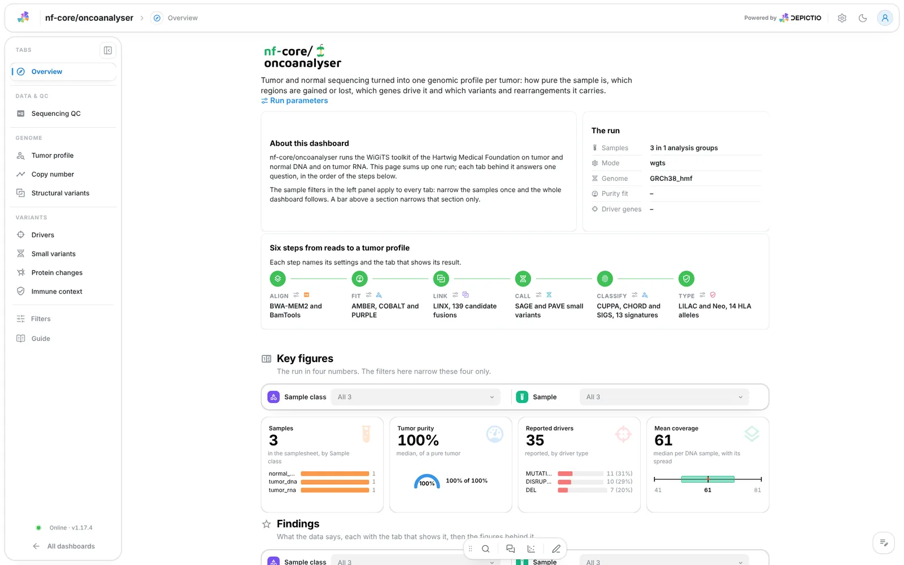
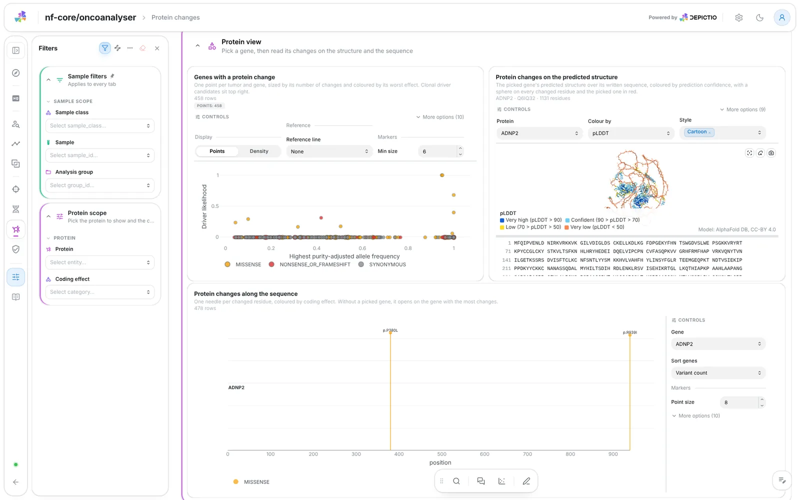

<div class="template-banner">
  <a class="template-banner-logo" href="https://nf-co.re/oncoanalyser" target="_blank" title="nf-core/oncoanalyser on nf-co.re">
    
    
  </a>
  <div class="template-banner-body">
    <h1 class="template-title">Cancer Genomics</h1>
    <p class="template-subtitle">Tumor genomes from the WiGiTS toolkit: sequencing QC, purity and ploidy, copy number, structural variants, the driver catalog, somatic and protein-level variants, and immune context.</p>
    <p class="template-links">
      <a href="https://nf-co.re/oncoanalyser" target="_blank"><i class="mdi mdi-open-in-new"></i> nf-co.re</a>
      <a href="https://github.com/nf-core/oncoanalyser" target="_blank"><i class="mdi mdi-github"></i> GitHub</a>
    </p>
  </div>
  <span class="template-status-draft template-banner-badge" data-tooltip="Draft: generated and not yet reviewed. Expect it to need fixes before it is usable."><i class="mdi mdi-pencil-outline"></i> Draft</span>
</div>

<div class="tpl-version-pick" data-latest="3.0.0">
  <span class="tpl-version-icon"><i class="mdi mdi-source-branch"></i></span>
  <span class="tpl-version-label">Template version</span>
  <select id="tpl-version" class="tpl-version-select" aria-label="Template version">
    <option value="3.0.0" selected>3.0.0</option>
  </select>
  <span class="tpl-version-badge">latest</span>
</div>

The oncoanalyser template reads the tables the Hartwig Medical Foundation
WiGiTS toolkit writes for each tumor, from sequencing QC to the protein
changes and neoepitopes of its variants:

- :material-compass-outline: **Overview**: the run in four key figures, live findings and four figures, each linked to the tab that explains it
- :material-quality-high: **Data & QC**: BamTools coverage and insert sizes, and QSEE's verdict on each check
- :material-account-search-outline: **Tumor profile**: purity and ploidy, CUPPA's tissue of origin, COSMIC signatures and the HRD probability
- :material-chart-timeline-variant: **Copy number and structural variants**: PURPLE's copy-number profile, gene-level events, and LINX's rearrangements and fusions
- :material-target: **Drivers and variants**: the driver catalog, somatic small variants, and protein changes on the sequence and on a predicted structure
- :material-shield-check-outline: **Immune context**: HLA alleles, candidate neoepitopes and telomere length

!!! info "Tables only"
    The template reads the tools' tables and the PURPLE somatic VCF. It reads no
    BAM and no MultiQC report (the pipeline writes none), so it has no MultiQC
    tab. Isofox, PEACH, CIDER, ORANGE and the virus tables are not read yet.

---

## :material-rocket-launch-outline: Quick start

=== "Point at a finished run"

    ```bash
    depictio ingest /path/to/oncoanalyser_results \
      --template nf-core/oncoanalyser/latest
    ```

    The pipeline outdir is what you pass: one `<group_id>/` directory per tumor,
    plus `pipeline_info/`. oncoanalyser does not publish the samplesheet it ran
    on, so the template reads `input/samplesheet.csv` under that directory by
    default. Copy your `--input` sheet there, or name it. A sheet you name makes
    the CLI guess the id and group columns from its header, so pin them:

    ```bash
    depictio ingest /path/to/oncoanalyser_results \
      --template nf-core/oncoanalyser/latest \
      --var METADATA_FILE=/path/to/samplesheet.csv \
      --var METADATA_ID_COL=sample_id \
      --var GROUP_COL=sample_class
    ```

    | Variable | Default | Role |
    |---|---|---|
    | `METADATA_FILE` | `{DATA_ROOT}/input/samplesheet.csv` | The samplesheet the run started with |
    | `GROUP_COL` | `sample_class` | Sheet column the dashboard groups samples by. The default is `sample_type` and `sequence_type` joined, e.g. `tumor_dna` |
    | `GENOME` | `hg38` | UCSC name of the assembly: `hg38` for `GRCh38_hmf`, `hg19` for `GRCh37_hmf`. It sets the chord diagram, the genome track and its gene lane |

=== "From the pipeline itself (v1.10.0+)"

    ```bash
    depictio config nextflow --install     # once per machine
    nextflow run nf-core/oncoanalyser -r 3.0.0 -profile docker \
      --mode wgts --genome GRCh38_hmf --input samplesheet.csv --outdir results
    ```

    No `depictio ingest`, and no template named: the pipeline ingests its own
    output directory when it finishes and resolves this template from its own
    manifest. See [Nextflow trigger](../../depictio-cli/nextflow-trigger.md). The
    trigger passes no `--var`, so put a copy of the samplesheet at
    `results/input/samplesheet.csv` before the run, and ingest by hand for a
    `--genome GRCh37_hmf` run.

---

## :material-book-open-variant: Reference

The template reads the per-tumor tables of PURPLE, LINX, BamTools, QSEE, CUPPA,
SIGS, CHORD, LILAC, TEAL and Neo, and PURPLE's somatic VCF, of which it keeps the
PASS calls. Every output sits under `<group_id>/<tool>/`, so a cohort run is a set
of group directories side by side, and each recipe globs for its files. The
protein changes come from the PAVE annotation of the VCF: the three-letter
residues of each HGVS protein change become a residue number and one-letter amino
acids. A driver row from LINX is kept only when PURPLE has no row for the same
tumor, gene and driver type, so LINX's disruptions are added without doubling the
reported drivers.

!!! info "Optional tools drop their tiles"
    CUPPA, SIGS, CHORD, LILAC, TEAL, Neo and QSEE can be excluded with
    `--processes_exclude`, and a targeted (panel) run skips several of them. A
    run without them skips those collections at ingest, and the dashboard drops
    the tiles that bind them: the Findings row and the Pipeline step that cite
    them, a section whose tiles all go, and the Immune context tab when LILAC, Neo
    and TEAL are all missing. Without QSEE only the QC verdicts and the QSEE
    table go.

<div class="tpl-version-block" data-version="3.0.0" markdown>

--8<-- "pipeline-templates/nf-core/_generated/oncoanalyser-latest.md"

</div>

---

## :material-view-dashboard-outline: Dashboard tabs

One dashboard: the **Overview**, then eight child tabs in three groups, read as a
funnel from the sequencing to the tumor's genome and then to its variants. Each
tab below carries the **same icon and colour the dashboard gives it**, so the page
and the app read alike.

| Group | Tabs |
|---|---|
| Data & QC | Sequencing QC |
| Genome | Tumor profile, Copy number, Structural variants |
| Variants | Drivers, Small variants, Protein changes, Immune context |

Each child tab opens with a short intro and a strip of four cards, then at most
three open sections; tables and record cards follow, collapsed. The persistent
*Sample filters* (sample class, sample, analysis group) sit in the left panel and
narrow every tab through the samplesheet links. The *Sample sheet* is pinned,
collapsed, to the bottom of every child tab.

=== ":material-compass-outline: Overview"

    *Tumor genomes, from the reads to purity, copy number, drivers, variants and immune context.*

    [{ loading=lazy }](../../images/pipeline-templates/nf-core/oncoanalyser/overview_light.webp){ .tpl-shot target="_blank" rel="noopener" }

    A short hero links the run parameters. *About this dashboard* says how the two
    filter levels work, *The run* lists the samples, analysis groups, mode, genome
    and purity fit, and *Pipeline* walks six steps (align, fit, link, call,
    classify, type), each linked to its settings and its tab. The findings are live
    values and follow the filters: the leading signature's share of SNVs, genes
    lost and gained, structural variants by their commonest resolved event, and
    somatic calls per megabase. A run without CUPPA and SIGS loses the signature
    finding.

    ??? abstract ":material-tune-variant: Filters and components"

        **Filters** · the left panel starts collapsed. *Key figures* and
        *Findings* each have their own filter bar (sample class and sample id):
        each narrows its own section only.

        | Section | What it holds |
        |---|---|
        | Top | Hero, *About this dashboard*, *The run*, *Pipeline* |
        | Key figures | 4 headline cards: samples, tumor purity, reported drivers, mean coverage |
        | Findings | Live result rows, then 4 figures: the signature shares, the copy-number profile, the structural variant chord diagram and the allele frequency histogram |
        | How to read this dashboard | The tabs by group, each with its question |

=== ":material-quality-high:{ .mc-orange } Sequencing QC"

    **Data & QC** · *Is the sequencing deep and clean enough for the calls?*

    BamTools' summary and QSEE's checks. The mean coverage, reads per sample, the
    highest duplicate share and the lowest share at 30x or more. Then the
    cumulative coverage and the insert size distribution, one curve per sample, and
    QSEE's PASS, WARN and FAIL verdicts per tool. The BamTools summary with a
    library record and the QSEE check table are collapsed.

    ??? abstract ":material-tune-variant: Filters and components"

        **Filters** · a `Mean coverage` range on `hmf_bamtools_summary`, and
        `QC verdict` and `Source tool` on `qsee_status`.

        | Section | What it holds |
        |---|---|
        | QC at a glance | 4 cards |
        | Coverage and insert size | 2 advanced visualizations |
        | QC verdicts | *QC verdicts per tool* |
        | Library detail (collapsed) | *BamTools summary per sample*, *Library record* |
        | QC reference tables (collapsed) | *QSEE checks* |

=== ":material-account-search-outline:{ .mc-blue } Tumor profile"

    **Genome** · *How pure is the tumor, and what kind of tumor is it?*

    PURPLE's fit and the classifiers around it. Purity, ploidy, mutations per Mb
    and microsatellite indels. Then CUPPA's cancer-type probability per classifier
    as a heatmap, the share of SNVs per COSMIC signature beside CHORD's HRD
    probability and the SNVs allocated, and purity against ploidy with one point
    per tumor. The PURPLE fit table with a tumor record and the CUPPA and CHORD
    tables are collapsed.

    ??? abstract ":material-tune-variant: Filters and components"

        **Filters** · `PURPLE fit status` and `PURPLE QC` on `purple_purity`.

        | Section | What it holds |
        |---|---|
        | Tumor at a glance | 4 cards |
        | Tissue of origin | 1 advanced visualization: the CUPPA heatmap |
        | Mutational processes | *Share of SNVs per mutational signature*, 2 cards |
        | Purity and ploidy | 1 advanced visualization |
        | Tumor detail (collapsed) | *PURPLE fit per tumor*, *Tumor record* |
        | Reference tables (collapsed) | *CUPPA probabilities*, *CHORD prediction* |

=== ":material-chart-timeline-variant:{ .mc-indigo } Copy number"

    **Genome** · *Which regions are gained or lost, and in which genes?*

    Segments, the median segment copy number, genes in view and the LOH share of
    the genome. Then PURPLE's copy-number profile along the genome (log2 of copy
    number over 2, with the B-allele frequency underneath) and the lowest against
    the highest copy number per gene. Events follow PURPLE's cut-offs: `AMP` when
    the lowest copy number is above three times the ploidy, `DEL` below 0.5
    copies, `LOH` when the minor allele is below 0.5 copies, and `PARTIAL_*` when
    only part of the gene qualifies. The tab opens with the event filter on whole
    and partial amplifications and deletions so the gene scatter stays readable;
    clearing it adds the genes with LOH or no change. The gene table with a gene
    record is collapsed.

    ??? abstract ":material-tune-variant: Filters and components"

        **Filters** · `Gene copy-number event` on `purple_gene_copy_number` and
        `Chromosome` on `purple_cnv_segments`.

        | Section | What it holds |
        |---|---|
        | Copy number at a glance | 4 cards |
        | Copy-number profile | 1 advanced visualization |
        | Gene copy number | 1 advanced visualization |
        | Gene detail (collapsed) | *Copy number per gene*, *Gene record* |

=== ":material-vector-link:{ .mc-violet } Structural variants"

    **Genome** · *Which rearrangements shaped the genome, and which fusions follow?*

    LINX's clustered rearrangements and fusion calls. Structural variants, SV
    clusters, the median junction copy number and candidate fusions. Then a chord
    diagram of the breakend pairs beside the SVs per resolved event, and the kept
    and lost exons per fusion beside the fusions per reading frame. The pipeline
    writes no transcript model, so exon spans are drawn in exon units along the
    fused transcript, from the fused and total exon counts of each partner. The
    fusion table with a fusion record and the SV table are collapsed.

    ??? abstract ":material-tune-variant: Filters and components"

        **Filters** · `Resolved event` and `SV type` on `linx_svs`, and `Fusion
        phase` on `linx_fusions`.

        | Section | What it holds |
        |---|---|
        | Structural variants at a glance | 4 cards |
        | Rearrangement landscape | 1 advanced visualization: the chord diagram, and *SVs per resolved event* |
        | Fusion structure | 1 advanced visualization: the exon layout, and *Fusions per reading frame* |
        | Fusion detail (collapsed) | *Candidate fusions*, *Fusion record* |
        | Structural variant tables (collapsed) | *Structural variants* |

=== ":material-target:{ .mc-red } Drivers"

    **Variants** · *Which genes drive this tumor, and how?*

    PURPLE's driver catalog, with LINX's disruptions added. Driver entries,
    oncogenes and suppressors, biallelic entries and the median driver
    likelihood. Then an oncoplot of driver genes by tumor and driver type beside
    the entries per gene role, and the likelihood per driver type. The tab opens
    with `Report status` on `REPORTED` so the oncoplot stays readable on a
    whole-genome catalog; clearing it adds the unreported entries. The driver
    table with a driver record is collapsed.

    ??? abstract ":material-tune-variant: Filters and components"

        **Filters** · `Driver type`, `Gene role`, `Origin` and `Report status` on
        `purple_drivers`.

        | Section | What it holds |
        |---|---|
        | Drivers at a glance | 4 cards |
        | Driver landscape | 1 advanced visualization: the oncoplot, and *Entries per gene role and driver type* |
        | Driver likelihood | *Driver likelihood per driver type* |
        | Driver detail (collapsed) | *Driver catalog*, *Driver record* |

=== ":material-dna:{ .mc-cyan } Small variants"

    **Variants** · *How many somatic variants are there, and how clonal?*

    PASS calls of PURPLE's somatic VCF, with the gene, effect and HGVS change from
    PAVE's canonical transcript. Somatic calls, coding calls, the median
    purity-adjusted allele frequency and the median variant copy number. Then
    their histograms (a variant type keeps one colour on every tile) and every call
    along the genome, with a gene lane. The variant table with a variant record is
    collapsed.

    ??? abstract ":material-tune-variant: Filters and components"

        **Filters** · `Coding effect`, `Variant type` and a `Purity-adjusted allele
        frequency` range on `purple_somatic_variants`.

        | Section | What it holds |
        |---|---|
        | Variants at a glance | 4 cards |
        | Clonality | *Purity-adjusted allele frequency*, *Variant copy number* |
        | Along the genome | 1 advanced visualization |
        | Variant detail (collapsed) | *Somatic small variants*, *Variant record* |

=== ":material-molecule:{ .mc-grape } Protein changes"

    **Variants** · *Which proteins change, and where on the protein and its structure?*

    [{ loading=lazy }](../../images/pipeline-templates/nf-core/oncoanalyser/protein_changes_light.webp){ .tpl-shot target="_blank" rel="noopener" }

    Protein changes, proteins hit, changes at known hotspots and the median
    allele frequency. Then a scatter of the genes with a change (highest
    purity-adjusted allele frequency against PURPLE's driver likelihood, sized by
    change count, coloured by worst effect) beside the predicted structure of the
    picked gene over its written sequence, and a full-width lollipop of its
    changes. Click a gene on the scatter and the other two follow it; click a
    residue in one and it is marked in the others, red on the structure. Without a
    pick the views open on the protein with the most changes, and the `Protein`
    filter drives them too. The change table with a record is collapsed.

    !!! note "The structure tile needs the resolver"
        The pipeline predicts no structure. The [3D structure](../../features/protein-tiles.md#molecule-3d)
        tile looks the picked gene up by its symbol (UniProt, then the AlphaFold DB
        model), which needs `DEPICTIO_STRUCTURE_RESOLVER_ENABLED=true` on the
        server (it is off by default; see the
        [structure resolver](../../features/protein-tiles.md#structure-resolver)).
        With it off the tile says the lookup is disabled, and the scatter, the
        lollipop and the table keep working. A change whose reference residue
        disagrees with the model is listed, not drawn.

    ??? abstract ":material-tune-variant: Filters and components"

        **Filters** · `Protein` (a single pick) and `Coding effect` on
        `purple_protein_changes`.

        | Section | What it holds |
        |---|---|
        | Protein changes at a glance | 4 cards |
        | Protein view | 3 advanced visualizations: the gene scatter, the structure and the lollipop |
        | Protein change detail (collapsed) | *Protein changes*, *Protein change record* |

=== ":material-shield-check-outline:{ .mc-pink } Immune context"

    **Variants** · *Which HLA alleles does the tumor keep, and what could they present?*

    LILAC's HLA alleles, Neo's candidate neoepitopes and TEAL's telomere length.
    HLA alleles, candidate neoepitopes, their median expression and telomere
    length. Then the tumor copy number per HLA allele beside the telomere length
    per sample, and neoepitope expression against variant copy number beside the
    neoepitopes per source event. The neoepitope table with a record and the HLA
    allele and telomere tables are collapsed. The tab is dropped when LILAC, Neo and
    TEAL are all missing.

    ??? abstract ":material-tune-variant: Filters and components"

        **Filters** · `HLA gene` on `lilac_alleles` and `Neoepitope source` on
        `neo_neoepitopes`.

        | Section | What it holds |
        |---|---|
        | Immune context at a glance | 4 cards |
        | HLA and telomeres | *Tumor copy number per HLA allele*, *Telomere length per sample* |
        | Neoepitopes | 1 advanced visualization, *Neoepitopes per source event* |
        | Neoepitope detail (collapsed) | *Candidate neoepitopes*, *Neoepitope record* |
        | Immune reference tables (collapsed) | *HLA alleles*, *Telomere length* |

The sample sheet selects on `sample_id`, and the sample links carry the pick to
every collection. A driver pick narrows the protein changes to its genes, and a
gene picked in the copy-number table or scatter narrows the driver catalog. Each
record card sits beside the table that drives it and opens on the selected row.

---

## :material-play-circle-outline: Running the pipeline

Depictio reads the **output** of nf-core/oncoanalyser, it does not run the
pipeline. Run the pipeline first; its `--input` sheet has one row per input file
with `group_id`, `subject_id`, `sample_id`, `sample_type` and `sequence_type`:

```bash
nextflow run nf-core/oncoanalyser -r 3.0.0 \
  --mode wgts \
  --genome GRCh38_hmf \
  --input samplesheet.csv \
  --outdir results -profile docker
```

Then point Depictio at the results, with the samplesheet the run started with:

```bash
depictio ingest results/ \
  --template nf-core/oncoanalyser/latest \
  --var METADATA_FILE=samplesheet.csv \
  --var METADATA_ID_COL=sample_id \
  --var GROUP_COL=sample_class
```

See [nf-co.re/oncoanalyser/usage](https://nf-co.re/oncoanalyser/3.0.0/docs/usage) for full pipeline documentation.

---

## :material-folder-open-outline: Required data structure

Point `depictio ingest` at the pipeline outdir. Depictio scans recursively and
matches on file name; every tumor-level file is named after the tumor's
`sample_id`, which is the key the sample hub links on.

```text
<DATA_ROOT>/
├── input/samplesheet.csv                          # not published by the pipeline: copy it here, or --var METADATA_FILE
├── pipeline_info/
│   ├── params*.json
│   └── *software*versions*.yml
└── <group_id>/                                    # one directory per tumor
    ├── purple/
    │   ├── *.purple.{purity.tsv,qc,cnv.somatic.tsv,cnv.gene.tsv,somatic.vcf.gz}
    │   └── *.driver.catalog.*.tsv
    ├── linx/
    │   ├── somatic_annotations/*.linx.{svs,clusters,fusion,breakend}.tsv
    │   └── {somatic,germline}_annotations/*.driver.catalog.tsv
    ├── bamtools/<sample>/*.bam_metric.{summary,coverage,frag_length}.tsv
    ├── qsee/*.qsee.status.tsv.gz                  # optional
    ├── cuppa/*.cuppa.vis_data.tsv                 # optional
    ├── sigs/*.sig.allocation.tsv                  # optional
    ├── chord/*.chord.prediction.tsv               # optional
    ├── lilac/*.lilac.tsv                          # optional
    ├── teal/*.teal.tellength.tsv                  # optional
    └── neo/scorer/*.neo.neoepitope.tsv            # optional
```

---

## :material-flask-outline: Validation runs

The template was validated against the AWS megatest of the 3.0.0 release,
`results-7c74c87a43749952b38c9a18915947570f0595a0`, on its `test_full` profile:
one WGTS subject, a tumor and normal DNA pair plus tumor RNA. The full run is
272 GB, almost all of it BAMs. `megatest.yaml` lists the tables-only subset the
template needs, about 33 MB, and the script copies the samplesheet under
`input/`. The screenshots above come from that run:

```bash
bash depictio/projects/nf-core/oncoanalyser/3.0.0/download_test_data.sh /tmp/oncoanalyser_test
depictio ingest /tmp/oncoanalyser_test --template nf-core/oncoanalyser/latest
```

Do not pass `--project` when ingesting: the dashboard is attached to the
project by name, so renaming it breaks a later `depictio dashboard import`.
Re-ingesting accumulates dashboards, so delete the project before repeating a run.

---

## :material-link-variant: Additional resources

- [nf-co.re/oncoanalyser](https://nf-co.re/oncoanalyser): official pipeline documentation
- [nf-co.re/oncoanalyser/3.0.0/results](https://nf-co.re/oncoanalyser/3.0.0/results): AWS test results
- [Template System Reference](../../usage/projects/templates.md): YAML format, variables, conditionals
- [Recipes](../../usage/projects/recipes.md): how to read, test, and write recipes

---

## :material-account-group-outline: Authorship

<div class="tpl-credits">
  <div class="tpl-credit">
    <span class="tpl-credit-role"><i class="mdi mdi-code-braces"></i> Developers</span>
    <span class="tpl-credit-note">Wrote the template, its recipes and its dashboards.</span>
    <a class="tpl-person" href="https://github.com/weber8thomas" target="_blank" rel="noopener">
       weber8thomas
    </a>
  </div>
  <div class="tpl-credit">
    <span class="tpl-credit-role"><i class="mdi mdi-eye-check-outline"></i> Reviewers</span>
    <span class="tpl-credit-note">Nobody has run it on their own data and signed it off yet, which is what keeps it a Draft.</span>
    <span class="tpl-person"><i class="mdi mdi-account-plus-outline"></i> Open</span>
  </div>
  <div class="tpl-credit">
    <span class="tpl-credit-role"><i class="mdi mdi-wrench-outline"></i> Maintainers</span>
    <span class="tpl-credit-note">Keep it working as nf-core/oncoanalyser releases.</span>
    <a class="tpl-person" href="https://github.com/weber8thomas" target="_blank" rel="noopener">
       weber8thomas
    </a>
  </div>
</div>

Reviewing a template on your own data, or taking over a role here, is a
contribution in itself: the [contributing guide](../../developer/contributing-templates.md)
says what each one involves.
