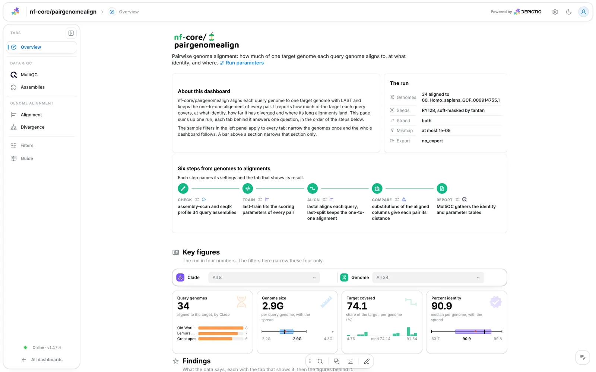

<div class="template-banner">
  <a class="template-banner-logo" href="https://nf-co.re/pairgenomealign" target="_blank" title="nf-core/pairgenomealign on nf-co.re">
    
    
  </a>
  <div class="template-banner-body">
    <h1 class="template-title">Pairwise Genome Alignment</h1>
    <p class="template-subtitle">Query genomes aligned to one target with LAST: how much of the target each genome covers and at what identity, how far it has diverged, the contiguity and gaps of the query assemblies, and where the long alignments land.</p>
    <p class="template-links">
      <a href="https://nf-co.re/pairgenomealign" target="_blank"><i class="mdi mdi-open-in-new"></i> nf-co.re</a>
      <a href="https://github.com/nf-core/pairgenomealign" target="_blank"><i class="mdi mdi-github"></i> GitHub</a>
    </p>
  </div>
  <span class="template-status-draft template-banner-badge" data-tooltip="Draft: generated and not yet reviewed. Expect it to need fixes before it is usable."><i class="mdi mdi-pencil-outline"></i> Draft</span>
</div>

<div class="tpl-version-pick" data-latest="3.0.4">
  <span class="tpl-version-icon"><i class="mdi mdi-source-branch"></i></span>
  <span class="tpl-version-label">Template version</span>
  <select id="tpl-version" class="tpl-version-select" aria-label="Template version">
    <option value="3.0.4" selected>3.0.4</option>
  </select>
  <span class="tpl-version-badge">latest</span>
</div>

The pairgenomealign template follows a run that aligns every genome of its
samplesheet (the queries) to one target genome, from the query assemblies to where
the long alignments land on the target:

- :material-compass-outline: **Overview**: the run in four key figures, live findings and four figures, each linked to the tab that explains it
- :material-chart-box-outline: **Data & QC**: the MultiQC report, and the contiguity, size, composition and scaffolding gaps of each query assembly
- :material-align-horizontal-left: **Alignment**: the share of the target each genome covers and the identity of its one-to-one alignment, with the scoring parameters last-train fitted
- :material-family-tree: **Divergence**: Kimura distance, transition bias and the 12-class substitution spectrum of every pair
- :material-vector-link: **Synteny**: the long alignments of one query on a ring shared with the target (needs the PSL export)

!!! info "Summaries, not alignments"
    The MAF alignments are gigabytes per pair and are not read: the template
    reads the small per-pair summaries LAST writes next to them. The Synteny tab
    needs the PSL export (`--export_aln_to psl`); without it the tab is dropped
    at import and the other tabs are untouched.

---

## :material-rocket-launch-outline: Quick start

=== "Point at a finished run"

    ```bash
    depictio ingest /path/to/pairgenomealign_results \
      --template nf-core/pairgenomealign/latest
    ```

    The results directory is the only thing you have to pass. Every per-pair
    output is named `<target>___<query>`, and the query genome is the join key.

=== "With a design table"

    ```bash
    depictio ingest /path/to/pairgenomealign_results \
      --template nf-core/pairgenomealign/latest \
      --var METADATA_FILE=genome_metadata.tsv \
      --var GROUP_COL=clade
    ```

    The samplesheet carries only the genome id and its FASTA, so the design is an
    optional TSV: the genome id in a `sample` column (or the first column) and one
    column per factor. `GROUP_COL` picks the factor the filters and colours use,
    the first by default. A run with `--skip_assembly_qc` needs
    `--var SKIP_ASSEMBLY_QC=true`.

=== "From the pipeline itself (v1.10.0+)"

    ```bash
    depictio config nextflow --install     # once per machine
    nextflow run nf-core/pairgenomealign -r 3.0.4 -profile docker --outdir results
    ```

    No `depictio ingest`, and no template named: the pipeline ingests its own
    output directory when it finishes and resolves this template from its own
    manifest. See [Nextflow trigger](../../depictio-cli/nextflow-trigger.md).

---

## :material-book-open-variant: Reference

The template reads, per genome pair, the one-to-one identity summary
(`*.o2o.tsv`), the substitution matrix with its distance estimates
(`*.o2o.matrix.txt`) and the fitted scoring parameters (`*.train.tsv`); per query
assembly, the assembly-scan JSON and the seqtk poly-N BED; and the optional PSL
export. A genome hub, one row per query genome, joins them with the design table:
every filter starts from it, and a selection made on an alignment or assembly tile
narrows the hub and through it every other tab.

!!! info "Self-adapting layout"
    The dashboard adapts to whatever the run actually produced: components bound
    to pruned or unparsed data collections are hidden, tabs left with no real
    visualizations are dropped entirely, and the remaining components are
    re-packed so there are no empty rows. Without the PSL export the Synteny tab,
    its pipeline step and its findings row go. With `--skip_assembly_qc` the
    assembly statistics go, while the gap views read from the BEDs stay.

<div class="tpl-version-block" data-version="3.0.4" markdown>

--8<-- "pipeline-templates/nf-core/_generated/pairgenomealign-latest.md"

</div>

---

## :material-view-dashboard-outline: Dashboard tabs

One dashboard: the **Overview**, then five child tabs in two groups, read as a
funnel from the query assemblies to where the long alignments land on the target.
Each tab below carries the **same icon and colour the dashboard gives it**, so the
page and the app read alike.

| Group | Tabs |
|---|---|
| Data & QC | MultiQC, Assemblies |
| Genome alignment | Alignment, Divergence, Synteny |

Each child tab opens with a short intro and a strip of four cards, then at most
three open sections; tables and record cards follow, collapsed. The persistent
*Sample filters* (design group and query genome) narrow every tab through the
genome hub.

=== ":material-compass-outline: Overview"

    *Pairwise genome alignment, from the query assemblies to identity, divergence and synteny.*

    [{ loading=lazy }](../../images/pipeline-templates/nf-core/pairgenomealign/overview_light.webp){ .tpl-shot target="_blank" rel="noopener" }

    A short hero links the run parameters. *The run* lists the genome count and
    target, the seed and soft-masking, the strand, the mismap limit and the
    export format, and *Six steps from genomes to alignments* walks check, train,
    align, compare, link and report, each linked to its parameters and its tab.
    The findings are live values that follow the filters.

    ??? abstract ":material-tune-variant: Filters and components"

        **Filters** · the left panel starts collapsed. *Key figures* and
        *Findings* each have their own filter bar (the design group and the
        query genome): each narrows its own section only.

        | Section | What it holds |
        |---|---|
        | Key figures | 4 headline cards: query genomes (split by group), genome size, target covered, percent identity |
        | Findings | Live result rows (identity with target coverage, K80 distance with transition bias, N50 with the share of sequences over 1 Mb, synteny links with their matching bases), then 4 figures: the contiguity scatter, identity against coverage, the fitted gap costs and the saturation scatter |

=== "{ width=18 }{ width=18 } MultiQC"

    **Data & QC** · *What does the MultiQC report say about the alignments?*

    MultiQC panels only. The report holds custom content: the one-to-one identity
    and the fitted parameters of every genome pair, then the contig length
    statistics and the base content of every query assembly. The pair id reaches
    the alignment panels by prefix and the genome the assembly panels directly,
    so the pinned sample filters narrow them.

    ??? abstract ":material-tune-variant: Filters and components"

        **Filters** · `Report scope` (`Report row`) narrows the panels to
        selected report rows, next to the pinned sample filters.

        | Section | What it holds |
        |---|---|
        | Alignment sections | 2 MultiQC panels: one-to-one alignment identity, fitted alignment parameters |
        | Assembly sections | 2 MultiQC panels: contig length statistics, base content |

=== ":material-puzzle-outline:{ .mc-blue } Assemblies"

    **Data & QC** · *How contiguous is each query assembly, and where are its gaps?*

    Sequences against N50 of each assembly on log axes, sized by length, then the
    gap length matrix: one row per assembly, the lengths of its runs of N on a
    log10 scale across and the share of its runs in each bin as the colour. A
    fixed scaffolding filler is one dark cell, and a dotted line marks the common
    100 bp one.

    ??? abstract ":material-tune-variant: Filters and components"

        **Filters** · `Assembly scope`: `N50 (bp)` and `Sequences`, both range
        sliders.

        | Section | What it holds |
        |---|---|
        | Assemblies at a glance | 4 cards: N50, sequences over 1 Mb, assembly length, GC content |
        | Contiguity | 1 advanced visualization, *Sequences against N50 per assembly*; a lasso on it narrows every tab |
        | Scaffolding gaps | 1 advanced visualization, *Gap lengths per assembly* |
        | Assembly tables (collapsed) | *Assembly statistics*, *Assembly gaps* |

=== ":material-align-horizontal-left:{ .mc-violet } Alignment"

    **Genome alignment** · *How much of the target does each genome cover, at what identity?*

    Percent identity is the identical columns over all alignment columns, gaps
    included. Every genome is placed by target coverage and identity, with the
    record of the picked genome beside it (alignment, divergence and assembly in
    one card), then the gap cost last-train fitted against the identity of its
    training alignments. A closer genome gets a higher cost.

    ??? abstract ":material-tune-variant: Filters and components"

        **Filters** · `Alignment scope`: `Percent identity` and `Target covered
        (%)`, both range sliders.

        | Section | What it holds |
        |---|---|
        | Alignment at a glance | 4 cards: percent identity, target covered, aligned length, gap opening cost |
        | Identity and coverage | *Target coverage against identity per genome*, with the *Picked genome* record beside it |
        | Fitted parameters | 1 advanced visualization, *Fitted gap cost against training identity* |
        | Alignment tables (collapsed) | *One-to-one alignment per query genome*, *Fitted scoring parameters per genome pair* |

=== ":material-family-tree:{ .mc-indigo } Divergence"

    **Genome alignment** · *How far has each genome diverged from the target?*

    The K80 distance is substitutions per site on the aligned A, C, G and T
    columns. The transition bias is plotted against the raw distance, one point per
    pair sized by its blocks (the ratio falls as multiple hits saturate the
    transitions), beside the substitution spectrum: the share of each of the 12
    directed substitutions per genome, scaled per column and clustered by row.

    ??? abstract ":material-tune-variant: Filters and components"

        **Filters** · `Divergence scope`: `K80 distance`, a range slider.

        | Section | What it holds |
        |---|---|
        | Divergence at a glance | 4 cards: K80 distance, transitions over transversions, alignment blocks, deletions in the query |
        | Saturation | 1 advanced visualization, *Transition bias against divergence* |
        | Substitution spectrum | 1 advanced visualization, *Substitution spectrum per genome* |
        | Divergence tables (collapsed) | *Substitutions and distances per genome pair* |

=== ":material-vector-link:{ .mc-grape } Synteny"

    **Genome alignment** · *Where do the long alignments of each query land on the target?*

    Only with a PSL export, which keeps up to 2000 alignments per pair. Target and
    query sequences share the ring: a chord joins the two loci of an alignment, its
    width the matching bases and its colour the orientation. The ring reads one
    query genome, and its picker is always selected, so it holds the first query
    until another is picked.

    ??? abstract ":material-tune-variant: Filters and components"

        **Filters** · `Synteny scope`: `Query genome` (a single pick) and
        `Orientation`.

        | Section | What it holds |
        |---|---|
        | Synteny at a glance | 4 cards: links, matching bases, identity of the links, span of the links |
        | Synteny ring | 1 advanced visualization, *Synteny between the target and the picked query*; click chords to select their alignments |
        | Link tables (collapsed) | *Alignments behind the chords* |

---

## :material-play-circle-outline: Running the pipeline

Depictio reads the **output** of nf-core/pairgenomealign, it does not run the
pipeline. Run the pipeline first, with the PSL export if you want the Synteny tab:

```bash
nextflow run nf-core/pairgenomealign -r 3.0.4 \
  --input samplesheet.csv \
  --target target_genome.fasta \
  --export_aln_to psl \
  --outdir results -profile docker
```

Then point Depictio at the results. The run writes a MultiQC parquet, so no
reprocess step is needed:

```bash
depictio ingest results/ --template nf-core/pairgenomealign/latest
```

See [nf-co.re/pairgenomealign/usage](https://nf-co.re/pairgenomealign/3.0.4/docs/usage) for full pipeline documentation.

---

## :material-folder-open-outline: Required data structure

Point `depictio ingest` at the directory holding the pipeline output. Depictio scans
recursively and matches on file name. The `*.o2o.tsv` summaries and the MultiQC
report are mandatory; the rest is optional.

```text
<DATA_ROOT>/
├── input/
│   └── genome_metadata.tsv                     # optional design table (--var METADATA_FILE)
├── pipeline_info/                              # params_*.json, *software*versions*.yml
├── multiqc/multiqc_data/multiqc.parquet        # custom content sections
├── alignment/
│   ├── <target>___<query>.o2o.tsv              # mandatory: identity and coverage per pair
│   ├── <target>___<query>.o2o.matrix.txt       # substitutions and distances (Divergence)
│   ├── <target>___<query>.train.tsv            # fitted scoring parameters (Alignment)
│   └── <target>___<query>.psl.gz               # only with --export_aln_to psl
├── assemblyscan/*.json                         # absent with --skip_assembly_qc
└── cutn/*.bed                                  # runs of N per query assembly
```

---

## :material-flask-outline: Validation runs

The repository ships
[`download_test_data.sh`](https://github.com/depictio/depictio/blob/main/depictio/projects/nf-core/pairgenomealign/3.0.4/download_test_data.sh),
which fetches the subset of nf-core's AWS megatest run that the template needs:

```bash
bash depictio/projects/nf-core/pairgenomealign/3.0.4/download_test_data.sh /tmp/pga_test
```

The run is
`s3://nf-core-awsmegatests/pairgenomealign/results-8ee09a1cdc920fc90cd62358952045e5019e1fe0/`,
the 3.0.4 `test_full` profile: 34 query genomes aligned to one target assembly. The
run is 42.8 GB, almost all of it alignments; the manifest keeps the per-pair
summaries, about 20 MB. It ran without the PSL export, so the Synteny tab is
dropped on this data. The script also copies the samplesheet and the design table
the template ships (`clade`, `divergence_mya`) to `input/`.

Then run Depictio against it:

```bash
depictio ingest /tmp/pga_test \
  --template nf-core/pairgenomealign/latest \
  --var METADATA_FILE=/tmp/pga_test/input/genome_metadata.tsv \
  --var GROUP_COL=clade
```

---

## :material-link-variant: Additional resources

- [nf-co.re/pairgenomealign](https://nf-co.re/pairgenomealign): official pipeline documentation
- [nf-co.re/pairgenomealign/3.0.4/results](https://nf-co.re/pairgenomealign/3.0.4/results): AWS test results
- [Template System Reference](../../usage/projects/templates.md): YAML format, variables, conditionals
- [Recipes](../../usage/projects/recipes.md): how to read, test, and write recipes

---

## :material-account-group-outline: Authorship

<div class="tpl-credits">
  <div class="tpl-credit">
    <span class="tpl-credit-role"><i class="mdi mdi-code-braces"></i> Developers</span>
    <span class="tpl-credit-note">Wrote the template, its recipes and its dashboards.</span>
    <a class="tpl-person" href="https://github.com/weber8thomas" target="_blank" rel="noopener">
       weber8thomas
    </a>
  </div>
  <div class="tpl-credit">
    <span class="tpl-credit-role"><i class="mdi mdi-eye-check-outline"></i> Reviewers</span>
    <span class="tpl-credit-note">Nobody has run it on their own data and signed it off yet, which is what keeps it a Draft.</span>
    <span class="tpl-person"><i class="mdi mdi-account-plus-outline"></i> Open</span>
  </div>
  <div class="tpl-credit">
    <span class="tpl-credit-role"><i class="mdi mdi-wrench-outline"></i> Maintainers</span>
    <span class="tpl-credit-note">Keep it working as nf-core/pairgenomealign releases.</span>
    <a class="tpl-person" href="https://github.com/weber8thomas" target="_blank" rel="noopener">
       weber8thomas
    </a>
  </div>
</div>

Reviewing a template on your own data, or taking over a role here, is a
contribution in itself: the [contributing guide](../../developer/contributing-templates.md)
says what each one involves.
