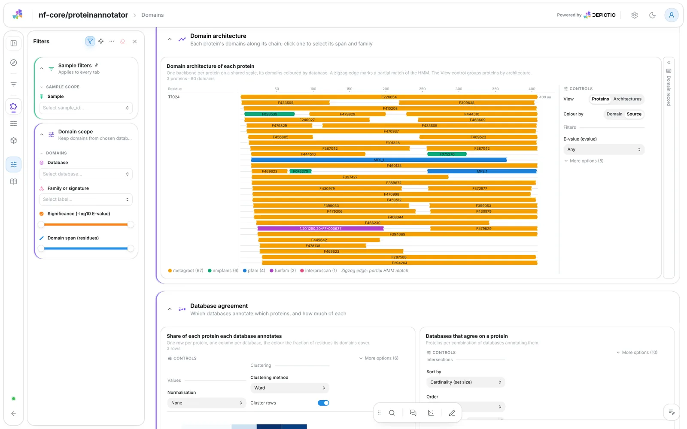
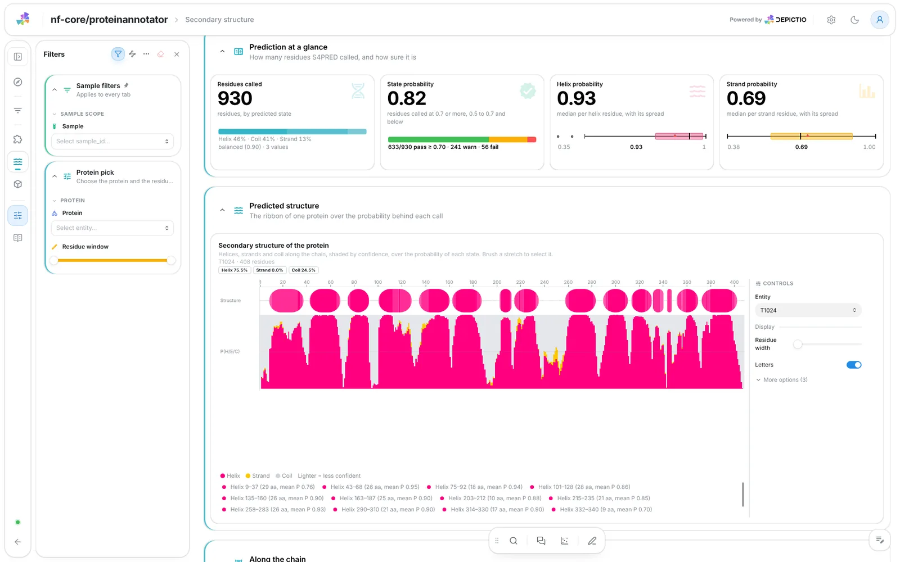

<div class="template-banner">
  <a class="template-banner-logo" href="https://nf-co.re/proteinannotator" target="_blank" title="nf-core/proteinannotator on nf-co.re">
    
    
  </a>
  <div class="template-banner-body">
    <h1 class="template-title">Protein annotation</h1>
    <p class="template-subtitle">Protein sequences filtered, searched for domains in four HMM libraries and InterProScan, given a predicted secondary structure, and folded on demand one protein at a time.</p>
    <p class="template-links">
      <a href="https://nf-co.re/proteinannotator" target="_blank"><i class="mdi mdi-open-in-new"></i> nf-co.re</a>
      <a href="https://github.com/nf-core/proteinannotator" target="_blank"><i class="mdi mdi-github"></i> GitHub</a>
    </p>
  </div>
  <span class="template-status-draft template-banner-badge" data-tooltip="Draft: generated and not yet reviewed. Expect it to need fixes before it is usable."><i class="mdi mdi-pencil-outline"></i> Draft</span>
</div>

<div class="tpl-version-pick" data-latest="1.1.0">
  <span class="tpl-version-icon"><i class="mdi mdi-source-branch"></i></span>
  <span class="tpl-version-label">Template version</span>
  <select id="tpl-version" class="tpl-version-select" aria-label="Template version">
    <option value="1.1.0" selected>1.1.0</option>
  </select>
  <span class="tpl-version-badge">latest</span>
</div>

The proteinannotator template follows an nf-core/proteinannotator run from the
input FASTA files to one protein's structure, reading each tool's own files and
joining them per residue, per domain, per protein and per sample:

- :material-compass-outline: **Overview**: the run in four key figures, live findings and four figures, each linked to the tab that explains it
- :material-filter-variant: **Data & QC**: what the length and duplicate filter removed, and how much of each protein the databases describe
- :material-puzzle-outline: **Domains**: hits from Pfam, FunFam, NMPFamsDB, MetagRoot and InterProScan in one table, drawn along each chain, and where the databases agree
- :material-waves: **Secondary structure**: the S4PRED helix, strand and coil calls per residue, with the domains that cover them
- :material-cube-outline: **Structure**: one protein in 3D, coloured by its best domain, linked residue by residue to its sequence track

!!! info "Folding needs the structure resolver and sends the sequence out"
    The pipeline predicts no 3D structure. The Structure tab folds the picked
    protein from its sequence through the
    [structure resolver](../../features/protein-tiles.md#structure-resolver),
    which is off by default: an administrator sets
    `DEPICTIO_STRUCTURE_RESOLVER_ENABLED=true` on the server. Folding sends the
    protein sequence to ESMFold on Meta's ESM Atlas (`api.esmatlas.com`), and
    ESMFold folds at most 400 residues. With the resolver off, or for a longer
    protein, the tile says why it is empty and the rest of the dashboard is
    unaffected.

!!! note "Grouping needs a design table"
    The pipeline's samplesheet has only `id` and `fasta`, so a design is always
    an extra table, passed with `--var METADATA_FILE`. Without one, the group
    filters, the Samples card and the design table are pruned, and every tile
    bound to the per-sample summary keeps working.

---

## :material-rocket-launch-outline: Quick start

=== "Point at a finished run"

    ```bash
    depictio ingest /path/to/proteinannotator_results \
      --template nf-core/proteinannotator/latest
    ```

    The results directory is the only thing you have to pass. To group and
    filter samples, add a design table: the sample id in the first column (or a
    column named `sample`), then one column per factor.

    ```bash
    depictio ingest /path/to/proteinannotator_results \
      --template nf-core/proteinannotator/latest \
      --var METADATA_FILE=/path/to/design.tsv
    ```

    | Variable | Default | Role |
    |---|---|---|
    | `METADATA_FILE` | unset | design table; enables the group filters, the Samples card and the design table |
    | `GROUP_COL` | first factor column | design column the dashboard groups and filters by |
    | `SKIP_INTERPROSCAN` | unset | set for a `--skip_interproscan` run: drops the InterProScan collections and the step that cites them |
    | `SKIP_S4PRED` | unset | set for a `--skip_s4pred` run: drops the Secondary structure tab; the residue table keeps its sequence and domains |

=== "From the pipeline itself (v1.10.0+)"

    ```bash
    depictio config nextflow --install     # once per machine
    nextflow run nf-core/proteinannotator -r 1.1.0 -profile docker --outdir results
    ```

    No `depictio ingest`, and no template named: the pipeline ingests its own
    output directory when it finishes and resolves this template from its own
    manifest. See [Nextflow trigger](../../depictio-cli/nextflow-trigger.md).

---

## :material-book-open-variant: Reference

The template reads the SeqFu statistics and the filtered FASTA of `qc/`, the
hmmsearch domain tables of four HMM libraries (Pfam, FunFam, NMPFamsDB,
MetagRoot), InterProScan's signature matches and the S4PRED secondary
structure. Empty files are normal (InterProScan writes an empty TSV for a sample
with no match, hmmsearch a header-only table) and read as no rows. The run's
MultiQC report holds only SeqFu sections anchored by sample name, so the template
has no MultiQC tab.

- **Protein ids.** A protein is the first word of its FASTA header, the id the
  three tools report. Characters outside `A-Za-z0-9._+-` become `_` in every
  table, so the S4PRED, domain, residue and protein tables share one `entity`.
- **Domains.** hmmsearch domains are kept at an independent E-value of 0.01 or
  less, HMMER's own inclusion threshold, and span the envelope coordinates.
  Weaker hits stay in the collapsed *hmmsearch hits* section. InterProScan
  matches are kept as reported.
- **Coverage.** A protein's annotated share counts the residues covered by at
  least one domain once. The best domain, the one with the lowest E-value, names
  the protein and colours the structure.

!!! info "Self-adapting layout"
    The dashboard adapts to whatever the run actually produced: components bound
    to pruned or unparsed data collections are hidden, tabs left with no real
    visualizations are dropped entirely, and the remaining components are
    re-packed so there are no empty rows. A `--skip_s4pred` run loses the
    Secondary structure tab and its Overview finding.

<div class="tpl-version-block" data-version="1.1.0" markdown>

--8<-- "pipeline-templates/nf-core/_generated/proteinannotator-latest.md"

</div>

---

## :material-view-dashboard-outline: Dashboard tabs

One dashboard: the **Overview**, then four child tabs in two groups, read from
the sequences that survived the filter to the structure of one of them. Each tab
below carries the **same icon and colour the dashboard gives it**, so the page
and the app read alike.

| Group | Tabs |
|---|---|
| Data & QC | Input filtering |
| Annotation | Domains, Secondary structure, Structure |

Each child tab opens with a short intro and a strip of four cards, then at most
three open sections; tables follow, collapsed. The persistent *Sample filters*
sit in the left panel and the *Sample sheet* (the design table and the
per-sample summary) is pinned, collapsed, to the bottom of every child tab. The
annotation databases share one palette, and the S4PRED states are fixed:
helix, strand and coil.

=== ":material-compass-outline: Overview"

    *Protein sequences, filtered, searched for domains and given a predicted secondary structure.*

    A short hero links the run parameters. *About this dashboard* says how the two
    filter levels work, *The run* lists the samples, the proteins, the length
    window, the E-value and the InterProScan applications, and *Pipeline* walks
    five steps (filter, search, match, predict, fold), each linked to its
    parameters and its tab. The findings are live values that follow the filters:
    the median annotated share, the domains and the database that reports most,
    the commonest predicted state, and the proteins short enough to fold.

    ??? abstract ":material-tune-variant: Filters and components"

        **Filters** · the left panel starts collapsed. *Key figures* has its own
        filter bar (group and sample), *Findings* another (group and database):
        each narrows its own section only.

        | Section | What it holds |
        |---|---|
        | Top | Hero, *About this dashboard*, *The run*, *Pipeline* |
        | Key figures | 4 headline cards: samples, proteins, domains, residues in a domain |
        | Findings | Live result rows, then 4 figures: length against annotated share, the domain architecture, the state shares and one protein along its chain |
        | How to read this dashboard | The tabs by group, each with its question |

=== ":material-filter-variant:{ .mc-orange } Input filtering"

    **Data & QC** · *Which sequences passed the filter, and how well are they annotated?*

    The sequences removed, the protein length, the residues kept per sample and
    the domains per protein. Then the sequences before and after the filter, per
    sample, and the length against the share of the protein that sits in a
    domain, one point per protein, whose picked protein opens in a record card
    beside it. Low points are mostly outside known families. The protein table is
    collapsed.

    ??? abstract ":material-tune-variant: Filters and components"

        **Filters** · `Protein length (residues)`, `Residues in a domain (%)` and
        `Annotation status` on `proteinannotator_proteins`.

        | Section | What it holds |
        |---|---|
        | Filter at a glance | 4 cards |
        | Filter yield | *Sequences before and after the filter* |
        | Annotated share | 2 advanced visualizations: the scatter and the *Protein record* |
        | Protein table (collapsed) | *Proteins* |

=== ":material-puzzle-outline:{ .mc-violet } Domains"

    **Annotation** · *Which domains does each protein carry, and do the databases agree?*

    [{ loading=lazy }](../../images/pipeline-templates/nf-core/proteinannotator/domains_light.webp){ .tpl-shot target="_blank" rel="noopener" }

    The [domain architecture](../../features/protein-tiles.md#domain-architecture)
    draws one backbone per protein with its domains from all five databases,
    coloured by database; a click selects the protein and the span on the residue
    tables and the family on the domain table, the scatter and the record card.
    A *View* control groups proteins by architecture. The protein by database
    heatmap and the UpSet plot show which databases agree, and significance
    against span separates families from motifs and borderline calls. The domain
    table and the raw hmmsearch hits are collapsed.

    ??? abstract ":material-tune-variant: Filters and components"

        **Filters** · `Database`, `Family or signature`, `Significance (-log10
        E-value)` and `Domain span (residues)` on `proteinannotator_domains`.

        | Section | What it holds |
        |---|---|
        | Domains at a glance | 4 cards |
        | Domain architecture | 2 advanced visualizations: the architecture and the *Domain record* |
        | Database agreement | 2 advanced visualizations: the coverage heatmap and the UpSet |
        | Domain calls | *Significance against span* |
        | Domain detail (collapsed) | *Domains* |
        | hmmsearch hits (collapsed) | *Bit score against HMM coverage*, *hmmsearch domain table* |

=== ":material-waves:{ .mc-cyan } Secondary structure"

    **Annotation** · *Which stretches of each protein fold as helix, strand or coil?*

    [{ loading=lazy }](../../images/pipeline-templates/nf-core/proteinannotator/secondary_structure_light.webp){ .tpl-shot target="_blank" rel="noopener" }

    The residues S4PRED called, the probability of the called state, and the helix
    and strand probabilities. Then the
    [secondary structure](../../features/protein-tiles.md#secondary-structure)
    ribbon of one protein over the probability of each state, with its segment
    list; a brush or a segment pick selects the residues on the
    [sequence track](../../features/protein-tiles.md#sequence-track) below, which
    also draws the domain spans. A stacked bar compares the state shares of the
    proteins. The residue table is collapsed.

    ??? abstract ":material-tune-variant: Filters and components"

        **Filters** · `Protein` and `Residue window` on
        `s4pred_secondary_structure`.

        | Section | What it holds |
        |---|---|
        | Prediction at a glance | 4 cards |
        | Predicted structure | 1 advanced visualization, the ribbon |
        | Along the chain | 1 advanced visualization, the sequence track |
        | Composition | *Predicted states per protein* |
        | Residue table (collapsed) | *Residues* |

=== ":material-cube-outline:{ .mc-indigo } Structure"

    **Annotation** · *Where do the domains sit on one protein's 3D structure?*

    A table of the proteins (sample, length, annotated share, best domain) picks
    the protein; its [3D structure](../../features/protein-tiles.md#molecule-3d),
    coloured by best domain over its written sequence, and the sequence track
    (state, probability and domain spans) stand linked residue by residue. A click
    on a residue in 3D, on a letter of the sequence or a brush on the track
    selects the same residues in all three. A protein over 400 residues cannot be
    folded: its tile says so, and the *Longest protein* card flags it.

    ??? abstract ":material-tune-variant: Filters and components"

        **Filters** · `Protein` and `Protein length (residues)` on
        `proteinannotator_proteins`, and `Residue window` on
        `proteinannotator_residues`. The length filter has no default window, so
        every protein is listed.

        | Section | What it holds |
        |---|---|
        | Structure at a glance | 4 cards: proteins in view, residues in a domain, domains per residue, longest protein |
        | Structure and sequence | *Proteins to fold*, then 2 advanced visualizations: the predicted structure and the sequence track |
        | Residue table (collapsed) | *Residues* |

Tables and point views select on `entity`, the protein id, so a protein picked in
one tile is the protein in the others; the domain tiles also select on the
family, and the structure and the track on the residue position.

---

## :material-play-circle-outline: Running the pipeline

Depictio reads the **output** of nf-core/proteinannotator, it does not run the
pipeline. Run the pipeline first:

```bash
nextflow run nf-core/proteinannotator -r 1.1.0 \
  --input samplesheet.csv \
  --outdir results \
  -profile docker
```

The samplesheet is `id,fasta`, one protein FASTA per sample. Then point Depictio
at the results, with a design table if you have one:

```bash
depictio ingest results/ \
  --template nf-core/proteinannotator/latest \
  --var METADATA_FILE=design.tsv
```

For a run with `--skip_interproscan` or `--skip_s4pred`, add
`--var SKIP_INTERPROSCAN=true` or `--var SKIP_S4PRED=true`.

See [nf-co.re/proteinannotator/usage](https://nf-co.re/proteinannotator/1.1.0/docs/usage)
for full pipeline documentation.

---

## :material-folder-open-outline: Required data structure

Point `depictio ingest` at the directory holding the pipeline output. Depictio
scans recursively and matches on file name; the sample and the database are read
off the path.

```text
<DATA_ROOT>/
├── input/
│   └── design.tsv                              # optional, wherever --var METADATA_FILE points
├── pipeline_info/
│   ├── params_*.json
│   └── *software*versions*.yml
├── qc/<sample>/
│   ├── <sample>_{before,after}.tsv             # SeqFu statistics around the filter
│   └── <sample>.fasta                          # the filtered FASTA every later step ran on
├── domain_annotation/<db>/<sample>.domtbl.gz   # hmmsearch, one directory per library
├── functional_annotation/interproscan/<sample>/<sample>.tsv   # optional
└── s4pred/<sample>/ss2/<sequence id>.ss2       # optional
```

---

## :material-flask-outline: Validation runs

The repository ships
[`download_test_data.sh`](https://github.com/depictio/depictio/blob/main/depictio/projects/nf-core/proteinannotator/1.1.0/download_test_data.sh),
which fetches the subset of nf-core's AWS megatest run that the template needs
and copies the vendored samplesheet and design table into `input/`:

```bash
bash depictio/projects/nf-core/proteinannotator/1.1.0/download_test_data.sh \
  /tmp/proteinannotator_test
depictio ingest /tmp/proteinannotator_test \
  --template nf-core/proteinannotator/latest \
  --var METADATA_FILE=/tmp/proteinannotator_test/input/sample_metadata.tsv
```

The run is
`s3://nf-core-awsmegatests/proteinannotator/results-cbf78d471f62d91af666e8c77bcd580b4743c6be/`,
a development run that reports itself as v1.2.0dev: three single-protein FASTA
inputs (two structure-prediction targets and one enzyme) searched against
test-sized Pfam, FunFam, NMPFamsDB and MetagRoot libraries, InterProScan with the
HAMAP, TIGRFAM and SFLD applications, and S4PRED. The design table's
`protein_set` column was written for the demo.

---

## :material-link-variant: Additional resources

- [nf-co.re/proteinannotator](https://nf-co.re/proteinannotator): official pipeline documentation
- [nf-co.re/proteinannotator/results](https://nf-co.re/proteinannotator/results): AWS test results
- [Template System Reference](../../usage/projects/templates.md): YAML format, variables, conditionals
- [Recipes](../../usage/projects/recipes.md): how to read, test, and write recipes

---

## :material-account-group-outline: Authorship

<div class="tpl-credits">
  <div class="tpl-credit">
    <span class="tpl-credit-role"><i class="mdi mdi-code-braces"></i> Developers</span>
    <span class="tpl-credit-note">Wrote the template, its recipes and its dashboards.</span>
    <a class="tpl-person" href="https://github.com/weber8thomas" target="_blank" rel="noopener">
       weber8thomas
    </a>
  </div>
  <div class="tpl-credit">
    <span class="tpl-credit-role"><i class="mdi mdi-eye-check-outline"></i> Reviewers</span>
    <span class="tpl-credit-note">Nobody has run it on their own data and signed it off yet, which is what keeps it a Draft.</span>
    <span class="tpl-person"><i class="mdi mdi-account-plus-outline"></i> Open</span>
  </div>
  <div class="tpl-credit">
    <span class="tpl-credit-role"><i class="mdi mdi-wrench-outline"></i> Maintainers</span>
    <span class="tpl-credit-note">Keep it working as nf-core/proteinannotator releases.</span>
    <a class="tpl-person" href="https://github.com/weber8thomas" target="_blank" rel="noopener">
       weber8thomas
    </a>
  </div>
</div>

Reviewing a template on your own data, or taking over a role here, is a
contribution in itself: the [contributing guide](../../developer/contributing-templates.md)
says what each one involves.
