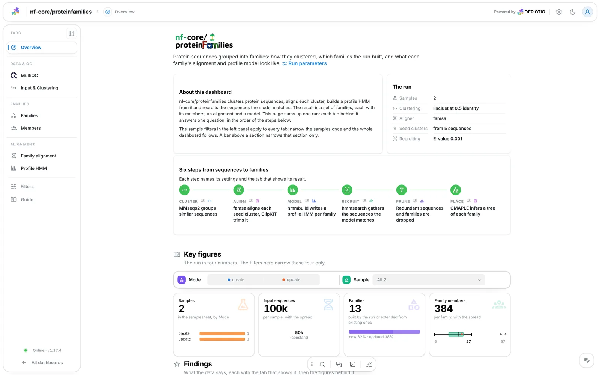
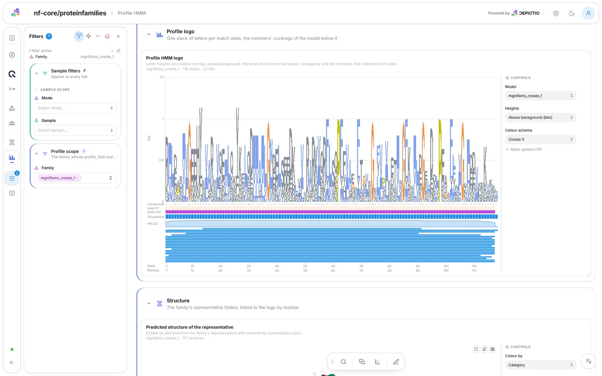

<div class="template-banner">
  <a class="template-banner-logo" href="https://nf-co.re/proteinfamilies" target="_blank" title="nf-core/proteinfamilies on nf-co.re">
    
    
  </a>
  <div class="template-banner-body">
    <h1 class="template-title">Protein families</h1>
    <p class="template-subtitle">Protein sequences grouped into families: how the input clustered, the families a run built or extended, and each family's alignment, residue conservation, predicted structure and profile HMM.</p>
    <p class="template-links">
      <a href="https://nf-co.re/proteinfamilies" target="_blank"><i class="mdi mdi-open-in-new"></i> nf-co.re</a>
      <a href="https://github.com/nf-core/proteinfamilies" target="_blank"><i class="mdi mdi-github"></i> GitHub</a>
    </p>
  </div>
  <span class="template-status-draft template-banner-badge" data-tooltip="Draft: generated and not yet reviewed. Expect it to need fixes before it is usable."><i class="mdi mdi-pencil-outline"></i> Draft</span>
</div>

<div class="tpl-version-pick" data-latest="2.5.0">
  <span class="tpl-version-icon"><i class="mdi mdi-source-branch"></i></span>
  <span class="tpl-version-label">Template version</span>
  <select id="tpl-version" class="tpl-version-select" aria-label="Template version">
    <option value="2.5.0" selected>2.5.0</option>
  </select>
  <span class="tpl-version-badge">latest</span>
</div>

The proteinfamilies template follows an nf-core/proteinfamilies run from the
input sequences to one family's profile model, funnel-wise:

- :material-compass-outline: **Overview**: the run in four key figures, live findings and four figures, each linked to the tab that explains it
- :material-set-merge: **Data & QC**: the input sequences before and after preprocessing, and the MMseqs2 cluster size distribution per sample
- :material-shape-outline: **Families**: the families a run built or extended, their size and conservation, and how close their members sit to the representative
- :material-dna: **Alignment**: each family's alignment, residue conservation and predicted structure, and its profile HMM as a sequence logo with the members that matched it

The persistent `Sample filters` (mode, sample) sit in the left panel and narrow
every tab through the samplesheet links.

!!! info "Structure tiles need the structure resolver"
    proteinfamilies publishes no structure files. The 3D tiles of the Family
    alignment and Profile HMM tabs fold the family representative from its
    sequence through the [structure resolver](../../features/protein-tiles.md#structure-resolver),
    which is off by default: an administrator sets
    `DEPICTIO_STRUCTURE_RESOLVER_ENABLED=true` on the server. The sequence is
    sent to ESMFold on Meta's ESM Atlas, which folds at most 400 residues. With
    the resolver off the tile shows an empty state.

!!! note "Create and update runs"
    A run either creates families from its input sequences or, given the HMMs
    and alignments of an existing library, first matches the sequences against
    those families and extends them. The `mode` column (`create` or `update`) is
    derived from the samplesheet and is the default grouping. Families an update
    run extended carry the origin `updated`, the others `new`.

---

## :material-rocket-launch-outline: Quick start

=== "Point at a finished run"

    ```bash
    depictio ingest /path/to/proteinfamilies_results \
      --template nf-core/proteinfamilies/latest
    ```

    The results directory is the only thing you have to pass, with one
    exception: proteinfamilies reads its samplesheet from `--input` and does not
    publish it. The template looks for it at `{DATA_ROOT}/input/samplesheet.csv`;
    copy it there, or point to it:

    ```bash
    depictio ingest /path/to/proteinfamilies_results \
      --template nf-core/proteinfamilies/latest \
      --var METADATA_FILE=/path/to/samplesheet.csv
    ```

    | Variable | Default | Role |
    |---|---|---|
    | `METADATA_FILE` | `{DATA_ROOT}/input/samplesheet.csv` | the samplesheet the run was started with |
    | `GROUP_COL` | `mode` | samplesheet column the dashboard groups and filters samples by; any design column added to the sheet can replace `mode` |
    | `GROUP_COL_DISPLAY` | `Mode` | reader-facing label of `GROUP_COL` in filters and cards |

=== "From the pipeline itself (v1.10.0+)"

    ```bash
    depictio config nextflow --install     # once per machine
    nextflow run nf-core/proteinfamilies -r 2.5.0 -profile docker --outdir results
    ```

    No `depictio ingest`, and no template named: the pipeline ingests its own
    output directory when it finishes and resolves this template from its own
    manifest. See [Nextflow trigger](../../depictio-cli/nextflow-trigger.md). The
    trigger passes no `--var`, so put a copy of the samplesheet at
    `results/input/samplesheet.csv` before the run.

---

## :material-book-open-variant: Reference

The template reads the SeqFu statistics of the input, the MMseqs2 cluster size
distribution, the family metadata and member rosters, the family alignments,
the family HMMs and the hmmalign alignments. Per-family files are laid out
`<step>/<sample>/<family>.<ext>`, so every family collection carries the sample
(the directory) and the family (the file name), and the families table carries a
family pick to the alignment, residue and member collections. Families an update
run extended live under `update_families/`. The alignment scan reads FAMSA
(`.aln`, the default) and MAFFT (`.fas`) full alignments alike, and the
HH-suite reformatted `.fas.gz` that a `--skip_sequence_redundancy_removal` run
writes.

!!! info "Self-adapting layout"
    The dashboard adapts to whatever the run actually produced: components bound
    to pruned or unparsed data collections are hidden, tabs left with no real
    visualizations are dropped entirely, and the remaining components are
    re-packed so there are no empty rows. A run that published neither the
    family HMMs (`hmm/`) nor the hmmalign alignments (`full_msa/raw/`) loses the
    logo, the hits lane and the table of members on the model. A run with no
    update sample has no `updated` family.

<div class="tpl-version-block" data-version="2.5.0" markdown>

--8<-- "pipeline-templates/nf-core/_generated/proteinfamilies-latest.md"

</div>

---

## :material-view-dashboard-outline: Dashboard tabs

One dashboard: the **Overview**, then five child tabs in three groups, read as a
funnel from the input sequences to one family's profile model. Each tab below
carries the **same icon and colour the dashboard gives it**, so the page and the
app read alike.

| Group | Tabs |
|---|---|
| Data & QC | Input & Clustering |
| Families | Families, Members |
| Alignment | Family alignment, Profile HMM |

Each child tab opens with a short intro and a strip of four cards, then at most
three open sections; tables and record cards follow, collapsed. The *Sample
sheet* and the family table (*Reference tables*) are pinned, collapsed, to the
bottom of every child tab. The family origin and the conservation class
(conserved, intermediate, variable) have fixed colours, so the landscape, the
histograms, the track and the structure agree.

=== ":material-compass-outline: Overview"

    *Protein families, from the input sequences to each family's profile HMM.*

    [{ loading=lazy }](../../images/pipeline-templates/nf-core/proteinfamilies/overview_light.webp){ .tpl-shot target="_blank" rel="noopener" }

    A short hero links the run parameters. *About this dashboard* says how to move
    through the tabs, *The run* lists the samples, the clustering tool and
    identity, the aligner, the seed cluster threshold and the recruiting E-value,
    and *Pipeline* walks five steps (cluster, align, model, recruit, prune), each
    linked to its parameters and its tab. The findings are live values that follow
    the filters.

    ??? abstract ":material-tune-variant: Filters and components"

        **Filters** · the left panel starts collapsed. *Key figures* has its own
        filter bar (mode and sample), *Findings* another (mode and family
        origin): each narrows its own section only.

        | Section | What it holds |
        |---|---|
        | Top | Hero, *About this dashboard*, *The run*, *Pipeline* |
        | Key figures | 4 headline cards: samples, input sequences, families, family members |
        | Findings | Live result rows, then 4 figures: the initial cluster size distribution, the family landscape, the member scatter and the residue conservation histogram |
        | How to read this dashboard | The tabs by group, each with its question |

=== ":material-set-merge:{ .mc-blue } Input & Clustering"

    **Data & QC** · *How many sequences went in, and how did they cluster?*

    The SeqFu statistics of the input and the MMseqs2 cluster sizes. The input
    sequences, the sequences kept after the length filter, gap removal and
    deduplication, the mean sequence length and the share left as singleton
    clusters. Then the initial cluster size distribution, one curve per sample on
    log axes (only clusters above the size threshold seed a family), and the
    sequences before and after preprocessing. A large drop there points at a
    length range or duplicate content worth checking.

    ??? abstract ":material-tune-variant: Filters and components"

        **Filters** · a `Members per cluster` band on `cluster_sizes`.

        | Section | What it holds |
        |---|---|
        | Input at a glance | 4 cards |
        | Initial clusters | 1 advanced visualization |
        | Preprocessing | *Input sequences before and after preprocessing* |
        | Input tables (collapsed) | *Input sequence statistics*, *Initial cluster sizes* |

=== ":material-shape-outline:{ .mc-violet } Families"

    **Families** · *Which families were built, and how large and conserved?*

    The families, split into new ones and existing ones the run extended, the
    members per family, the members recruited beyond the seed and the mean
    residue conservation. Then the family landscape, one point per family by size
    against mean conservation and sized by representative length, with the record
    of the picked family beside it, and the family size per sample.

    ??? abstract ":material-tune-variant: Filters and components"

        **Filters** · `Family origin`, `Members per family` and `Mean residue
        conservation` on `families`.

        | Section | What it holds |
        |---|---|
        | Families at a glance | 4 cards |
        | Family landscape | 2 advanced visualizations: the landscape and the *Picked family* record |
        | Family size | *Family size per sample* |

=== ":material-account-group-outline:{ .mc-teal } Members"

    **Families** · *How close are the members to their family's representative?*

    The members, their identity to the representative, the share of it they cover
    and their length. Then the identity per family, where a wide box is a family
    ranging from near copies to distant homologues, and the member scatter,
    coverage against identity, with the record of the picked member beside it.
    The member roster is collapsed.

    ??? abstract ":material-tune-variant: Filters and components"

        **Filters** · `Identity to the representative`, `Representative covered`
        and `Family origin` on `family_members`.

        | Section | What it holds |
        |---|---|
        | Members at a glance | 4 cards |
        | Identity per family | *Identity to the representative per family* |
        | Member detail | 2 advanced visualizations: the scatter and the *Picked member* record |
        | Member table (collapsed) | *Family members* |

=== ":material-dna:{ .mc-grape } Family alignment"

    **Alignment** · *How conserved is each family's representative, residue by residue?*

    The aligned sequences, their identity to the representative, the residue
    conservation and the column occupancy. Then two histograms of the
    representative's residues, by conservation score and by column occupancy,
    coloured by class. Pick a family on the scatter and its representative is
    folded and coloured by conservation, with the sequence track under it and the
    family alignment below. Residues picked in the structure, on the track or by
    brushing alignment columns are selected in all three. The alignment shows at
    most 500 rows per family.

    ??? abstract ":material-tune-variant: Filters and components"

        **Filters** · an `Identity to the representative` range on `family_msa`.

        | Section | What it holds |
        |---|---|
        | Alignment at a glance | 4 cards |
        | Conservation | 2 figures |
        | Structure and sequence | 3 advanced visualizations: the family scatter, the predicted structure, the sequence track |
        | Alignment | *Family alignment* |
        | Residue table (collapsed) | *Residue conservation* |

=== ":material-chart-bar:{ .mc-indigo } Profile HMM"

    **Alignment** · *What does a family's profile model look like?*

    [{ loading=lazy }](../../images/pipeline-templates/nf-core/proteinfamilies/profile_hmm_light.webp){ .tpl-shot target="_blank" rel="noopener" }

    One family at a time: the `Family` filter always holds a value, opens on the
    family with most members and cannot be cleared, so the logo, the structure and
    the track agree. The strip reads the representative's residues and the
    members' identity and length. Then the profile logo of the family HMM, one
    stack of letters per match state with the insert, occupancy and consensus
    lanes and, under it, the members the hmmalign alignment placed on the model;
    the predicted structure of the representative, coloured by conservation
    class; and its sequence track. The states are mapped onto the representative's
    residues through the family's hmmalign alignment, so a brush on the logo
    selects those residues in the structure and on the track.

    ??? abstract ":material-tune-variant: Filters and components"

        **Filters** · a `Family` picker on `families`.

        | Section | What it holds |
        |---|---|
        | Profile at a glance | 4 cards |
        | Profile logo | 1 advanced visualization |
        | Structure | 1 advanced visualization |
        | Residues | 1 advanced visualization, the sequence track |
        | Family alignment (collapsed) | *Family alignment* |
        | Hits table (collapsed) | *Members on the model* |

    !!! note "Families an update run extended"
        They have no hmmalign alignment: their logo is drawn, but a pick on it
        selects no residue. The family scatter is not repeated here, since the
        picker holds one family.

Tables and point views select on their entity column. The samplesheet links carry
a sample pick to every sample-level collection; a family picked on a scatter
narrows the family-level tables and moves the structure, the track and the
alignment to that family, and each record card follows the scatter beside it.

---

## :material-play-circle-outline: Running the pipeline

Depictio reads the **output** of nf-core/proteinfamilies, it does not run the
pipeline. Run the pipeline first:

```bash
nextflow run nf-core/proteinfamilies -r 2.5.0 \
  --input samplesheet.csv \
  --outdir results \
  -profile docker
```

The samplesheet is `sample,fasta`, plus `existing_hmms_to_update` and
`existing_msas_to_update` for a sample that extends an existing family library.
Then point Depictio at the results, naming the samplesheet the pipeline did not
publish:

```bash
depictio ingest results/ \
  --template nf-core/proteinfamilies/latest \
  --var METADATA_FILE=samplesheet.csv
```

The run can also write samplesheets for [proteinfold](proteinfold.md) and
[proteinannotator](proteinannotator.md); `--skip_proteinfold_samplesheet` and
`--skip_proteinannotator_samplesheet` turn them off.

See [nf-co.re/proteinfamilies/usage](https://nf-co.re/proteinfamilies/2.5.0/docs/usage)
for full pipeline documentation.

---

## :material-folder-open-outline: Required data structure

Point `depictio ingest` at the directory holding the pipeline output. Depictio
scans recursively and matches on file name; the sample and the family are read
off the path.

```text
<DATA_ROOT>/
├── input/
│   └── samplesheet.csv                         # --var METADATA_FILE (not published by the pipeline)
├── pipeline_info/
│   ├── params_*.json
│   └── *software*versions*.yml
├── qc/<sample>/<sample>_{before,after}.tsv     # SeqFu statistics of the input
├── mmseqs/initial_clustering/
│   └── *_clustering_distribution_mqc.csv       # cluster size distribution
├── family_reps/<sample>/
│   ├── *_meta_mqc.csv                          # family metadata
│   └── <sample>.tsv                            # member roster
├── full_msa/
│   ├── filtered/{famsa_align,mafft_align,hhsuite_reformat}/<sample>/<family>.{aln,fas}
│   └── raw/hmmer_hmmalign/<sample>/<family>.sto.gz   # optional: logo mapping, hits lane
├── hmm/filtered/<sample>/<family>.hmm.gz       # optional: the profile logo
└── update_families/                            # update samples only, same layout
```

Only the HMMs and the hmmalign alignments are optional.

---

## :material-flask-outline: Validation runs

The repository ships
[`download_test_data.sh`](https://github.com/depictio/depictio/blob/main/depictio/projects/nf-core/proteinfamilies/2.5.0/download_test_data.sh),
which fetches the subset of nf-core's AWS megatest run that the template needs
(files up to 5 MB) and copies the vendored samplesheet into `input/`:

```bash
bash depictio/projects/nf-core/proteinfamilies/2.5.0/download_test_data.sh \
  /tmp/proteinfamilies_test
depictio ingest /tmp/proteinfamilies_test \
  --template nf-core/proteinfamilies/latest
```

The run is
`s3://nf-core-awsmegatests/proteinfamilies/results-f8c0b183e59df3d87c38d0f7c4acc6918593f4f5/`,
the `test_full` profile: two samples of 50,000 metagenomic protein sequences
each, one creating families from scratch and one updating an existing family
library before creating new families from its unmatched sequences. The
screenshots above come from that run.

---

## :material-link-variant: Additional resources

- [nf-co.re/proteinfamilies](https://nf-co.re/proteinfamilies): official pipeline documentation
- [nf-co.re/proteinfamilies/2.5.0/results](https://nf-co.re/proteinfamilies/2.5.0/results): AWS test results
- [Template System Reference](../../usage/projects/templates.md): YAML format, variables, conditionals
- [Recipes](../../usage/projects/recipes.md): how to read, test, and write recipes

---

## :material-account-group-outline: Authorship

<div class="tpl-credits">
  <div class="tpl-credit">
    <span class="tpl-credit-role"><i class="mdi mdi-code-braces"></i> Developers</span>
    <span class="tpl-credit-note">Wrote the template, its recipes and its dashboards.</span>
    <a class="tpl-person" href="https://github.com/weber8thomas" target="_blank" rel="noopener">
       weber8thomas
    </a>
  </div>
  <div class="tpl-credit">
    <span class="tpl-credit-role"><i class="mdi mdi-eye-check-outline"></i> Reviewers</span>
    <span class="tpl-credit-note">Nobody has run it on their own data and signed it off yet, which is what keeps it a Draft.</span>
    <span class="tpl-person"><i class="mdi mdi-account-plus-outline"></i> Open</span>
  </div>
  <div class="tpl-credit">
    <span class="tpl-credit-role"><i class="mdi mdi-wrench-outline"></i> Maintainers</span>
    <span class="tpl-credit-note">Keep it working as nf-core/proteinfamilies releases.</span>
    <a class="tpl-person" href="https://github.com/weber8thomas" target="_blank" rel="noopener">
       weber8thomas
    </a>
  </div>
</div>

Reviewing a template on your own data, or taking over a role here, is a
contribution in itself: the [contributing guide](../../developer/contributing-templates.md)
says what each one involves.
