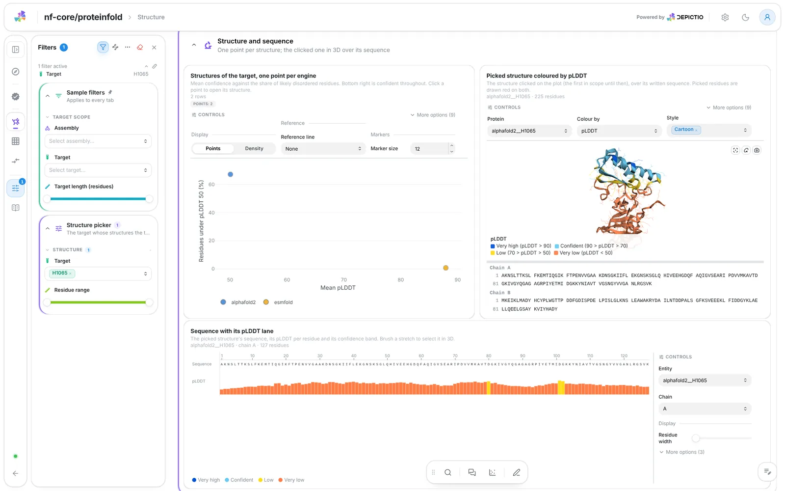
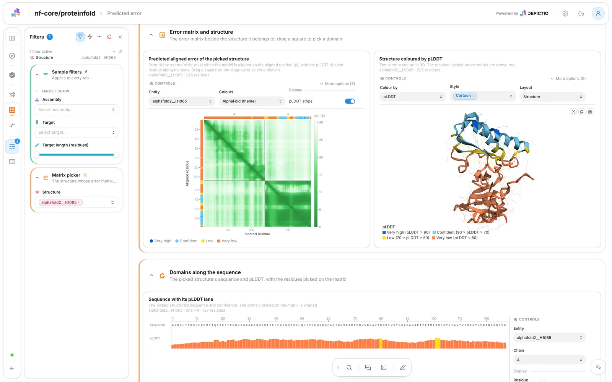

<div class="template-banner">
  <a class="template-banner-logo" href="https://nf-co.re/proteinfold" target="_blank" title="nf-core/proteinfold on nf-co.re">
    
    
  </a>
  <div class="template-banner-body">
    <h1 class="template-title">Protein structure prediction</h1>
    <p class="template-subtitle">Protein sequences folded by one or several engines, then scored: how far each model can be trusted, where along the chain it is confident, how domains and chains sit relative to each other, and where the engines agree.</p>
    <p class="template-links">
      <a href="https://nf-co.re/proteinfold" target="_blank"><i class="mdi mdi-open-in-new"></i> nf-co.re</a>
      <a href="https://github.com/nf-core/proteinfold" target="_blank"><i class="mdi mdi-github"></i> GitHub</a>
    </p>
  </div>
  <span class="template-status-draft template-banner-badge" data-tooltip="Draft: generated and not yet reviewed. Expect it to need fixes before it is usable."><i class="mdi mdi-pencil-outline"></i> Draft</span>
</div>

<div class="tpl-version-pick" data-latest="2.1.0">
  <span class="tpl-version-icon"><i class="mdi mdi-source-branch"></i></span>
  <span class="tpl-version-label">Template version</span>
  <select id="tpl-version" class="tpl-version-select" aria-label="Template version">
    <option value="2.1.0" selected>2.1.0</option>
  </select>
  <span class="tpl-version-badge">latest</span>
</div>

The proteinfold template reads the models an nf-core/proteinfold run wrote for
each target and engine (AlphaFold2 in standard or split-MSA mode, ColabFold,
ESMFold, RoseTTAFold All-Atom, ...), and follows them from their scores to the
engines' agreement:

- :material-compass-outline: **Overview**: the run in four key figures, live findings and four figures, each linked to the tab that explains it
- :material-check-decagram: **Model scores**: the pLDDT and pTM of every model, per engine
- :material-molecule: **Structure**: the picked structure in 3D over its sequence, per-residue confidence, the Ramachandran plot and the alignment it was folded from
- :material-grid: **Predicted error**: the predicted aligned error matrix beside the structure, to pick a confident domain
- :material-compare-horizontal: **Engines comparison**: the engines and the models of one target, rank by rank and residue by residue

The persistent `Sample filters` (assembly, target, target length) sit in the
left panel and narrow every tab through the target hub.

!!! info "Structures are read from the run, not resolved"
    The 3D and Ramachandran tiles read the top-ranked PDB that each engine
    publishes under `top_ranked_structures/`, so nothing leaves the server and
    the [structure resolver](../../features/protein-tiles.md#structure-resolver)
    (`DEPICTIO_STRUCTURE_RESOLVER_ENABLED`) is not used. Those PDBs are required:
    a run that published none has no structure to open.

---

## :material-rocket-launch-outline: Quick start

=== "Point at a finished run"

    ```bash
    depictio ingest /path/to/proteinfold_results \
      --template nf-core/proteinfold/latest
    ```

    The results directory is the only thing you have to pass, with one
    exception: proteinfold does not publish the samplesheet it ran on. The
    template looks for it at `{DATA_ROOT}/input/samplesheet.csv`; copy it there,
    or point to it:

    ```bash
    depictio ingest /path/to/proteinfold_results \
      --template nf-core/proteinfold/latest \
      --var METADATA_FILE=/path/to/samplesheet.csv
    ```

    | Variable | Default | Role |
    |---|---|---|
    | `METADATA_FILE` | `{DATA_ROOT}/input/samplesheet.csv` | the samplesheet the run was started with |
    | `GROUP_COL` | `assembly` | column the dashboard groups and filters targets by; `assembly` is derived (single chain or complex), and any samplesheet column beyond `id` and `fasta` works |
    | `GROUP_COL_DISPLAY` | `Assembly` | reader-facing label of `GROUP_COL` in filters and cards |

=== "From the pipeline itself (v1.10.0+)"

    ```bash
    depictio config nextflow --install     # once per machine
    nextflow run nf-core/proteinfold -r 2.1.0 -profile docker --outdir results
    ```

    No `depictio ingest`, and no template named: the pipeline ingests its own
    output directory when it finishes and resolves this template from its own
    manifest. See [Nextflow trigger](../../depictio-cli/nextflow-trigger.md). The
    trigger passes no `--var`, so put a copy of the samplesheet at
    `results/input/samplesheet.csv` before the run.

---

## :material-book-open-variant: Reference

The unit of every structure tile is the **entity**: one engine's top-ranked
structure of one target. Its id is the id the structures collection gives the
PDB, `<engine>__<target>`, with a non-default AlphaFold2 mode between the two,
so every per-structure table joins the 3D object without a lookup. The
template reads the PDBs (pLDDT sits in the B-factor column), the per-model
pLDDT, pTM, ipTM and ipSAE tables, the PAE matrix of the top-ranked model only
(`_0_` for AlphaFold2 and RoseTTAFold All-Atom, `_1_` for ColabFold, which numbers
its models from 1) and the integer-coded alignments of the MSA-based engines.
Model ranks are renumbered from 1, and the pLDDT bands follow AlphaFold:
very high from 90, confident from 70, low from 50, very low below.

ESMFold writes no alignment, no PAE and no TM scores, and single-chain targets
write empty ipTM and ipSAE files, which read as no rows. Alignments are capped at
500 rows, and a profile longer than 200 residues is averaged over equal windows.
The MultiQC reports repeat the residue table and cannot be bound generically,
so the template has no MultiQC tab.

!!! info "Self-adapting layout"
    The dashboard adapts to whatever the run actually produced: components bound
    to pruned or unparsed data collections are hidden, tabs left with no real
    visualizations are dropped entirely, and the remaining components are
    re-packed so there are no empty rows. The PAE matrices, the score files and
    the alignments are optional: a run that wrote no PAE drops the *assess* step
    of the Overview pipeline with them.

<div class="tpl-version-block" data-version="2.1.0" markdown>

--8<-- "pipeline-templates/nf-core/_generated/proteinfold-latest.md"

</div>

---

## :material-view-dashboard-outline: Dashboard tabs

One dashboard: the **Overview**, then four child tabs in two groups, read from
how far a model can be trusted to whether the engines agree. Each tab below
carries the **same icon and colour the dashboard gives it**, so the page and the
app read alike.

| Group | Tabs |
|---|---|
| Data & QC | Model scores |
| Structure | Structure, Predicted error, Engines comparison |

Each child tab opens with a short intro and a strip of four cards, then at most
three open sections; tables and record cards follow, collapsed. The *Sample
sheet* (the targets of the samplesheet) is pinned, collapsed, to the bottom of
every child tab. The pLDDT bands take AlphaFold's own colours.

=== ":material-compass-outline: Overview"

    *Protein structure prediction, from the sequence to the model each engine builds.*

    A short hero links the run parameters. *About this dashboard* says how to move
    through the tabs, *The run* counts the targets, engines, models and residues
    and prints the requested mode, and *Pipeline* walks six steps (targets, align,
    fold, score, assess, compare), each linked to its parameters and its tab. The
    findings are live values that follow the filters: the structures and engines,
    the median mean pLDDT with the share of residues under 50, the mean PAE and
    the models ranked.

    ??? abstract ":material-tune-variant: Filters and components"

        **Filters** · the left panel starts collapsed. *Key figures* has its own
        filter bar (assembly and target), *Findings* another (assembly and
        engine): each narrows its own section only.

        | Section | What it holds |
        |---|---|
        | Top | Hero, *About this dashboard*, *The run*, *Pipeline* |
        | Key figures | 4 headline cards: targets by assembly, top-ranked structures by engine, mean pLDDT, residues at pLDDT 70 or more |
        | Findings | Live result rows, then 4 figures: the first structure in 3D, the mean pLDDT per engine, the PAE matrix of the first structure and the top model of each engine per target |
        | How to read this dashboard | The tabs by group, each with its question |

=== ":material-check-decagram:{ .mc-teal } Model scores"

    **Data & QC** · *How far can each engine's top-ranked models be trusted?*

    The models predicted, the mean pLDDT of the top models, the share of residues
    at pLDDT 70 or more and the pTM of the top models. Then every model's mean
    pLDDT against its pTM, and the mean pLDDT of every model per engine. pLDDT
    scores each residue and pTM the whole fold, so a high pLDDT with a low pTM is
    a set of confident pieces placed loosely. Engines that write no TM score
    (ESMFold, RoseTTAFold All-Atom) are absent from the scatter and the pTM card.

    ??? abstract ":material-tune-variant: Filters and components"

        **Filters** · `Engine` and `Model rank` on `proteinfold_models`.

        | Section | What it holds |
        |---|---|
        | Models at a glance | 4 cards |
        | Confidence and fold quality | 1 advanced visualization |
        | Engines compared | *Mean pLDDT of every model, per engine* |

=== ":material-molecule:{ .mc-violet } Structure"

    **Structure** · *Where along each structure is the prediction confident?*

    [{ loading=lazy }](../../images/pipeline-templates/nf-core/proteinfold/structure_light.webp){ .tpl-shot target="_blank" rel="noopener" }

    The tab reads one target: its `Target` filter always holds a value and opens
    on the first. The strip gives the median residue pLDDT, the residues by
    confidence band, the likely disordered residues and the best mean pLDDT. Then
    a table with one row per engine's top-ranked structure picks the structure,
    which opens in [3D](../../features/protein-tiles.md#molecule-3d) coloured by
    pLDDT over its written sequence, with the sequence and its pLDDT lane below.
    A click on a residue in 3D, on a letter or a brush on the track selects the
    same residues in all of them. The
    [Ramachandran plot](../../features/protein-tiles.md#ramachandran) of the
    picked structure (phi and psi computed in the browser, coloured by pLDDT)
    sits beside the pLDDT profile of every engine. The alignment the structure
    was folded from and the residue table are collapsed.

    ??? abstract ":material-tune-variant: Filters and components"

        **Filters** · `Target` and `Residue range` on `proteinfold_residues`.

        | Section | What it holds |
        |---|---|
        | Confidence at a glance | 4 cards |
        | Structure and sequence | *Structures of the target, one row per engine*, then 2 advanced visualizations: the structure and the sequence track |
        | Backbone and engines | 2 advanced visualizations: the Ramachandran plot and the pLDDT per engine |
        | Alignment (collapsed) | *Alignment the structure was folded from* |
        | Residue table (collapsed) | *Residues of the structures in scope* |

    !!! note "A lone query row in the alignment"
        It is the data, not a filter: the engine found or used no homologs. ESMFold
        folds without an alignment, so its structure opens the tile on an empty
        state.

=== ":material-grid:{ .mc-orange } Predicted error"

    **Structure** · *Which domains and chains does the model place confidently?*

    [{ loading=lazy }](../../images/pipeline-templates/nf-core/proteinfold/predicted_error_light.webp){ .tpl-shot target="_blank" rel="noopener" }

    The tab reads one structure. The strip gives its mean PAE, the pLDDT of its
    residues, and the pTM and ipTM of its top-ranked model against AlphaFold's
    cut-offs (pTM 0.5; ipTM 0.8 and 0.6). Then the
    [PAE matrix](../../features/protein-tiles.md#pae-matrix) beside the same
    structure in 3D, coloured by pLDDT, and the sequence with its pLDDT lane below.
    A diagonal brush on the matrix selects a square as a residue range: the
    structure draws it red and the sequence track shades it, so a confident domain
    is picked in 3D. Dark blocks off the diagonal are domains or chains placed
    confidently relative to each other; on a complex the chain boundaries are
    marked.

    ??? abstract ":material-tune-variant: Filters and components"

        **Filters** · a `Structure` picker on `proteinfold_residues`. It always
        holds a value and does not offer ESMFold's structures, which have no
        matrix. There is no engine filter: the structure id carries its engine.

        | Section | What it holds |
        |---|---|
        | Error at a glance | 4 cards |
        | Error matrix and structure | 2 advanced visualizations: the matrix and the structure |
        | Domains along the sequence | 1 advanced visualization, the sequence track |

=== ":material-compare-horizontal:{ .mc-blue } Engines comparison"

    **Structure** · *Do the engines and their models agree on each target?*

    The models in scope, split by engine, the median mean pLDDT per model, the
    weakest model's mean pLDDT against the 70 and 50 cut-offs, and the pTM per
    model. Then the mean pLDDT of each engine's top-ranked model, the mean pLDDT
    by model rank, one line per engine (a steep fall from the first model means
    the ranking was decisive), and the per-residue profile: one curve per engine,
    the line the top-ranked model and the band the lowest to the highest of its
    models. A wide band marks residues the engine's models disagree on, and curves
    that part mark residues the engines disagree on. The models table and its
    record card are collapsed.

    ??? abstract ":material-tune-variant: Filters and components"

        **Filters** · `Target compared` (one at a time), `Engines compared` and
        `Model rank` on `proteinfold_models`.

        | Section | What it holds |
        |---|---|
        | Models at a glance | 4 cards |
        | Best model per engine | *Mean pLDDT of each engine's top-ranked model* |
        | Rank and agreement | *Mean pLDDT by model rank*, and 1 advanced visualization |
        | Model detail (collapsed) | *Models*, *Model record* |

Tables and point views select on `entity`, the structure id, so a pick narrows
the other tiles of its collection and follows the project links to the rest. The
three single-unit pickers (the target of Structure and Engines comparison, the
structure of Predicted error) always hold exactly one value, so the tiles that
show one structure at a time agree on it.

---

## :material-play-circle-outline: Running the pipeline

Depictio reads the **output** of nf-core/proteinfold, it does not run the
pipeline. Run the pipeline first:

```bash
nextflow run nf-core/proteinfold -r 2.1.0 \
  --input samplesheet.csv \
  --mode alphafold2,colabfold,esmfold \
  --outdir results \
  -profile docker
```

The samplesheet is `id,fasta`; extra columns are kept and can become the
grouping column. `--mode` takes one or several engines, and each needs its own
databases and weights: see the usage documentation. Then point Depictio at the
results, naming the samplesheet the pipeline did not publish:

```bash
depictio ingest results/ \
  --template nf-core/proteinfold/latest \
  --var METADATA_FILE=samplesheet.csv
```

See [nf-co.re/proteinfold/usage](https://nf-co.re/proteinfold/2.1.0/docs/usage)
for full pipeline documentation.

---

## :material-folder-open-outline: Required data structure

Point `depictio ingest` at the directory holding the pipeline output. Depictio
scans recursively and matches on file name; the engine, its AlphaFold2 mode and
the target are read off the path.

```text
<DATA_ROOT>/
├── input/
│   └── samplesheet.csv                         # --var METADATA_FILE (not published by the pipeline)
├── pipeline_info/
│   ├── params_*.json
│   └── *software*versions*.yml
└── <engine>[/<mode>]/                          # alphafold2/standard, colabfold, esmfold, ...
    ├── top_ranked_structures/<target>.pdb      # required: pLDDT in the B-factor
    ├── <target>_plddt.tsv                      # per-model pLDDT
    ├── <target>_{ptm,iptm,ipsae}.tsv           # optional; ipTM and ipSAE empty for one chain
    ├── <target>/paes/<target>_0_pae.tsv        # optional; _1_ for colabfold
    └── <target>/<target>_<engine>_msa.tsv      # optional; MSA-based engines only
```

---

## :material-flask-outline: Validation runs

The repository ships
[`download_test_data.sh`](https://github.com/depictio/depictio/blob/main/depictio/projects/nf-core/proteinfold/2.1.0/download_test_data.sh),
which fetches the subset of nf-core's AWS megatest run that the template needs
and copies the vendored samplesheet into `input/`:

```bash
bash depictio/projects/nf-core/proteinfold/2.1.0/download_test_data.sh \
  /tmp/proteinfold_test
depictio ingest /tmp/proteinfold_test \
  --template nf-core/proteinfold/latest
```

The run is
`s3://nf-core-awsmegatests/proteinfold/results-a414fd1368009500b66761e37e7cde80366a45e9/`,
a 2.1.0 development run (the 2.0.0 release run is empty): eleven `test_full`
runs gathered under one prefix, AlphaFold2 (standard and split-MSA), ColabFold,
ESMFold and RoseTTAFold All-Atom on two monomer targets, and AlphaFold2
multimer and ESMFold on one heterodimer. The script fetches the top-ranked PAE
matrix of each engine and target only.

---

## :material-link-variant: Additional resources

- [nf-co.re/proteinfold](https://nf-co.re/proteinfold): official pipeline documentation
- [nf-co.re/proteinfold/results](https://nf-co.re/proteinfold/results): AWS test results
- [Template System Reference](../../usage/projects/templates.md): YAML format, variables, conditionals
- [Recipes](../../usage/projects/recipes.md): how to read, test, and write recipes

---

## :material-account-group-outline: Authorship

<div class="tpl-credits">
  <div class="tpl-credit">
    <span class="tpl-credit-role"><i class="mdi mdi-code-braces"></i> Developers</span>
    <span class="tpl-credit-note">Wrote the template, its recipes and its dashboards.</span>
    <a class="tpl-person" href="https://github.com/weber8thomas" target="_blank" rel="noopener">
       weber8thomas
    </a>
  </div>
  <div class="tpl-credit">
    <span class="tpl-credit-role"><i class="mdi mdi-eye-check-outline"></i> Reviewers</span>
    <span class="tpl-credit-note">Nobody has run it on their own data and signed it off yet, which is what keeps it a Draft.</span>
    <span class="tpl-person"><i class="mdi mdi-account-plus-outline"></i> Open</span>
  </div>
  <div class="tpl-credit">
    <span class="tpl-credit-role"><i class="mdi mdi-wrench-outline"></i> Maintainers</span>
    <span class="tpl-credit-note">Keep it working as nf-core/proteinfold releases.</span>
    <a class="tpl-person" href="https://github.com/weber8thomas" target="_blank" rel="noopener">
       weber8thomas
    </a>
  </div>
</div>

Reviewing a template on your own data, or taking over a role here, is a
contribution in itself: the [contributing guide](../../developer/contributing-templates.md)
says what each one involves.
