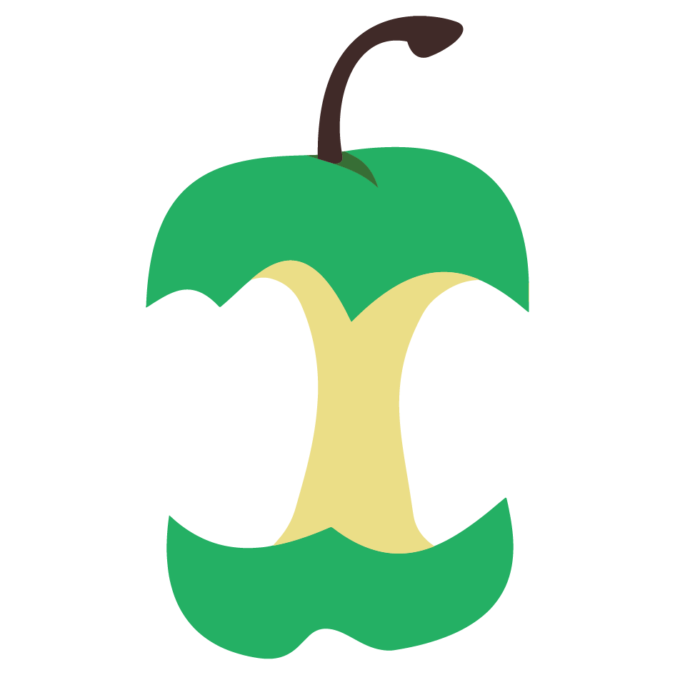

# :material-account-group-outline: Hands-on courses

Two courses, in order. Each episode ends with exercises and their solutions.

{ .ws-logo .off-glb } **nf-core/ampliseq** :material-penguin: **Palmer penguins**

-   :material-web: **[Depictio in the browser](../workshop/index.md)**

    ---

    Course 1 · in the browser · 6 episodes

    Read a shared dashboard, edit your copy, create projects from files and from an nf-core run, follow a new run.

    :material-account-school-outline: No Depictio experience 
    :material-web: A browser 
    :material-server-outline: No server? Run one in the [workshop Codespace](https://codespaces.new/depictio/depictio?devcontainer_path=.devcontainer/workshop/devcontainer.json&quickstart=1)

-   :material-console: **[Depictio from the command line](../workshop-cli/index.md)**

    ---

    Course 2 · in a terminal · 5 episodes

    Your tables become a project, a new run is compared, a dashboard is a file, a template reads an nf-core run.

    :material-console: Some terminal practice 
    :material-language-python: Python 3.11+, macOS or Linux 
    :material-server-outline: No server? Run one on your laptop: [`depictio local up`](../../installation/local.md)

[Start course 1Depictio in the browser](../workshop/index.md){ .ws-go .ws-ep1 }
[Start course 2Depictio from the command line](../workshop-cli/index.md){ .ws-go .ws-ep4 }

[Teaching it?Instructor notes, course 1](../workshop/facilitators.md){ .ws-help .ws-inst }
[Teaching it?Instructor notes, course 2](../workshop-cli/facilitators.md){ .ws-help .ws-inst }

