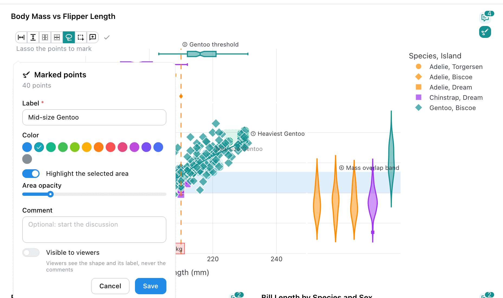
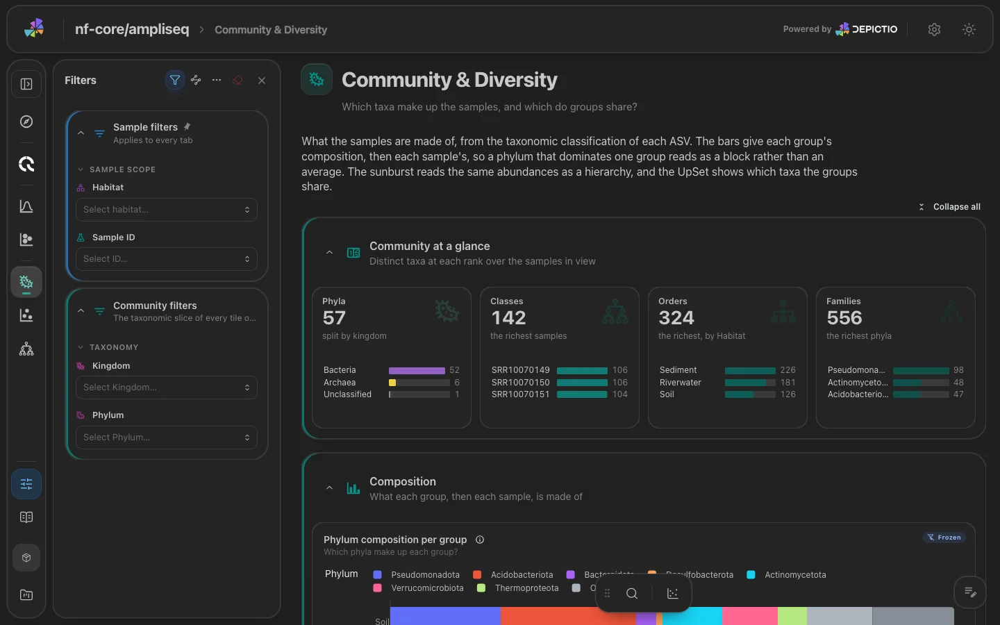
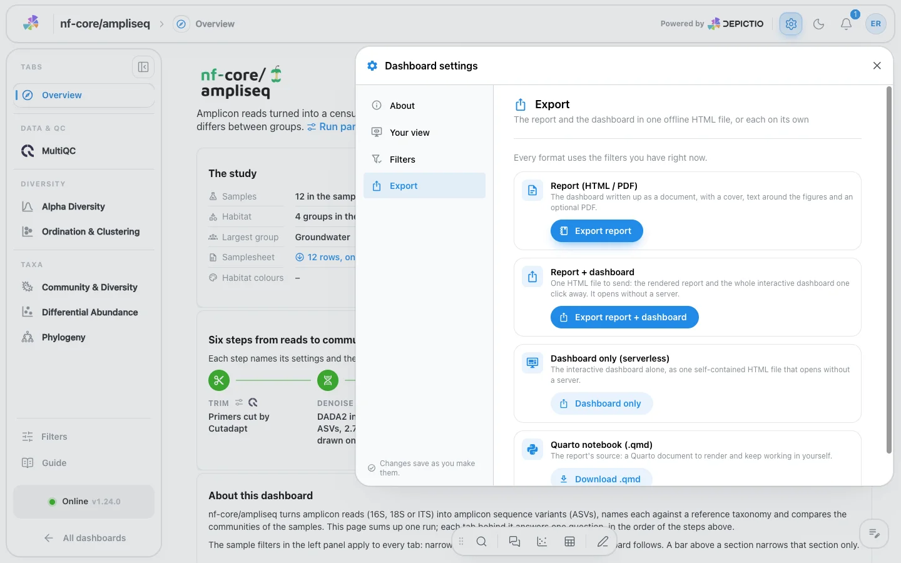
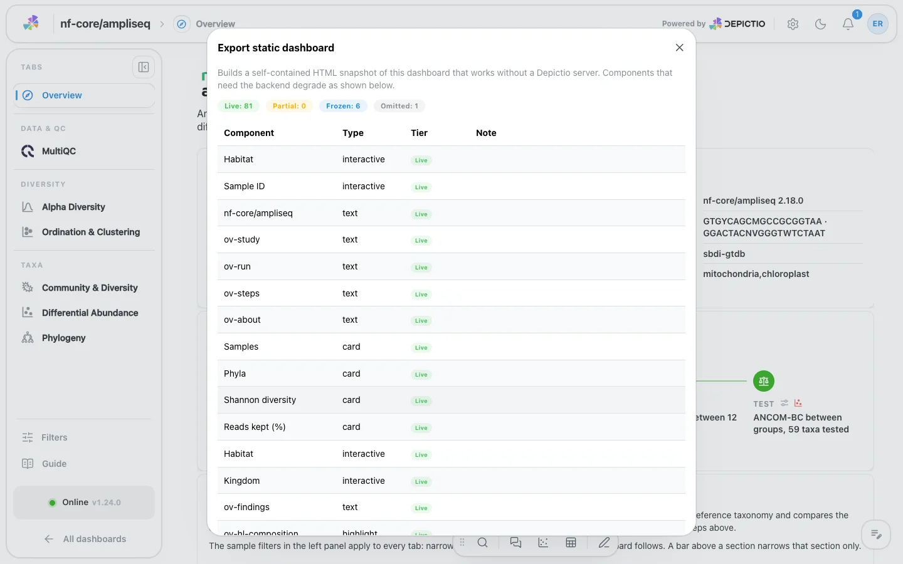

# 3. Collaborate and export

[**0** Setup](setup.md){ .ws-ep0 } [**1** Your tables](project-builder.md){ .ws-ep1 } [**2** nf-core run](nf-core-run.md){ .ws-ep2 } [**3** Collaborate](collaborate-and-export.md){ .ws-ep3 .ws-here } [**+** Going further](going-further.md){ .ws-ep4 }

:material-pencil-outline: **Designer** :material-web: **In the browser** :material-database-outline: **Your copy of nf-core/ampliseq** :material-timer-outline: **Hands-on 3 · 15 min**

!!! overview "Overview"
    **Questions**

    - How do I label samples my own way, without changing the data?
    - How do I discuss a figure with others?
    - How do I hand a dashboard to someone who has no server?

    **Objectives**

    - Label samples in **Metadata** mode.
    - Comment on a figure and annotate it.
    - Compare a component with an earlier version.
    - Export the dashboard as one HTML file.

Work on your own copy of the nf-core/ampliseq dashboard from Day 1 (episode 2). If you have none, duplicate **nf-core/ampliseq** from the **Dashboards** page (**⋮**, then **Duplicate**) and rename the copy with your first name. The four steps can be done in any order.

## :material-tag-outline: Hands-on 3 · Step 1: label samples in Metadata mode { #label }

You know groups of samples from a lasso. Sometimes you know the groups from outside the data. The **Metadata** panel opens the project's sample sheet beside the dashboard: you add a column of your own, and each label becomes a group. The real table does not change.

1. Open your copy and click **Metadata** in the dock, at the bottom. The panel opens on the right, with the sample sheet.
2. Click the **+** column, name it `my_group`, and type a label for three samples, for example `mine`. Pasting a column from a spreadsheet works too.
3. Open the column's menu and click **Compare in the charts**. Each label value becomes a group in **Analysis**, with a tag icon.
4. Colour a figure by your label: in **Analysis**, pick your groups under **Color figures by**, then look at a figure of the **Community & Diversity** tab.

<!-- TODO: check the exact name of the Analysis control that colours figures by label groups on 1.24.0 (the guide says "charts coloured by My groups"). -->

{target=_blank}
{target=_blank}

Where the labels live: on your account when you are signed in, so only you see them, from any computer. Without an account they stay in this browser. An editor of the dashboard can share a label column with every reader.

## :material-comment-text-outline: Step 2: comment and annotate { #comment-and-annotate }

A shared dashboard is also a place to talk about the data.

1. **Comment.** Hover a figure and click the comments icon in its action bar. Type your remark and click **Post** (or press Ctrl+Enter). The comment keeps the filters and the selection it was written with: when a colleague opens the thread, they see what you saw. You must be signed in to write. This workshop's server lets readers comment.
2. **Annotate.** Hover a figure and click **Annotate** in its action bar. A tool palette appears on the figure: pick **Range on x**, **Vertical line**, **Mark points (lasso)** or **Note**, and draw. Give it a **Label**, then click **Save**, and click the check mark to leave annotate mode.
3. Back in your dashboard, click **Save**.

<!-- TODO: the slide says "in Edit mode, one annotation"; docs/features/comments-annotations.md says annotations live in the viewer, not the editor. Check on 1.24.0 where Annotate shows for the owner of a copy. -->

{target=_blank}

An annotation stays with the editors of the project until you switch on **Visible to viewers**: then every reader sees its shape and its label, never the discussion.

## :material-history: Step 3: versions { #versions }

You cannot break anything for good. Every save records a version of the whole dashboard, and each component has its own history.

1. In **Edit** mode, change a figure (its colour or its axis) and click **Save**. Your copy now has at least two versions.
2. Open the figure's **⋮** menu and click **History**.
3. Pick the previous version. Click **Compare**: the version is on the left and the component as it is now, **Current**, on the right.
4. Restore only if you want the old figure back: the rest of the dashboard stays as it is.

{target=_blank}
{target=_blank}

## :material-file-export-outline: Step 4: export { #export }

A dashboard does not have to stay on the server. Click the gear (**Settings**), then **Dashboard settings**, then **Export**, and choose **Dashboard only (serverless)**: the interactive dashboard as one self-contained HTML file. Every format uses the filters you have right now.

1. Before it builds the file, Depictio lists every component with its tier: **Live** (redrawn in the browser), **Partial**, **Frozen** (kept as computed at export) or **Omitted**. For the ampliseq dashboard: 81 live, 0 partial, 6 frozen, 1 omitted.
2. Save the file: one `.html` of about 16 MB.
3. Turn the network off and open the file from your disk. The tabs, the filter panel and the figures work, with no server: 0 network requests. A frozen figure carries a **Frozen** badge and keeps the view it had at export.

{ .ws-shot }

Only the owner of a dashboard can export it, so you can export your copy. A server setting turns the exports on; on the workshop server they are on.

!!! question "Check your understanding"
    Who sees your Metadata labels? Who sees your annotation? And what happens to a **Frozen** figure when you change a filter in the exported file?

    ??? solution "Answer"
        Your labels: only you, from your account, unless an editor shares the column. Your annotation: the editors and owners of the project, until you switch on **Visible to viewers**. A frozen figure keeps the view it had at export: it does not follow a new filter.

!!! challenge "Challenge: two exports, one question"
    Export **Dashboard only** twice: once with no filter, once with **Habitat** set to *Soil*. Open both files with the network off. What does the **Phyla** card show in each?

    ??? solution "Solution"
        57 phyla in the first file and 26 in the second: every export uses the filters you have at that moment, and the card is redrawn in the browser (it is **Live**).

!!! keypoints "Key points"
    - **Metadata** mode labels samples without changing the table: each label is a group that colours and splits the charts.
    - A comment keeps the filters and the selection it was written with; an annotation is drawn on a figure and stays with the editors until it is made visible to viewers.
    - Every save is a version; a component's **History** compares it with an earlier one and restores just that component.
    - **Dashboard only (serverless)** exports one HTML file that opens without a server, with the filters you have at that moment.

??? note "Bonus · Metadata mode: more than one column"
    Why the Metadata button may be missing: it shows only when the project has an eligible table, a table that is the source of a link and has at most 10,000 rows. The nf-core/ampliseq project has one.

    - **Import** a CSV or TSV, or drop it on the panel: pick **As labels**, then **Add columns**, **Fill missing** or **Replace**. The file is read in your browser and never sent to the server.
    - The column menu: **Rename**, **Delete**, **Keep on my account**, **Share on this dashboard** (every reader sees the column, read-only, and can **Copy to my labels**), and **Save to table**, which writes the column into the table as a new version after a dry run. **Save to table** needs an owner or an editor.
    - **Export** in the panel header downloads the table's rows with your label columns, as a TSV built in the browser.
    - At most 24 groups in all, 20 label columns, 80 characters per label.

    More in [Label samples from the dashboard](../metadata-panel.md).

??? note "Bonus · Comments in detail"
    - The **Comments** button in the dashboard header opens every thread of the current tab. Its badge counts the open threads.
    - A thread takes replies (**Reply**), can be resolved and reopened (**Resolve**, **Reopen**), and **Show on dashboard** scrolls to its component and applies its filters and selection again, to today's data.
    - A thread says **Data changed** when a data collection its component reads was processed again since it was written, and **Component changed** when the component was edited.
    - You can edit or delete your own comments. A project owner can delete anyone's.
    - Commenters see each other's e-mail addresses.

    More in [Comments and Annotations](../../features/comments-annotations.md).

??? note "Bonus · Annotation shapes"
    | Tool | What it draws |
    |------|---------------|
    | **Range on x** / **Range on y** | A band across one axis: drag a box, only its extent is kept |
    | **Vertical line** / **Horizontal line** | A dashed reference line at one value |
    | **Mark points (lasso)** / **Mark points (box)** | Rings around the selected points, optionally with the area shaded |
    | **Note** | A numbered label with an arrow, attached to a data point |

    Shapes are stored in data coordinates, so they keep their place when the figure is resized or redrawn. Annotations are stored apart from the dashboard: saving or restoring the dashboard never drops them. Tables take **Mark rows**; 3D, polar and pie charts are comment-only.

??? note "Bonus · Versions in detail: Settings, History"
    In **Edit** mode, **Settings → History** lists every version of the dashboard, newest first. A row has **Restore** and a **⋮** menu: **Preview in a new tab** (read-only), **Bookmark** (names the version and keeps it for good) and **Delete**. A restore first records the present state as a version, so it can be undone, and it never changes permissions, comments or the data.

    {target=_blank}
    {target=_blank}

    More in [Dashboard and data versions](../../features/versioning.md).

??? note "Bonus · The four export formats, and what is live or frozen"
    A dashboard does not have to stay on the server. Open the dashboard, click the gear (**Settings**), then **Export**. The page offers four formats, and every format uses the filters you have right now.

    - **Report (HTML / PDF)**: the dashboard written up as a document, with a cover, text around the figures and an optional PDF.
    - **Report + dashboard**: one HTML file to send, with the rendered report and the whole interactive dashboard one click away. It opens without a server.
    - **Dashboard only (serverless)**: the interactive dashboard alone, as one self-contained HTML file that opens without a server.
    - **Quarto notebook (.qmd)**: the report's source, a Quarto document to render and keep working in yourself.

    { .ws-shot }

    { .ws-shot }

[Stuck?Troubleshooting](troubleshooting.md#collaborate-and-export){ .ws-help }
[ThenGoing further](going-further.md){ .ws-go .ws-ep4 }

