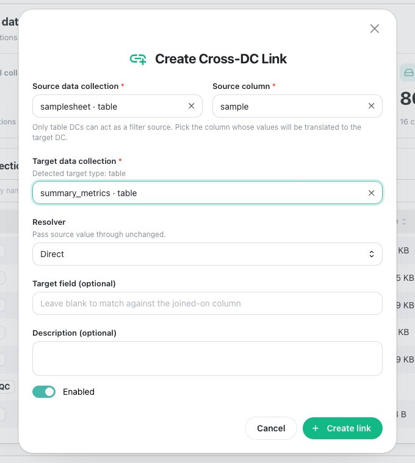
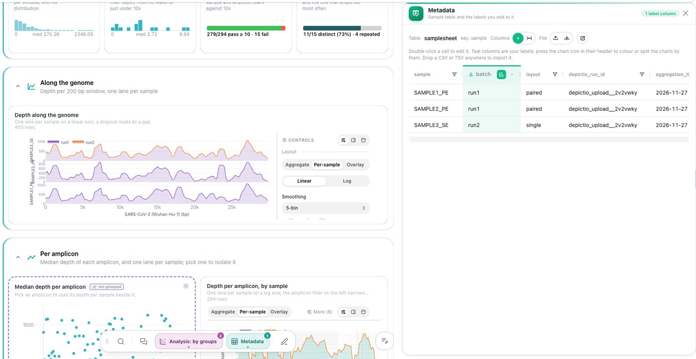
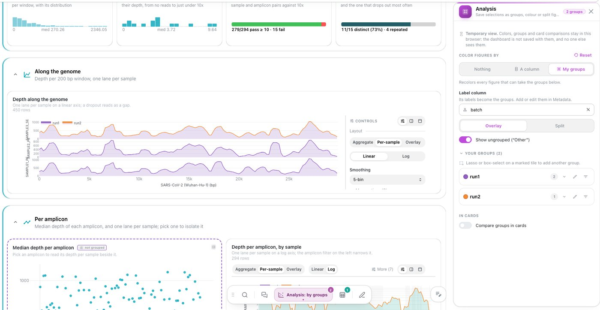
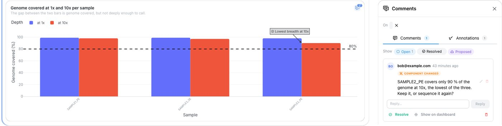
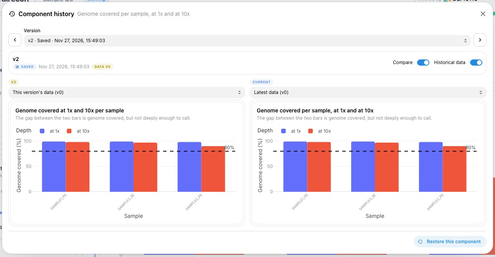
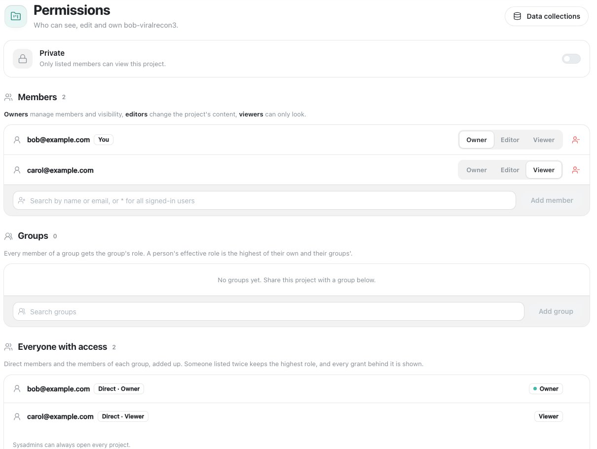
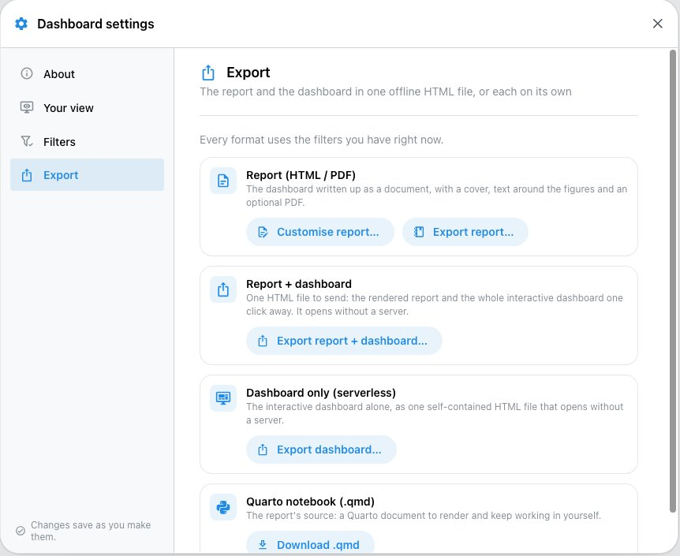
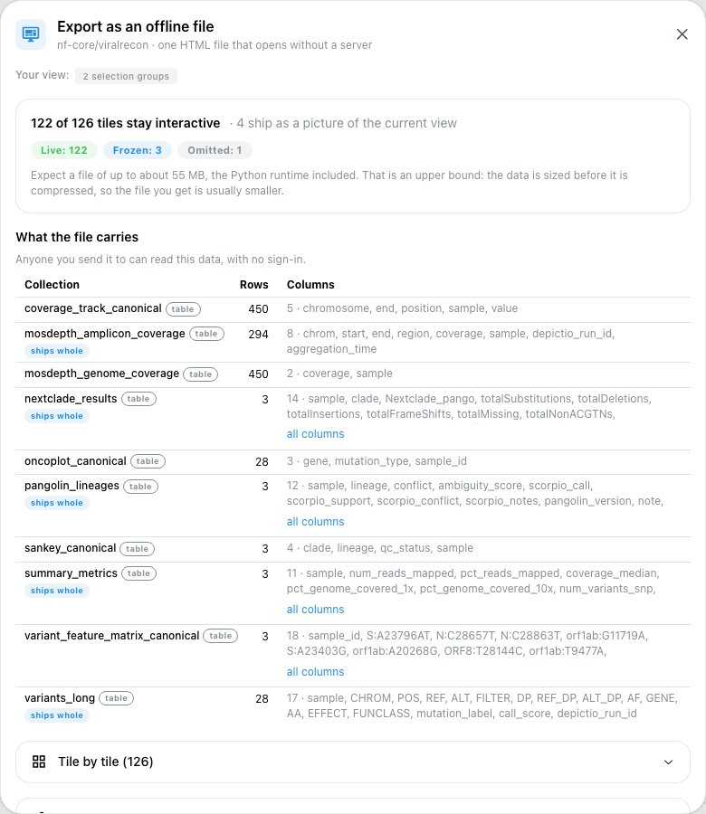

# 3. Work on your dashboard, together

[**0** Setup](setup.md){ .ws-ep0 } [**1** Your tables](project-builder.md){ .ws-ep1 } [**2** nf-core run](nf-core-run.md){ .ws-ep2 } [**3** Together](collaborate-and-export.md){ .ws-ep3 .ws-here } [**+** Going further](going-further.md){ .ws-ep4 }

:material-pencil-outline: **Owner of the project** :material-web: **In the browser** :material-database-outline: **Your nf-core/viralrecon dashboard** :material-timer-outline: **Hands-on 3 · 15 min**

!!! overview "Overview"
    **Questions**

    - How do I group samples my own way, without changing the data?
    - How do I talk about a figure with a colleague?
    - How do I keep a safe copy of my work, share it, or send it to someone with no server?

    **Objectives**

    - Add a label column in **Metadata** mode and colour the figures by it.
    - Comment on a figure and annotate it.
    - Save a version, then compare a component with the previous one.
    - Share the project with a colleague.
    - Export the dashboard as one HTML file.

You own the **nf-core/viralrecon** dashboard that episode 2 created: you can edit it, share it and export it. Work through the five steps in order. Open your project from the **Projects** page, and the dashboard from the project.

## :material-tag-outline: Hands-on 3 · Step 1: group the samples in Metadata mode { #label }

You have three samples: `SAMPLE1_PE`, `SAMPLE2_PE` and `SAMPLE3_SE`. Say they were sequenced in two runs: the first two in `run1`, the third in `run2`. The data does not say so. You add it as a column of your own, and each label becomes a group.

The **Metadata** panel needs a small table of samples, linked to the run's tables. The run has none, so you add one first, on the project page.

1. Download [`samplesheet.csv`](samplesheet.csv). It has one row per sample, and a `layout` column.
2. Open your project. Click **Add data** and drop the file on **Drop files or folders here**. Click **Add 1 table**.
3. Still on the project page, scroll down to **Cross-DC links** and click **Add link**. Fill in: **Source data collection** `samplesheet · table`, **Source column** `sample`, **Target data collection** `summary_metrics · table`. Click **Create link**.

{ .ws-shot }

Now open the dashboard.

4. Click **Metadata** in the dock, at the bottom. The panel opens on the right, with the `samplesheet` table.
5. Click the green **+** next to **Columns**, name the column `batch`, and click **Add**. Double-click a cell of the new column, type a label, press Enter. Do the three rows: `run1`, `run1`, `run2`.
6. Look at the header of the `batch` column: the chart icon turns the labels into groups. When it is on, **Analysis** shows **2 groups**. If not, press the icon.

{ .ws-shot }

7. Open **Analysis** in the dock. Under **Color figures by**, click **A column**, open **Pick a column…** and pick `batch`. The panel switches to **My groups**, with `batch` as the label column.
8. Open the **Coverage & Depth** tab. The lanes of **Depth along the genome** are now coloured by `run1` and `run2`.

{ .ws-shot }

Only some figures take the groups: on this dashboard, the two depth plots of **Coverage & Depth**. On **Sample QC** and **Overview** the panel says that none of the components can receive them.

The real tables do not change. Your labels live on your account, so you find them again from any computer, and a colleague does not see them.

## :material-comment-text-outline: Step 2: comment and annotate { #comment-and-annotate }

Open the **Sample QC** tab and find **Genome covered per sample, at 1x and at 10x**, a bar chart.

1. **Comment.** Hover the figure and click the comments icon in its action bar. Type your remark, for example `SAMPLE2_PE covers only 90 % of the genome at 10x. Keep it, or sequence it again?`, and click **Post**.
2. **Annotate.** Hover the figure again and click **Annotate**. In the tool palette, pick **Note**, and click the bar of the sample you mean. Type a label, for example `Lowest breadth at 10x`, and click **Save**. Click **Leave annotate mode**.

{ .ws-shot }

Use a bar chart for the note. On a figure with a log axis, the note is saved but not drawn.

## :material-history: Step 3: edit a component, save, compare { #versions }

You cannot break anything for good: every save records a version, and each component keeps its own history.

1. Click **Edit** in the dock. If a **Not now** button appears, click it.
2. On the **Sample QC** tab, hover the same bar chart and open its **Component actions** menu, then click **Edit**. Open **Card header & style** and change the title, for example to `Genome covered per sample, at 1x and at 10x`. Click **Save changes**.
3. Click **Save** in the dock. Your dashboard now has a new version.
4. Open the **Component actions** menu of the chart again and click **History**. Use the left arrow to go to the previous version, then switch on **Compare**: the previous version is on the left, the component as it is now (**Current**) on the right. The titles differ.

{ .ws-shot }

**Restore this component** brings the old one back. The rest of the dashboard stays as it is.

## :material-account-multiple-outline: Step 4: share the project { #share }

A dashboard belongs to a project, and the project decides who sees it.

1. Go back to your project and click **Permissions**.
2. Read the page. The switch at the top says **Public** (any signed-in user can open the project) or **Private** (*Only listed members can view this project*). **Members** lists people one by one, with a role: **Owner**, **Editor** or **Viewer**. **Groups** works the same way for a group, and **Everyone with access** adds both up.
3. Type the e-mail address of the person next to you in **Search by name or email**, pick them, and click **Add member**. They are listed as **Viewer**: *viewers can only look*.

{ .ws-shot }

Leave the **Public** switch as it is.

## :material-file-export-outline: Step 5: export it for offline use { #export }

A dashboard does not have to stay on the server.

1. Click the gear in the header (**Settings**), then **Export**. Under **Dashboard only (serverless)**, click **Export dashboard…**. Every export uses the filters you have right now.
2. A dialog lists what the file will carry: the tables, with their rows and columns, and every tile of the dashboard with its tier. **Live** tiles are redrawn in the browser. **Frozen** tiles ship as a picture of the current view. **Omitted** tiles are left out. Read it before you go on.

{ .ws-shot }

3. Click **Export** and save the file.
4. Turn the network off, and open the `.html` file from your disk. Pick a sample in the filters: the cards and the figures change.

<!-- TODO (not verified): the export file could not be built on the test server (the static runtime bundle was missing), so steps 3 and 4 were never run: no file size, no check with the network off, no check that a filter changes a card in the file. Run them once on the workshop server, add a screenshot of the file opened from disk (file:// address), and delete this comment. Steps 1 and 2 were seen working. -->

!!! warning "Anyone you send the file to can read this data"
    The dialog says it: *Anyone you send it to can read this data, with no sign-in.* Check the tables it lists before you send it.

!!! question "Check your understanding"
    A colleague opens the same dashboard, after you labelled the samples in step 1. Do they see the groups `run1` and `run2`? Where do your labels live?

    ??? solution "Answer"
        No. The labels are yours: they are kept on your account, not in the project, and the tables are not changed. The groups, the colours and the comparison in the cards are a temporary view too: they stay in your browser.

!!! challenge "Challenge: what stays interactive"
    Open **Export dashboard…** again, and read the dialog without exporting. How many tiles stay interactive, how many do not, and how large can the file be at most?

    ??? solution "Solution"
        On the nf-core/viralrecon dashboard, **122 of 126** tiles stay interactive (**Live**). Four do not: **3** are **Frozen**, **1** is **Omitted**. The file is **up to about 55 MB**: the dialog says it is an upper bound, because the data is sized before it is compressed.

        { .ws-shot }

!!! keypoints "Key points"
    - **Metadata** mode adds your own label column beside the samples, without changing the table. Each label is a group that can colour the figures that carry the sample.
    - A comment and a note stay on the figure they were written on.
    - Every save is a version. The history of a component compares it with an earlier one, and restores just that component.
    - **Permissions** lists who sees the project, and with which role: owner, editor or viewer.
    - **Dashboard only (serverless)** exports one HTML file with the filters you have at that moment. Anyone who gets it can read its data.

??? note "Bonus · Compare the groups in the cards"
    Open the **Sample QC** tab and **Analysis**. With `batch` as your label column, switch on **Compare groups in cards**. Each card now shows its number for all the samples and for each group. Read the **Median depth** card: which run has the deeper samples, and by how much?

    ??? solution "Solution"
        `run2`, by 50. The card shows **286** for all three samples, **236** for `run1` (two samples) and **286** for `run2` (one sample).

??? note "Bonus · Fix your comment"
    Open the comments of the bar chart again. Hover your comment and click the pencil. Change the text so that it also quotes the depth of the sample, and save it.

    ??? solution "Solution"
        The text is replaced, and the comment stays on the figure. Example: `SAMPLE2_PE has the lowest depth (181) and only 90 % of the genome at 10x. Keep it, or sequence it again?`

[ThenGoing further](going-further.md){ .ws-go .ws-ep4 }

