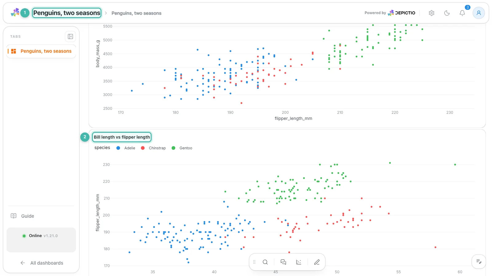

# 3. A dashboard as code

<div class="ws-strip" markdown>
[**0** Setup](setup.md){ .ws-ep0 } [**1** First project](first-project.md){ .ws-ep1 } [**2** A new season](own-tables.md){ .ws-ep2 } [**3** As code](dashboard-as-code.md){ .ws-ep3 .ws-here } [**4** nf-core](nf-core-run.md){ .ws-ep4 }
</div>

<div class="ws-meta ws-ep3" markdown>
<span class="ws-chip" markdown="span">:material-file-code-outline: **Editor, in a text editor**</span> <span class="ws-chip" markdown="span">:material-penguin: **Your penguins project**</span>
</div>

!!! overview "Overview"
    **Questions**

    - Can I write a dashboard as a file, and keep it with my code?
    - How do I know a file is correct before it reaches the server?

    **Objectives**

    - Export a dashboard to YAML and read how a figure is described.
    - Add a figure, validate the file, import it.

A dashboard is also a YAML file: one entry per component, with its type, its data collection and its settings. The file can be reviewed, kept in git and handed to a colleague.

[{ .ws-diagram }](../../images/tutorials/workshop-cli/diagrams/as-code_light.png){target=_blank}
[{ .ws-diagram }](../../images/tutorials/workshop-cli/diagrams/as-code_dark.png){target=_blank}

## :material-file-export-outline: Export

1. Open the penguins dashboard of episodes 1 and 2, *Penguin field survey*. Its **ID** is the last part of the address: `…/dashboard/<ID>`.
2. Export it:

    ```console
    $ depictio dashboard export <ID> -o dashboard.yaml
    ✓ Dashboard exported to: dashboard.yaml
    ```

    Name the output `dashboard.yaml`, not the name of your project file: the export overwrites the output file without asking.

3. Open `dashboard.yaml`. A figure reads:

    ```yaml
    -   component_type: figure
        workflow_tag: field_survey
        data_collection_tag: physical_features
        visu_type: scatter
        # --- optional ---
        figure_params:
            x: flipper_length_mm
            y: body_mass_g
            color: species
        mode: ui
        selection_enabled: false
        title_size: sm
        title_align: left
        # --- generated on export ---
        tag: figure-scatter_flipper_length_mm_body_mass_g-2e4cdb
        index: 3acd1b0e-c5e7-4243-b1a8-794c5607ea4c
        layout:
            x: 0
            y: 2
            w: 8
            h: 5
        title: Flipper length vs body mass
    ```

`tag` and `index` are written by the server: leave them out of what you add. `layout` places the component on a grid 8 wide: `y` counts rows from the top, `h` its height.

## :material-pencil-outline: Change it

1. Change `title:` at the top, for instance to *Penguins, two seasons*.
2. Add a figure at the end of `components:`:

    ```yaml
    -   component_type: figure
        workflow_tag: field_survey
        data_collection_tag: physical_features
        visu_type: scatter
        title: Bill length vs flipper length
        figure_params:
            x: bill_length_mm
            y: flipper_length_mm
            color: species
        layout: {x: 0, y: 7, w: 8, h: 5}
    ```

3. Check the file:

    ```console
    $ depictio dashboard validate dashboard.yaml
    ✓ Schema + domain OK
    ✓ Server schema OK
    ✓ Validation passed
    ```

## :material-file-import-outline: Import

```console
$ depictio dashboard import dashboard.yaml
✓ Dashboard imported successfully!
  Dashboard ID: …
  Title: Penguins, two seasons
  Project ID: …

View at: https://…/dashboard/…
```

Open the address the CLI prints: the new figure is under the first two (2).

[{ .ws-shot }](../../images/tutorials/workshop-cli/ep3_imported.webp){target=_blank}

The new title makes a **new** dashboard in your project, next to the one you exported: the server matches dashboards by title. To update one in place, keep its title and add `--overwrite`.

!!! challenge "Challenge 3.1: import twice"
    Change the colour of your new figure to `island`, then run `depictio dashboard import dashboard.yaml` again. What happens? How do you update the dashboard?

    ??? solution "Solution"
        The import is refused: *Dashboard 'Penguins, two seasons' already exists in this project. Use --overwrite to update it.* With `depictio dashboard import dashboard.yaml --overwrite` it reads *Dashboard updated successfully!*, and the dashboard keeps its address.

!!! challenge "Challenge 3.2: a typo"
    In a card of `dashboard.yaml`, change `column_name: body_mass_g` to `column_name: body_mass`. Run `depictio dashboard validate dashboard.yaml`. Is the mistake caught? Then run it with `--server ~/.depictio/CLI.yaml`.

    ??? solution "Solution"
        Without `--server`, validate only warns: *Column 'body_mass' not found in 'field_survey/physical_features'*, lists the available columns, and still ends with *Validation passed*. Naming the server makes the check count: *Validation failed (1 error(s))*. `import` refuses the file either way.

!!! warning "Figure columns are not checked"
    A wrong column inside `figure_params` passes `validate` and `import`: the figure is saved, and stays empty. Check figure columns against the list validate prints for cards, or against the data collection's page.

!!! keypoints "Key points"
    - `dashboard export` writes a dashboard as YAML; `import` sends one back.
    - The server matches dashboards by title: a new title makes a new dashboard, `--overwrite` updates one.
    - `validate --server ~/.depictio/CLI.yaml` checks columns against your data before you import.

<div class="ws-next" markdown>
[<span class="ws-k">Stuck?</span><span class="ws-t">Troubleshooting</span>](troubleshooting.md#episode-3){ .ws-help }
[<span class="ws-k">Optional episode</span><span class="ws-t">4. An nf-core run, with its template</span>](nf-core-run.md){ .ws-go .ws-ep4 }
</div>
