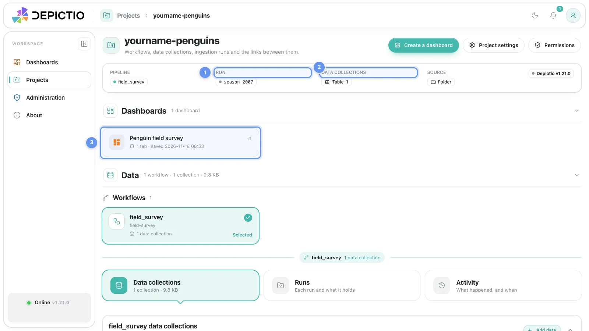
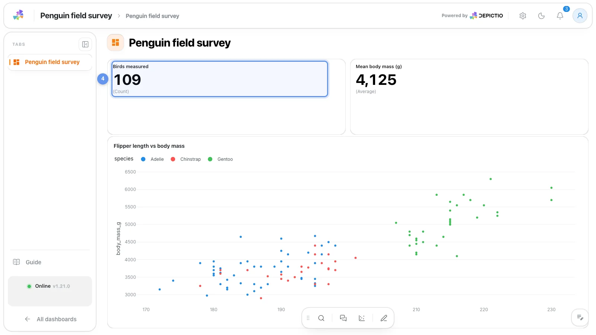

# 1. Your first project from the command line

<div class="ws-strip" markdown>
[**0** Setup](setup.md){ .ws-ep0 } [**1** First project](first-project.md){ .ws-ep1 .ws-here } [**2** A new season](own-tables.md){ .ws-ep2 } [**3** As code](dashboard-as-code.md){ .ws-ep3 } [**4** nf-core](nf-core-run.md){ .ws-ep4 }
</div>

<div class="ws-meta ws-ep1" markdown>
<span class="ws-chip" markdown="span">:material-console: **Creator, from the terminal**</span> <span class="ws-chip" markdown="span">:material-penguin: **Palmer Penguins, one table, one season**</span>
</div>

!!! overview "Overview"
    **Questions**

    - How do I turn a table on my laptop into a Depictio project?
    - How do I check what will happen before anything is sent?

    **Objectives**

    - Read a project file of one table.
    - Run a dry run, then the ingestion, with a starter dashboard.

In the browser course, episode 4, you uploaded the penguin tables in the browser. Here the CLI reads them on your laptop. A short **project file** tells it which file makes which table.

[{ .ws-diagram }](../../images/tutorials/workshop-cli/diagrams/cli-flow_light.png){target=_blank}
[{ .ws-diagram }](../../images/tutorials/workshop-cli/diagrams/cli-flow_dark.png){target=_blank}

## :material-folder-download-outline: Get the files

Download [`penguins-workshop.zip`](penguins-workshop.zip), unzip it, and **work inside the folder**: the project files name the seasons relative to it. Episodes 1 to 3 use this folder.

```bash
unzip penguins-workshop.zip
cd penguins-workshop
```

```console
penguins-workshop/
├── penguins-1.yaml      episode 1: one table
├── penguins.yaml        episode 2: two tables, a link, any season
├── starter.yaml         a starter dashboard
└── seasons/
    ├── season_2007/     demographic_data.csv, physical_features.csv
    └── season_2008/     the same two files, for 2008
```

## :material-file-code-outline: Read the project file

Open `penguins-1.yaml` in a text editor:

```yaml
name: "Penguins field seasons"
workflows:
  - name: "field_survey"
    engine:
      name: "field-survey"
    data_location:
      structure: "flat"
      locations:
        - "seasons/season_2007"
    data_collections:
      - data_collection_tag: "physical_features"
        config:
          type: "Table"
          metatype: "Aggregate"
          scan:
            mode: "recursive"
            scan_parameters:
              regex_config:
                pattern: "physical_features.csv"
          dc_specific_properties:
            format: "CSV"
```

| Line | What it says |
|---|---|
| `workflows` | One source of results. `engine` names what produced them: here a field survey |
| `locations` | The folder to read: one folder is one **run** |
| `data_collection_tag` | The name of the table in Depictio |
| `pattern` | The file to look for in the folder, here `physical_features.csv` |
| `metatype: "Aggregate"` | The rows of every run add up in one table: episode 2 uses it |
| `format: "CSV"` | How to read the file |

## :material-clipboard-check-outline: Dry run

Give the project a name of your own: names are unique on the server.

```console
$ depictio ingest --project-config-path penguins-1.yaml \
    --project yourname-penguins --dashboard starter.yaml --dry-run
✓ Project configuration is valid (checked locally; a dry run does not contact the server)
• Would create project 'yourname-penguins' on the server
│ physical_features │ recursive │ physical_features.csv │ 1 │
• Would import 1 dashboard(s)
✓ Dry run complete (8/8 steps): the configuration is valid, and nothing was changed.
```

The dry run reads the file and the folder on your laptop, and shows what each table finds: here **1** file. It sends nothing. It still needs your `CLI.yaml`: without one it refuses to run, although it does not contact the server.

!!! challenge "Challenge 1.1: a typo"
    In `penguins-1.yaml`, change the pattern to `physical_feature.csv` (no *s*) and run the dry run again. What changes? Put the *s* back.

    ??? solution "Solution"
        The table now finds **0** files, and the dry run warns: *1 data collection(s) would match no file: physical_features. Check DATA_DIR and the scan patterns before running for real.* It still ends with *Dry run complete*: read the counts and the warnings, not only the last line.

## :material-database-import-outline: Ingest

The same command without `--dry-run`:

```console
$ depictio ingest --project-config-path penguins-1.yaml \
    --project yourname-penguins --dashboard starter.yaml
…
✓ Project created on server
✓ Data collection 'physical_features' processed successfully.
✓ Dashboard created: Penguin field survey
• Project: https://…/projects/…
• Dashboard 'Penguin field survey' created: https://…/dashboard/…
✓ Ingestion completed successfully! (8/8 steps)
```

`--dashboard` adds the dashboard described in `starter.yaml`: two cards and a scatter. Open the **Project** link the CLI printed:

[{ .ws-shot }](../../images/tutorials/workshop-cli/ep1_project.webp){target=_blank}

Then open the dashboard (3):

[{ .ws-shot }](../../images/tutorials/workshop-cli/ep1_dashboard.webp){target=_blank}

!!! challenge "Challenge 1.2: what came in?"
    How many birds does **Birds measured** show (4)? What is the mean body mass? Which run does the project list?

    ??? solution "Solution"
        109 birds, a mean body mass of 4,125 g, and one run: `season_2007`, named after the folder.

!!! keypoints "Key points"
    - A project file describes your tables: where the files are, which file makes which table.
    - `--dry-run` shows what each table finds, without sending anything: read it first.
    - `--project` names the project; `--dashboard` adds a dashboard from a YAML file.

<div class="ws-next" markdown>
[<span class="ws-k">Stuck?</span><span class="ws-t">Troubleshooting</span>](troubleshooting.md#episode-1){ .ws-help }
[<span class="ws-k">Next episode</span><span class="ws-t">2. A second table, then a new season</span>](own-tables.md){ .ws-go .ws-ep2 }
</div>
