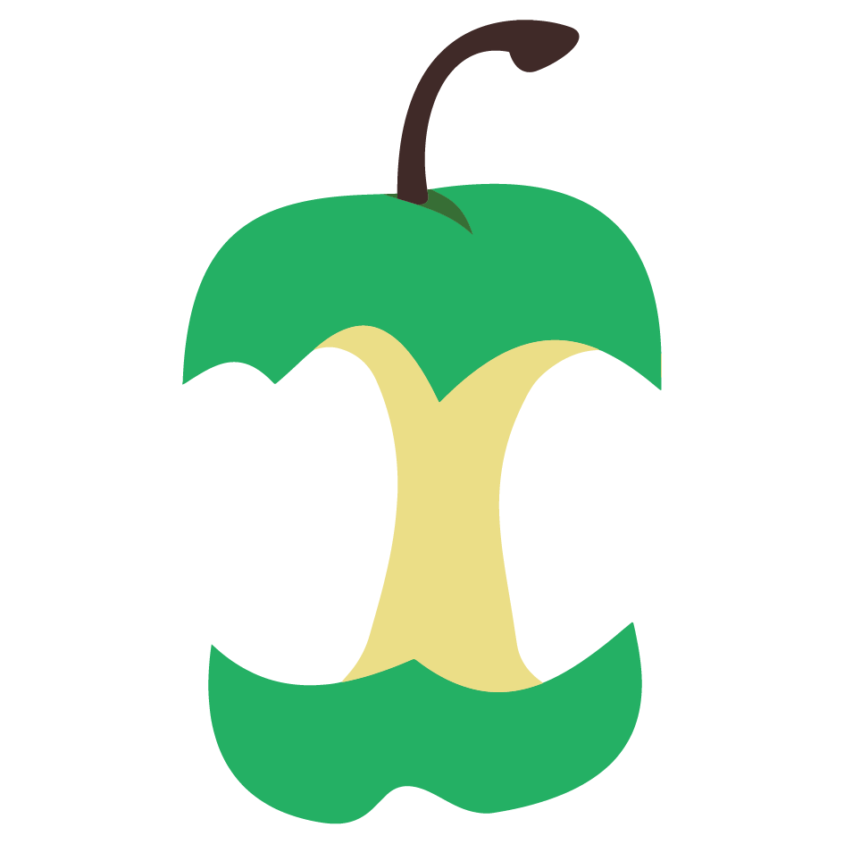

# :material-console: Depictio from the command line <small>(v1.23+)</small>

The second <a href="../courses/">hands-on course</a>. In <a href="../workshop/">Depictio in the browser</a> everything happens in the browser. Here the same things happen from your own computer, with the Depictio command line: a results folder on your laptop becomes a project on the server, and a dashboard becomes a file you can edit.

[{ .ws-diagram }](../../images/tutorials/workshop-cli/diagrams/cli-flow_light.png){target=_blank}
[{ .ws-diagram }](../../images/tutorials/workshop-cli/diagrams/cli-flow_dark.png){target=_blank}

:material-console: **Some terminal practice** :material-laptop: **macOS or Linux** :material-language-python: **Python 3.11 or later**

## Episodes

-   0 **[Setup](setup.md)**

    ---

    Before the session

    How do I install the CLI and connect it to the server?

-   1 **[Your first project from the command line](first-project.md)**

    ---

    Palmer Penguins · one table, one season

    How do I turn a table on my laptop into a project and a dashboard?

-   2 **[A second table, then a new season](own-tables.md)**

    ---

    Palmer Penguins · two tables, two seasons

    How do I add a table, link it, and bring the next batch?

-   3 **[A dashboard as code](dashboard-as-code.md)**

    ---

    A YAML file

    How do I write, check and share a dashboard as a file?

-   4 **[An nf-core run, with its template](nf-core-run.md)**

    ---

    Optional · nf-core/ampliseq

    How does a pipeline Depictio knows skip the project file?

## Two datasets

-   :material-penguin: **Palmer Penguins**

    ---

    The census and measurements of the browser course, split into one folder per field season.

    Episodes 1, 2, 3 · [palmerpenguins](https://allisonhorst.github.io/palmerpenguins/), CC0

-   { .ws-logo .off-glb } **nf-core/ampliseq 2.18.0**

    ---

    The megatest run of the browser course, as a folder you download: 12 samples from soil, sediment and water.

    Episode 4 · [nf-core/ampliseq](https://nf-co.re/ampliseq/2.18.0)

## Requirements

-   :material-laptop: **Technical**

    ---

    - A laptop with **macOS or Linux**. On Windows, [WSL2](https://learn.microsoft.com/windows/wsl/install) with Ubuntu.
    - **Python 3.11 to 3.13**: `python3 --version`. Python 3.14 does not work yet. No administrator rights needed: everything goes in a folder of your own.
    - About **1.5 GB** of free disk space.
    - A network that reaches the workshop server **and** its storage: [Setup](setup.md) checks both. Try it before the day.
    - The workshop server address and a personal account, given by the instructor.

-   :material-school-outline: **Skills**

    ---

    - Running commands in a terminal: `cd`, `ls`, `unzip`, pasting a command and reading what it prints.
    - Editing a text file and keeping its indentation: YAML counts spaces.
    - The words of the browser course: project, data collection, link, run, dashboard. The [Reference](../workshop/reference.md) lists them; the course itself helps but is not required.
    - No programming.

[InstructorsInstructor notes](facilitators.md){ .ws-help .ws-inst }
[Stuck?Troubleshooting](troubleshooting.md){ .ws-help }
[Start here0. Setup](setup.md){ .ws-go .ws-ep0 }

