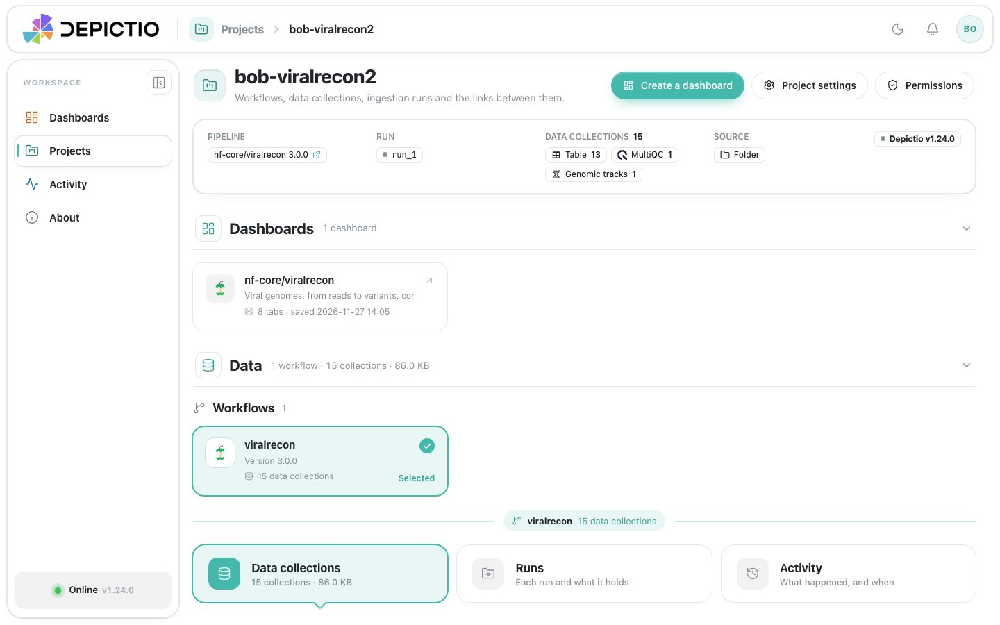
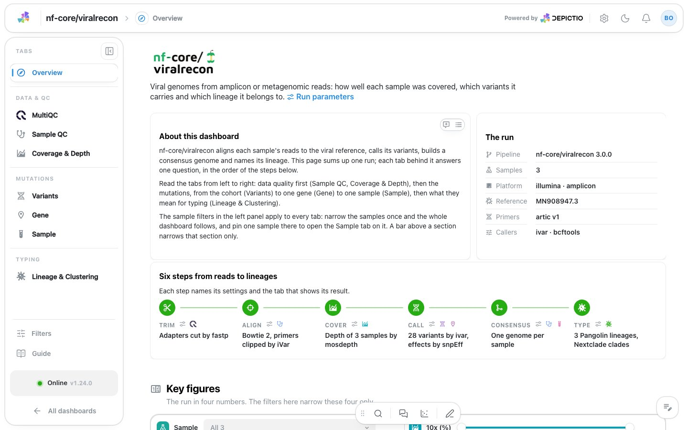

# 2. An nf-core run from the terminal

<div class="ws-strip" markdown>
[**0** Setup](setup.md){ .ws-ep0 } [**1** Your tables](project-builder.md){ .ws-ep1 } [**2** nf-core run](nf-core-run.md){ .ws-ep2 .ws-here } [**3** Together](collaborate-and-export.md){ .ws-ep3 } [**+** Going further](going-further.md){ .ws-ep4 }
</div>

<div class="ws-meta ws-ep2" markdown>
<span class="ws-chip" markdown="span">:material-console: **Creator, from the terminal**</span> <span class="ws-chip" markdown="span">{ .ws-logo .off-glb } **nf-core/viralrecon 3.0.0**</span> <span class="ws-chip" markdown="span">:material-timer-outline: **Hands-on 2 · 15 min**</span>
</div>

!!! overview "Overview"
    **Questions**

    - Do I have to write a project file for an nf-core run?
    - How do I check what will happen before anything is sent?

    **Objectives**

    - Run two small commands: check the connection, ask the catalog about a tool.
    - Dry-run a run folder: the CLI finds the pipeline and its template.
    - Ingest the run into a project of your own, and open its dashboard.

In episode 1 you described your own tables in the Project Builder. For a pipeline Depictio knows, a **template** does it for you: the CLI recognises the pipeline and its version from the results folder, and brings the data collections and the dashboard with it. The run here is **nf-core/viralrecon 3.0.0**: SARS-CoV-2 genomes from amplicon reads, three samples.

Every command runs in `~/depictio-workshop`, with the environment of [Setup](setup.md) active.

## :material-console-line: Hands-on 2 · Step 1: two warm-up commands { #warm-up }

First, the connection: the same check as in Setup.

```console
$ depictio config check
╭─ Command Used ─╮
│ config check   │
╰────────────────╯
• Server: https://… (configuration ~/.depictio/CLI.yaml)
• Checking server accessibility...
✓ Depictio CLI configuration is model-compliant.
✓ Server accessible - User: you@example.org
… Checking S3 storage configuration...
✓ S3 storage configuration is valid
```

Then ask the CLI what it knows about one tool of the run, **Pangolin**, which names the lineage of each genome:

```console
$ depictio catalog info pangolin
Pangolin  (pangolin)
  Assigns SARS-CoV-2 genomes to global outbreak lineages.
  homepage:  https://github.com/cov-lineages/pangolin
  bio.tools: https://bio.tools/pangolin_cov-lineages
  nf-core:   https://github.com/nf-core/modules/tree/master/modules/nf-core/pangolin/run

  ── pangolin_report
     Per-sample PANGO lineage report.
     keyword: run
     find:    {'filename': '*.pangolin.csv', 'path_glob_alt': []}
     recipe:  pangolin/pangolin_lineages.py
     render:  figure
     render:  table
     render:  card
     render:  card
```

The catalog says which file of a run Depictio looks for (`*.pangolin.csv`), the script that turns it into a table (`recipe`), and the components it can draw from it (`render`). A template is a set of such outputs, one per tool of the pipeline.

## :material-folder-download-outline: Step 2: get the run { #get-the-run }

Download [`viralrecon.zip`](viralrecon.zip) (1.3 MB): your browser saves it in `~/Downloads`. Move it to the workshop folder and unzip it there:

```bash
mv ~/Downloads/viralrecon.zip ~/depictio-workshop/
cd ~/depictio-workshop
unzip viralrecon.zip
ls viralrecon/run_1
```

```console
multiqc  pipeline_info  variants
```

`viralrecon/` holds one run folder, `run_1/`: the part of the pipeline's results that the template reads.

## :material-clipboard-check-outline: Step 3: the dry run { #dry-run }

You write no project file: the template of nf-core/viralrecon 3.0.0 is one, written once for every run of that version. Always pass `--project` with a name of your own, here `yourname-viralrecon`: without it, the template's default name is used, the same for everyone.

`--dry-run` checks every step and **sends nothing**. The full output, scroll inside the block:

<div class="ws-scroll" markdown>

```console
$ depictio ingest viralrecon/ --project yourname-viralrecon --dry-run
╭─ Command Used ─╮
│ ingest         │
╰────────────────╯
• Detected nf-core/viralrecon 3.0.0 (nextflow, 22 tool(s)) [[1]]
✓ Auto-selected template: nf-core/viralrecon/3.0.0 [[1]]
• DRY RUN MODE - No actual operations will be performed
• Server: https://… (configuration ~/.depictio/CLI.yaml)
╭────────────────────────────────────╮
│ Step 0: Resolving project template │
╰────────────────────────────────────╯
✓ Template 'nf-core/viralrecon/3.0.0' loaded successfully
• Template provides 1 default dashboard(s)
• Resolved template configuration:
•   Project: yourname-viralrecon
•   Template: nf-core/viralrecon/3.0.0 (template version 2.4.1)
•   Data root: /Users/you/depictio-workshop/viralrecon
•   Workflow 'viralrecon': 15 data collection(s): multiqc_data, summary_metrics, variants_long, tracks, pangolin_lineages, nextclade_results, mosdepth_amplicon_coverage, mosdepth_genome_coverage, mosdepth_amplicon_heatmap, oncoplot_canonical, complex_heatmap_canonical, coverage_track_canonical, sankey_canonical, upset_canonical, variant_feature_matrix_canonical
╭───────────────────────────────────────────╮
│ Dry run: what this data root would ingest │
╰───────────────────────────────────────────╯
• Template: nf-core/viralrecon/3.0.0
• Data root: /Users/you/depictio-workshop/viralrecon
• Project name: yourname-viralrecon
• Detected runs (1): run_1
• Dashboards: base.yaml
    Resolved template variables      [[2]]
╭───────────────────┬──────────────╮ [[2]]
│ Variable          │ Value        │ [[2]]
├───────────────────┼──────────────┤ [[2]]
│ GROUP_COL         │ __no_group__ │ [[2]]
│ GROUP_COL_DISPLAY │ Group        │ [[2]]
│ METADATA_ID_COL   │ sample       │ [[2]]
╰───────────────────┴──────────────╯ [[2]]
                  Data collections under this data root                    [[3]]
╭──────────────────────────────────┬────────┬───────────┬───────┬────────╮ [[3]]
│ Data collection                  │ Kind   │ Mode      │ Files │ Status │ [[3]]
├──────────────────────────────────┼────────┼───────────┼───────┼────────┤ [[3]]
│ multiqc_data                     │ scan   │ recursive │ 1     │ ok     │ [[3]]
│ summary_metrics                  │ recipe │ -         │ 1     │ ok     │ [[3]]
│ variants_long                    │ recipe │ -         │ 1     │ ok     │ [[3]]
│ tracks                           │ recipe │ -         │ 2     │ ok     │ [[3]]
│ pangolin_lineages                │ recipe │ -         │ 3     │ ok     │ [[3]]
│ nextclade_results                │ recipe │ -         │ 3     │ ok     │ [[3]]
│ mosdepth_amplicon_coverage       │ scan   │ recursive │ 1     │ ok     │ [[3]]
│ mosdepth_genome_coverage         │ scan   │ recursive │ 1     │ ok     │ [[3]]
│ mosdepth_amplicon_heatmap        │ scan   │ recursive │ 1     │ ok     │ [[3]]
│ oncoplot_canonical               │ recipe │ -         │ 1     │ ok     │ [[3]]
│ complex_heatmap_canonical        │ recipe │ -         │ 1     │ ok     │ [[3]]
│ coverage_track_canonical         │ recipe │ -         │ 1     │ ok     │ [[3]]
│ sankey_canonical                 │ recipe │ -         │ 2     │ ok     │ [[3]]
│ upset_canonical                  │ recipe │ -         │ 2     │ ok     │ [[3]]
│ variant_feature_matrix_canonical │ recipe │ -         │ 3     │ ok     │ [[3]]
╰──────────────────────────────────┴────────┴───────────┴───────┴────────╯ [[3]]
✓ 15 data collection(s) will ingest, 0 empty, 0 missing sources [[4]]
╭─────────────────────────────────────────╮ [[5]]
│ Step 1/8: Checking server accessibility │ [[5]]
╰─────────────────────────────────────────╯ [[5]]
• Would check that this server answers [[5]]
╭─────────────────────────────────────────────╮ [[5]]
│ Step 2/8: Checking S3 storage configuration │ [[5]]
╰─────────────────────────────────────────────╯ [[5]]
• Would check the S3 storage configuration [[5]]
╭────────────────────────────────────────────╮ [[5]]
│ Step 3/8: Validating project configuration │ [[5]]
╰────────────────────────────────────────────╯ [[5]]
✓ Project configuration is valid (checked locally; a dry run does not contact the server) [[5]]
╭───────────────────────────────────────────────────╮ [[5]]
│ Step 4/8: Syncing project configuration to server │ [[5]]
╰───────────────────────────────────────────────────╯ [[5]]
• Would create project 'yourname-viralrecon' on the server [[5]]
╭───────────────────────────────╮ [[5]]
│ Step 5/8: Scanning data files │ [[5]]
╰───────────────────────────────╯ [[5]]
• Would scan the data files [[5]]
╭───────────────────────────────────────╮ [[5]]
│ Step 6/8: Processing data collections │ [[5]]
╰───────────────────────────────────────╯ [[5]]
• Would process the data collections [[5]]
╭─────────────────────────────────╮ [[5]]
│ Step 7/8: Executing table joins │ [[5]]
╰─────────────────────────────────╯ [[5]]
• No joins defined in project config [[5]]
╭────────────────────────────────╮ [[5]]
│ Step 8/8: Importing dashboards │ [[5]]
╰────────────────────────────────╯ [[5]]
• Would import 1 dashboard(s) [[5]]
╭───────────────────╮ [[5]]
│ Ingestion summary │ [[5]]
╰───────────────────╯ [[5]]
• Template used: nf-core/viralrecon/3.0.0 [[5]]
✓ Dry run complete (8/8 steps): the configuration is valid, and nothing was changed. [[5]]
```

</div>

1. **The pipeline**: the CLI read `pipeline_info/`, found nf-core/viralrecon 3.0.0, and picked the template of that version.
2. **The template variables**: blanks the run fills in. This run has no groups of samples to compare: `GROUP_COL` reads `__no_group__`, and there is nothing to set.
3. **The data collections**: one line per table of the template, with the files it found. A `scan` reads a file as it is; a `recipe` computes a table from files of the run (the `pangolin_lineages` line is the Pangolin output of step 1).
4. **The verdict**: 15 tables will be written, none empty, none missing.
5. **The eight steps** the ingestion will run, each saying what it *would* do.

!!! challenge "Challenge 2.1: one line, three files"
    In the dry run, find the table made from the Pangolin files. How many files does it read, and why that number?

    ??? solution "Solution"
        `pangolin_lineages`, a `recipe`, reads **3** files: one `*.pangolin.csv` per sample, the file `depictio catalog info pangolin` named in step 1. The recipe stacks them into one table of three rows, one lineage per sample.

## :material-database-import-outline: Step 4: ingest, then open the dashboard { #ingest }

The same command without `--dry-run`. `--rich-tables` prints what each step does: the files scanned, a preview of each table and its statistics. It takes about 30 seconds. The full output, scroll inside the block:

<div class="ws-scroll" markdown>

```console
$ depictio ingest viralrecon/ --project yourname-viralrecon --rich-tables
╭─ Command Used ─╮
│ ingest         │
╰────────────────╯
• Detected nf-core/viralrecon 3.0.0 (nextflow, 22 tool(s))
✓ Auto-selected template: nf-core/viralrecon/3.0.0
• Server: https://… (configuration ~/.depictio/CLI.yaml)
╭────────────────────────────────────╮ [[1]]
│ Step 0: Resolving project template │ [[1]]
╰────────────────────────────────────╯ [[1]]
✓ Template 'nf-core/viralrecon/3.0.0' loaded successfully [[1]]
• Template provides 1 default dashboard(s) [[1]]
╭─────────────────────────────────────────╮ [[1]]
│ Step 1/8: Checking server accessibility │ [[1]]
╰─────────────────────────────────────────╯ [[1]]
• Checking server accessibility... [[1]]
✓ Depictio CLI configuration is model-compliant. [[1]]
✓ Server accessibility check passed [[1]]
╭─────────────────────────────────────────────╮ [[1]]
│ Step 2/8: Checking S3 storage configuration │ [[1]]
╰─────────────────────────────────────────────╯ [[1]]
✓ S3 storage configuration check passed [[1]]
╭────────────────────────────────────────────╮ [[1]]
│ Step 3/8: Validating project configuration │ [[1]]
╰────────────────────────────────────────────╯ [[1]]
• Checking server accessibility... [[1]]
✓ Depictio CLI configuration is model-compliant. [[1]]
✓ Project configuration validation passed [[1]]
╭───────────────────────────────────────────────────╮ [[1]]
│ Step 4/8: Syncing project configuration to server │ [[1]]
╰───────────────────────────────────────────────────╯ [[1]]
• Syncing pipeline configuration to server... [[1]]
• Project configuration not found on server, creating project... [[1]]
✓ Project created on server [[1]]
✓ Project configuration sync completed [[1]]
• Links already have DC IDs (no tag: placeholders) [[1]]
╭───────────────────────────────╮ [[2]]
│ Step 5/8: Scanning data files │ [[2]]
╰───────────────────────────────╯ [[2]]
• Scanning Project: 'yourname-viralrecon' [[2]]
•  ↪ Scanning Workflow: 'viralrecon' [[2]]
•   ↪ Found 4 aggregate and 0 single data collections [[2]]
•   ↪ Scanning Data Collection: 'multiqc_data' - type multiqc - metatype Recursive [[2]]
•   ↪ Scanning Data Collection: 'mosdepth_amplicon_coverage' - type table - metatype Recursive [[2]]
•   ↪ Scanning Data Collection: 'mosdepth_genome_coverage' - type table - metatype Recursive [[2]]
•   ↪ Scanning Data Collection: 'mosdepth_amplicon_heatmap' - type table - metatype Recursive [[2]]
 [[2]]
 [[2]]
                               Workflow Runs Files Scan Results Stats Summary (by Data Collection)   [[2]]
╭─────────────────┬────────────────────┬─────────┬─────────┬─────────┬─────────┬─────────┬─────────┬ [[2]]
│ Run Tag         │ Data Collection    │  Total  │   New   │ Changed │ Unchan… │ Updated │ Missing │ [[2]]
├─────────────────┼────────────────────┼─────────┼─────────┼─────────┼─────────┼─────────┼─────────┼ [[2]]
│ run_1           │ multiqc_data       │    1    │    1    │    0    │    0    │    0    │    0    │ [[2]]
├─────────────────┼────────────────────┼─────────┼─────────┼─────────┼─────────┼─────────┼─────────┼ [[2]]
│                 │ mosdepth_amplicon… │    1    │    1    │    0    │    0    │    0    │    0    │ [[2]]
├─────────────────┼────────────────────┼─────────┼─────────┼─────────┼─────────┼─────────┼─────────┼ [[2]]
│                 │ mosdepth_genome_c… │    1    │    1    │    0    │    0    │    0    │    0    │ [[2]]
├─────────────────┼────────────────────┼─────────┼─────────┼─────────┼─────────┼─────────┼─────────┼ [[2]]
│                 │ mosdepth_amplicon… │    1    │    1    │    0    │    0    │    0    │    0    │ [[2]]
├─────────────────┼────────────────────┼─────────┼─────────┼─────────┼─────────┼─────────┼─────────┼ [[2]]
│                 │ Run Total          │    4    │    4    │    0    │    0    │    0    │    0    │ [[2]]
╰─────────────────┴────────────────────┴─────────┴─────────┴─────────┴─────────┴─────────┴─────────┴ [[2]]
✓ Scanned 1 runs in workflow viralrecon [[2]]
✓ Workflow viralrecon processed successfully [[2]]
✓ Data scanning completed [[2]]
╭───────────────────────────────────────╮ [[3]]
│ Step 6/8: Processing data collections │ [[3]]
╰───────────────────────────────────────╯ [[3]]
• Processing Project: 'yourname-viralrecon' [[3]]
•  ↪ Processing Workflow: 'viralrecon' [[3]]
•   ↪ Processing Data Collection: multiqc_data - type multiqc [[3]]
                             MultiQC Processing Summary - multiqc_data                               [[3]]
╭──────────────────────┬─────────────────┬─────────────────────────────────────────────────────────╮ [[3]]
│ Metric               │      Value      │ Details                                                 │ [[3]]
├──────────────────────┼─────────────────┼─────────────────────────────────────────────────────────┤ [[3]]
│ Files Processed      │        1        │ 1 MultiQC parquet file                                  │ [[3]]
├──────────────────────┼─────────────────┼─────────────────────────────────────────────────────────┤ [[3]]
│ Total Samples        │        7        │ Unique samples across all files                         │ [[3]]
├──────────────────────┼─────────────────┼─────────────────────────────────────────────────────────┤ [[3]]
│ Total Modules        │       17        │ QC modules detected                                     │ [[3]]
├──────────────────────┼─────────────────┼─────────────────────────────────────────────────────────┤ [[3]]
│ Total Plots          │       39        │ nf-core-viralrecon-methods-description: 0 plots;        │ [[3]]
│                      │                 │ nextclade_clade: 1 plots; summary_variants_metrics: 1   │ [[3]]
│                      │                 │ plots; fastqc: 10 plots; fastp: 5 plots; kraken: 1      │ [[3]]
│                      │                 │ plots; bowtie2: 2 plots; samtools_bowtie2: 2 plots;     │ [[3]]
│                      │                 │ samtools_ivar: 2 plots; samtools_markduplicates: 2      │ [[3]]
│                      │                 │ plots; mosdepth: 2 plots; ivar_variants: 1 plots;       │ [[3]]
│                      │                 │ pangolin: 1 plots; bcftools: 3 plots; snpeff: 4 plots;  │ [[3]]
│                      │                 │ quast_variants: 2 plots; nf-core-viralrecon-summary: 0  │ [[3]]
│                      │                 │ plots                                                   │ [[3]]
╰──────────────────────┴─────────────────┴─────────────────────────────────────────────────────────╯ [[3]]
 [[3]]
 [[3]]
•   ↪ Processing Data Collection: summary_metrics - type table - metatype Aggregated [[3]]
• Running recipe: multiqc/summary_metrics.py [[3]]
• Recipe data dir: /Users/you/depictio-workshop/viralrecon [[3]]
✓ Recipe 'multiqc/summary_metrics.py' produced 3 rows, written to Delta Lake [[3]]
•   ↪ Processing Data Collection: variants_long - type table - metatype Aggregated [[3]]
• Running recipe: nf-core/viralrecon/variants_long.py [[3]]
• Recipe data dir: /Users/you/depictio-workshop/viralrecon [[3]]
✓ Recipe 'nf-core/viralrecon/variants_long.py' produced 28 rows, written to Delta Lake [[3]]
•   ↪ Processing Data Collection: tracks - type genomic_tracks [[3]]
• Running recipe: nf-core/viralrecon/tracks.py [[3]]
• Recipe data dir: /Users/you/depictio-workshop/viralrecon [[3]]
✓ Track files: 12 uploaded, 0 already present (s3://…/genomic_tracks/6b098e143a2c6f6733768742/) [[3]]
✓ Recipe 'nf-core/viralrecon/tracks.py' produced 6 rows, written to Delta Lake [[3]]
•   ↪ Processing Data Collection: pangolin_lineages - type table - metatype Aggregated [[3]]
• Running recipe: pangolin/pangolin_lineages.py [[3]]
• Recipe data dir: /Users/you/depictio-workshop/viralrecon [[3]]
✓ Recipe 'pangolin/pangolin_lineages.py' produced 3 rows, written to Delta Lake [[3]]
•   ↪ Processing Data Collection: nextclade_results - type table - metatype Aggregated [[3]]
• Running recipe: nextclade/nextclade_results.py [[3]]
• Recipe data dir: /Users/you/depictio-workshop/viralrecon [[3]]
✓ Recipe 'nextclade/nextclade_results.py' produced 3 rows, written to Delta Lake [[3]]
•   ↪ Processing Data Collection: mosdepth_amplicon_coverage - type table - metatype Aggregated [[3]]
• S3 Destination does not exist, will create it during processing [[3]]
 [[3]]
 [[3]]
                    Aggregated DataFrame - {data_collection.data_collection_tag}                     [[3]]
╭────────────┬─────────┬─────────┬─────────────┬──────────┬────────────┬─────────────┬─────────────╮ [[3]]
│ chrom      │ start   │ end     │ region      │ coverage │ sample     │ depictio_r… │ aggregatio… │ [[3]]
│ (String)   │ (Int64) │ (Int64) │ (String)    │ (Int64)  │ (String)   │ (String)    │ (String)    │ [[3]]
├────────────┼─────────┼─────────┼─────────────┼──────────┼────────────┼─────────────┼─────────────┤ [[3]]
│ MN908947.3 │ 30      │ 410     │ nCoV-2019_1 │ 677      │ SAMPLE2_PE │ run_1       │ 2026-11-27  │ [[3]]
│            │         │         │             │          │            │             │ 15:05:18    │ [[3]]
├────────────┼─────────┼─────────┼─────────────┼──────────┼────────────┼─────────────┼─────────────┤ [[3]]
│ MN908947.3 │ 320     │ 726     │ nCoV-2019_2 │ 59       │ SAMPLE2_PE │ run_1       │ 2026-11-27  │ [[3]]
│            │         │         │             │          │            │             │ 15:05:18    │ [[3]]
├────────────┼─────────┼─────────┼─────────────┼──────────┼────────────┼─────────────┼─────────────┤ [[3]]
│ MN908947.3 │ 642     │ 1028    │ nCoV-2019_3 │ 1090     │ SAMPLE2_PE │ run_1       │ 2026-11-27  │ [[3]]
│            │         │         │             │          │            │             │ 15:05:18    │ [[3]]
├────────────┼─────────┼─────────┼─────────────┼──────────┼────────────┼─────────────┼─────────────┤ [[3]]
│ MN908947.3 │ 943     │ 1337    │ nCoV-2019_4 │ 1390     │ SAMPLE2_PE │ run_1       │ 2026-11-27  │ [[3]]
│            │         │         │             │          │            │             │ 15:05:18    │ [[3]]
├────────────┼─────────┼─────────┼─────────────┼──────────┼────────────┼─────────────┼─────────────┤ [[3]]
│ MN908947.3 │ 1242    │ 1651    │ nCoV-2019_5 │ 173      │ SAMPLE2_PE │ run_1       │ 2026-11-27  │ [[3]]
│            │         │         │             │          │            │             │ 15:05:18    │ [[3]]
├────────────┼─────────┼─────────┼─────────────┼──────────┼────────────┼─────────────┼─────────────┤ [[3]]
│ MN908947.3 │ 1573    │ 1964    │ nCoV-2019_6 │ 124      │ SAMPLE2_PE │ run_1       │ 2026-11-27  │ [[3]]
│            │         │         │             │          │            │             │ 15:05:18    │ [[3]]
├────────────┼─────────┼─────────┼─────────────┼──────────┼────────────┼─────────────┼─────────────┤ [[3]]
│ MN908947.3 │ 1875    │ 2269    │ nCoV-2019_7 │ 201      │ SAMPLE2_PE │ run_1       │ 2026-11-27  │ [[3]]
│            │         │         │             │          │            │             │ 15:05:18    │ [[3]]
├────────────┼─────────┼─────────┼─────────────┼──────────┼────────────┼─────────────┼─────────────┤ [[3]]
│ MN908947.3 │ 2181    │ 2592    │ nCoV-2019_8 │ 164      │ SAMPLE2_PE │ run_1       │ 2026-11-27  │ [[3]]
│            │         │         │             │          │            │             │ 15:05:18    │ [[3]]
├────────────┼─────────┼─────────┼─────────────┼──────────┼────────────┼─────────────┼─────────────┤ [[3]]
│ MN908947.3 │ 2505    │ 2904    │ nCoV-2019_9 │ 112      │ SAMPLE2_PE │ run_1       │ 2026-11-27  │ [[3]]
│            │         │         │             │          │            │             │ 15:05:18    │ [[3]]
├────────────┼─────────┼─────────┼─────────────┼──────────┼────────────┼─────────────┼─────────────┤ [[3]]
│ MN908947.3 │ 2826    │ 3210    │ nCoV-2019_… │ 47       │ SAMPLE2_PE │ run_1       │ 2026-11-27  │ [[3]]
│            │         │         │             │          │            │             │ 15:05:18    │ [[3]]
├────────────┼─────────┼─────────┼─────────────┼──────────┼────────────┼─────────────┼─────────────┤ [[3]]
│ ...        │ ...     │ ...     │ ...         │ ...      │ ...        │ ...         │ ...         │ [[3]]
╰────────────┴─────────┴─────────┴─────────────┴──────────┴────────────┴─────────────┴─────────────╯ [[3]]
 [[3]]
Showing 10 of 294 rows [[3]]
 [[3]]
 [[3]]
 [[3]]
 [[3]]
 [[3]]
                                       Descriptive Statistics                                        [[3]]
╭──────────┬──────────┬──────────┬──────────┬──────────┬──────────┬──────────┬──────────┬──────────╮ [[3]]
│ statist… │ chrom    │ start    │ end      │ region   │ coverage │ sample   │ depicti… │ aggrega… │ [[3]]
├──────────┼──────────┼──────────┼──────────┼──────────┼──────────┼──────────┼──────────┼──────────┤ [[3]]
│ count    │ 294      │ 294.0000 │ 294.0000 │ 294      │ 294.0000 │ 294      │ 294      │ 294      │ [[3]]
├──────────┼──────────┼──────────┼──────────┼──────────┼──────────┼──────────┼──────────┼──────────┤ [[3]]
│ null_co… │ 0        │ 0.0000   │ 0.0000   │ 0        │ 0.0000   │ 0        │ 0        │ 0        │ [[3]]
├──────────┼──────────┼──────────┼──────────┼──────────┼──────────┼──────────┼──────────┼──────────┤ [[3]]
│ mean     │ null     │ 14790.1… │ 15182.9… │ null     │ 414.9660 │ null     │ null     │ null     │ [[3]]
├──────────┼──────────┼──────────┼──────────┼──────────┼──────────┼──────────┼──────────┼──────────┤ [[3]]
│ std      │ null     │ 8621.37… │ 8621.14… │ null     │ 432.3225 │ null     │ null     │ null     │ [[3]]
├──────────┼──────────┼──────────┼──────────┼──────────┼──────────┼──────────┼──────────┼──────────┤ [[3]]
│ min      │ MN90894… │ 30.0000  │ 410.0000 │ nCoV-20… │ 0.0000   │ SAMPLE1… │ run_1    │ 2026-11… │ [[3]]
│          │          │          │          │          │          │          │          │ 15:05:18 │ [[3]]
├──────────┼──────────┼──────────┼──────────┼──────────┼──────────┼──────────┼──────────┼──────────┤ [[3]]
│ 25%      │ null     │ 7305.00… │ 7694.00… │ null     │ 99.0000  │ null     │ null     │ null     │ [[3]]
├──────────┼──────────┼──────────┼──────────┼──────────┼──────────┼──────────┼──────────┼──────────┤ [[3]]
│ 50%      │ null     │ 14865.0… │ 15246.0… │ null     │ 264.0000 │ null     │ null     │ null     │ [[3]]
├──────────┼──────────┼──────────┼──────────┼──────────┼──────────┼──────────┼──────────┼──────────┤ [[3]]
│ 75%      │ null     │ 22262.0… │ 22650.0… │ null     │ 602.0000 │ null     │ null     │ null     │ [[3]]
├──────────┼──────────┼──────────┼──────────┼──────────┼──────────┼──────────┼──────────┼──────────┤ [[3]]
│ max      │ MN90894… │ 29486.0… │ 29866.0… │ nCoV-20… │ 2280.00… │ SAMPLE3… │ run_1    │ 2026-11… │ [[3]]
│          │          │          │          │          │          │          │          │ 15:05:18 │ [[3]]
╰──────────┴──────────┴──────────┴──────────┴──────────┴──────────┴──────────┴──────────┴──────────╯ [[3]]
                                                                                    [[3]]
  Property       Value                                                              [[3]]
 ─────────────────────────────────────────────────────────────────────────────────  [[3]]
  Shape          294 rows × 8 columns                                               [[3]]
  Memory Usage   0.02 MB                                                            [[3]]
  Columns        chrom   start   end     region  coverage        sample             [[3]]
                 depictio_run_id aggregation_time                                   [[3]]
                                                                                    [[3]]
              Column Data Types               [[3]]
                                              [[3]]
  Column             Data Type   Null Count   [[3]]
 ───────────────────────────────────────────  [[3]]
  chrom              String      0            [[3]]
  start              Int64       0            [[3]]
  end                Int64       0            [[3]]
  region             String      0            [[3]]
  coverage           Int64       0            [[3]]
  sample             String      0            [[3]]
  depictio_run_id    String      0            [[3]]
  aggregation_time   String      0            [[3]]
                                              [[3]]
•   ↪ Processing Data Collection: mosdepth_genome_coverage - type table - metatype Aggregated [[3]]
• S3 Destination does not exist, will create it during processing [[3]]
 [[3]]
 [[3]]
                   Aggregated DataFrame - {data_collection.data_collection_tag}                     [[3]]
╭────────────┬─────────┬─────────┬───────────┬────────────┬─────────────────┬─────────────────────╮ [[3]]
│ chrom      │ start   │ end     │ coverage  │ sample     │ depictio_run_id │ aggregation_time    │ [[3]]
│ (String)   │ (Int64) │ (Int64) │ (Float64) │ (String)   │ (String)        │ (String)            │ [[3]]
├────────────┼─────────┼─────────┼───────────┼────────────┼─────────────────┼─────────────────────┤ [[3]]
│ MN908947.3 │ 0       │ 200     │ 411.5300  │ SAMPLE2_PE │ run_1           │ 2026-11-27 15:05:19 │ [[3]]
├────────────┼─────────┼─────────┼───────────┼────────────┼─────────────────┼─────────────────────┤ [[3]]
│ MN908947.3 │ 200     │ 400     │ 560.8000  │ SAMPLE2_PE │ run_1           │ 2026-11-27 15:05:19 │ [[3]]
├────────────┼─────────┼─────────┼───────────┼────────────┼─────────────────┼─────────────────────┤ [[3]]
│ MN908947.3 │ 400     │ 600     │ 55.0900   │ SAMPLE2_PE │ run_1           │ 2026-11-27 15:05:19 │ [[3]]
├────────────┼─────────┼─────────┼───────────┼────────────┼─────────────────┼─────────────────────┤ [[3]]
│ MN908947.3 │ 600     │ 800     │ 594.0800  │ SAMPLE2_PE │ run_1           │ 2026-11-27 15:05:19 │ [[3]]
├────────────┼─────────┼─────────┼───────────┼────────────┼─────────────────┼─────────────────────┤ [[3]]
│ MN908947.3 │ 800     │ 1000    │ 1071.2700 │ SAMPLE2_PE │ run_1           │ 2026-11-27 15:05:19 │ [[3]]
├────────────┼─────────┼─────────┼───────────┼────────────┼─────────────────┼─────────────────────┤ [[3]]
│ MN908947.3 │ 1000    │ 1200    │ 1314.6500 │ SAMPLE2_PE │ run_1           │ 2026-11-27 15:05:19 │ [[3]]
├────────────┼─────────┼─────────┼───────────┼────────────┼─────────────────┼─────────────────────┤ [[3]]
│ MN908947.3 │ 1200    │ 1400    │ 642.6500  │ SAMPLE2_PE │ run_1           │ 2026-11-27 15:05:19 │ [[3]]
├────────────┼─────────┼─────────┼───────────┼────────────┼─────────────────┼─────────────────────┤ [[3]]
│ MN908947.3 │ 1400    │ 1600    │ 151.0200  │ SAMPLE2_PE │ run_1           │ 2026-11-27 15:05:19 │ [[3]]
├────────────┼─────────┼─────────┼───────────┼────────────┼─────────────────┼─────────────────────┤ [[3]]
│ MN908947.3 │ 1600    │ 1800    │ 117.4100  │ SAMPLE2_PE │ run_1           │ 2026-11-27 15:05:19 │ [[3]]
├────────────┼─────────┼─────────┼───────────┼────────────┼─────────────────┼─────────────────────┤ [[3]]
│ MN908947.3 │ 1800    │ 2000    │ 138.7300  │ SAMPLE2_PE │ run_1           │ 2026-11-27 15:05:19 │ [[3]]
├────────────┼─────────┼─────────┼───────────┼────────────┼─────────────────┼─────────────────────┤ [[3]]
│ ...        │ ...     │ ...     │ ...       │ ...        │ ...             │ ...                 │ [[3]]
╰────────────┴─────────┴─────────┴───────────┴────────────┴─────────────────┴─────────────────────╯ [[3]]
 [[3]]
Showing 10 of 450 rows [[3]]
 [[3]]
 [[3]]
 [[3]]
 [[3]]
 [[3]]
                                       Descriptive Statistics                                        [[3]]
╭───────────┬────────────┬───────────┬────────────┬───────────┬───────────┬────────────┬───────────╮ [[3]]
│ statistic │ chrom      │ start     │ end        │ coverage  │ sample    │ depictio_… │ aggregat… │ [[3]]
├───────────┼────────────┼───────────┼────────────┼───────────┼───────────┼────────────┼───────────┤ [[3]]
│ count     │ 450        │ 450.0000  │ 450.0000   │ 450.0000  │ 450       │ 450        │ 450       │ [[3]]
├───────────┼────────────┼───────────┼────────────┼───────────┼───────────┼────────────┼───────────┤ [[3]]
│ null_cou… │ 0          │ 0.0000    │ 0.0000     │ 0.0000    │ 0         │ 0          │ 0         │ [[3]]
├───────────┼────────────┼───────────┼────────────┼───────────┼───────────┼────────────┼───────────┤ [[3]]
│ mean      │ null       │ 14900.00… │ 15099.3533 │ 396.2881  │ null      │ null       │ null      │ [[3]]
├───────────┼────────────┼───────────┼────────────┼───────────┼───────────┼────────────┼───────────┤ [[3]]
│ std       │ null       │ 8669.6999 │ 8668.5896  │ 380.4254  │ null      │ null       │ null      │ [[3]]
├───────────┼────────────┼───────────┼────────────┼───────────┼───────────┼────────────┼───────────┤ [[3]]
│ min       │ MN908947.3 │ 0.0000    │ 200.0000   │ 0.0000    │ SAMPLE1_… │ run_1      │ 2026-11-… │ [[3]]
│           │            │           │            │           │           │            │ 15:05:19  │ [[3]]
├───────────┼────────────┼───────────┼────────────┼───────────┼───────────┼────────────┼───────────┤ [[3]]
│ 25%       │ null       │ 7400.0000 │ 7600.0000  │ 128.4600  │ null      │ null       │ null      │ [[3]]
├───────────┼────────────┼───────────┼────────────┼───────────┼───────────┼────────────┼───────────┤ [[3]]
│ 50%       │ null       │ 15000.00… │ 15200.0000 │ 271.1300  │ null      │ null       │ null      │ [[3]]
├───────────┼────────────┼───────────┼────────────┼───────────┼───────────┼────────────┼───────────┤ [[3]]
│ 75%       │ null       │ 22400.00… │ 22600.0000 │ 542.0000  │ null      │ null       │ null      │ [[3]]
├───────────┼────────────┼───────────┼────────────┼───────────┼───────────┼────────────┼───────────┤ [[3]]
│ max       │ MN908947.3 │ 29800.00… │ 29903.0000 │ 2346.0500 │ SAMPLE3_… │ run_1      │ 2026-11-… │ [[3]]
│           │            │           │            │           │           │            │ 15:05:19  │ [[3]]
╰───────────┴────────────┴───────────┴────────────┴───────────┴───────────┴────────────┴───────────╯ [[3]]
                                                                              [[3]]
  Property       Value                                                        [[3]]
 ───────────────────────────────────────────────────────────────────────────  [[3]]
  Shape          450 rows × 7 columns                                         [[3]]
  Memory Usage   0.03 MB                                                      [[3]]
  Columns        chrom   start   end     coverage        sample               [[3]]
                 depictio_run_id aggregation_time                             [[3]]
                                                                              [[3]]
              Column Data Types               [[3]]
                                              [[3]]
  Column             Data Type   Null Count   [[3]]
 ───────────────────────────────────────────  [[3]]
  chrom              String      0            [[3]]
  start              Int64       0            [[3]]
  end                Int64       0            [[3]]
  coverage           Float64     0            [[3]]
  sample             String      0            [[3]]
  depictio_run_id    String      0            [[3]]
  aggregation_time   String      0            [[3]]
                                              [[3]]
•   ↪ Processing Data Collection: mosdepth_amplicon_heatmap - type table - metatype Aggregated [[3]]
• S3 Destination does not exist, will create it during processing [[3]]
 [[3]]
 [[3]]
                    Aggregated DataFrame - {data_collection.data_collection_tag}                     [[3]]
╭────────┬────────┬────────┬────────┬────────┬─────────┬────────┬─────────┬────────┬─────────┬─────╮ [[3]]
│ sample │ nCoV-… │ nCoV-… │ nCoV-… │ nCoV-… │ nCoV-2… │ nCoV-… │ nCoV-2… │ nCoV-… │ nCoV-2… │     │ [[3]]
│ (Stri… │ (Floa… │ (Floa… │ (Floa… │ (Floa… │ (Float… │ (Floa… │ (Float… │ (Floa… │ (Float… │ ... │ [[3]]
├────────┼────────┼────────┼────────┼────────┼─────────┼────────┼─────────┼────────┼─────────┼─────┤ [[3]]
│ SAMPL… │ 2.6684 │ 2.2765 │ 3.1495 │ 3.1193 │ 2.1903  │ 2.1492 │ 2.2355  │ 2.3483 │ 2.2625  │ ... │ [[3]]
├────────┼────────┼────────┼────────┼────────┼─────────┼────────┼─────────┼────────┼─────────┼─────┤ [[3]]
│ SAMPL… │ 2.8149 │ 2.1399 │ 3.1329 │ 3.1483 │ 2.2672  │ 2.1959 │ 2.3617  │ 2.3464 │ 2.2304  │ ... │ [[3]]
├────────┼────────┼────────┼────────┼────────┼─────────┼────────┼─────────┼────────┼─────────┼─────┤ [[3]]
│ SAMPL… │ 2.8312 │ 1.7782 │ 3.0378 │ 3.1433 │ 2.2405  │ 2.0969 │ 2.3054  │ 2.2175 │ 2.0531  │ ... │ [[3]]
╰────────┴────────┴────────┴────────┴────────┴─────────┴────────┴─────────┴────────┴─────────┴─────╯ [[3]]
 [[3]]
Showing 3 of 3 rows, 10 of 101 columns [[3]]
 [[3]]
 [[3]]
 [[3]]
 [[3]]
 [[3]]
                                       Descriptive Statistics                                        [[3]]
╭────────┬────────┬────────┬────────┬────────┬─────────┬────────┬─────────┬────────┬─────────┬─────╮ [[3]]
│ stati… │ sample │ nCoV-… │ nCoV-… │ nCoV-… │ nCoV-2… │ nCoV-… │ nCoV-2… │ nCoV-… │ nCoV-2… │ ... │ [[3]]
├────────┼────────┼────────┼────────┼────────┼─────────┼────────┼─────────┼────────┼─────────┼─────┤ [[3]]
│ count  │ 3      │ 3.0000 │ 3.0000 │ 3.0000 │ 3.0000  │ 3.0000 │ 3.0000  │ 3.0000 │ 3.0000  │ ... │ [[3]]
├────────┼────────┼────────┼────────┼────────┼─────────┼────────┼─────────┼────────┼─────────┼─────┤ [[3]]
│ null_… │ 0      │ 0.0000 │ 0.0000 │ 0.0000 │ 0.0000  │ 0.0000 │ 0.0000  │ 0.0000 │ 0.0000  │ ... │ [[3]]
├────────┼────────┼────────┼────────┼────────┼─────────┼────────┼─────────┼────────┼─────────┼─────┤ [[3]]
│ mean   │ null   │ 2.7715 │ 2.0648 │ 3.1068 │ 3.1370  │ 2.2327 │ 2.1473  │ 2.3009 │ 2.3040  │ ... │ [[3]]
├────────┼────────┼────────┼────────┼────────┼─────────┼────────┼─────────┼────────┼─────────┼─────┤ [[3]]
│ std    │ null   │ 0.0897 │ 0.2575 │ 0.0603 │ 0.0155  │ 0.0390 │ 0.0495  │ 0.0632 │ 0.0750  │ ... │ [[3]]
├────────┼────────┼────────┼────────┼────────┼─────────┼────────┼─────────┼────────┼─────────┼─────┤ [[3]]
│ min    │ SAMPL… │ 2.6684 │ 1.7782 │ 3.0378 │ 3.1193  │ 2.1903 │ 2.0969  │ 2.2355 │ 2.2175  │ ... │ [[3]]
├────────┼────────┼────────┼────────┼────────┼─────────┼────────┼─────────┼────────┼─────────┼─────┤ [[3]]
│ 25%    │ null   │ 2.8149 │ 2.1399 │ 3.1329 │ 3.1433  │ 2.2405 │ 2.1492  │ 2.3054 │ 2.3464  │ ... │ [[3]]
├────────┼────────┼────────┼────────┼────────┼─────────┼────────┼─────────┼────────┼─────────┼─────┤ [[3]]
│ 50%    │ null   │ 2.8149 │ 2.1399 │ 3.1329 │ 3.1433  │ 2.2405 │ 2.1492  │ 2.3054 │ 2.3464  │ ... │ [[3]]
├────────┼────────┼────────┼────────┼────────┼─────────┼────────┼─────────┼────────┼─────────┼─────┤ [[3]]
│ 75%    │ null   │ 2.8312 │ 2.2765 │ 3.1495 │ 3.1483  │ 2.2672 │ 2.1959  │ 2.3617 │ 2.3483  │ ... │ [[3]]
├────────┼────────┼────────┼────────┼────────┼─────────┼────────┼─────────┼────────┼─────────┼─────┤ [[3]]
│ max    │ SAMPL… │ 2.8312 │ 2.2765 │ 3.1495 │ 3.1483  │ 2.2672 │ 2.1959  │ 2.3617 │ 2.3483  │ ... │ [[3]]
╰────────┴────────┴────────┴────────┴────────┴─────────┴────────┴─────────┴────────┴─────────┴─────╯ [[3]]
 [[3]]
Showing 9 of 9 rows, 10 of 102 columns [[3]]
 [[3]]
                                                                                                     [[3]]
  Property       Value                                                                               [[3]]
 ──────────────────────────────────────────────────────────────────────────────────────────────────  [[3]]
  Shape          3 rows × 101 columns                                                                [[3]]
  Memory Usage   0.00 MB                                                                             [[3]]
  Columns        sample  nCoV-2019_1     nCoV-2019_2     nCoV-2019_3     nCoV-2019_4                 [[3]]
                 nCoV-2019_5     nCoV-2019_6     nCoV-2019_7     nCoV-2019_8     nCoV-2019_9         [[3]]
                 nCoV-2019_10    nCoV-2019_11    nCoV-2019_12    nCoV-2019_13    nCoV-2019_14,       [[3]]
                 ... and 86 more columns                                                             [[3]]
                                                                                                     [[3]]
              Column Data Types               [[3]]
                                              [[3]]
  Column             Data Type   Null Count   [[3]]
 ───────────────────────────────────────────  [[3]]
  sample             String      0            [[3]]
  nCoV-2019_1        Float64     0            [[3]]
  nCoV-2019_2        Float64     0            [[3]]
  nCoV-2019_3        Float64     0            [[3]]
  nCoV-2019_4        Float64     0            [[3]]
  nCoV-2019_5        Float64     0            [[3]]
  nCoV-2019_6        Float64     0            [[3]]
  nCoV-2019_7        Float64     0            [[3]]
  nCoV-2019_8        Float64     0            [[3]]
  nCoV-2019_9        Float64     0            [[3]]
  nCoV-2019_10       Float64     0            [[3]]
  nCoV-2019_11       Float64     0            [[3]]
  nCoV-2019_12       Float64     0            [[3]]
  nCoV-2019_13       Float64     0            [[3]]
  nCoV-2019_14       Float64     0            [[3]]
  nCoV-2019_15       Float64     0            [[3]]
  nCoV-2019_16       Float64     0            [[3]]
  nCoV-2019_17       Float64     0            [[3]]
  nCoV-2019_18       Float64     0            [[3]]
  nCoV-2019_19       Float64     0            [[3]]
  nCoV-2019_20       Float64     0            [[3]]
  nCoV-2019_21       Float64     0            [[3]]
  nCoV-2019_22       Float64     0            [[3]]
  nCoV-2019_23       Float64     0            [[3]]
  nCoV-2019_24       Float64     0            [[3]]
  nCoV-2019_25       Float64     0            [[3]]
  nCoV-2019_26       Float64     0            [[3]]
  nCoV-2019_27       Float64     0            [[3]]
  nCoV-2019_28       Float64     0            [[3]]
  nCoV-2019_29       Int64       0            [[3]]
  nCoV-2019_30       Float64     0            [[3]]
  nCoV-2019_31       Float64     0            [[3]]
  nCoV-2019_32       Float64     0            [[3]]
  nCoV-2019_33       Float64     0            [[3]]
  nCoV-2019_34       Float64     0            [[3]]
  nCoV-2019_35       Float64     0            [[3]]
  nCoV-2019_36       Float64     0            [[3]]
  nCoV-2019_37       Float64     0            [[3]]
  nCoV-2019_38       Float64     0            [[3]]
  nCoV-2019_39       Float64     0            [[3]]
  nCoV-2019_40       Float64     0            [[3]]
  nCoV-2019_41       Float64     0            [[3]]
  nCoV-2019_42       Float64     0            [[3]]
  nCoV-2019_43       Float64     0            [[3]]
  nCoV-2019_44       Float64     0            [[3]]
  nCoV-2019_45       Float64     0            [[3]]
  nCoV-2019_46       Float64     0            [[3]]
  nCoV-2019_47       Float64     0            [[3]]
  nCoV-2019_48       Float64     0            [[3]]
  nCoV-2019_49       Float64     0            [[3]]
  nCoV-2019_50       Float64     0            [[3]]
  nCoV-2019_51       Float64     0            [[3]]
  nCoV-2019_52       Float64     0            [[3]]
  nCoV-2019_53       Float64     0            [[3]]
  nCoV-2019_54       Float64     0            [[3]]
  nCoV-2019_55       Float64     0            [[3]]
  nCoV-2019_56       Float64     0            [[3]]
  nCoV-2019_57       Float64     0            [[3]]
  nCoV-2019_58       Float64     0            [[3]]
  nCoV-2019_59       Float64     0            [[3]]
  nCoV-2019_60       Float64     0            [[3]]
  nCoV-2019_61       Float64     0            [[3]]
  nCoV-2019_62       Float64     0            [[3]]
  nCoV-2019_63       Float64     0            [[3]]
  nCoV-2019_64       Float64     0            [[3]]
  nCoV-2019_65       Float64     0            [[3]]
  nCoV-2019_66       Float64     0            [[3]]
  nCoV-2019_67       Float64     0            [[3]]
  nCoV-2019_68       Float64     0            [[3]]
  nCoV-2019_69       Float64     0            [[3]]
  nCoV-2019_70       Float64     0            [[3]]
  nCoV-2019_71       Float64     0            [[3]]
  nCoV-2019_72       Float64     0            [[3]]
  nCoV-2019_73       Float64     0            [[3]]
  nCoV-2019_74       Float64     0            [[3]]
  nCoV-2019_75       Float64     0            [[3]]
  nCoV-2019_76       Float64     0            [[3]]
  nCoV-2019_77       Float64     0            [[3]]
  nCoV-2019_78       Float64     0            [[3]]
  nCoV-2019_79       Float64     0            [[3]]
  nCoV-2019_80       Float64     0            [[3]]
  nCoV-2019_81       Float64     0            [[3]]
  nCoV-2019_82       Float64     0            [[3]]
  nCoV-2019_83       Float64     0            [[3]]
  nCoV-2019_84       Float64     0            [[3]]
  nCoV-2019_85       Float64     0            [[3]]
  nCoV-2019_86       Float64     0            [[3]]
  nCoV-2019_87       Float64     0            [[3]]
  nCoV-2019_88       Float64     0            [[3]]
  nCoV-2019_89       Float64     0            [[3]]
  nCoV-2019_90       Float64     0            [[3]]
  nCoV-2019_91       Float64     0            [[3]]
  nCoV-2019_92       Float64     0            [[3]]
  nCoV-2019_93       Float64     0            [[3]]
  nCoV-2019_94       Float64     0            [[3]]
  nCoV-2019_95       Float64     0            [[3]]
  nCoV-2019_96       Float64     0            [[3]]
  nCoV-2019_97       Float64     0            [[3]]
  nCoV-2019_98       Float64     0            [[3]]
  depictio_run_id    String      0            [[3]]
  aggregation_time   String      0            [[3]]
                                              [[3]]
•   ↪ Processing Data Collection: oncoplot_canonical - type table - metatype Aggregated [[3]]
• Running recipe: nf-core/viralrecon/oncoplot_canonical.py [[3]]
• Recipe data dir: /Users/you/depictio-workshop/viralrecon [[3]]
✓ Recipe 'nf-core/viralrecon/oncoplot_canonical.py' produced 28 rows, written to Delta Lake [[3]]
•   ↪ Processing Data Collection: complex_heatmap_canonical - type table - metatype Aggregated [[3]]
• Running recipe: mosdepth/complex_heatmap_canonical.py [[3]]
• Recipe data dir: /Users/you/depictio-workshop/viralrecon [[3]]
✓ Recipe 'mosdepth/complex_heatmap_canonical.py' produced 3 rows, written to Delta Lake [[3]]
•   ↪ Processing Data Collection: coverage_track_canonical - type table - metatype Aggregated [[3]]
• Running recipe: mosdepth/coverage_track_canonical.py [[3]]
• Recipe data dir: /Users/you/depictio-workshop/viralrecon [[3]]
✓ Recipe 'mosdepth/coverage_track_canonical.py' produced 450 rows, written to Delta Lake [[3]]
•   ↪ Processing Data Collection: sankey_canonical - type table - metatype Aggregated [[3]]
• Running recipe: nf-core/viralrecon/sankey_canonical.py [[3]]
• Recipe data dir: /Users/you/depictio-workshop/viralrecon [[3]]
✓ Recipe 'nf-core/viralrecon/sankey_canonical.py' produced 3 rows, written to Delta Lake [[3]]
•   ↪ Processing Data Collection: upset_canonical - type table - metatype Aggregated [[3]]
• Running recipe: nf-core/viralrecon/upset_canonical.py [[3]]
• Recipe data dir: /Users/you/depictio-workshop/viralrecon [[3]]
✓ Recipe 'nf-core/viralrecon/upset_canonical.py' produced 14 rows, written to Delta Lake [[3]]
•   ↪ Processing Data Collection: variant_feature_matrix_canonical - type table - metatype Aggregated [[3]]
• Running recipe: nf-core/viralrecon/variant_feature_matrix_canonical.py [[3]]
• Recipe data dir: /Users/you/depictio-workshop/viralrecon [[3]]
✓ Recipe 'nf-core/viralrecon/variant_feature_matrix_canonical.py' produced 3 rows, written to Delta Lake [[3]]
✓ Data collection 'multiqc_data' processed successfully. Processed 1 MultiQC files and created 1 individual reports [[3]]
✓ Data collection 'summary_metrics' processed successfully. Recipe 'multiqc/summary_metrics.py' result written to s3://…. [[3]]
✓ Data collection 'variants_long' processed successfully. Recipe 'nf-core/viralrecon/variants_long.py' result written to s3://…. [[3]]
✓ Data collection 'tracks' processed successfully. Recipe 'nf-core/viralrecon/tracks.py' result written to s3://…. [[3]]
✓ Data collection 'pangolin_lineages' processed successfully. Recipe 'pangolin/pangolin_lineages.py' result written to s3://…. [[3]]
✓ Data collection 'nextclade_results' processed successfully. Recipe 'nextclade/nextclade_results.py' result written to s3://…. [[3]]
✓ Data collection 'mosdepth_amplicon_coverage' processed successfully. Aggregated data written to s3://…. [[3]]
✓ Data collection 'mosdepth_genome_coverage' processed successfully. Aggregated data written to s3://…. [[3]]
✓ Data collection 'mosdepth_amplicon_heatmap' processed successfully. Aggregated data written to s3://…. [[3]]
✓ Data collection 'oncoplot_canonical' processed successfully. Recipe 'nf-core/viralrecon/oncoplot_canonical.py' result written to s3://…. [[3]]
✓ Data collection 'complex_heatmap_canonical' processed successfully. Recipe 'mosdepth/complex_heatmap_canonical.py' result written to s3://…. [[3]]
✓ Data collection 'coverage_track_canonical' processed successfully. Recipe 'mosdepth/coverage_track_canonical.py' result written to s3://…. [[3]]
✓ Data collection 'sankey_canonical' processed successfully. Recipe 'nf-core/viralrecon/sankey_canonical.py' result written to s3://…. [[3]]
✓ Data collection 'upset_canonical' processed successfully. Recipe 'nf-core/viralrecon/upset_canonical.py' result written to s3://…. [[3]]
✓ Data collection 'variant_feature_matrix_canonical' processed successfully. Recipe 'nf-core/viralrecon/variant_feature_matrix_canonical.py' result written to s3://…. [[3]]
✓ Workflow viralrecon processing completed [[3]]
✓ Processing completed! Total data collections processed: 15 [[3]]
✓ Data processing completed [[3]]
╭─────────────────────────────────╮ [[4]]
│ Step 7/8: Executing table joins │ [[4]]
╰─────────────────────────────────╯ [[4]]
• No joins defined in project config [[4]]
╭────────────────────────────────╮ [[4]]
│ Step 8/8: Importing dashboards │ [[4]]
╰────────────────────────────────╯ [[4]]
✓ Dashboard created: nf-core/viralrecon [[4]]
•   View at: https://…/dashboard/… [[4]]
✓ Dashboard import completed [[4]]
╭───────────────────╮ [[4]]
│ Ingestion summary │ [[4]]
╰───────────────────╯ [[4]]
• Project: https://…/projects/… [[4]]
• Dashboard 'nf-core/viralrecon' created: https://…/dashboard/… [[4]]
• Template used: nf-core/viralrecon/3.0.0 [[4]]
✓ Ingestion completed successfully! (8/8 steps) [[4]]
```

</div>

1. **Check and create**: the template, the server, the storage, then the project is created on the server.
2. **Scan**: the files of `run_1` that the template reads as they are, counted per table.
3. **Process**: each table is computed and written to the server's storage. `--rich-tables` shows the MultiQC summary, then a preview and the statistics of each table.
4. **The dashboard**: the template's dashboard is created, and the CLI prints the addresses of the project and the dashboard.

Open the **Project** link: the pipeline and its version, the run `run_1`, the 15 data collections, and the dashboard.

{ .ws-shot }

Open the **nf-core/viralrecon** dashboard: eight tabs, from the quality of the run to the lineage of each sample. You work on it in episode 3.

{ .ws-shot }

!!! question "Check your understanding"
    You ran the same command twice, with and without `--dry-run`. What did the first one change on the server, and what did the second one create?

    ??? solution "Answer"
        The dry run changed nothing: it checks the same steps and sends nothing. The ingestion created the project `yourname-viralrecon`, wrote its 15 tables to the server's storage, and created its dashboard. Your files stay in `~/depictio-workshop/viralrecon`.

!!! keypoints "Key points"
    - `depictio ingest <folder>` detects the pipeline and its version, and picks the template: no project file to write.
    - `--dry-run` shows what each data collection finds, without sending anything: read it first.
    - `--project` names the project: always pass it. `--rich-tables` shows what each step does.

??? note "Bonus · What is in the run"
    The zip holds the part of a viralrecon run that the template reads, from a run of the pipeline's `test` profile: three SARS-CoV-2 samples, two paired-end and one single-end.

    | In `viralrecon/run_1/` | What the pipeline wrote | What Depictio makes of it |
    |---|---|---|
    | `pipeline_info/` | the run's parameters and the versions of its tools | which pipeline and which version this is |
    | `multiqc/` | the MultiQC data and the summary of the variant calls | the MultiQC tab, the run summary table |
    | `variants/bowtie2/` | the aligned reads (BAM, 12 % of the reads to keep the zip small) and the depth along the genome (mosdepth) | the coverage tables, and the reads in the genome browser |
    | `variants/ivar/` | the variants (VCF), their long table, the consensus genomes with their Pangolin lineage and Nextclade clade | the variant tables, the lineage and clade tables, the variants in the genome browser |

    Ask the catalog about the other tools: `depictio catalog info nextclade`, `depictio catalog info mosdepth`.

<div class="ws-next" markdown>
[<span class="ws-k">Then</span><span class="ws-t">3. Work on your dashboard, together</span>](collaborate-and-export.md){ .ws-go .ws-ep3 }
</div>
