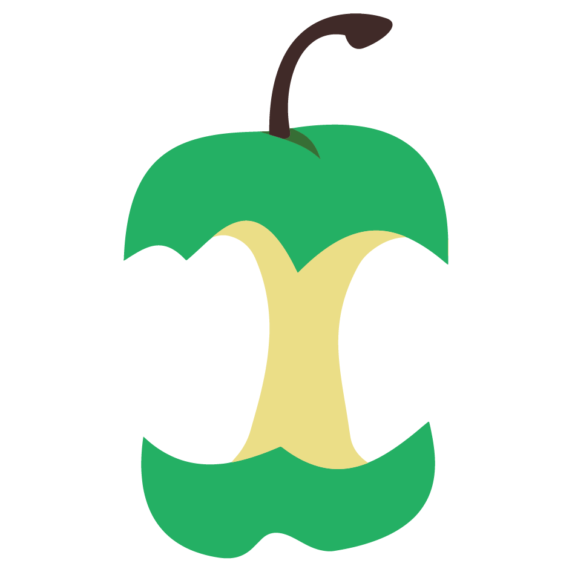
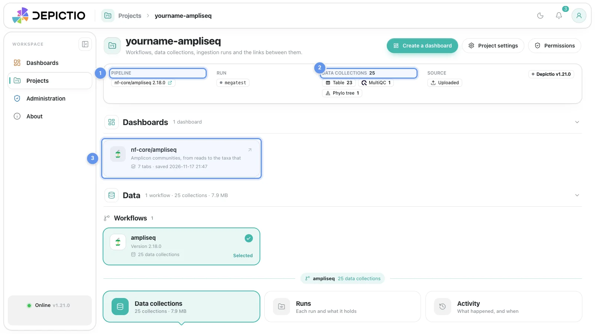

# 4. An nf-core run, with its template

<div class="ws-strip" markdown>
[**0** Setup](setup.md){ .ws-ep0 } [**1** First project](first-project.md){ .ws-ep1 } [**2** A new season](own-tables.md){ .ws-ep2 } [**3** As code](dashboard-as-code.md){ .ws-ep3 } [**4** nf-core](nf-core-run.md){ .ws-ep4 .ws-here }
</div>

<div class="ws-meta ws-ep4" markdown>
<span class="ws-chip" markdown="span">:material-star-outline: **Optional, if time allows**</span> <span class="ws-chip" markdown="span">{ .ws-logo .off-glb } **nf-core/ampliseq 2.18.0**</span>
</div>

!!! overview "Overview"
    **Questions**

    - How do I send a pipeline's results folder to Depictio without the browser?
    - How do I check what will happen before anything is sent?

    **Objectives**

    - Run a dry run and read what it found.
    - Ingest the run into a project of your own.

In episodes 1 to 3 you wrote the project file. For a pipeline Depictio knows, a **template** writes it: the CLI recognises the pipeline and its version from the results folder, and brings the data collections, links and dashboards with it. This is the project of the browser course, episode 3, built from your laptop.

[{ .ws-diagram }](../../images/tutorials/workshop-cli/diagrams/ingest-steps_light.png){target=_blank}
[{ .ws-diagram }](../../images/tutorials/workshop-cli/diagrams/ingest-steps_dark.png){target=_blank}

## :material-folder-download-outline: Get the run

Download [`megatest.zip`](megatest.zip) and unzip it in your working folder:

```bash
unzip megatest.zip
ls megatest
```

```console
input  multiqc  overall_summary.tsv  pipeline_info  qiime2
```

These are the outputs of the nf-core/ampliseq 2.18.0 megatest, the run of the browser course.

## :material-clipboard-check-outline: Dry run

```console
$ depictio ingest megatest/ --project yourname-ampliseq --dry-run
• Detected nf-core/ampliseq 2.18.0 (nextflow, 20 tool(s))
✓ Auto-selected template: nf-core/ampliseq/2.18.0
…
! 21 data collection(s) will ingest, 0 empty, 4 missing sources
…
✓ Dry run complete (8/8 steps): the configuration is valid, and nothing was changed.
```

The dry run reads the folder, picks the template from the pipeline and its version, and lists each data collection with what it found. It sends nothing to the server.

Always pass `--project` with a name of your own, here `yourname-ampliseq`. Without it, the dry run says it would create *Ampliseq Microbial Community Analysis*: the template's default name, which is also the name of the server's demo project.

!!! challenge "Challenge 4.1: what is missing?"
    In the dry run's tables, find the **template variables** and the data collections marked **missing**. Which variable explains why `ancombc_results` finds no files?

    ??? solution "Solution"
        `GROUP_COL` reads `name`: the CLI took the `name` column of the sample metadata (`input/Metadata_full.tsv`) as the group to compare. The differential abundance results of this run are per **habitat** (`qiime2/ancombc/differentials/Category-habitat-…`), so `ancombc_results`, and `ma_canonical` which is built from it, find nothing. Set the variable yourself:

        ```console
        $ depictio ingest megatest/ --project yourname-ampliseq --dry-run --var GROUP_COL=habitat
        ! 23 data collection(s) will ingest, 0 empty, 2 missing sources
        ```

        The two left are the SIDLE collections, for multi-region runs: this run has none, and they are optional.

## :material-database-import-outline: Ingest

Give the project a name of your own: names are unique on the server.

```console
$ depictio ingest megatest/ --var GROUP_COL=habitat --project yourname-ampliseq
…
• Project: https://…/projects/…
• Dashboard 'nf-core/ampliseq' created: https://…/dashboard/…
! Skipped 2 optional data collection(s), their inputs are absent from this run: sidle_reconstructed, sidle_reconstruction_qc
✓ Ingestion completed successfully! (8/8 steps)
```

Open the **Project** link the CLI printed:

[{ .ws-shot }](../../images/tutorials/workshop-cli/ep4_project.webp){target=_blank}

From the project, open the **nf-core/ampliseq** dashboard (3).

!!! warning "Without `--var GROUP_COL=habitat`"
    The ingestion stops at `ma_canonical` with *Data processing failed*: always pass the variable for this run.

!!! challenge "Challenge 4.2: the same project as in the browser?"
    Open your project in the browser, **Projects → yourname-ampliseq**. How many data collections and links does it have? How many tabs has its dashboard? Compare with episode 4 of the browser course.

    ??? solution "Solution"
        25 data collections and 21 links; the dashboard has 7 tabs: Overview, MultiQC, Alpha Diversity, Ordination & Clustering, Community & Diversity, Differential Abundance, Phylogeny. The browser course counted 23 and 19: the CLI keeps the two optional SIDLE collections, empty, and the two links that reach them. The run is named `megatest`, after the folder.

!!! further "Going further"
    `depictio ingest --help` lists the other options: `--template` to force a template, `--update-config` to refresh a project after you change something, `--attach-run` to add a run, which episode 2 uses.

!!! keypoints "Key points"
    - `depictio ingest <folder>` detects the pipeline and its version, and picks the template.
    - `--dry-run` shows what each data collection finds, without sending anything: read it first.
    - `--var` sets a template variable the CLI guessed wrong; `--project` names the project: always pass it.

<div class="ws-next" markdown>
[<span class="ws-k">Stuck?</span><span class="ws-t">Troubleshooting</span>](troubleshooting.md#episode-4){ .ws-help }
[<span class="ws-k">Then</span><span class="ws-t">Going further</span>](going-further.md){ .ws-go .ws-ep4 }
</div>
