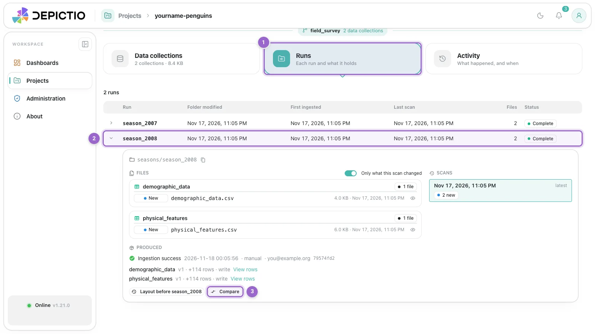
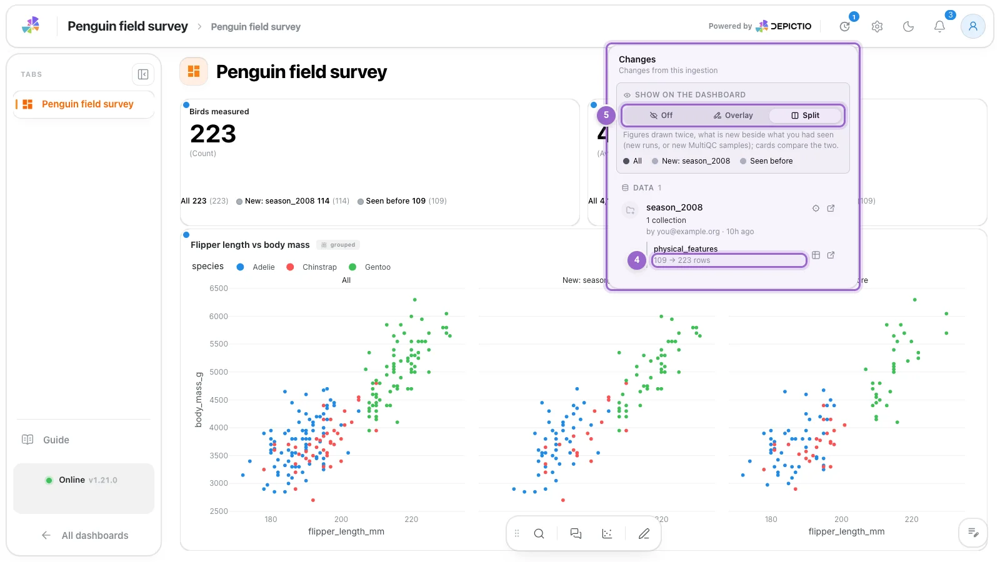

# 2. A second table, then a new season

<div class="ws-strip" markdown>
[**0** Setup](setup.md){ .ws-ep0 } [**1** First project](first-project.md){ .ws-ep1 } [**2** A new season](own-tables.md){ .ws-ep2 .ws-here } [**3** As code](dashboard-as-code.md){ .ws-ep3 } [**4** nf-core](nf-core-run.md){ .ws-ep4 }
</div>

<div class="ws-meta ws-ep2" markdown>
<span class="ws-chip" markdown="span">:material-console: **Creator, from the terminal**</span> <span class="ws-chip" markdown="span">:material-penguin: **Palmer Penguins, two tables, two seasons**</span>
</div>

!!! overview "Overview"
    **Questions**

    - How do I add a table to a project, and link it to the first one?
    - The next season arrives: how do I add it, and see what it changed?

    **Objectives**

    - Extend the project file: a second table, a link, any season.
    - Refresh the project with `--update-config`.
    - Add the 2008 season as a new run, and compare.

You continue with the project of episode 1, in the same `penguins-workshop/` folder. `penguins.yaml` is `penguins-1.yaml` with three additions.

[{ .ws-diagram }](../../images/tutorials/workshop-cli/diagrams/project-file_light.png){target=_blank}
[{ .ws-diagram }](../../images/tutorials/workshop-cli/diagrams/project-file_dark.png){target=_blank}

## :material-file-compare: What changes in the file

```bash
diff penguins-1.yaml penguins.yaml
```

The three additions, in `penguins.yaml`: the `{SEASON_DIR}` location, the `demographic_data` table and the `links` block.

```yaml
      locations:
        - "{SEASON_DIR}"             # filled from the SEASON_DIR environment variable
    data_collections:
      - data_collection_tag: "physical_features"
        # … as in episode 1
      - data_collection_tag: "demographic_data"
        config:
          type: "Table"
          metatype: "Aggregate"
          scan:
            mode: "recursive"
            scan_parameters:
              regex_config:
                pattern: "demographic_data.csv"
          dc_specific_properties:
            format: "CSV"
links:
  - source_dc_tag: "demographic_data"     # filter on this table...
    source_column: "individual_id"
    target_dc_tag: "physical_features"    # ...narrows this one
    target_type: "table"
    link_config:
      target_field: "individual_id"
```

`diff` also shows two lines where only a comment was added, on `name: "field-survey"` and `structure: "flat"`: they explain the Runs tab and the runs, and change nothing.

| Addition | Why |
|---|---|
| `{SEASON_DIR}` | One file for every season: `SEASON_DIR=seasons/season_2008` on the command line picks the folder |
| `demographic_data` | Who each bird is: species, island, sex |
| `links` | The two tables share `individual_id`: a filter on a column only `demographic_data` has, such as `sex`, can narrow `physical_features` |

## :material-database-refresh: Refresh the project

```console
$ SEASON_DIR=seasons/season_2007 depictio ingest --project-config-path penguins.yaml \
    --project yourname-penguins --update-config
…
• The project keeps 1 run location(s): those of this configuration
✓ Project updated on server
✓ Data collection 'physical_features' processed successfully.
✓ Data collection 'demographic_data' processed successfully.
✓ Ingestion completed successfully! (7/7 steps)
```

`SEASON_DIR=…` goes on the **same line**, before `depictio`: it fills `{SEASON_DIR}` for this command only. `--update-config` refreshes a project that exists: its tables and links follow the file, and your dashboard stays as it is.

!!! challenge "Challenge 2.1: what did the refresh change?"
    Open your project in the browser. How many data collections, links and runs does it have now?

    ??? solution "Solution"
        Two data collections, `physical_features` and `demographic_data`, and one link. Still one run, `season_2007`: the folder is the same, written as `{SEASON_DIR}`.

## :material-update: A new season: 2008

```console
$ SEASON_DIR=seasons/season_2008 depictio ingest --project-config-path penguins.yaml \
    --project yourname-penguins --attach-run
…
✓ Workflow 'field_survey': +1 run location(s) -> seasons/season_2008
✓ Ingestion completed successfully! (8/8 steps)
```

`--attach-run` adds the folder to the **existing** project as one more run.

1. In the browser, open your project's **Runs** tab (1): two runs, `season_2007` and `season_2008`.
2. Expand **season_2008** (2): its two new files, and under **Produced** what the ingestion wrote to each table: +114 rows.
3. Click **Compare** (3).

    [{ .ws-shot }](../../images/tutorials/workshop-cli/ep2_runs.webp){target=_blank}

4. Open **Changes** (the badge icon in the dashboard header). **Show on the dashboard → Split** (5) draws each figure three times: all the birds, the new season, the ones seen before.

    [{ .ws-shot }](../../images/tutorials/workshop-cli/ep2_compare.webp){target=_blank}

!!! challenge "Challenge 2.2: what did 2008 bring?"
    In the **Changes** panel, which table changed, and how many rows did it have before and after? Switch **Show on the dashboard** to **Split**: what do the cards show?

    ??? solution "Solution"
        The panel lists one collection: `physical_features`, from 109 to 223 rows. In **Split**, each figure is drawn three times: **All**, **New: season_2008** and **Seen before**. **Birds measured** reads 223, 114 and 109; the mean body mass reads 4,197, 4,267 and 4,125 g.

!!! callout "Why Compare stays grey on season_2007"
    Compare shows what an ingestion changed. The first run created the project: there was nothing before it to compare with. Each `--attach-run` records an ingestion for its run, so **Compare** works from the second run on.

!!! further "Going further"
    `depictio watch` runs `ingest` again whenever a folder changes: useful when new results land on a shared drive. See `depictio watch --help`.

!!! keypoints "Key points"
    - A project file grows with your data: add a table, add a link, and refresh with `--update-config`.
    - `{SEASON_DIR}` lets one file serve every season; set it on the command line.
    - `--attach-run` adds a folder as a new run; **Runs → Compare** shows what it changed.

<div class="ws-next" markdown>
[<span class="ws-k">Stuck?</span><span class="ws-t">Troubleshooting</span>](troubleshooting.md#episode-2){ .ws-help }
[<span class="ws-k">Next episode</span><span class="ws-t">3. A dashboard as code</span>](dashboard-as-code.md){ .ws-go .ws-ep3 }
</div>
