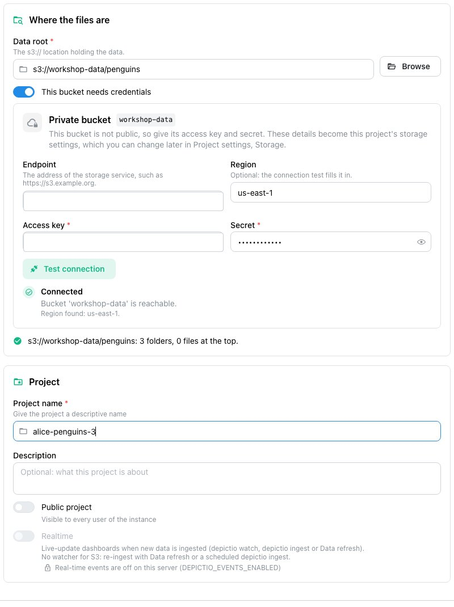
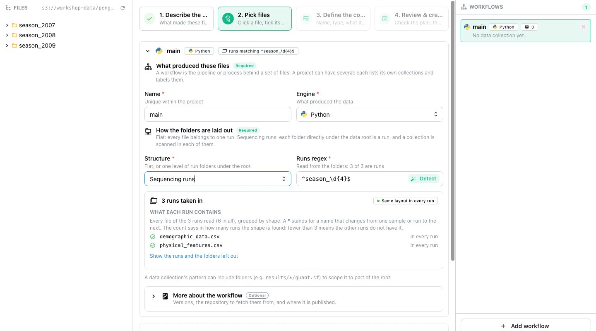
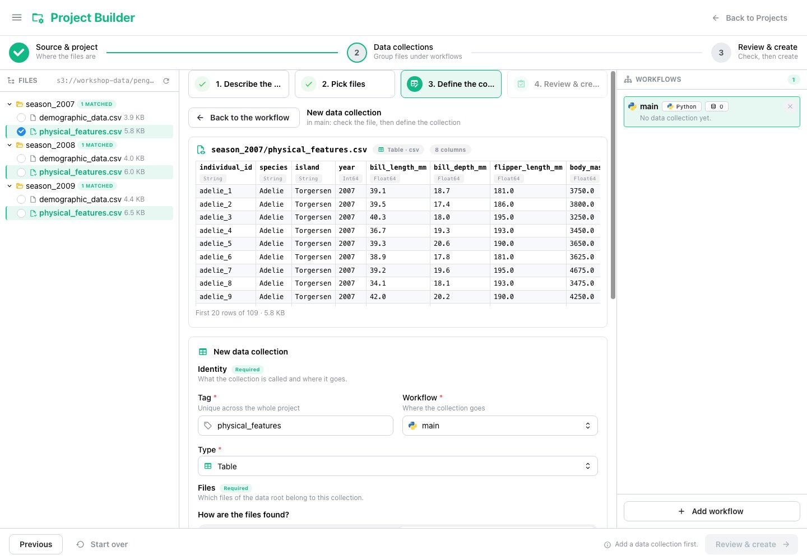
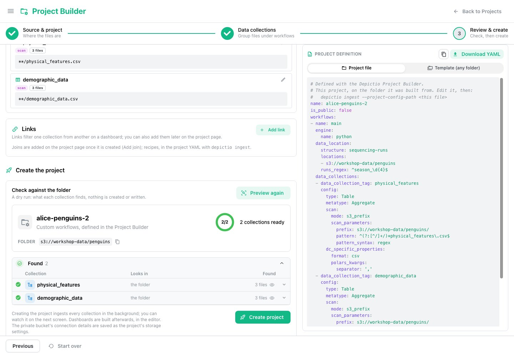
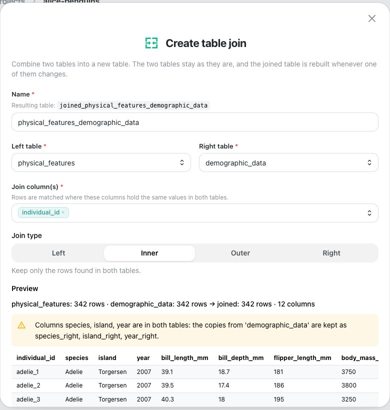
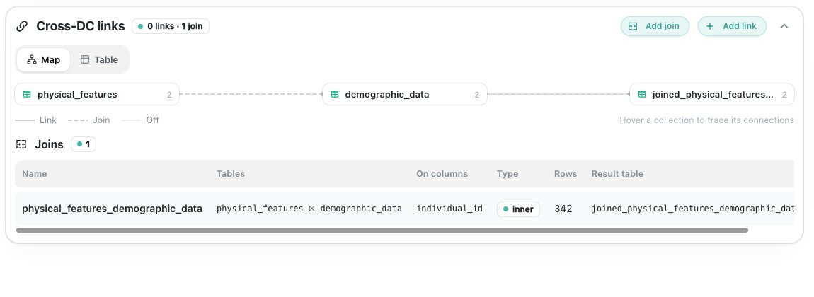
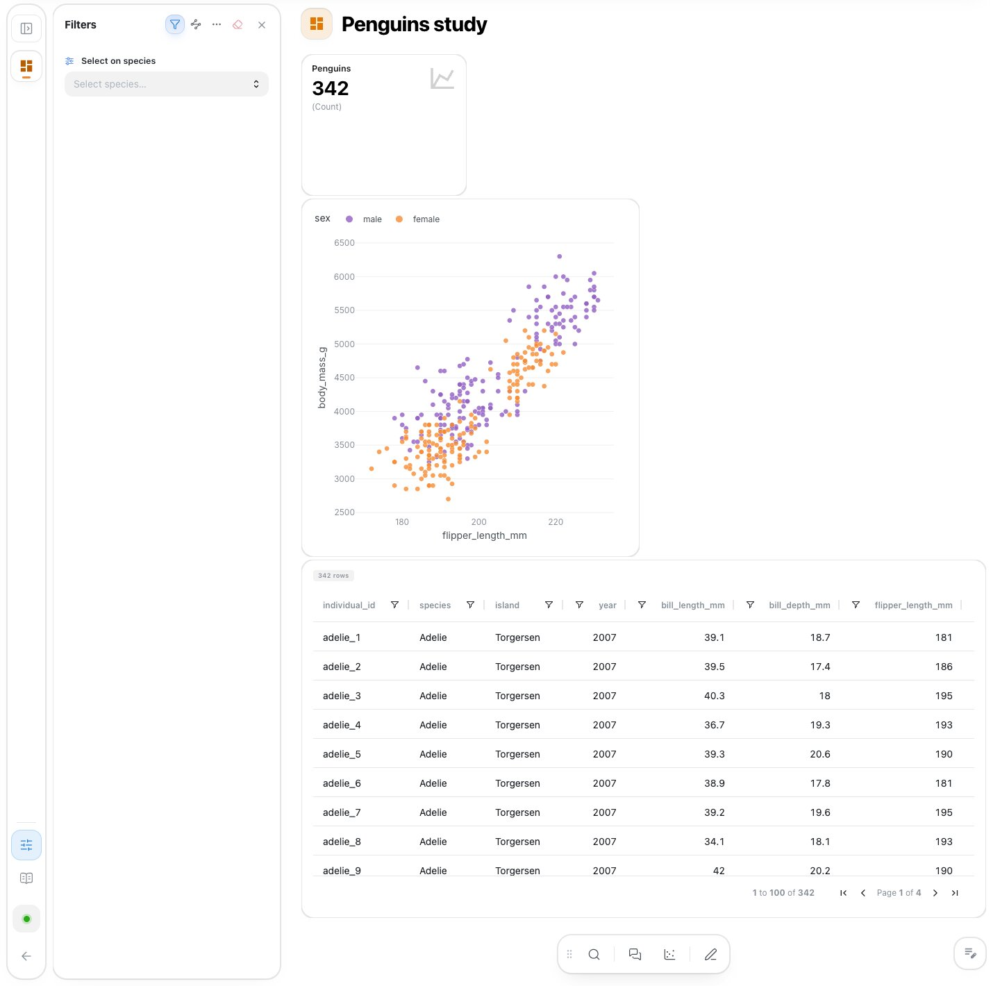
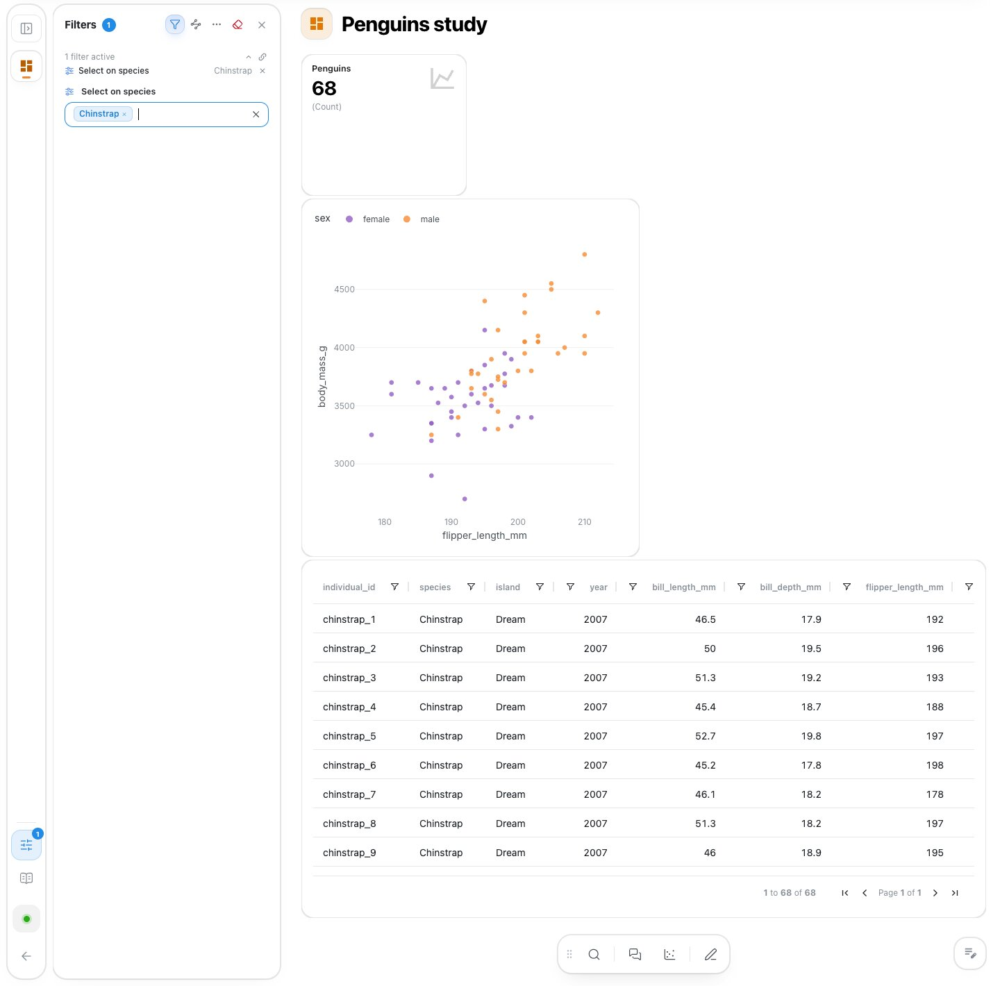
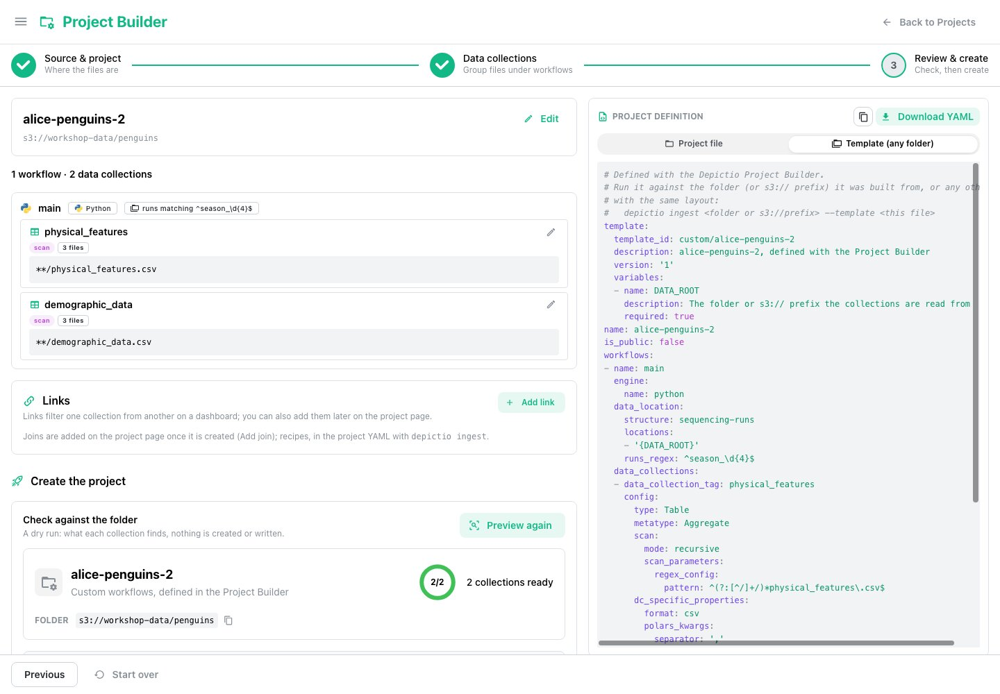
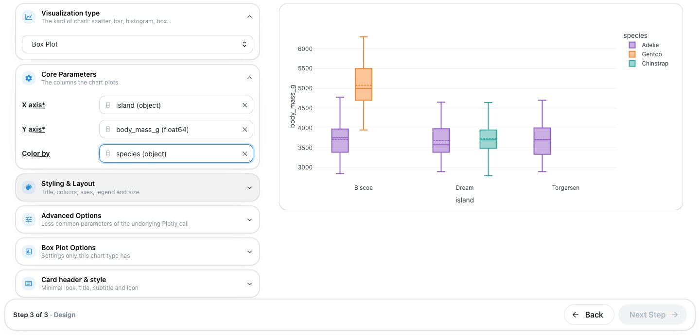

# 1. Your own tables, no template

<div class="ws-strip" markdown>
[**0** Setup](setup.md){ .ws-ep0 } [**1** Your tables](project-builder.md){ .ws-ep1 .ws-here } [**2** nf-core run](nf-core-run.md){ .ws-ep2 } [**3** Together](collaborate-and-export.md){ .ws-ep3 } [**+** Going further](going-further.md){ .ws-ep4 }
</div>

<div class="ws-meta ws-ep1" markdown>
<span class="ws-chip" markdown="span">:material-plus-box-outline: **Creator**</span> <span class="ws-chip" markdown="span">:material-web: **In the browser**</span> <span class="ws-chip" markdown="span">:material-penguin: **Palmer Penguins, three seasons**</span> <span class="ws-chip" markdown="span">:material-timer-outline: **Hands-on 1 · 10 min**</span>
</div>

!!! overview "Overview"
    **Questions**

    - How do I build a project and a dashboard from scratch, when no template exists for my data?
    - How do I tell Depictio that each folder is one run?
    - How do I use columns from two tables in one dashboard?

    **Objectives**

    - Define two data collections over three run folders in the **Project Builder**, preview them, create the project.
    - Join the two tables on `individual_id` with **Add join**.
    - Build a dashboard of four components: a card, a figure, a table and a filter.

Before you use the command line, you build a project and a dashboard **from scratch**, with no template: the way you would start for a workflow that Depictio does not know yet.

The data is the Palmer Penguins of the browser course. Each field season is **one run folder**, just as a pipeline writes one folder per run: `season_2007`, `season_2008` and `season_2009`. In each run there are two tables: `physical_features.csv` (the measurements) and `demographic_data.csv` (who each bird is, with its `sex`). Both carry `individual_id`. Together: 342 penguins.

The Project Builder reads a **folder in a bucket** (`s3://…`), not files from your laptop. The location of the penguins folder is given in the chat; below it is written `s3://<workshop-bucket>/penguins`.

## :material-folder-search-outline: Hands-on 1 · Step 1: the source and the project { #source }

1. Open **Projects**, **New project**, **Add data**, pick **2 Custom workflows**, then **Open the Project Builder** (or open `/projects/build` on the server).
2. Under **Data root**, paste `s3://<workshop-bucket>/penguins`. If the switch **This bucket needs credentials** turns on, fill in the **Endpoint**, **Access key** and **Secret** from the chat and click **Test connection**. It reads *Connected*, then Depictio lists the folder: *3 folders, 0 files at the top*. The three folders are the three runs.
3. Under **Project**, give a **Project name** of **your own** (it must be unique on the server), leave **Public project** off, and click **Next**.

{ .ws-shot }

## :material-folder-multiple-outline: Step 2: tell Depictio that each folder is a run { #runs }

You are now on **1. Describe the workflows**. A workflow is the process behind the files; here, one called `main`.

1. Keep the **Name** `main` and the **Engine** `Python`.
2. Under **How the folders are laid out**, open **Structure** and pick **Sequencing runs**. *Flat* would treat all files as one run; *Sequencing runs* says that each folder under the data root is a run.
3. **Runs regex** fills in by itself: `^season_\d{4}$`, *3 of 3 are runs*. The panel **3 runs taken in** reads *Same layout in every run*, and lists `demographic_data.csv` and `physical_features.csv` as *in every run*.

{ .ws-shot }

## :material-table-search: Step 3: two collections, then create { #collections }

1. Open **2. Pick files**. In the file tree, open `season_2007` and click `physical_features.csv`: a preview shows its columns and types. The same file in `season_2008` and `season_2009` lights up: one **scan** will cover the three runs.
2. Keep the tag `physical_features` and the type **Table**, and click **Add to main**. Click `demographic_data.csv`, keep the tag `demographic_data`, and **Add to main** again. Click **Review & create**.
3. The review reads *1 workflow · 2 data collections*, each a **scan** of *3 files*. On the right, **PROJECT DEFINITION** shows the **Project file** that the builder has written (see the first Bonus).
4. Click **Preview the ingestion**: a dry run, nothing is created. It reads *2 collections ready*, with *3 files* found for each. Then click **Create project**.
5. The dialog **Project created** reads *Ingestion completed in 0:12: 2 ingested*. Click **Open the project**: the project page shows **RUNS 3** and 2 data collections.

{ .ws-shot }

{ .ws-shot }

## :material-set-center: Step 4: join the two tables { #join }

Joins are usually written in the project file, and the command line makes them when it ingests. But, as in a database, you can also join two tables **on the project page**: the result is a **new table**, a view that is rebuilt whenever one of its two tables changes. The measurements are in one table and the `sex` in the other, so you need it.

1. On the project page, in **Cross-DC links**, click **Add join**. In **Create table join**, the **Left table** is `physical_features` and the **Right table** is `demographic_data`. Set **Join column(s)** to `individual_id`.
2. Set **Join type** to **Inner**: *Keep only the rows found in both tables*.
3. Read the **Preview** before you create anything: *physical_features: 342 rows · demographic_data: 342 rows → joined: 342 rows · 12 columns*. A yellow note says that `species`, `island` and `year` are in both tables: the copies from `demographic_data` are kept as `species_right`, `island_right` and `year_right`.
4. Click **Create join**. The **Joins** table lists it (**inner**, 342 rows) and the project has a third collection: `joined_physical_features_demographic_data`.

{ .ws-shot }

{ .ws-shot }

**Inner or left?** Here they give the same 342 rows (all four join types give 342), because every bird is in both tables. They differ only when a bird is missing from the right table: a **left** join keeps it, with empty demographic values; an **inner** join drops it. Inner is the simplest choice for this exercise.

## :material-view-dashboard-outline: Step 5: a dashboard with four components { #figure }

1. Click **Create a dashboard** at the top of the project page. **New Dashboard** opens with the project already chosen: type a title (for example `Penguins study`) and click **Create Dashboard**. You stay on the **Dashboards** list: click your new dashboard to open it.
2. Click **Start editing**, then the **+** button. Pick **Component**, then **Manual**. For each component below, click its type tile, open the list under **Data Source**, pick `joined_physical_features_demographic_data`, click **Next Step**, set the options, then click **Create component**. Add the four, then click **Save**.

    | Type | Options |
    |---|---|
    | **Card** | **Card title** `Penguins`; **Select your column** `individual_id`. Leave the aggregation as it is: it fills in **Count**. |
    | **Figure** | **Visualization type** **Scatter Plot**; **X axis** `flipper_length_mm`; **Y axis** `body_mass_g`; **Color by** `sex`. |
    | **Table** | Nothing to set. |
    | **Interactive** | **Select your column** `species`. |

3. In the left panel **Filters**, **Select on species** now filters the three other components.

The figure uses `flipper_length_mm` and `body_mass_g` from `physical_features` and `sex` from `demographic_data`: without the join, one figure could not use both. The card reads **342**; the table reads *1 to 100 of 342* (4 pages).

{ .ws-shot }

!!! question "Check your understanding"
    The join is an **Inner** join and gives 342 rows. What would a **Left** join give here, and when would the two differ? Where does the column `species_right` come from?

    ??? solution "Answer"
        Also 342 rows: every bird of `physical_features` has a row in `demographic_data`. They differ when a bird is missing from the right table: a left join keeps it with empty demographic values, an inner join drops it. `species_right` is the copy of `species` from `demographic_data`, renamed because `physical_features` has a `species` column too.

!!! challenge "Challenge: the Chinstrap penguins"
    In the **Filters** panel, open **Select on species** and pick **Chinstrap**. How many Chinstrap penguins are there? On which island? Then pick **Gentoo** instead: how many?

    ??? solution "Solution"
        68 Chinstrap penguins (the card reads **68**, the table *1 to 68 of 68*), all on **Dream**. Gentoo: 123. One filter changes the card, the figure and the table at once, because they all read the same joined table.

        { .ws-shot }

!!! keypoints "Key points"
    - The Project Builder reads a folder in a bucket and lets you say what each file is, without a template.
    - **Sequencing runs** tells it that each folder is a run, as a pipeline would write one folder per run.
    - One **scan** over the runs makes one collection with the rows of every run.
    - **Preview the ingestion** is a dry run: nothing is created until **Create project**.
    - A **join** on the project page makes a new table from two tables on a shared column; its preview counts the rows before anything is created.
    - A dashboard component reads one collection: the joined table lets a figure use columns from both tables.

??? note "Bonus · Read the project file the builder wrote"
    In the review step of Step 3, **PROJECT DEFINITION** shows the **Project file**: your project, written for you (**Download YAML** saves it). Here it is for the three seasons:

    ```yaml
    name: <your-project-name>                       # [[1]]
    is_public: false                                # [[1]]
    workflows:
      - name: main
        engine:
          name: python
        data_location:
          structure: sequencing-runs                # [[2]]
          locations:
            - s3://<workshop-bucket>/penguins       # [[2]]
          runs_regex: ^season_\d{4}$                # [[2]]
        data_collections:
          - data_collection_tag: physical_features  # [[3]]
            config:
              type: Table                           # [[3]]
              metatype: Aggregate                   # [[3]]
              scan:
                mode: s3_prefix                     # [[3]]
                scan_parameters:
                  prefix: s3://<workshop-bucket>/penguins/
                  pattern: ^(?:[^/]+/)*physical_features\.csv$   # [[3]]
                  pattern_syntax: regex
              dc_specific_properties:
                format: csv
    ```

    **Exercise.** (a) Which lines make the three season folders three runs? (b) How does a collection find its file in every run? (c) In the review, click **Template (any folder)**: which lines change?

    ??? solution "Solution"
        1. **The project** (band 1): its name and the visibility you left off.
        2. (a) **The runs** (band 2): `structure: sequencing-runs` and `runs_regex: ^season_\d{4}$` are what you set in Step 2; the location is the data root of Step 1.
        3. (b) **A collection** (band 3): its tag, `Table`, `Aggregate` (the rows of every run add up in one table), and a scan of the bucket prefix. The regular expression `^(?:[^/]+/)*physical_features\.csv$` accepts the file at any depth, so it matches `season_2007/physical_features.csv` and the same file in the two other seasons. The file holds one such block for `demographic_data` too.

        (c) The **Template (any folder)** switch shows the same project as a template: a `template:` block on top with a `DATA_ROOT` variable, `'{DATA_ROOT}'` in place of the location, and `mode: recursive` with no prefix. Run it on any folder with the same layout: `depictio ingest <folder> --template <file>`.

        { .ws-shot }

??? note "Bonus · A second figure: compare the islands"
    On the same dashboard, click the pencil, then add a **Figure** on `joined_physical_features_demographic_data`. Choose **Box Plot**, **X axis** `island`, **Y axis** `body_mass_g`, **Color by** `species`. Which species live on which island? Which species is the heaviest?

    ??? solution "Solution"
        **Biscoe** has Adelie and Gentoo, **Dream** has Adelie and Chinstrap, **Torgersen** has only Adelie. Gentoo is the heaviest: its median is about 5000 g, against about 3700 g for the other two. The figure is only a preview in the editor here: **Create component** and **Save** keep it on your dashboard.

        { .ws-shot }

<div class="ws-next" markdown>
[<span class="ws-k">Next episode</span><span class="ws-t">2. An nf-core run from the terminal</span>](nf-core-run.md){ .ws-go .ws-ep2 }
</div>
