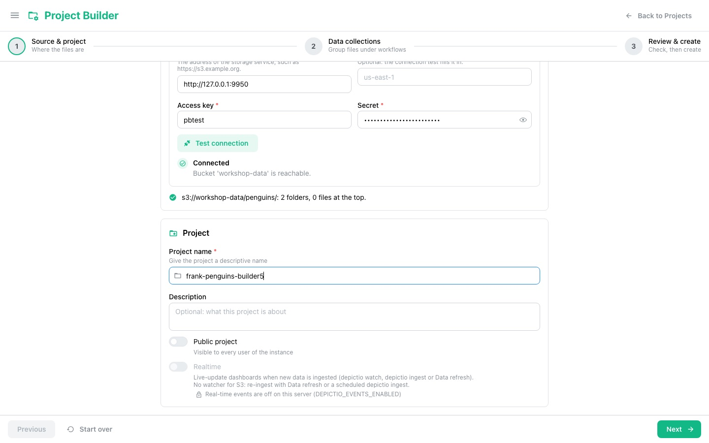
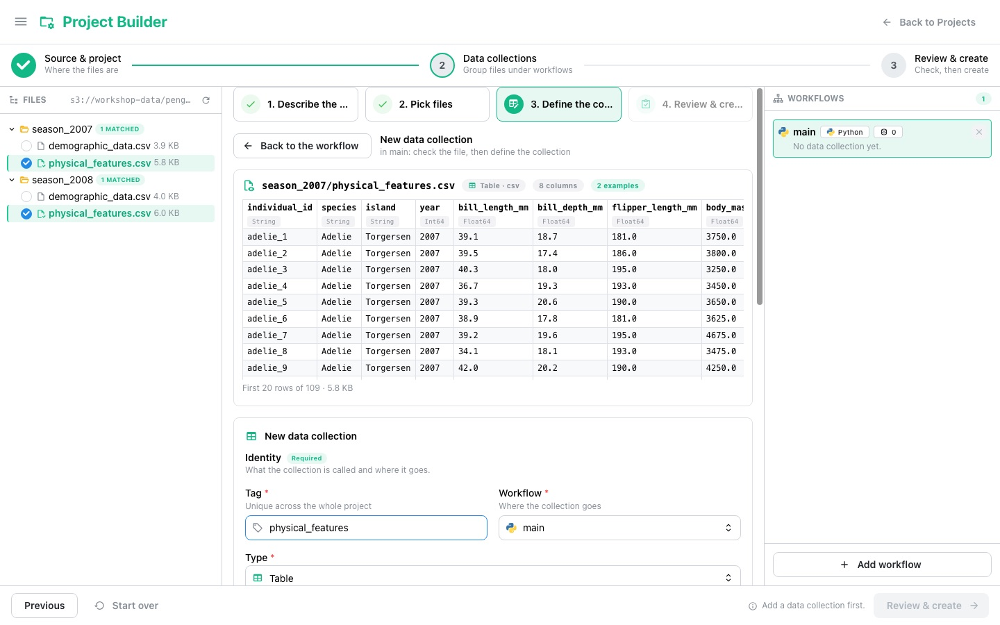
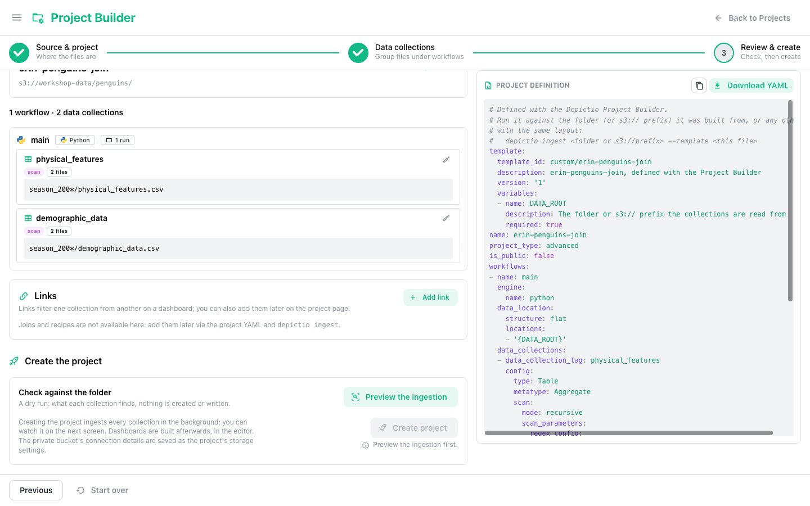
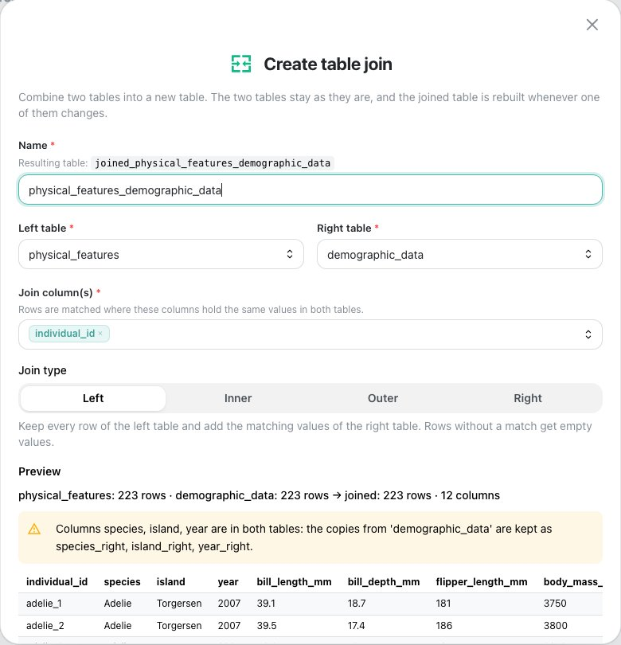
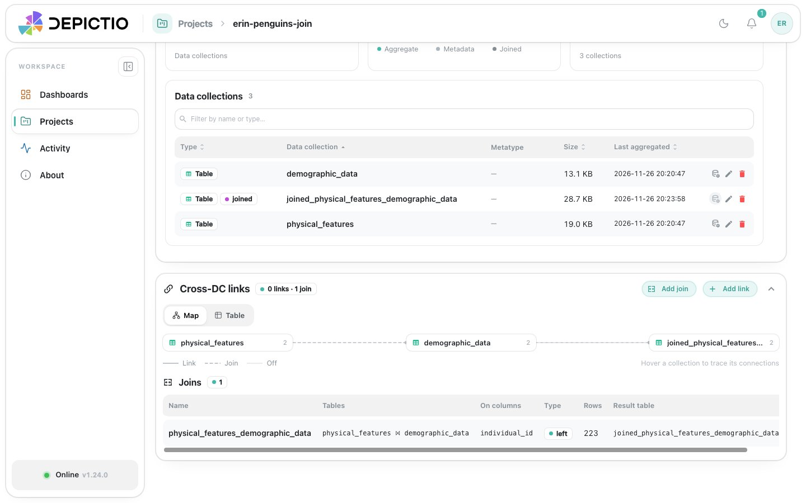
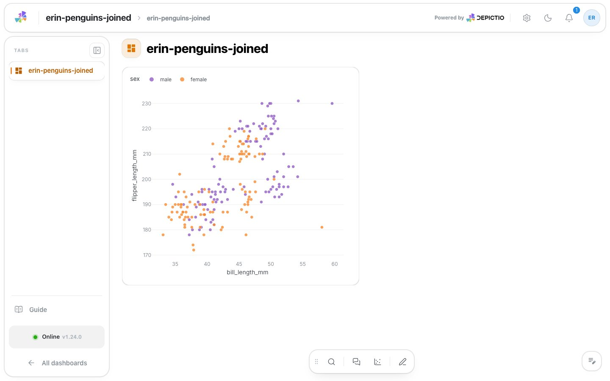

# 1. Your own tables, no template

<div class="ws-strip" markdown>
[**0** Setup](setup.md){ .ws-ep0 } [**1** Your tables](project-builder.md){ .ws-ep1 .ws-here } [**2** nf-core run](nf-core-run.md){ .ws-ep2 } [**3** Collaborate](collaborate-and-export.md){ .ws-ep3 } [**+** Going further](going-further.md){ .ws-ep4 }
</div>

<div class="ws-meta ws-ep1" markdown>
<span class="ws-chip" markdown="span">:material-plus-box-outline: **Creator**</span> <span class="ws-chip" markdown="span">:material-web: **In the browser**</span> <span class="ws-chip" markdown="span">:material-penguin: **Palmer Penguins, two seasons**</span> <span class="ws-chip" markdown="span">:material-timer-outline: **Hands-on 1 · 10 min**</span>
</div>

!!! overview "Overview"
    **Questions**

    - How do I turn my own tables into a project when no template exists?
    - How do I plot columns from two tables in one figure?

    **Objectives**

    - Define two data collections in the **Project Builder**, preview them, create the project.
    - Join the two tables on `individual_id` with **Add join**.
    - Make one figure from the joined table.

Yesterday the run had a template: Depictio knew what each file was. Most of your own data has none. The data here is the Palmer Penguins of the browser course: two field seasons, and in each season two tables, `physical_features.csv` (the measurements) and `demographic_data.csv` (who each bird is, with its `sex`). Both carry `individual_id`.

The Project Builder reads a **folder in a bucket** (`s3://…`), not files from your laptop. The location of the penguins folder is given in the chat.

## :material-folder-search-outline: Hands-on 1 · Step 1: the source and the project { #source }

1. Open **Projects**, **New project**, **Add data**, pick **2 Custom workflows**, then **Open the Project Builder** (or open `/projects/build` on the server).
2. Under **Data root**, paste the `s3://` location from the chat. If the switch **This bucket needs credentials** turns on, fill in the **Endpoint**, **Access key** and **Secret** from the chat and click **Test connection**. Depictio lists the folder: *2 folders, 0 files at the top*.
3. Under **Project**, give a **Project name** of **your own** (it must be unique on the server), leave **Public project** off, and click **Next**.

{ .ws-shot }

<!-- TODO: retake this screenshot with the workshop bucket once its location is decided. -->

## :material-table-search: Step 2: two collections, then create { #collections }

1. In the file tree, click `season_2007/physical_features.csv` (a preview shows its columns), then tick `season_2008/physical_features.csv`. The collection becomes a **scan** over both seasons: *MATCHES 2 FILES*.
2. Change the tag to `physical_features`, keep the type **Table**, and click **Add to main**. Do the same for `demographic_data.csv`, with the tag `demographic_data`. Click **Review & create**.
3. The review reads *1 workflow · 2 data collections*. Click **Preview the ingestion** (a dry run: each collection is *Found*, 2 files), then **Create project**.
4. The dialog **Project created** reads *Ingestion completed*; click **Open the project**. The project page lists 2 data collections.

{ .ws-shot }

{ .ws-shot }

## :material-set-center: Step 3: join the two tables { #join }

1. On the project page, in **Cross-DC links**, click **Add join**. The dialog **Create table join** is filled in: **Left table** `physical_features`, **Right table** `demographic_data`, **Join column(s)** `individual_id`, **Join type** **Left**.
2. Read the **Preview** before you create anything: *physical_features: 223 rows · demographic_data: 223 rows → joined: 223 rows · 12 columns*. A yellow note says that `species`, `island` and `year` are in both tables: the copies from `demographic_data` are kept as `species_right`, `island_right` and `year_right`.
3. Click **Create join**. A third collection appears: `joined_physical_features_demographic_data`, and the **Joins** table shows its 223 rows.

{ .ws-shot }

{ .ws-shot }

## :material-chart-scatter-plot: Step 4: one figure from both tables { #figure }

1. Click **Create a dashboard** at the top of the project page. **New Dashboard** opens with the project already chosen: give a title and click **Create Dashboard**.
2. Click **Start editing**, **Add component**, **Manual**, **Figure**. Under **Data Source**, open the list and pick `joined_physical_features_demographic_data`, then **Next Step**.
3. Set **X** to `bill_length_mm`, **Y** to `flipper_length_mm` and **Color by** to `sex`. Click **Create component**, then **Save**.

The measurements come from `physical_features`, `sex` from `demographic_data`: without the join, one figure could not use both.

{ .ws-shot }

!!! question "Check your understanding"
    The join is a **Left** join and gives 223 rows. What would an **Inner** join give here, and when would the two differ? Where does the column `species_right` come from?

    ??? solution "Answer"
        Also 223 rows: every bird of `physical_features` has a row in `demographic_data`. They differ when a bird is missing from the right table: a left join keeps it with empty demographic values, an inner join drops it. `species_right` is the copy of `species` from `demographic_data`, renamed because `physical_features` has a `species` column too.

!!! challenge "Challenge: who is heavier?"
    Add a second **Figure** on the joined table: `flipper_length_mm` on x, `body_mass_g` on y, coloured by `sex`. Within one species, which sex is heavier? Which of the two tables could not have drawn this figure on its own?

    ??? solution "Solution"
        Within each species, males are heavier than females: their points sit higher. Neither table alone: `body_mass_g` is in `physical_features` and `sex` in `demographic_data`.

!!! keypoints "Key points"
    - The Project Builder reads a folder in a bucket and lets you say what each file is, without a template.
    - Ticking the same file in each season makes a **scan**: one collection over every season.
    - **Preview the ingestion** is a dry run; **Create project** only works after it.
    - A **join**, added on the project page, puts two tables side by side on a shared column; its preview counts the rows before anything is created.

??? note "Bonus · The data, file by file"
    ```console
    penguins/
    ├── season_2007/
    │   ├── demographic_data.csv     who each bird is: individual_id, species, island, year, sex
    │   └── physical_features.csv    its measurements: individual_id, species, island, year and 4 measures (109 rows in 2007)
    └── season_2008/
        ├── demographic_data.csv     the same two files, for 2008
        └── physical_features.csv
    ```

??? note "Bonus · A link instead of a join"
    A **link** does not build a new table: it lets a filter on one collection narrow another on a dashboard. In the review step of the Project Builder, under **Links**, **Add link**: **From collection** `physical_features`, **Filters collection** `demographic_data`, **Resolver** *Direct: the same values*, **Column** and **Target column** `individual_id`. The link goes one way: a filter on the **From** collection narrows the **Filters** collection. Links can also be added later on the project page, next to **Add join**.

??? note "Bonus · The YAML the Project Builder writes, block by block"
    **Download YAML** saves the file shown under **PROJECT DEFINITION**: the **Project file**, your project with its real location. It starts with a comment that says how to use it:

    ```yaml
    # Defined with the Depictio Project Builder.
    # This project, on the folder it was built from. Edit it, then:
    #   depictio ingest --project-config-path <this file>
    name: <your-project-name>                   # [[1]]
    is_public: false                            # [[1]]
    workflows:                                  # [[2]]
      - name: main                              # [[2]]
        engine:                                 # [[2]]
          name: python                          # [[2]]
        data_location:                          # [[2]]
          structure: flat                       # [[2]]
          locations:                            # [[2]]
            - s3://<workshop-bucket>/penguins   # [[2]]
        data_collections:                       # [[3]]
          - data_collection_tag: physical_features   # [[3]]
            config:                             # [[3]]
              type: Table                       # [[3]]
              metatype: Aggregate               # [[3]]
              scan:                             # [[3]]
                mode: s3_prefix                 # [[3]]
                scan_parameters:                # [[3]]
                  prefix: s3://<workshop-bucket>/penguins/   # [[3]]
                  pattern: ^physical_features\.csv$         # [[3]]
                  pattern_syntax: regex         # [[3]]
              dc_specific_properties:           # [[3]]
                format: csv                     # [[3]]
    ```

    1. **The project**: its name and visibility. `is_public: false` is the switch you left off.
    2. **The workflow `main`**: engine `python`, structure `flat` (the location is read as one run) and the location you pasted in step 1.
    3. **A data collection**: its tag, its type `Table`, `Aggregate` (the rows of every season add up in one table) and a scan of the bucket prefix (`s3_prefix`) with a regular expression that finds the file in each season folder. The file holds one such block for `physical_features` and one for `demographic_data`, then any link you added.

    To ingest it yourself, `depictio ingest --project-config-path <file>`, the command line must be able to read the bucket: the instructor tells you whether it is open to everyone or which credentials to add to your configuration.

    The switch **Template (any folder)** shows the same project as a template: a `template:` block on top and `{DATA_ROOT}` in place of the location, to read another folder with the same layout (`depictio ingest <folder> --template <file>`). The same fields appear in the project files you write by hand: see Going further, [A project file by hand](first-project.md).

??? note "Bonus · What the Project Builder leaves for later"
    The Project Builder defines collections and links. **Joins** are added afterwards on the project page (step 3), **recipes** in the project YAML with `depictio ingest`. A pipeline with a template skips all this: that is the next episode.

<div class="ws-next" markdown>
[<span class="ws-k">Stuck?</span><span class="ws-t">Troubleshooting</span>](troubleshooting.md#project-builder){ .ws-help }
[<span class="ws-k">Next episode</span><span class="ws-t">2. An nf-core run from the terminal</span>](nf-core-run.md){ .ws-go .ws-ep2 }
</div>
