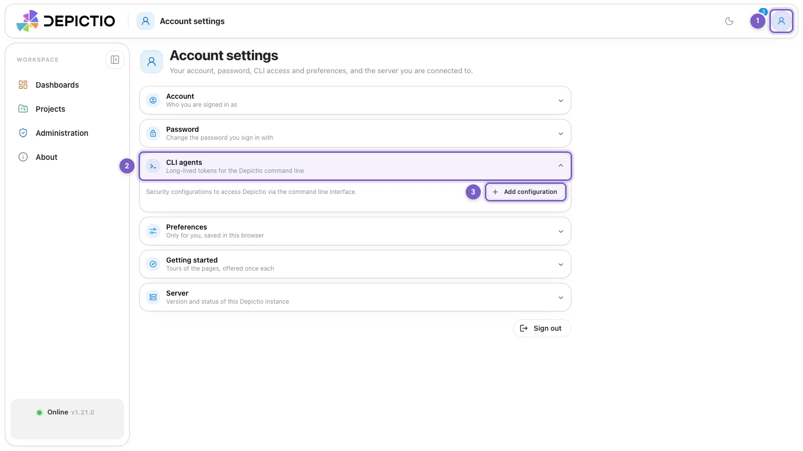

# 0. Setup

<div class="ws-strip" markdown>
[**0** Setup](setup.md){ .ws-ep0 } [**1** Your tables](project-builder.md){ .ws-ep1 } [**2** nf-core run](nf-core-run.md){ .ws-ep2 } [**3** Collaborate](collaborate-and-export.md){ .ws-ep3 } [**+** Going further](going-further.md){ .ws-ep4 }
</div>

<div class="ws-meta ws-ep0" markdown>
<span class="ws-chip" markdown="span">:material-account-group-outline: **Everyone**</span> <span class="ws-chip" markdown="span">:material-timer-sand-empty: **Before the session**</span>
</div>

!!! overview "Overview"
    **Questions**

    - How do I install the Depictio command line?
    - How does it know which server I use, and who I am?

    **Objectives**

    - Install the CLI in its own Python environment.
    - Download your `CLI.yaml` and check the connection.

## :material-language-python: Install the CLI

You need **Python 3.11 to 3.13** and a terminal on macOS or Linux; on Windows, use [WSL2](https://learn.microsoft.com/windows/wsl/install). Python 3.14 does not work yet: a dependency of the CLI does not support it. With uv, `--python 3.12` picks a working Python for you.

Everything of the workshop goes in **one folder in your home directory**, `~/depictio-workshop`: the Python environment now, the files of each episode later. Every command of the lesson is written for it.

=== "uv"

    ```bash
    mkdir -p ~/depictio-workshop
    cd ~/depictio-workshop
    uv venv --python 3.12 depictio-env
    source ~/depictio-workshop/depictio-env/bin/activate
    uv pip install "depictio[multiqc]==1.24.0"
    ```

=== "pip"

    ```bash
    mkdir -p ~/depictio-workshop
    cd ~/depictio-workshop
    python3.12 -m venv depictio-env
    source ~/depictio-workshop/depictio-env/bin/activate
    pip install "depictio[multiqc]==1.24.0"
    ```

The `[multiqc]` part adds { .ws-logo .ws-logo-mono .off-glb } MultiQC, which reads the MultiQC report of the nf-core run in episode 2: install it with the extra today. The environment takes about 1.2 GB. Outside the workshop, if you do not ingest nf-core runs, `pip install "depictio==1.24.0"` is enough: the CLI alone, a lighter install.

Check the install:

```console
$ depictio --version
Depictio CLI version: 1.24.0
```

The version must read **1.24.0**: the version the workshop server runs.

!!! callout "A new terminal"
    In every new terminal, activate the environment and go back to the workshop folder:

    ```bash
    source ~/depictio-workshop/depictio-env/bin/activate
    cd ~/depictio-workshop
    ```

## :material-key-outline: Your CLI.yaml

The CLI reads one file, `~/.depictio/CLI.yaml`. You create it on the server, from your account, and download it once.

1. Open the **workshop server** address the instructor gave you and sign in. Today's account is new: the first sign-in asks you to **choose your own password**. Set it first; until then the server refuses everything else, the CLI included.
2. Click your profile badge at the top right (1): **Account settings** opens.
3. Open **CLI agents** (2), then click **Add configuration** (3).

    { .ws-shot }

4. Give the configuration a **Name**, such as *laptop*, then **Create** (4).

    { .ws-shot }

5. Click **Download** (5), then **Done** (6). The file `CLI.yaml` lands in your **Downloads** folder, `~/Downloads`. The window shows the file **only once**: after Done, the server cannot show it again.

    { .ws-shot }

6. Move the file from `~/Downloads` to `~/.depictio`, the folder the CLI reads:

    ```bash
    mkdir -p ~/.depictio
    mv ~/Downloads/CLI.yaml ~/.depictio/CLI.yaml
    ```

    If your Downloads folder already held a `CLI.yaml`, the new file is named `CLI (1).yaml`: move that one instead, `mv ~/Downloads/"CLI (1).yaml" ~/.depictio/CLI.yaml`.

The file has three parts:

```yaml
api_base_url: https://…          # the server the CLI talks to [[1]]
user:                            # who you are [[2]]
  email: you@example.org [[2]]
  token: [[2]]
    access_token: •••            #    signs each command in as you [[2]]
    refresh_token: •••           #    renews the access token [[2]]
    expire_datetime: …           #    the configuration stops working on this date [[2]]
s3_storage:                      # where the CLI writes your tables [[3]]
  external_host: … [[3]]
  bucket: … [[3]]
  root_user: … [[3]]
  root_password: ••• [[3]]
```

1. **The server**: `api_base_url`, the address the CLI talks to.
2. **You**: your account and its two tokens. The access token signs each command in as you, the refresh token renews it; the configuration stops working on `expire_datetime`.
3. **The storage**: where the CLI writes your tables, with its address, bucket and keys.

The CLI writes your tables itself, straight to the server's storage: that is why the storage access is in the file.

!!! warning "Keep it private"
    `CLI.yaml` signs the CLI in as you and opens the server's storage. Do not paste it in the chat or commit it. Lost it? Create another configuration.

## :material-check-circle-outline: Check the connection

```console
$ depictio config check
• Server: https://… (configuration ~/.depictio/CLI.yaml)
• Checking server accessibility...
✓ Depictio CLI configuration is model-compliant. [[1]]
✓ Server accessible - User: you@example.org [[2]]
… Checking S3 storage configuration...
✓ S3 storage configuration is valid [[3]]
```

The three ✓ lines say:

1. the file is **complete**;
2. the server **knows your account**;
3. the storage **accepts your tables**.

A line starting with ✗ names the part that fails: see [Troubleshooting](troubleshooting.md#setup).

!!! challenge "Challenge 0.1: until when?"
    Run `depictio config show`. Until when does your configuration work? Are your token and the storage password printed?

    ??? solution "Solution"
        `expire_datetime`, under `token`, reads one year after you created the configuration: after that date, create another one. The tokens and the storage password are masked: `config show` is safe to share on screen, `CLI.yaml` is not.

!!! keypoints "Key points"
    - The CLI lives in its own Python environment, `~/depictio-workshop/depictio-env`, at the server's version: `depictio[multiqc]==1.24.0`.
    - `~/.depictio/CLI.yaml` is created once in **Account settings → CLI agents**: the server, your token, and the storage the CLI writes to.
    - `depictio config check` tests the file, the server and the storage before anything else.

??? note "Bonus · Usage statistics"
    The first command you run prints a short notice: the CLI sends anonymous usage data (which command ran, whether it succeeded, the operating system and the versions), never file paths, arguments, project names or credentials. To turn them off, add `export DEPICTIO_TELEMETRY_ENABLED=false` to your shell, or set `DO_NOT_TRACK=1`.

<div class="ws-next" markdown>
[<span class="ws-k">Stuck?</span><span class="ws-t">Troubleshooting</span>](troubleshooting.md#setup){ .ws-help }
[<span class="ws-k">Next episode</span><span class="ws-t">1. Your own tables, no template</span>](project-builder.md){ .ws-go .ws-ep1 }
</div>
