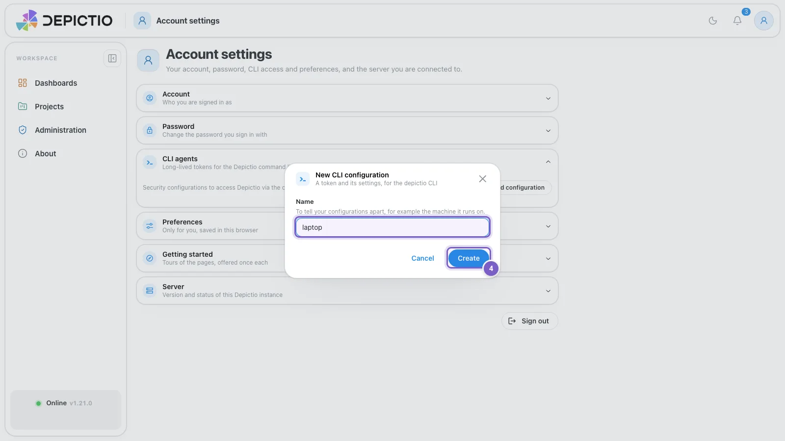
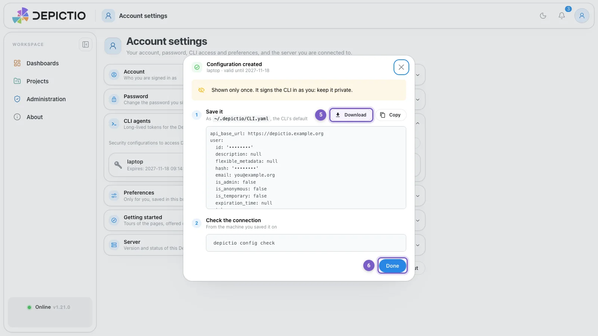

# 0. Setup

<div class="ws-strip" markdown>
[**0** Setup](setup.md){ .ws-ep0 .ws-here } [**1** First project](first-project.md){ .ws-ep1 } [**2** A new season](own-tables.md){ .ws-ep2 } [**3** As code](dashboard-as-code.md){ .ws-ep3 } [**4** nf-core](nf-core-run.md){ .ws-ep4 }
</div>

<div class="ws-meta ws-ep0" markdown>
<span class="ws-chip" markdown="span">:material-account-group-outline: **Everyone**</span> <span class="ws-chip" markdown="span">:material-timer-sand-empty: **Before the session**</span>
</div>

!!! overview "Overview"
    **Questions**

    - How do I install the Depictio command line?
    - How does it know which server I use, and who I am?

    **Objectives**

    - Install the CLI in its own Python environment.
    - Download your `CLI.yaml` and check the connection.

## :material-language-python: Install the CLI

You need **Python 3.11 to 3.13** and a terminal on macOS or Linux; on Windows, use [WSL2](https://learn.microsoft.com/windows/wsl/install). Python 3.14 does not work yet: a dependency of the CLI does not support it. With uv, `--python 3.12` picks a working Python for you.

=== "uv"

    ```bash
    uv venv --python 3.12 depictio-env
    source depictio-env/bin/activate
    uv pip install "depictio[multiqc]~=1.23.0"
    ```

=== "pip"

    ```bash
    python3.12 -m venv depictio-env
    source depictio-env/bin/activate
    pip install "depictio[multiqc]~=1.23.0"
    ```

The `[multiqc]` part adds { .ws-logo .ws-logo-mono .off-glb } MultiQC, which the nf-core run of episode 4 needs. The environment takes about 1.2 GB.

Check the install:

```console
$ depictio --version
Depictio CLI version: 1.23.0
```

Any 1.23 version is fine: `~=1.23.0` installs the latest 1.23 release, the line the workshop server runs.

!!! callout "A new terminal"
    In every new terminal, activate the environment again: `source depictio-env/bin/activate`.

!!! note "Usage statistics"
    The first command you run prints a short notice: the CLI sends anonymous usage data (which command ran, whether it succeeded, the operating system and the versions), never file paths, arguments, project names or credentials. To turn them off, add `export DEPICTIO_TELEMETRY_ENABLED=false` to your shell, or set `DO_NOT_TRACK=1`.

## :material-key-outline: Your CLI.yaml

The CLI reads one file, `~/.depictio/CLI.yaml`: the server address, your personal token and the access to the server's storage. You download it from your account.

1. Open the **workshop server** address the instructor gave you and sign in.
2. Click your profile badge at the top right (1): **Account settings** opens.
3. Open **CLI agents** (2), then click **Add configuration** (3).

    [{ .ws-shot }](../../images/tutorials/workshop-cli/setup_cliagents.webp){target=_blank}

4. Give the configuration a **Name**, such as *laptop*, then **Create** (4).

    [{ .ws-shot }](../../images/tutorials/workshop-cli/setup_new.webp){target=_blank}

5. **Configuration created** is shown **only once**. Click **Download** (5): the file `CLI.yaml` lands in your downloads. **Copy** works too: paste the content into `~/.depictio/CLI.yaml` yourself. Then **Done** (6).

    [{ .ws-shot }](../../images/tutorials/workshop-cli/setup_created.webp){target=_blank}

    The file holds the server address, your token and the access to the server's storage (masked in this picture).

6. Move the file to where the CLI looks for it:

    ```bash
    mkdir -p ~/.depictio
    mv ~/Downloads/CLI.yaml ~/.depictio/CLI.yaml
    ```

    !!! warning "A second download"
        If `~/Downloads` already holds a `CLI.yaml`, the new one lands as `CLI (1).yaml`, and the command above moves the **old** file. Move the file you just downloaded, or delete the old one first.

!!! warning "Keep it private"
    `CLI.yaml` signs the CLI in as you and opens the server's storage. Do not paste it in the chat or commit it. Lost it? Create another configuration.

## :material-check-circle-outline: Check the connection

```console
$ depictio config check
• Server: https://… (configuration ~/.depictio/CLI.yaml)
• Checking server accessibility...
✓ Depictio CLI configuration is model-compliant.
✓ Server accessible - User: you@example.org
… Checking S3 storage configuration...
✓ S3 storage configuration is valid
```

What matters is the three ✓ lines.

!!! challenge "Challenge 0.1: which server?"
    Run `depictio config show`. Which server does your CLI talk to? Is your token printed?

    ??? solution "Solution"
        The first line names the server and the file it was read from: `• Server: https://… (configuration ~/.depictio/CLI.yaml)`. The token and the storage password are masked.

!!! keypoints "Key points"
    - The CLI lives in its own Python environment: `depictio[multiqc]`.
    - `~/.depictio/CLI.yaml`, downloaded from **Account settings → CLI agents**, tells the CLI which server and who you are.
    - `depictio config check` tests the server and the storage before anything else.

<div class="ws-next" markdown>
[<span class="ws-k">Stuck?</span><span class="ws-t">Troubleshooting</span>](troubleshooting.md#setup){ .ws-help }
[<span class="ws-k">Next episode</span><span class="ws-t">1. Your first project from the command line</span>](first-project.md){ .ws-go .ws-ep1 }
</div>
