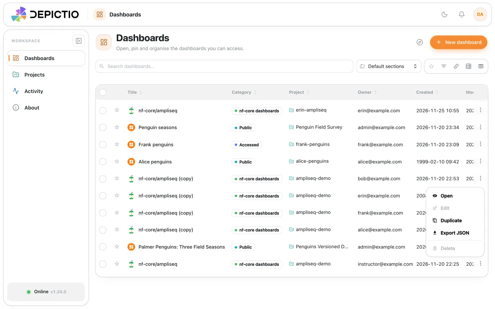

# 2. Make your own copy and edit it

<div class="ws-strip" markdown>
[**0** Setup](get-started.md){ .ws-ep0 } [**1** Read](view.md){ .ws-ep1 } [**2** Edit](edit-your-copy.md){ .ws-ep2 .ws-here } [**3** From a run](from-nf-core-run.md){ .ws-ep3 } [**4** Showcases](showcases.md){ .ws-ep6 } [**+** From files](from-a-file.md){ .ws-ep4 } [**+** New run](new-run-and-versions.md){ .ws-ep5 }
</div>

<div class="ws-meta ws-ep2" markdown>
<span class="ws-chip" markdown="span">:material-pencil-outline: **Designer**</span> <span class="ws-chip" markdown="span">:material-database-outline: **Your copy of nf-core/ampliseq**</span> <span class="ws-chip" markdown="span">:material-timer-outline: **Hands-on 2 · 10 min**</span> <span class="ws-chip" markdown="span">:material-flag-outline: **After episode 1**</span>
</div>

!!! overview "Overview"
    **Questions**

    - Can I change a dashboard someone shared with me?
    - How do I add a figure, and keep it?

    **Objectives**

    - Duplicate a dashboard into a copy of your own.
    - Open your copy in **Edit** mode and add a figure.
    - Save it.

The shared dashboard almost suits you. You cannot change it, since others use it as it is. You make a **copy**: the copy belongs to you, and you are its **owner**. As a **designer**, you change the dashboard, never the data.

## :material-content-copy: Hands-on 2 · Step 1: make your copy { #make-your-copy }

1. On **Dashboards**, open the **⋮** menu of **nf-core/ampliseq** and click **Duplicate**. The copy is made at once: **nf-core/ampliseq (copy)**.
2. Rename it with your first name. On the copy whose **Owner** is your e-mail, open **⋮**, then **Edit**. In **Dashboard Title**, write for example `nf-core/ampliseq Ana`, then **Save Changes**. Everyone who opens the project sees your copy in the list, read-only: with a name, you find yours.

{ .ws-shot }

## :material-pencil-outline: Step 2: open it in Edit mode

Open your copy and click **Edit**, the pencil icon in the bottom toolbar.

{ .ws-diagram }
{ .ws-diagram }

## :material-chart-scatter-plot: Step 3: add a figure { #add-a-figure }

1. Click **+** in the bottom toolbar, then **Component**, **New component** and **Figure**.
2. Pick the data collection **ancombc_results**, the differential abundance results, then **Next Step**.
3. Set **X axis** to `lfc`, **Y axis** to `neg_log10_qval` and **Color by** to `contrast`, then **Create component**.
4. The figure lands on the tab you are on: scroll to find it.

Prefer code? Edit your figure and switch to **Code Mode**: Depictio wrote the same figure as one line of Python. See the Bonus at the end.

{ .ws-shot }

## :material-content-save-outline: Step 4: save

Click **Save** in the bottom toolbar. Every save is kept as a version of your dashboard; you go back to one on Day 2.

!!! question "Check your understanding"
    Who owns **nf-core/ampliseq (copy)**, and what happened to the shared **nf-core/ampliseq** when you added a figure? Did you change the data?

    ??? solution "Answer"
        You own the copy, and only you can edit it. The shared dashboard is as it was, and so is the data: a designer changes a dashboard, never the data.

!!! challenge "Challenge: read your figure"
    What does each point stand for, and where are the taxa that differ the most?

    ??? solution "Solution"
        One point per phylum and contrast, each habitat against groundwater. The phyla that differ the most are high (small q-value) and far from 0 on x (large log fold change). This is a volcano plot: the Differential Abundance tab draws the same data.

!!! keypoints "Key points"
    - Duplicate a shared dashboard to change it: the copy is yours, the original stays as it was.
    - A figure is a data collection plus a few choices (x, y, colour); Code mode gives the same in Python.
    - Annotations, versions and **Export** (a dashboard as one HTML file that opens without a server) are on Day 2.

??? note "Bonus · A table and a MultiQC plot"
    ### :material-table: Table and { .ws-logo .ws-logo-mono .off-glb } MultiQC

    1. Add a **Table** from a data collection of your choice: **Next Step**, then **Create component**.
    2. Add a { .ws-logo .ws-logo-mono .off-glb } **MultiQC** component: pick a module, then a plot, then **Create component**. The *General Stats Table* module needs no plot.
    3. Click **Save**.

    !!! further "Going further"
        Add a **Card** with a summary value, an interactive **Filter**, a **Map** of the sampling sites, or a **Text** to document your tab.

??? note "Bonus · The same figure as code (Python, optional)"
    !!! challenge "Challenge (optional, Python): the same figure as code"
        Edit your figure and switch to **Code Mode**: Depictio wrote the figure as one line of Plotly Express. Change `color` to another column and click **Execute Code**.

        ??? solution "Solution"
            The line Depictio wrote:

            ```python
            fig = px.scatter(df, x="lfc", y="neg_log10_qval", color="contrast")
            ```

            Any column of `ancombc_results` works in `color`; the figure is drawn again with it.

<span id="without-a-server"></span>

??? note "Bonus · Annotations, versions and exports: now on Day 2"
    Drawing an annotation on a figure, going back to an earlier version of a dashboard or of one component, and exporting a dashboard as a file that opens without a server (*Without a server*) moved to Day 2: [Collaborate and export](../workshop-cli/collaborate-and-export.md). The export part is [here](../workshop-cli/collaborate-and-export.md#export).


<div class="ws-next" markdown>
[<span class="ws-k">Stuck?</span><span class="ws-t">Troubleshooting</span>](troubleshooting.md#episode-2){ .ws-help }
[<span class="ws-k">Next episode</span><span class="ws-t">3. Create a project from an nf-core run</span>](from-nf-core-run.md){ .ws-go .ws-ep3 }
</div>
