# 2. Make your own copy and edit it

<div class="ws-strip" markdown>
[**0** Setup](get-started.md){ .ws-ep0 } [**1** Read](view.md){ .ws-ep1 } [**2** Edit](edit-your-copy.md){ .ws-ep2 .ws-here } [**3** From a run](from-nf-core-run.md){ .ws-ep3 } [**4** Showcases](showcases.md){ .ws-ep6 } [**+** From files](from-a-file.md){ .ws-ep4 }
</div>

<div class="ws-meta ws-ep2" markdown>
<span class="ws-chip" markdown="span">:material-pencil-outline: **Designer**</span> <span class="ws-chip" markdown="span">:material-database-outline: **Your copy of nf-core/ampliseq**</span> <span class="ws-chip" markdown="span">:material-timer-outline: **Hands-on 2 · 10 min**</span> <span class="ws-chip" markdown="span">:material-flag-outline: **After episode 1**</span>
</div>

!!! overview "Overview"
    **Questions**

    - Can I change a dashboard someone shared with me?
    - How do I add a figure, and keep it?

    **Objectives**

    - Duplicate a dashboard into a copy of your own.
    - Open your copy in **Edit** mode and add a figure.
    - Save it.

The shared dashboard almost suits you. You cannot change it, since others use it as it is. You make a **copy**: the copy belongs to you, and you are its **owner**. As a **designer**, you change the dashboard, never the data.

## :material-content-copy: Hands-on 2 · Step 1: make your copy { #make-your-copy }

1. On **Dashboards**, open the **⋮** menu of **nf-core/ampliseq** and click **Duplicate**. The copy is made at once: **nf-core/ampliseq (copy)**.
2. Rename it with your first name. On the copy whose **Owner** is your e-mail, open **⋮**, then **Edit**. In **Dashboard Title**, write for example `nf-core/ampliseq Ana`, then **Save Changes**. Everyone who opens the project sees your copy in the list, read-only: with a name, you find yours.

{ .ws-shot }

## :material-pencil-outline: Step 2: open it in Edit mode

Open your copy and click **Edit**, the pencil icon in the bottom toolbar.

{ .ws-diagram }
{ .ws-diagram }

## :material-chart-scatter-plot: Step 3: add a figure { #add-a-figure }

1. Click **+** in the bottom toolbar, then **Component**, **New component** and **Figure**.
2. Pick the data collection **ancombc_results**, the differential abundance results, then **Next Step**.
3. Set **X axis** to `lfc`, **Y axis** to `neg_log10_qval` and **Color by** to `contrast`, then **Create component**.
4. The figure lands on the tab you are on: scroll to find it.

Prefer code? Edit your figure and switch to **Code Mode**: Depictio wrote the same figure as one line of Python. See the Bonus at the end.

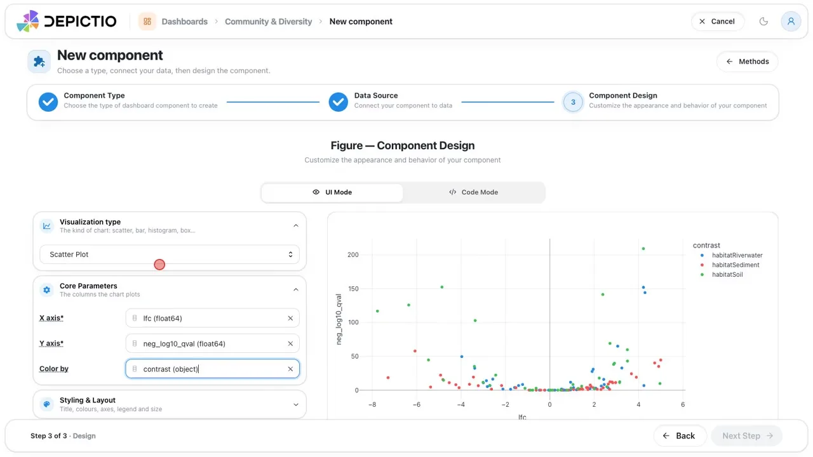{ .ws-shot }

## :material-content-save-outline: Step 4: save

Click **Save** in the bottom toolbar. Every save is kept as a version of your dashboard; you go back to one on Day 2.

!!! question "Check your understanding"
    Who owns **nf-core/ampliseq (copy)**, and what happened to the shared **nf-core/ampliseq** when you added a figure? Did you change the data?

    ??? solution "Answer"
        You own the copy, and only you can edit it. The shared dashboard is as it was, and so is the data: a designer changes a dashboard, never the data.

!!! challenge "Challenge: read your figure"
    What does each point stand for, and where are the taxa that differ the most?

    ??? solution "Solution"
        One point per phylum and contrast, each habitat against groundwater. The phyla that differ the most are high (small q-value) and far from 0 on x (large log fold change). This is a volcano plot: the Differential Abundance tab draws the same data.

!!! keypoints "Key points"
    - Duplicate a shared dashboard to change it: the copy is yours, the original stays as it was.
    - A figure is a data collection plus a few choices (x, y, colour); Code mode gives the same in Python.
    - Annotations, versions and **Export** (a dashboard as one HTML file that opens without a server) are on Day 2.

??? note "Bonus · More component types"
    **Goal:** add a table, two kinds of MultiQC plot, a card with several numbers and an advanced figure to your copy. Each one starts the same way: click **+**, then **Component**, then **New component**. Click the type you want: the page moves on to **Data Source**. Pick the data collection and click **Next Step**, then design the component and click **Create component**. The new component lands on the tab you are on: scroll to find it.

    The list has ten types: **Figure**, **Card**, **Interactive** (filters), **Table**, **MultiQC**, **Image**, **Map**, **Genome browser**, **Text** (a heading or a note) and **Advanced viz**.

    ### :material-table: 1. A table

    1. Click **Table**, pick the data collection `read_tracking` (the reads kept at each step, one row per sample), then **Next Step**.
    2. Open **Display options**: **Striped rows** and **CSV export** are on. Switch **Compact rows** on.
    3. Open **Columns visibility** and untick `depictio_run_id`.
    4. Click **Create component**.

    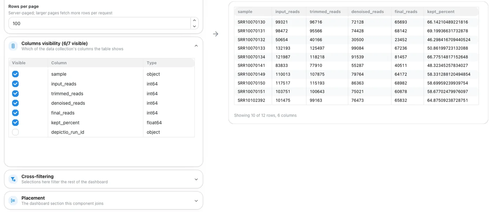{ .ws-shot }

    ### :material-chart-line: 2. Two kinds of { .ws-logo .ws-logo-mono .off-glb } MultiQC component

    Click **MultiQC**, pick the data collection `multiqc_data`, then **Next Step**. The **Module** list has **General Stats Table**, `cutadapt`, `fastqc`, `nf-core-ampliseq-methods-description` and `nf-core-ampliseq-summary`.

    1. **A summary of all samples.** In **Module**, pick **General Stats Table**. There is no plot to choose: the tile shows *General Statistics*, one row per metric (trimmed bases, duplicates, GC, number of reads...) with one dot per sample. Click **Create component**.

        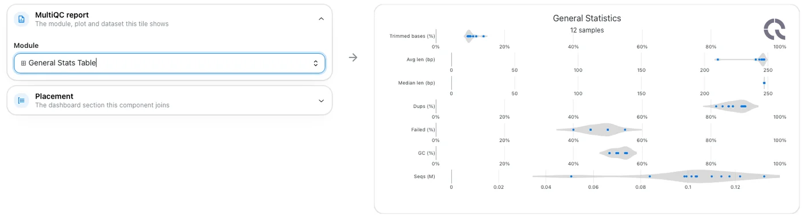{ .ws-shot }

    2. **One plot of one module.** Add a second **MultiQC** component. In **Module**, pick `fastqc`. Then in **Plot**, pick **Per Sequence GC Content**, and in **Dataset**, pick **Percentages**. One line per sample: the GC share of the reads. Click **Create component**.

        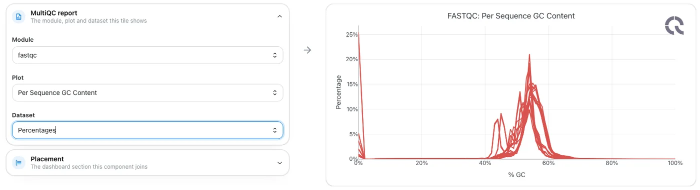{ .ws-shot }

    The **Plot** list of `fastqc` has eleven plots, for example **Sequence Quality Histograms**, **Adapter Content** and **Status Checks**.

    ### :material-numeric-3-box-outline: 3. A card with several numbers

    A card shows one value. A *breakdown* adds a strip with more numbers under it.

    1. Click **Card**, pick the data collection `read_tracking`, then **Next Step**.
    2. Under **Value**, write the **Card title** `Reads kept, median and range`. In **Select your column**, pick `kept_percent`. In **Select your aggregation method**, pick **Median**.
    3. Open **Breakdown**. In **Multi-metric style**, pick **Vertical list (median / min / max)**.
    4. Open **Display**. For **Style**, click **Accent**. In **Caption**, write `over the 12 samples`. In **Decimals**, write `1`.
    5. Click **Create component**.

    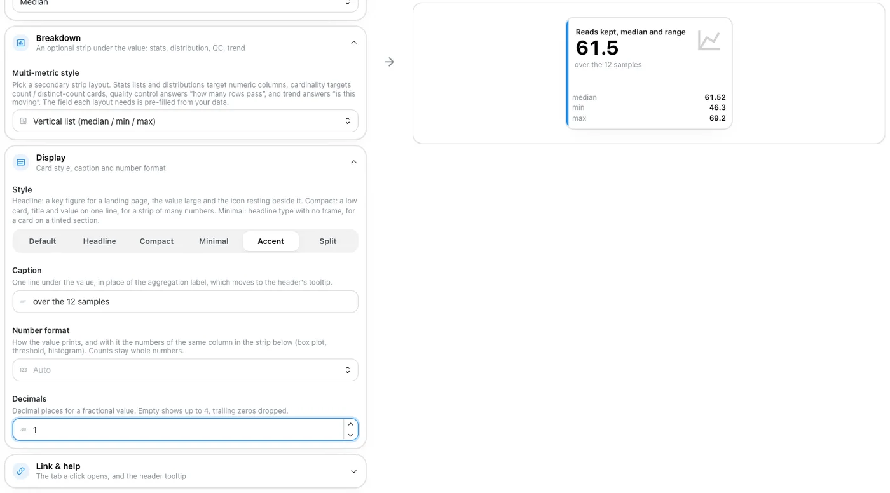{ .ws-shot }

    The big number shows 61.5 because of **Decimals**; the list keeps its own digits. Other choices you can try:

    - **Aggregation**: Count, Distinct count, Sum, Average, Median, Min, Max, Range, Variance, Std deviation, Percentile, Skewness and Kurtosis.
    - **Multi-metric style**: lists, a box plot, a histogram, a threshold, a gauge, a trend line, top-N bars, a donut and more.
    - **Style**: Default, Headline, Compact, Minimal, Accent and Split.
    - **Link & help**: **Link to a tab** makes the card open that tab when you click it.
    - **Colours & icon**: background, title colour, icon and title size.

    ### :material-flask-outline: 4. An advanced figure

    **Advanced viz** holds ready-made figures for a type of result, such as a volcano plot. Depictio ranks them by how well they fit your data collection.

    1. Click **Advanced viz**, pick the data collection `ancombc_results`, then **Next Step**.
    2. Under **Recommended for this data collection** you see **Differential-abundance bars (tool)**, **Volcano plot**, **Parallel coordinates** and **Scatter (X/Y)**. **Other visualisations** has 45 more kinds. Click **Volcano plot**.
    3. Under **Column bindings**, the three required roles are already filled: `feature_id` is `id`, `effect_size` is `lfc` and `significance` is `q_val`. The optional roles are `label`, `category`, `p_value` and `avg_log_intensity`: leave them empty.
    4. Click **Create component**.

    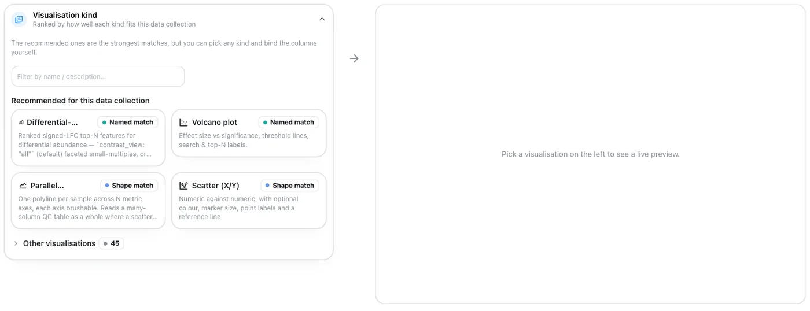{ .ws-shot }

    The volcano plot counts the taxa that go up (UP: 54), go down (DN: 43) or do not change (NS: 80), and draws the labels of the strongest ones. On the dashboard, the **Controls** panel on its right sets the thresholds: **p / padj** (0.05) and **|effect|** (1).

    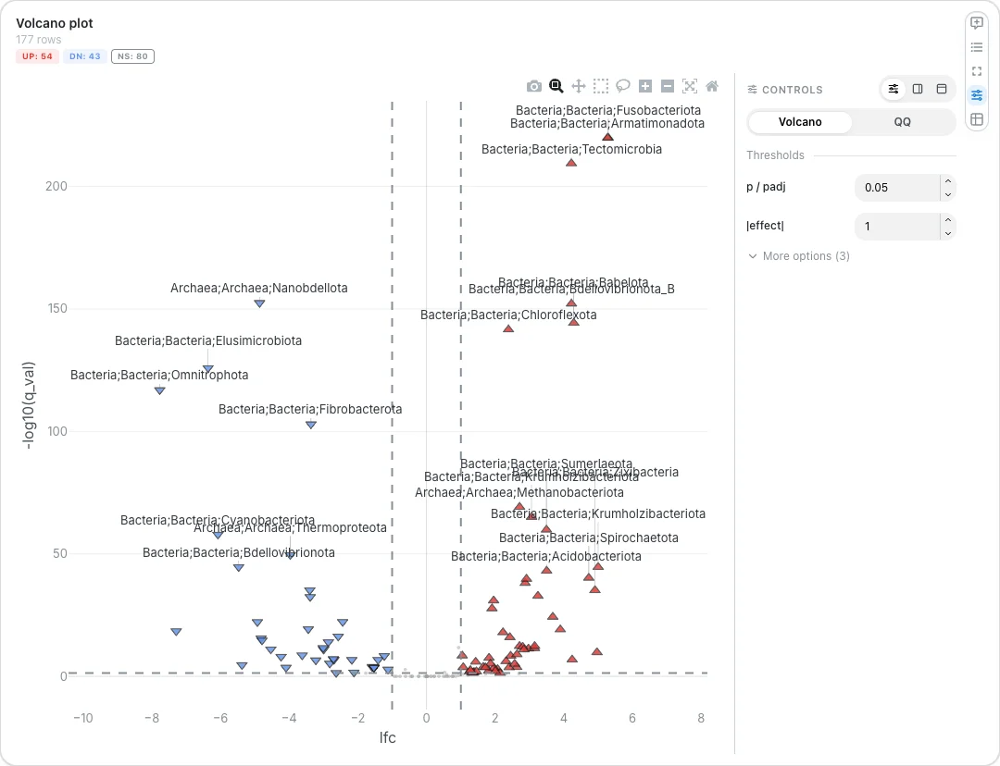{ .ws-shot }

    Click **Save** to keep your new components.

??? note "Bonus · The same figure as code (Python, optional)"
    **Goal:** build a richer figure with clicks, then read it as one call of Plotly Express.

    ### :material-chart-scatter-plot: A richer figure

    1. Click **+**, **Component**, **New component** and **Figure**. Pick `ancombc_results`, then **Next Step**.
    2. Set **X axis** to `lfc`, **Y axis** to `neg_log10_qval` and **Color by** to `contrast`. Stay in **UI Mode**.
    3. Open **Styling & Layout**. Set **Hover title** to `Phylum`. In **Hover fields**, pick `q_val` and `Kingdom`.
    4. Open **Advanced Options**. Set **Facet columns by** to `contrast`.
    5. Open **Scatter Plot Options**. Set **Size by** to `se` (the standard error of the log fold change).

    You get one panel per contrast, and a bigger dot where the estimate is less sure. Point at a dot: the tooltip shows the phylum, then `contrast`, `lfc`, `neg_log10_qval`, `se`, `q_val` and `Kingdom`.

    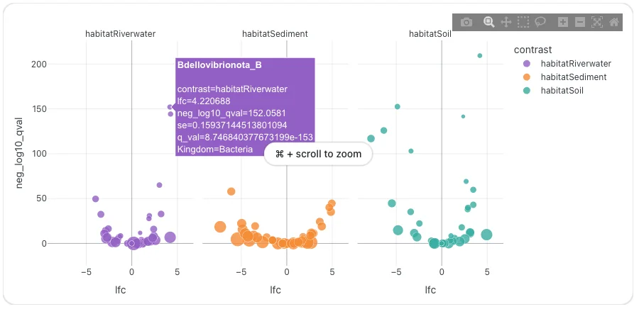{ .ws-shot }

    ### :material-code-braces: Read it as code

    1. Above the form, click **Code Mode**. Depictio wrote your settings as Python:

        ```python
        fig = px.scatter(df, x="lfc", y="neg_log10_qval", color="contrast",
                         hover_name="Phylum", hover_data=["q_val", "Kingdom"],
                         facet_col="contrast", size="se")
        ```

        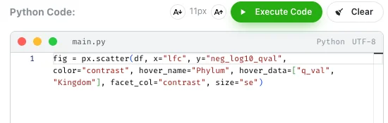{ .ws-shot }

    2. Read it. `px.scatter` draws the dots, and `df` is your data collection. **Hover title** became `hover_name`, **Hover fields** became `hover_data`, **Facet columns by** became `facet_col` and **Size by** became `size`.
    3. Click **Execute Code** to run it. Code runs on the server, and only for **editors** of the project. If you are a viewer, you see this message instead, and your UI Mode figure is not affected:

        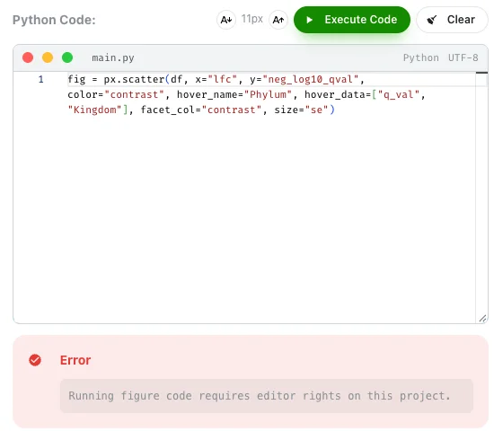{ .ws-shot }

    **Good to know:** Depictio writes the code the first time you open **Code Mode** on a figure. Set the options first, then switch. A later change in **UI Mode** does not rewrite code you already have.

    !!! challenge "Challenge (optional): two more arguments"
        Make a new figure with `lfc`, `neg_log10_qval` and `contrast` like above. In **Styling & Layout**, write a **Title** and set an **Opacity** of 0.6, then open **Code Mode**. Which two arguments did Depictio add?

        ??? solution "Solution"
            `title` and `opacity`:

            ```python
            fig = px.scatter(df, x="lfc", y="neg_log10_qval", color="contrast",
                             title="Differential abundance by habitat", opacity=0.6)
            ```

            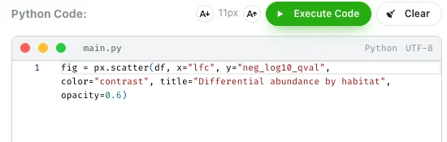{ .ws-shot }

            The figure has a heading, and the dots are a little see-through where they overlap:

            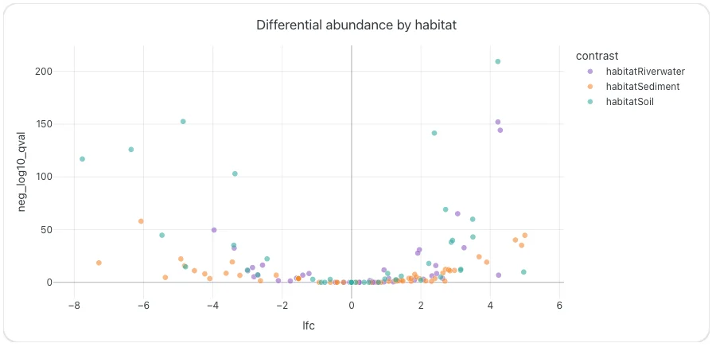{ .ws-shot }

<div class="ws-next" markdown>
[<span class="ws-k">Stuck?</span><span class="ws-t">Troubleshooting</span>](troubleshooting.md#episode-2){ .ws-help }
[<span class="ws-k">Next episode</span><span class="ws-t">3. Create a project from an nf-core run</span>](from-nf-core-run.md){ .ws-go .ws-ep3 }
</div>
