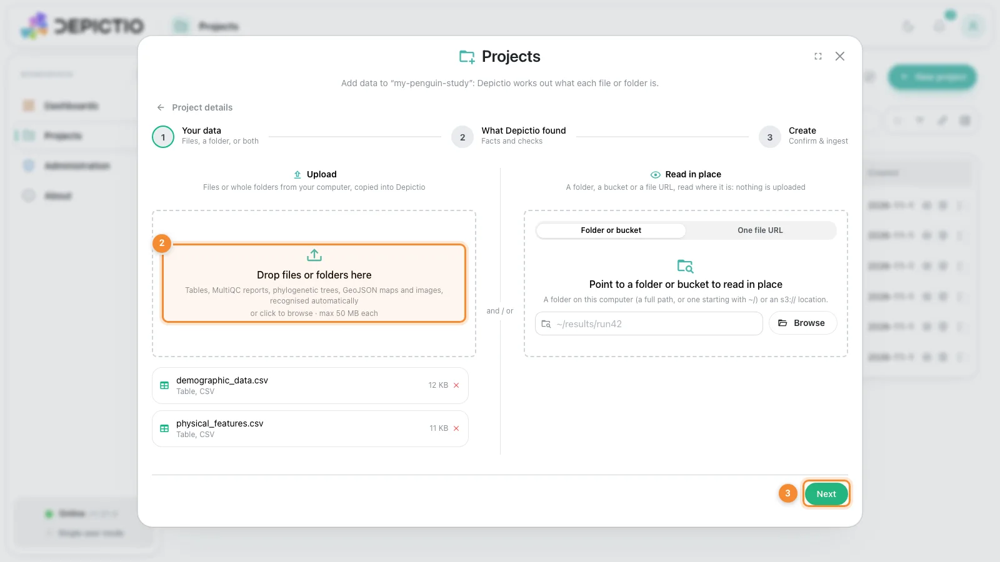
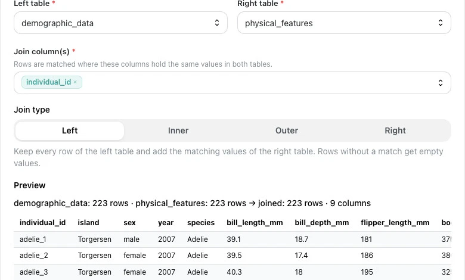
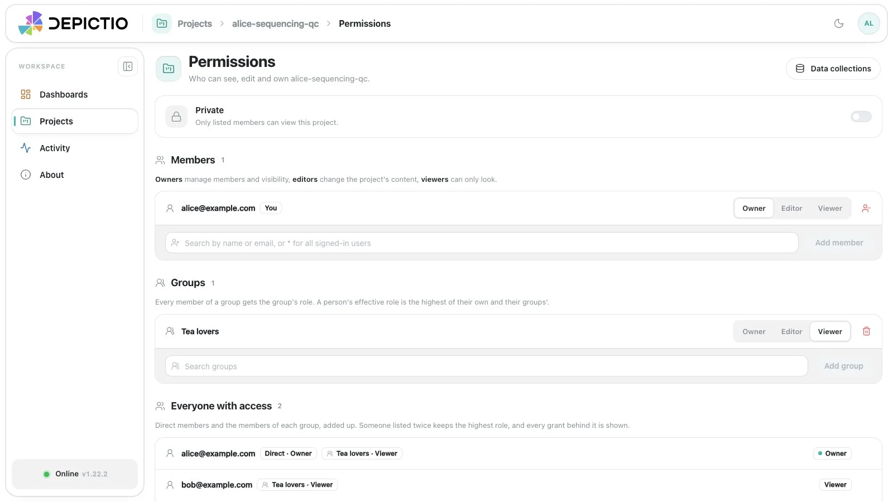

# Optional A · Create a project from files

[**0** Setup](get-started.md){ .ws-ep0 } [**1** Read](view.md){ .ws-ep1 } [**2** Edit](edit-your-copy.md){ .ws-ep2 } [**3** From a run](from-nf-core-run.md){ .ws-ep3 } [**4** Showcases](showcases.md){ .ws-ep6 } [**+** From files](from-a-file.md){ .ws-ep4 .ws-here } [**+** New run](new-run-and-versions.md){ .ws-ep5 }

!!! note "Optional"
    Optional: not part of the timed workshop. Do it after the workshop, on the same server while it runs.

:material-plus-box-outline: **Creator** :material-database-outline: **Palmer Penguins, two CSV files** :material-flag-outline: **After episode 2**

!!! overview "Overview"
    **Questions**

    - How do I make a project from my own tables, without a pipeline?
    - How do I plot columns that sit in two different tables?
    - How do I share my project with a group, or with everyone?

    **Objectives**

    - Create a project by dropping two CSV files.
    - Join the two tables into a new one with **Add join**, after the instructor's demo.
    - Filter a dashboard on species, and plot species against the measurements.
    - Share the project with your group, then open one project to everyone.

You have two seasons of a penguin field study, 2007 and 2008, and no pipeline. The census says who each penguin is; the measurements say how big it is. Both have one row per penguin and a column `individual_id` naming it.

Download the two files:

| File | Columns | Rows |
|---|---|---|
| [`demographic_data.csv`](demographic_data.csv) | `individual_id`, `island`, `sex`, `year`, `species` | 223 |
| [`physical_features.csv`](physical_features.csv) | `individual_id`, `bill_length_mm`, `bill_depth_mm`, `flipper_length_mm`, `body_mass_g` | 223 |

You keep this project and its dashboard for [Optional B](new-run-and-versions.md), where the 2009 season arrives.

## :material-upload-outline: Hands-on A1 · Create the project { #create-the-project }

1. **Projects**, then **New project**. If you cannot see **Next** later in the dialog, close the **Welcome** card at the bottom right: on a smaller screen it covers the button. Give it your own name, then **Add data**.
2. Drop both files on **Drop files or folders here**, under **Upload**, or click the area to pick them. The files are copied into Depictio.
3. Click **Next**. **What Depictio found** reads *2 files: 2 tables*.
4. Click **Create project with 2 tables**. The dialog stays open on *Link your tables · 2 possible links found*. You do not need a link here: the join of the next step does more. Click **Open project**: the project page opens.

{ .ws-shot }

Each file became a **data collection**, here two tables. Each stays as it is: nothing ties them yet.

!!! callout "RUNS 2"
    The project header counts **2 runs**: each upload is recorded as a **run** of the project, one batch of results. [Optional B](new-run-and-versions.md) adds a season without a new run.

## :material-set-center: Join the two tables: watch the demo, then do it { #join }

The instructor shows the join first, on the shared screen. Watch what is chosen and what the **Preview** says, then do the same steps on your project: the dashboard below reads the joined table, so you need it.

A figure reads one data collection. To colour the measurements by species, the measurements and `species` must be in one table. A **join** makes that table from both.

1. On the project page, in **Cross-DC links**, click **Add join**. The dialog **Create table join** opens: *Combine two tables into a new table. The two tables stay as they are, and the joined table is rebuilt whenever one of them changes.*
2. **Name**: `penguins`. The hint reads *Resulting table: joined_penguins*.
3. Depictio has already chosen the rest: **Left table** `demographic_data`, **Right table** `physical_features`, **Join column(s)** `individual_id` (*Rows are matched where these columns hold the same values in both tables.*), and **Join type** **Left**: *Keep every row of the left table and add the matching values of the right table. Rows without a match get empty values.*
4. Read the **Preview**: *demographic_data: 223 rows · physical_features: 223 rows → joined: 223 rows · 9 columns*, then the first rows.
5. Click **Create join**. A notification confirms *Join created*, *joined_penguins: 223 rows*.

{ .ws-shot }

The project now has three data collections. `joined_penguins` carries a **joined** badge; its tooltip reads *Join of demographic_data and physical_features*. Under **Cross-DC links**, the **Joins** list shows the join: its name, the tables (*demographic_data ⋈ physical_features*), the columns, the type, the rows and the result table, with a delete button.

`demographic_data` and `physical_features` did not change. You do not edit `joined_penguins` yourself: **Manage data** is disabled on it, and Depictio rebuilds it whenever one of its two tables changes.

!!! callout "Link or join?"
    - A **link**, as on the dashboard of [episode 1](view.md), copies nothing: it carries a filter from one data collection to another, in one direction. Depictio offered two when you created the project; here a join does more.
    - A **join** makes a new table from both. The two tables stay as they are, and the joined table is rebuilt whenever one of them changes.
    - A figure reads one data collection: figures that need columns of both tables read the joined table.
    - A join can also be written in the project's YAML (`joins:` in `project.yaml`) for the command-line client. See [Data model: joining and linking](../../features/data-model.md#joining-and-linking) and the CLI's [`data join`](../../depictio-cli/usage.md#data-join).

    { .ws-diagram }
    { .ws-diagram }

## :material-chart-scatter-plot: Filter and plot

1. On the project page, click **Create a dashboard**. Type a **Dashboard Title** and click **Create Dashboard**.
2. In the list, click your dashboard's title, then **Start editing**.
3. **Add component**, in the middle of the empty dashboard, then **New component** and **Interactive**. Pick `joined_penguins`, **Next Step**, then **Select your column**: `species`. **Create component**. The filter appears in the **Filters** panel on the left.
4. **+** in the bottom toolbar, **Component**, **New component**, **Figure**. Pick `joined_penguins`, **Next Step**. **X axis** `bill_length_mm`, **Y axis** `flipper_length_mm`, coloured by `species`. **Create component**.
5. **Save**.

!!! challenge "Challenge A.1: follow the filter"
    In the filter, pick *Gentoo*. How many points does the figure show? And with each species in turn?

    ??? solution "Solution"
        80 points, one per Gentoo penguin of the 2007 and 2008 seasons. Adelie gives 99 and Chinstrap 44: 223 in all, as many as the census, since a left join keeps every row of `demographic_data`.

Keep this project and its dashboard: [Optional B](new-run-and-versions.md) adds the 2009 season to them.

## :material-account-group-outline: Hands-on A2 · Share it: your group, then everyone { #share-it-your-group-then-everyone }

So far, only you see this project. Sharing is set per **project**: whoever you share it with sees all of its dashboards. The server has two user groups, *Tea lovers* and *Coffee lovers*; the list of who is in which is in the chat.

1. On the project page, click **Permissions**. Use this project.
2. Under **Groups**, type your group's name in **Search groups**, pick it, then click **Add group**. It joins as **Viewer**, and **Everyone with access** lists the people it adds.
3. Open **Dashboards**: the list now shows the dashboards of the projects your group shared. Open one and leave a comment on a figure, as in [episode 1](view.md#groups).
4. One volunteer per group: at the top of **Permissions**, switch **Private** to **Public**, then **Make Public**.

{ .ws-shot }

!!! challenge "Challenge A.2: who sees what?"
    Before step 4, can someone from the other group open your dashboard? After a volunteer switches their project to **Public**, who sees it?

    ??? solution "Solution"
        Before: no. A project is open to its owner, to the people and groups listed in **Permissions**, and to nobody else. After: every signed-in account sees the public project, both groups included. Someone who is not signed in does not.

!!! callout "Owner, editor, viewer"
    Only an **owner** can share a project. Added as **Editor**, a person or a group can change the project's content; as **Viewer**, they can open it and comment. A user group is created by an administrator; you choose which projects to share with it.

!!! further "Going further: add columns to one table in place"
    A join makes a new table. To add columns to an existing table instead, open **demographic_data** on the project page and switch **Unlock cell edits** (**Read-only** becomes **Editable**). **Update from file**, pick `physical_features.csv`, tab **Add columns**, **Match on individual_id (223 rows)**, **Apply**. The four measurement columns are copied onto the census, as a new version of the same table; no row is added. This works for the project's owners and editors, on uploaded tables, up to 10,000 rows, and not on a published project. Do not do it on the project you keep for Optional B.

!!! further "Going further: edit a cell"
    With **Unlock cell edits** on, give **adelie_8** a sex in `demographic_data`: its cell is empty, like six others. **Save changes**, then open **Version history**: the version before your edit is still there, and `joined_penguins` is rebuilt with the new value.

!!! keypoints "Key points"
    - Each CSV you drop becomes a data collection, here of type table.
    - A figure reads one data collection. **Add join** makes a new table from two, `joined_<name>`; the two stay as they are, and the joined table is rebuilt whenever one of them changes.
    - A join can also be written in `project.yaml` for the command-line client.
    - Sharing is set per project: a user group added as **Viewer** sees all its dashboards; **Public** opens it to every signed-in account.

[Stuck?Troubleshooting](troubleshooting.md#optional-a){ .ws-help }
[Next episodeOptional B · Follow a new run](new-run-and-versions.md){ .ws-go .ws-ep5 }

