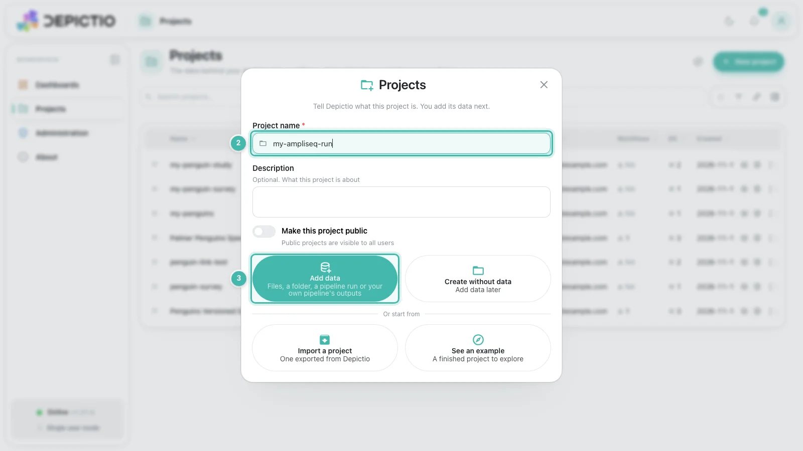
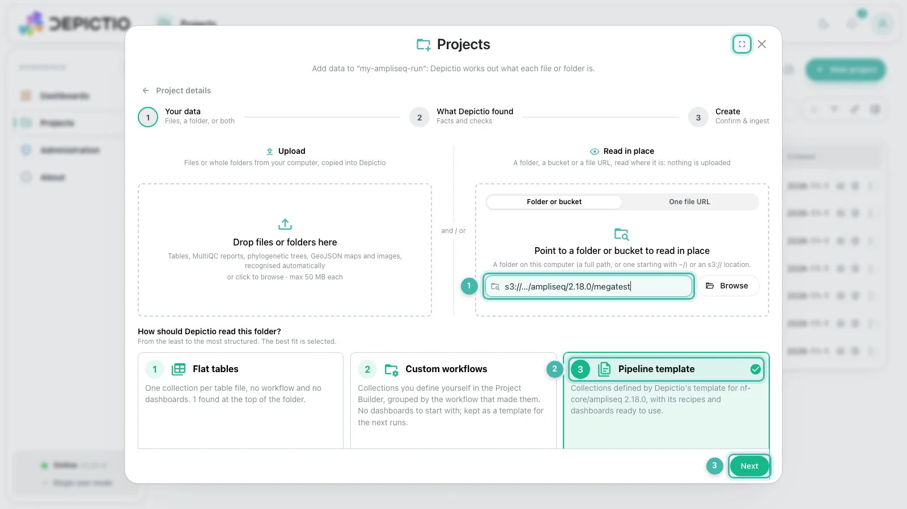
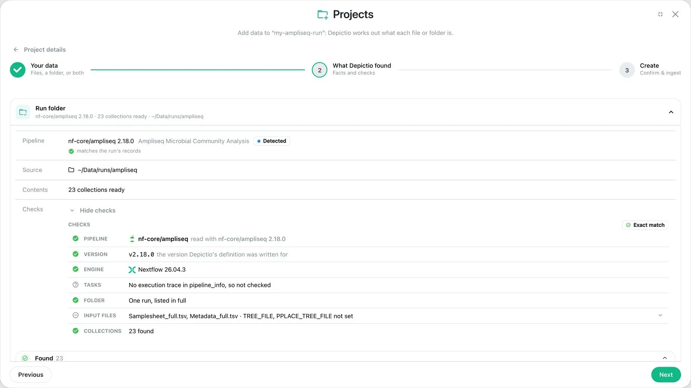

# 4. Create a project from an nf-core run

[**0** Setup](get-started.md){ .ws-ep0 } [**1** Read](view.md){ .ws-ep1 } [**2** Edit](edit-your-copy.md){ .ws-ep2 } [**3** From files](from-a-file.md){ .ws-ep3 } [**4** From a run](from-nf-core-run.md){ .ws-ep4 .ws-here } [**5** New run](new-run-and-versions.md){ .ws-ep5 }

:material-plus-box-outline: **Creator** :material-database-outline: **nf-core/ampliseq run on S3** :material-flag-outline: **After episode 0**

!!! overview "Overview"
    **Questions**

    - How do I turn the results of a pipeline run into a project?
    - What does Depictio check before it creates anything?

    **Objectives**

    - Create a project from an nf-core run folder on S3, without uploading it.
    - Read the checks: pipeline, version, collections found.
    - Open the dashboard the pipeline's template built.

A **run** is one batch of results added to a project: one upload (episode 3), one execution of a pipeline (episode 4), one field season (episode 5). Here, nf-core/ampliseq 2.18.0 ran once and wrote its results in one folder on S3. You point Depictio at that folder. Depictio **reads it in place**: nothing is copied or uploaded. It recognises the pipeline and its version, finds the outputs it knows, and builds the data collections and the dashboard from the pipeline's **template**.

<figure markdown="span" class="ws-media"><video autoplay controls muted loop playsinline poster="../../../images/tutorials/workshop/runfolder.webp" src="../../../images/tutorials/workshop/runfolder.mp4"></video></figure>

{ .ws-diagram }
{ .ws-diagram }

How Depictio reads remote folders: [Remote data](../../usage/projects/remote-data.md).

You need the **run location** from the instructor: an address starting with `s3://`. Paste it as given, with no `/` added at the end.

## :material-pencil-outline: Name the project

1. Open **Projects**, then **New project**.
2. Give it **your own name**: names are unique on the server.
3. Click **Add data**. The expand icon **⛶**, at the top right of the dialog, gives it the whole window.

{ .ws-shot }

## :material-folder-search-outline: Point at the run

1. Under **Read in place**, paste the run location.
2. Under **How should Depictio read this folder?**, Depictio selects **Pipeline template**: nf-core/ampliseq 2.18.0, detected from the run's `pipeline_info/` folder. Leave **Only the … found** selected: Depictio reads the outputs this run has.
3. Open **More pipeline settings** and set **Group column** to `habitat`. This run's sample sheet lists `name` first, one label per sample, and Depictio takes the first column unless told otherwise. The count under **Only the … found** updates after **Next**.
4. Click **Next**. It can take a few seconds: wait for the page to change.

{ .ws-shot }

## :material-clipboard-check-outline: Check and create

1. **What Depictio found** lists what it found and what it checked. Click **Show checks**.
2. Click **Next**, then **Create Project**. Nothing is created before this click.
3. Depictio reads the files in the background. Open the dashboard: it fills in as each collection is ready.

{ .ws-shot }

!!! challenge "Challenge 4.1: read the checks"
    Which pipeline and version did Depictio find? How many collections? What does the **Tasks** line say?

    ??? solution "Solution"
        | Check | Value |
        |---|---|
        | Pipeline | nf-core/ampliseq, exact match on 2.18.0 |
        | Collections found | 23; 22 if **Group column** was left on `name` |
        | Tasks | 207 tasks completed (4 after a retry), none failed |

!!! challenge "Challenge 4.2: what was created?"
    Open your project from **Projects**. How many data collections does it hold, and how many links? How many tabs has its dashboard?

    ??? solution "Solution"
        23 data collections, 19 links, 7 tabs. The links come from the template: most start from the sample metadata (`metadata`), which is why one filter on Habitat reached every tab in episode 1.

!!! callout "Your project is private"
    Only you can open it until you share it, under **Permissions** on the project page, as in [episode 3](from-a-file.md#share-it-your-group-then-everyone).

!!! further "Going further: where your project comes from"
    The instructor shows where the **Differential Abundance** tab comes from, on the shared screen. Nothing to do on your side.

    | | Where | What it holds |
    |---|---|---|
    | Template | [`nf-core/ampliseq/2.18.0/template.yaml`](https://github.com/depictio/depictio/blob/main/depictio/projects/nf-core/ampliseq/2.18.0/template.yaml){target=_blank} | The collection `ancombc_results`: which files of the run it reads, and the recipe that reshapes them |
    | Tools catalog | [`catalog/qiime2/ancombc.yaml`](https://github.com/depictio/depictio/blob/main/depictio/catalog/qiime2/ancombc.yaml){target=_blank} | The same output, described once for every pipeline that runs ANCOM-BC: the same recipe, and what it renders as |
    | Tool Studio | [Tool Studio](../../developer/tool-studio.md) | Where a tool is added to the catalog, in the browser |

    More in [Pipeline templates](../../pipeline-templates/nf-core/ampliseq.md) and the [Tools catalog](../../catalog/index.md). To contribute: [a template](../../developer/contributing-templates.md), [a tool](../../developer/contributing-a-tool.md).

!!! keypoints "Key points"
    - A run is one batch of results; here one execution of a pipeline, whose results folder stays where it is, on S3.
    - Depictio recognises nf-core pipelines and their version, and builds collections, links and a dashboard from the template.
    - Nothing is created before you confirm.

[Stuck?Troubleshooting](troubleshooting.md#episode-4){ .ws-help }
[Next episode5. Follow a new run](new-run-and-versions.md){ .ws-go .ws-ep5 }

