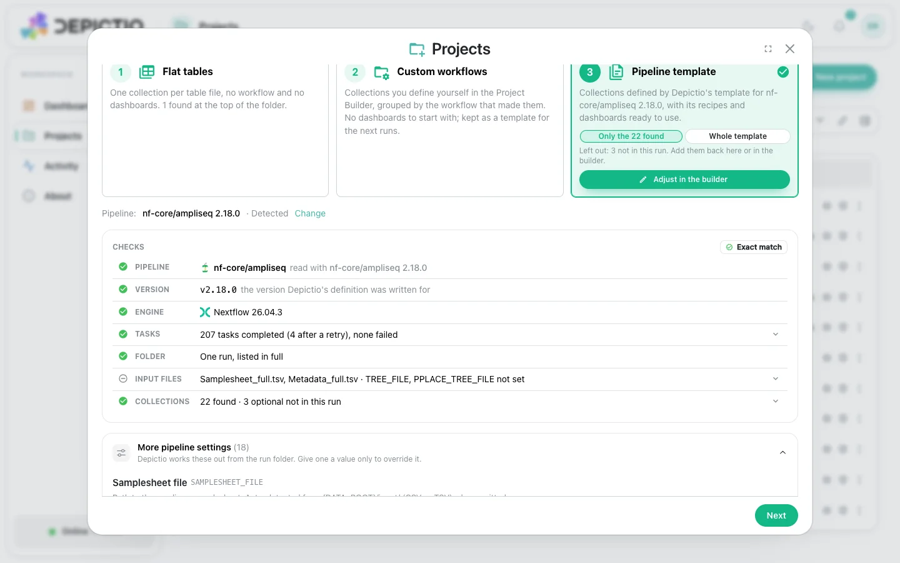
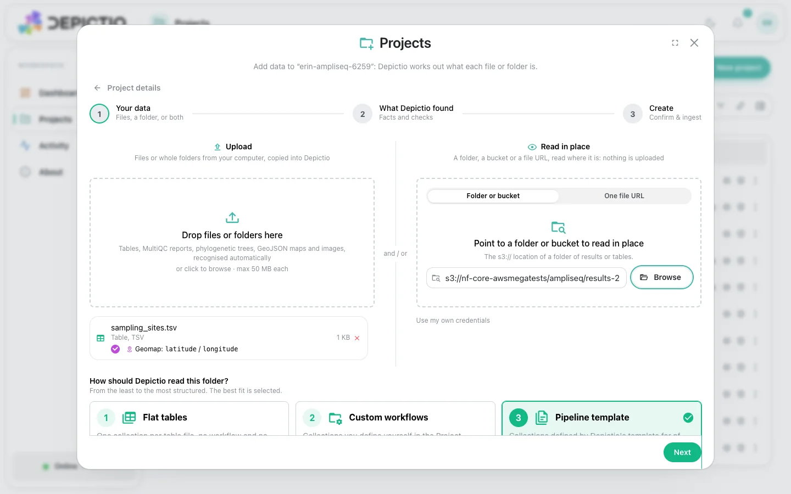
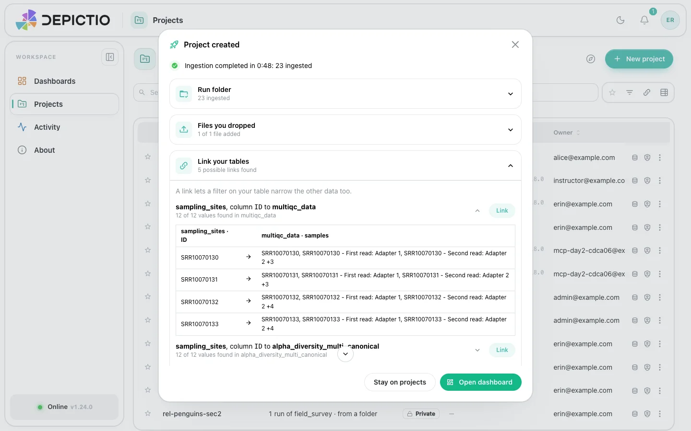
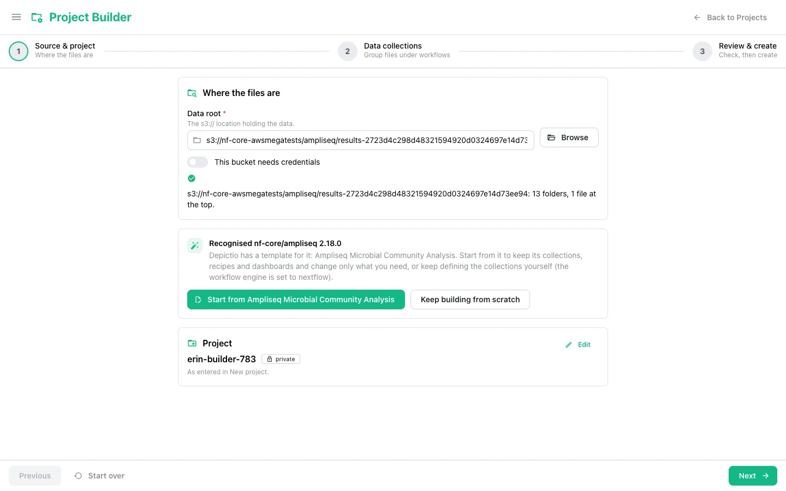
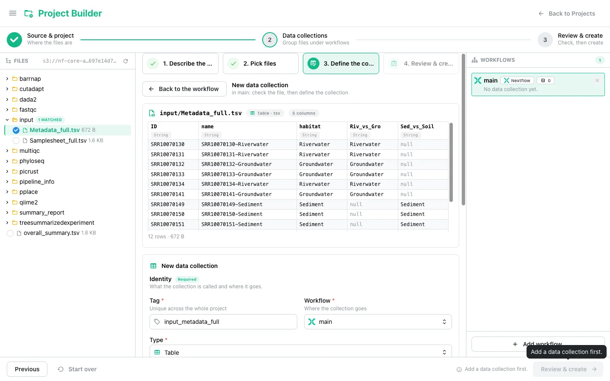

# 3. Create a project from an nf-core run

<div class="ws-strip" markdown>
[**0** Setup](get-started.md){ .ws-ep0 } [**1** Read](view.md){ .ws-ep1 } [**2** Edit](edit-your-copy.md){ .ws-ep2 } [**3** From a run](from-nf-core-run.md){ .ws-ep3 .ws-here } [**4** Showcases](showcases.md){ .ws-ep6 } [**+** From files](from-a-file.md){ .ws-ep4 } [**+** New run](new-run-and-versions.md){ .ws-ep5 }
</div>

<div class="ws-meta ws-ep3" markdown>
<span class="ws-chip" markdown="span">:material-plus-box-outline: **Creator**</span> <span class="ws-chip" markdown="span">:material-database-outline: **nf-core/ampliseq run on S3**</span> <span class="ws-chip" markdown="span">:material-timer-outline: **Hands-on 3 · 10 min**</span> <span class="ws-chip" markdown="span">:material-flag-outline: **After episode 0**</span>
</div>

!!! overview "Overview"
    **Questions**

    - How do I turn the results of an nf-core run into a dashboard?
    - Do I have to upload the files?

    **Objectives**

    - Name a project and point it at a run folder on S3.
    - Check what the template finds, create the project and open its dashboard.

A **run** is one execution of a pipeline. Here, nf-core/ampliseq 2.18.0 ran once and wrote its results in one folder on S3: you point Depictio at that folder, and it builds the project and its dashboard from it.

You rebuild the project you read in episode 1, from its run. In a Bonus at the end, you add what the pipeline does not know: where and when each sample was taken.

**The run location** is an address starting with `s3://`. Paste it as given, with no `/` added at the end:

```text
s3://nf-core-awsmegatests/ampliseq/results-2723d4c298d48321594920d0324697e14d73ee94
```

## :material-pencil-outline: Hands-on 3 · Step 1: name the project { #name-the-project }

1. Open **Projects**, then **New project**.
2. Give it **your own name**: names are unique on the server.
3. Click **Add data**. The expand icon **⛶**, at the top right of the dialog, gives it the whole window.

{ .ws-shot }

## :material-folder-search-outline: Step 2: point at the run

The first step of the dialog, **Your data**, has two halves: **Upload** on the left, **Read in place** on the right. Today you use **Read in place** only: the run stays in its bucket.

1. Under **Read in place**, on the tab **Folder or bucket**, paste the run location.
2. Under **How should Depictio read this folder?**, Depictio selects **Pipeline template**: nf-core/ampliseq 2.18.0, detected from the run's `pipeline_info/` folder. Leave **Only the … found** selected: Depictio reads the outputs this run has.
3. Open **More pipeline settings** and set **Group column** to `habitat`: it is the metadata column used to group and facet in dashboards. Without it, Depictio groups by `name`, the first column of this run's sample sheet, and you get 22 collections instead of 23.
4. Click **Next**. It can take a few seconds: wait for the page to change.

{ .ws-shot }

## :material-clipboard-check-outline: Step 3: check, create, open

1. **What Depictio found** lists the checks. Read three: the badge **Exact match** says the template was written for this version, **TASKS** reads 207 tasks, and **COLLECTIONS** reads 23 ready.
2. Click **Next**. The last step says how many data collections will be ingested, in the background.
3. Click **Create Project**. Nothing is created before this click.
4. The ingestion takes 2 to 3 minutes. When it is done, open your project from **Projects**, then its dashboard: it has 7 tabs.

{ .ws-shot }

!!! question "Check your understanding"
    Which pipeline and version did Depictio find? How many collections? What does the **Tasks** line say? What did **Group column** change?

    ??? solution "Answer"
        | Check | Value |
        |---|---|
        | Pipeline | nf-core/ampliseq, exact match on 2.18.0 |
        | Collections found | 23; 22 if **Group column** was left on `name` |
        | Tasks | 207 tasks completed (4 after a retry), none failed |

!!! challenge "Challenge: what was created?"
    Open your project from **Projects**. How many data collections does it hold, and how many links? How many tabs has its dashboard?

    ??? solution "Solution"
        23 data collections (22 if **Group column** was left on `name`), the ones of the template, and 7 tabs. The links are the 19 of the template. They mostly start from the sample metadata (`metadata`), which is why one filter on Habitat reached every tab in episode 1. If you also did the Bonus with your own table, add `sampling_sites` and one link for each link you made.

!!! keypoints "Key points"
    - A run is one batch of results; here one execution of a pipeline, whose results folder stays where it is, on S3.
    - Depictio reads `pipeline_info/`, finds the pipeline and its version, and builds data collections, links and a dashboard from the template.
    - Read in place keeps the run in its bucket; upload copies your files.
    - Nothing is created before you confirm.

??? note "Bonus · Good to know: the screenshot, and who can open your project"
    The screenshot of **What Depictio found** was taken with **Group column** empty, so **COLLECTIONS** reads 22 found. With `habitat` you get 23.

    !!! callout "Your project is private"
        Only you can open it until you share it, under **Permissions** on the project page, as in the optional [Create a project from files](from-a-file.md#share-it-your-group-then-everyone) (Optional A).

??? note "Bonus · How it works: template, collections, links"
    ### :material-sitemap-outline: How it works

    1. **Depictio reads `pipeline_info/`.** Every nf-core run writes its own records there. They tell Depictio which pipeline ran, in which version, and how its tasks ended.
    2. **It picks the template written for that version.** A **template** is a file that describes the project for one pipeline version. Here it is the template of nf-core/ampliseq 2.18.0. The match is exact, and the checks say so.
    3. **The template lists what the project holds.**
        - The **data collections**: for each one, which files of the run it reads. Some are **recipes**: Depictio computes them from several files with a script shipped with the template.
        - The **links** between data collections.
        - The **dashboard**.
    4. **Depictio reads the files and builds the project.** Nothing is created before you confirm.

    There are two ways to bring the data in:

    - **Read in place**: the run stays in its bucket. Depictio stores the tables it builds from it, not the run itself. This is what you do for the run.
    - **Upload**: the files are copied into Depictio, and each becomes a data collection. This is what you do for `sampling_sites.tsv`.

    You can use both in the same step.

    { .ws-diagram }
    { .ws-diagram }

    How Depictio reads remote folders: [Remote data](../../usage/projects/remote-data.md).

??? note "Bonus · Your own sample table, linked to the run"
    Add a table of your own to the project: where and when each sample was taken.

    Download [sampling_sites.tsv](sampling_sites.tsv). It has one row per sample of the run, 12 in all, taken from the public records of the study in the European Nucleotide Archive (ENA). Its columns are `ID`, `site`, `collection_date`, `latitude`, `longitude` and `read_count`. The samples come from four sites near Tübingen.

    In step 2, before you click **Next**:

    1. Under **Upload**, drop `sampling_sites.tsv` on **Drop files or folders here**. The file is listed as *Table, TSV* with *Geomap: latitude / longitude*: Depictio recognised the two columns as map coordinates.
    2. In step 3, **What Depictio found** also lists **Files you dropped**: one file, one table, `sampling_sites.tsv` with 6 columns.

    { .ws-shot }

    ### :material-link-variant: Link your table

    Depictio reads the files in the background. When it is done, the dialog **Project created** reports what it ingested: the run folder (23 data collections) and the file you dropped (1 of 1 file added). Below them is **Link your tables**, with *5 possible links found*.

    A **link** lets a filter on one data collection narrow another. It goes one way, from a source to a target. Here the source is `sampling_sites` and the targets are the run's data collections. A filter on `sampling_sites` narrows the target. A filter on the target does not narrow `sampling_sites`. The link needs a column that holds the same values on both sides: here `ID` in `sampling_sites`. Depictio checks how many of its values it finds on the other side.

    1. Read the first suggestion: `sampling_sites`, column `ID` to `multiqc_data`. *12 of 12 values found* says that every `ID` has a match, and the preview, opened in the screenshot, shows the matched values side by side.
    2. Click **Link** on that line. The other suggestions go to `alpha_diversity_multi_canonical`, `alpha_rarefaction`, `bray_curtis_canonical` and `embedding_pcoa`: add them if you want.

    { .ws-shot }

    Depictio suggests at most 5 links per table. It ranks them by the share of values found, then puts MultiQC first, then sorts by name. That is why `metadata` is not in the list. `metadata` is the sample sheet, and it is the data collection that most other links of the template start from, so it is the one to link to. A filter follows links one after the other, up to three: with `sampling_sites` → `metadata`, a filter on `sampling_sites` reaches `metadata`, then every data collection `metadata` links to. Use **Link it yourself**, at the bottom of **Link your tables**: link `sampling_sites` to `metadata` on `ID`. You can also use **Add link** on the project page later.

    Then click **Stay on projects**.

    !!! challenge "Challenge 3.2: what changed with your table?"
        Open your project from **Projects**. How many data collections does it hold, and how many links? How many tabs has its dashboard?

        ??? solution "Solution"
            24 data collections: the 23 of the template, plus `sampling_sites` (23 if **Group column** was left on `name`), and 25 if you also added `ena_runs` from its URL. 7 tabs. The links are the 19 of the template, plus one for each link you added. The template's links mostly start from the sample metadata (`metadata`), which is why one filter on Habitat reached every tab in episode 1.

??? note "Bonus · One table from a URL"
    ### :material-web: One table from a URL

    !!! note "Optional"
        This part is not part of the live session. Do it if you have time, or afterwards.

    A table can also come from an address. You add one to the project you just created: the run table of the same study, from ENA. ENA is the public archive where the sequencing runs of the study are deposited. The Depictio server fetches the file: nothing goes through your browser.

    1. Open your project from **Projects**. On the project page, click **Add data**.
    2. Under **Read in place**, open the tab **One file URL**.
    3. Paste this address:

        ```text
        https://www.ebi.ac.uk/ena/portal/api/filereport?accession=PRJNA563986&result=read_run&fields=run_accession,sample_title,collection_date,instrument_model,read_count,base_count&format=tsv
        ```

    4. The server previews the file: *The server can read filereport*. The address has no table extension (`.csv`, `.tsv`, `.parquet`, `.feather`), so pick **Format**: **TSV**. Set **Name** to `ena_runs`.
    5. Click **Add 1 table**. A message confirms *ena_runs was added from its URL.*

    { .ws-shot }

    `ena_runs` has six columns: `run_accession`, `sample_title`, `collection_date`, `instrument_model`, `read_count` and `base_count`. The address can be an `https://` or an `s3://` file, in CSV, TSV, Parquet or Feather, gzipped or not. The server accepts any public `https://` host by default. It refuses plain `http://` unless its settings allow it.

    !!! challenge "Challenge 3.3 (optional): what would you link `ena_runs` to?"
        Look at the rows of `ena_runs` and of `sampling_sites`. Which column of `ena_runs` would you link to which collection, and why? Does `ena_runs` have as many rows as `sampling_sites`?

        ??? solution "Solution"
            `run_accession` in `ena_runs` holds the same values as `ID` in `sampling_sites` and `metadata`: the ENA run accessions, such as `SRR10070130`. A link needs a column with the same values on both sides, and this is the one. The link goes one way: choose which of the two should be filtered by the other. `ena_runs` has 24 rows, `sampling_sites` 12. The study has 24 runs in ENA, and this run of the pipeline used 12 of them. All 12 `ID` values are among the 24 `run_accession` values. To count the rows yourself, run `curl -s '<the ENA address>' | tail -n +2 | wc -l`: the header line is skipped.

??? note "Bonus · Where data can come from"
    ### :material-database-import-outline: Where data can come from

    !!! note "Optional"
        This part is not part of the live session: read it if you have time, or afterwards.

    You used three ways in this episode: a public S3 bucket, an uploaded file and one file by URL. Depictio reads more. The browser and the command line read the same sources: the command line is another interface, not another source (Day 2). The table groups them by where the data is.

    | Where the data is | In the browser | From the command line | On the workshop server |
    |---|---|---|---|
    | **S3 buckets** | | | |
    | A public bucket | **Read in place**, **Folder or bucket**: paste the `s3://` location | `depictio ingest s3://bucket/run42` | Used in this episode: the server is set to read this public bucket |
    | A private bucket, with credentials | **Use my own credentials**: access key and secret for that bucket | `depictio ingest`, with the S3 endpoint and keys of the CLI configuration | Not used |
    | Another S3-compatible service | Same, with its **Endpoint** | Same, with `endpoint_url` in the CLI configuration | Not used |
    | Google Cloud Storage | In progress | In progress | Not used |
    | **HTTP** | | | |
    | One file, by URL | **Read in place**, **One file URL** | `--bind tag=https://host/data.csv` | Used in this episode |
    | Many files, listed in a manifest | **From Manifest** | `--manifest <url or path>` | Not used |
    | **Your computer** | | | |
    | Files or whole folders | **Upload**: drop them, up to 50 MB each | `depictio ingest <folder>` | Used in this episode |
    | **Command line and pipelines** | | | |
    | A results folder, the end of a Nextflow run, or a folder watched for changes | | `depictio ingest`, the Nextflow trigger, `depictio watch` | Day 2 |

    !!! note "A folder on the server's own disk"
        Depictio can read a folder on the machine it runs on only when it runs on that machine: `depictio local`, Docker with the disks mounted, or the Python bundle. The workshop server cannot read a folder on its own disk. Use **Upload**, or a bucket.

    Details of each case: [Remote data](../../usage/projects/remote-data.md#which-way-to-use).

??? note "Bonus · The Project Builder, for a pipeline with no template"
    Day 2 does this hands-on: [Your own tables, no template](../workshop-cli/project-builder.md).

    !!! further "A project from scratch: the Project Builder"
        Some pipelines have no template. Then you define the data collections yourself, in the **Project Builder**. The instructor shows it on the shared screen. It is not a step for you.

        1. **Choose how to read the folder.** In **Add data**, under **How should Depictio read this folder?**, pick **Custom workflows**, then click **Open the Project Builder**. A custom workflow has no dashboard to start with.

            { .ws-shot }

        2. **Source & project.** Give the data root: an `s3://` location, with a switch for a bucket that needs credentials. Depictio counts the folders at the top. If it recognises the pipeline, it offers **Start from Ampliseq Microbial Community Analysis**, to keep the template's collections, recipes and dashboards and change only what you need. **Keep building from scratch** ignores the template.

            { .ws-shot }

        3. **Define a data collection.** The file tree is on the left, the workflows on the right. Click a file, such as `input/Metadata_full.tsv`: its first rows and column types show. Fill in the tag, the workflow and the format, then click **Add to main**. Tick a file's siblings to cover every sample in one scan.

            { .ws-shot }

        4. **Review and create.** The page lists the data collections per workflow and the links. **Preview the ingestion** is a dry run: nothing is created. **Create project** is available after it. On the right, the project definition as YAML: **Download YAML** saves it, and `depictio ingest <folder or s3://prefix> --template <this file>` reuses it on the next runs. Dashboards are built afterwards, in the editor.

            { .ws-shot }

        An AI assistant to draft these definitions is planned.

??? note "Bonus · Where your project comes from"
    !!! further "Going further: where your project comes from"
        The instructor shows where the **Differential Abundance** tab comes from, on the shared screen. Nothing to do on your side.

        | | Where | What it holds |
        |---|---|---|
        | Template | [`nf-core/ampliseq/2.18.0/template.yaml`](https://github.com/depictio/depictio/blob/main/depictio/projects/nf-core/ampliseq/2.18.0/template.yaml){target=_blank} | The collection `ancombc_results`: which files of the run it reads, and the recipe that reshapes them |
        | Tools catalog | [`catalog/qiime2/ancombc.yaml`](https://github.com/depictio/depictio/blob/main/depictio/catalog/qiime2/ancombc.yaml){target=_blank} | The same output, described once for every pipeline that runs ANCOM-BC: the same recipe, and what it renders as |
        | Tool Studio | [Tool Studio](../../developer/tool-studio.md) | Where a tool is added to the catalog, in the browser |

        More in [Pipeline templates](../../pipeline-templates/nf-core/ampliseq.md) and the [Tools catalog](../../catalog/index.md). To contribute: [a template](../../developer/contributing-templates.md), [a tool](../../developer/contributing-a-tool.md).

??? note "Bonus · Several MultiQC reports in one collection"
    A **MultiQC** data collection can hold one report per run. When the runs are ingested together, their reports share **one collection**. Filters, and a link from a sample table, then work across the runs: you compare the QC of several sequencing runs in one dashboard.

    The example was tested in November 2026: three nf-core/seqinspector runs, `seqrun_1` to `seqrun_3`, with 4 samples each, in one folder. One project holds:

    - a MultiQC collection, `multiqc_data`, with the three reports;
    - a table, `samples`, from the `samples.csv` of each run: the columns `sample`, `condition`, `replicate`, `sequencing_run` and `lane`, 12 rows aggregated;
    - a link from `samples` to `multiqc_data`: `sample` in the table matches `sample_name` in the reports (the resolver `sample_mapping`).

    ```console
    qc-runs/                                 the folder to ingest (the absolute path goes in the project file)
    ├── seqrun_1/                            one run: a subfolder whose name matches runs_regex
    │   ├── multiqc/multiqc_data/multiqc.parquet    the run's MultiQC report
    │   └── samples.csv                      4 samples of this run
    ├── seqrun_2/                            same layout
    └── seqrun_3/                            same layout
    ```


    The project file. Replace `/path/to/qc-runs` with the absolute path of your folder:

    ```yaml
    name: "QC across runs"                     # the project's name [[1]]
    workflows:                                 # where the data comes from [[2]]
      - name: "seqinspector"                   # the pipeline that made the runs [[2]]
        version: "1.1.2"                       # its version [[2]]
        engine:                                # what ran it [[2]]
          name: "nextflow"                     # [[2]]
        catalog:                               # where the pipeline is listed [[2]]
          name: "nf-core"                      # [[2]]
          url: "https://nf-co.re"              # [[2]]
        data_location:                         # where the runs are [[3]]
          structure: "sequencing-runs"         # one folder holds one subfolder per run [[3]]
          runs_regex: "seqrun_.*"              # which subfolders are runs [[3]]
          locations:                           # [[3]]
            - "/path/to/qc-runs"               # the folder that holds seqrun_1 to seqrun_3 [[3]]
        data_collections:
          - data_collection_tag: "multiqc_data"  # one collection for the reports of all runs [[4]]
            config:                            # [[4]]
              type: "MultiQC"                  # [[4]]
              scan:                            # [[4]]
                mode: "recursive"              # look in each run folder and its subfolders [[4]]
                scan_parameters:               # [[4]]
                  regex_config:                # [[4]]
                    pattern: "multiqc/multiqc_data/multiqc.parquet"  # one report per run [[4]]
          - data_collection_tag: "samples"     # the sample table [[5]]
            config:                            # [[5]]
              type: "Table"                    # [[5]]
              metatype: "Aggregate"            # the rows of every run add up in one table [[5]]
              scan:                            # [[5]]
                mode: "recursive"              # [[5]]
                scan_parameters:               # [[5]]
                  regex_config:                # [[5]]
                    pattern: "samples.csv"     # the file that makes the table [[5]]
              dc_specific_properties:          # [[5]]
                format: "CSV"                  # how to read it [[5]]
    links:
      - source_dc_tag: "samples"               # the link starts from the sample table [[6]]
        source_column: "sample"                # its column of sample names [[6]]
        target_dc_tag: "multiqc_data"          # and filters the MultiQC collection [[6]]
        target_type: "multiqc"                 # [[6]]
        link_config:                           # [[6]]
          resolver: "sample_mapping"           # match sample names, across the runs [[6]]
          target_field: "sample_name"          # the sample name in the MultiQC reports [[6]]
    ```

    1. **The project**: its name. `--project` gives it your own name on the server.
    2. **The workflow**: the pipeline, its version and its engine, as in the other project files of Day 2.
    3. **Where the runs are**: `sequencing-runs` means one folder with a subfolder per run, and `runs_regex` picks the subfolders that are runs.
    4. **The MultiQC collection**: type `MultiQC`, with the pattern that finds the report in each run. All the reports go in this one collection.
    5. **The sample table**: `Aggregate` stacks the `samples.csv` of the three runs into one table of 12 rows.
    6. **The link**: a filter on `samples` reaches the MultiQC reports whose sample names match, in every run.

    Check it, then ingest it, from the folder that holds the file:

    ```bash
    # Dry run: reads the file and the folders, sends nothing. Read the counts.
    depictio ingest --project-config-path qc-runs.yaml --project yourname-qc-runs --dry-run

    # The same command without --dry-run creates the project.
    depictio ingest --project-config-path qc-runs.yaml --project yourname-qc-runs
    ```

    The CLI says *Processed 3 MultiQC files and created 3 individual reports*: three reports, one collection. In a dashboard built on this project, a filter on the `condition` of the `samples` table keeps only the matching samples in the MultiQC plots, in every run.

    !!! challenge "Challenge: one run among three"
        In the MultiQC plots, how would you show only the samples of `seqrun_2`? Which column of which table would you filter?

        ??? solution "Solution"
            The column `sequencing_run` of the `samples` table: the link carries the filter to the reports, so only the samples of `seqrun_2` stay in the MultiQC plots.


<div class="ws-next" markdown>
[<span class="ws-k">Stuck?</span><span class="ws-t">Troubleshooting</span>](troubleshooting.md#episode-3){ .ws-help }
[<span class="ws-k">Next episode</span><span class="ws-t">4. Showcases</span>](showcases.md){ .ws-go .ws-ep6 }
</div>
