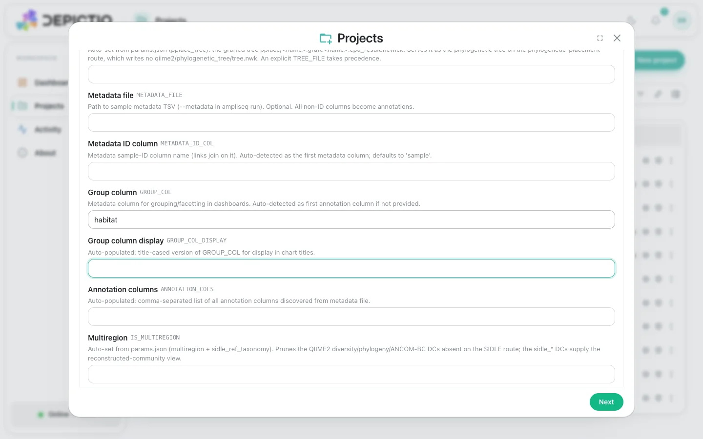
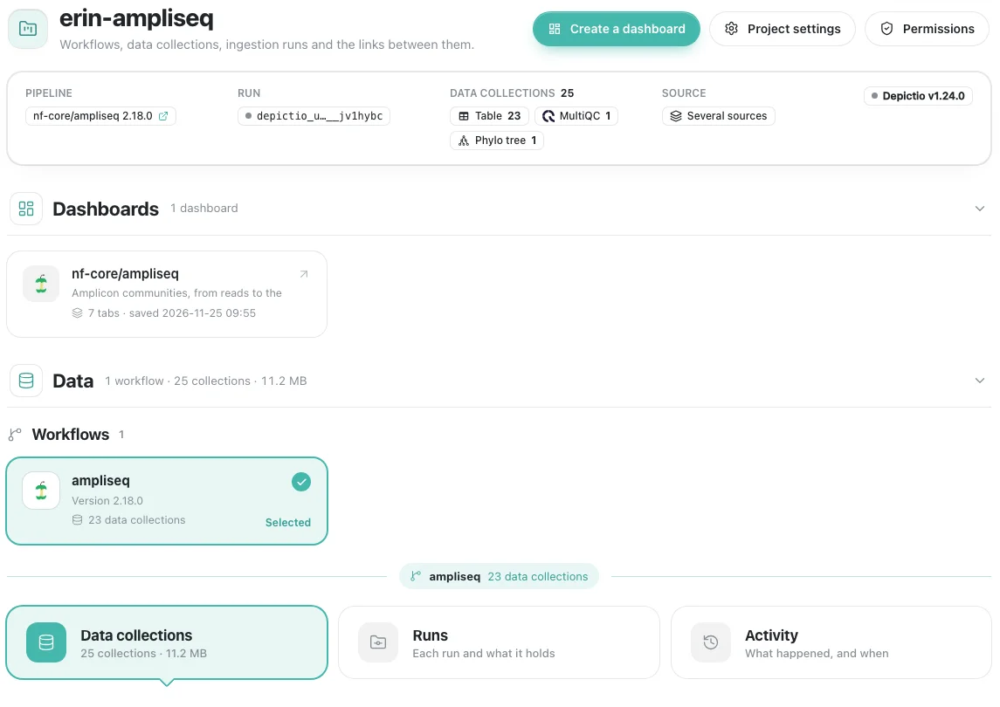
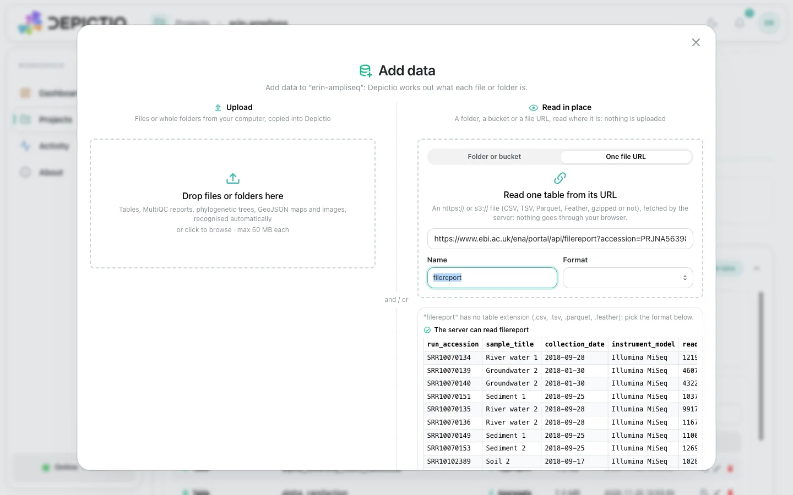

# 3. Create a project from an nf-core run

<div class="ws-strip" markdown>
[**0** Setup](get-started.md){ .ws-ep0 } [**1** Read](view.md){ .ws-ep1 } [**2** Edit](edit-your-copy.md){ .ws-ep2 } [**3** From a run](from-nf-core-run.md){ .ws-ep3 .ws-here } [**4** Showcases](showcases.md){ .ws-ep6 } [**+** From files](from-a-file.md){ .ws-ep4 }
</div>

<div class="ws-meta ws-ep3" markdown>
<span class="ws-chip" markdown="span">:material-plus-box-outline: **Creator**</span> <span class="ws-chip" markdown="span">:material-database-outline: **nf-core/ampliseq run on S3**</span> <span class="ws-chip" markdown="span">:material-timer-outline: **Hands-on 3 · 10 min**</span> <span class="ws-chip" markdown="span">:material-flag-outline: **After episode 0**</span>
</div>

!!! overview "Overview"
    **Questions**

    - How do I turn the results of an nf-core run into a dashboard?
    - Do I have to upload the files?

    **Objectives**

    - Name a project and point it at a run folder on S3.
    - Check what the template finds, create the project and open its dashboard.

A **run** is one execution of a pipeline. Here, nf-core/ampliseq 2.18.0 ran once and wrote its results in one folder on S3: you point Depictio at that folder, and it builds the project and its dashboard from it.

You rebuild the project you read in episode 1, from its run. In a Bonus at the end, you can add what the pipeline does not know: where and when each sample was taken.

**The run location** is an address starting with `s3://`. Paste it as given, with no `/` added at the end:

```text
s3://nf-core-awsmegatests/ampliseq/results-2723d4c298d48321594920d0324697e14d73ee94
```

## :material-pencil-outline: Hands-on 3 · Step 1: name the project { #name-the-project }

1. Open **Projects**, then **New project**.
2. Give it **your own name**: names are unique on the server.
3. Click **Add data**. The expand icon **⛶**, at the top right of the dialog, gives it the whole window.

{ .ws-shot }

## :material-folder-search-outline: Step 2: point at the run

The first step of the dialog, **Your data**, has two halves: **Upload** on the left, **Read in place** on the right. Today you use **Read in place** only: the run stays in its bucket.

1. Under **Read in place**, on the tab **Folder or bucket**, paste the run location.
2. Under **How should Depictio read this folder?**, Depictio selects **Pipeline template**: nf-core/ampliseq 2.18.0, detected from the run's `pipeline_info/` folder. Leave **Only the … found** selected: Depictio reads the outputs this run has.
3. Open **More pipeline settings** and set **Group column** to `habitat`: it is the metadata column used to group and facet in dashboards. Without it, Depictio groups by `name`, the first column of this run's sample sheet, and you get 22 collections instead of 23.
4. Click **Next**. It can take a few seconds: wait for the page to change.

{ .ws-shot }

## :material-clipboard-check-outline: Step 3: check, create, open

1. **What Depictio found** lists the checks. Read three: the badge **Exact match** says the template was written for this version, **TASKS** reads 207 tasks, and **COLLECTIONS** reads 23 ready.
2. Click **Next**. The last step says how many data collections will be ingested, in the background.
3. Click **Create Project**. Nothing is created before this click.
4. The ingestion takes 2 to 3 minutes. When it is done, open your project from **Projects**, then its dashboard: it has 7 tabs.

{ .ws-shot }

!!! question "Check your understanding"
    Which pipeline and version did Depictio find? How many collections? What does the **Tasks** line say? What did **Group column** change?

    ??? solution "Answer"
        | Check | Value |
        |---|---|
        | Pipeline | nf-core/ampliseq, exact match on 2.18.0 |
        | Collections found | 23; 22 if **Group column** was left on `name` |
        | Tasks | 207 tasks completed (4 after a retry), none failed |

!!! challenge "Challenge: what was created?"
    Open your project from **Projects**. How many data collections does it hold, and how many links? How many tabs has its dashboard?

    ??? solution "Solution"
        23 data collections (22 if **Group column** was left on `name`), the ones of the template, and 7 tabs. The links are the 19 of the template. They mostly start from the sample metadata (`metadata`), which is why one filter on Habitat reached every tab in episode 1. If you also did the Bonus with your own table, add `sampling_sites` and one link for each link you made.

!!! callout "Your project is private"
    Only you can open it until you share it, under **Permissions** on the project page, as in the optional [Create a project from files](from-a-file.md#share-it-your-group-then-everyone) (Optional A).

!!! keypoints "Key points"
    - A run is one batch of results; here one execution of a pipeline, whose results folder stays where it is, on S3.
    - Depictio reads `pipeline_info/`, finds the pipeline and its version, and builds data collections, links and a dashboard from the template.
    - Read in place keeps the run in its bucket; upload copies your files.
    - Nothing is created before you confirm.

??? note "Bonus · Your own sample table, linked to the run"
    Add a table of your own to the project: where and when each sample was taken.

    Download [sampling_sites.tsv](sampling_sites.tsv). It has one row per sample of the run, 12 in all, taken from the public records of the study in the European Nucleotide Archive (ENA). Its columns are `ID`, `site`, `collection_date`, `latitude`, `longitude` and `read_count`. The samples come from four sites near Tübingen.

    In step 2, before you click **Next**:

    1. Under **Upload**, drop `sampling_sites.tsv` on **Drop files or folders here**. The file is listed as *Table, TSV* with *Geomap: latitude / longitude*: Depictio recognised the two columns as map coordinates.
    2. In step 3, **What Depictio found** also lists **Files you dropped**: one file, one table, `sampling_sites.tsv` with 6 columns.

    { .ws-shot }

    ### :material-link-variant: Link your table

    Depictio reads the files in the background. When it is done, the dialog **Project created** reports what it ingested: the run folder (23 data collections) and the file you dropped (1 of 1 file added). Below them is **Link your tables**, with *5 possible links found*.

    A **link** lets a filter on one data collection narrow another. It goes one way, from a source to a target. Here the source is `sampling_sites` and the targets are the run's data collections. A filter on `sampling_sites` narrows the target. A filter on the target does not narrow `sampling_sites`. The link needs a column that holds the same values on both sides: here `ID` in `sampling_sites`. Depictio checks how many of its values it finds on the other side.

    1. Read the first suggestion: `sampling_sites`, column `ID` to `multiqc_data`. *12 of 12 values found* says that every `ID` has a match, and the preview, opened in the screenshot, shows the matched values side by side.
    2. Click **Link** on that line. The other suggestions go to `alpha_diversity_multi_canonical`, `alpha_rarefaction`, `bray_curtis_canonical` and `embedding_pcoa`: add them if you want.

    { .ws-shot }

    Depictio suggests at most 5 links per table. It ranks them by the share of values found, then puts MultiQC first, then sorts by name. That is why `metadata` is not in the list. `metadata` is the sample sheet, and it is the data collection that most other links of the template start from, so it is the one to link to. A filter follows links one after the other, up to three: with `sampling_sites` → `metadata`, a filter on `sampling_sites` reaches `metadata`, then every data collection `metadata` links to. Use **Link it yourself**, at the bottom of **Link your tables**: link `sampling_sites` to `metadata` on `ID`. You can also use **Add link** on the project page later.

    Then click **Stay on projects**.

    !!! challenge "Challenge 3.2: what changed with your table?"
        Open your project from **Projects**. How many data collections does it hold, and how many links? How many tabs has its dashboard?

        ??? solution "Solution"
            24 data collections: the 23 of the template, plus `sampling_sites` (23 if **Group column** was left on `name`), and 25 if you also added `ena_runs` from its URL. 7 tabs. The links are the 19 of the template, plus one for each link you added. The template's links mostly start from the sample metadata (`metadata`), which is why one filter on Habitat reached every tab in episode 1.

            { .ws-shot }

??? note "Bonus · One table from a URL"
    ### :material-web: One table from a URL

    !!! note "Optional"
        This part is not part of the live session. Do it if you have time, or afterwards.

    A table can also come from an address. You add one to the project you just created: the run table of the same study, from ENA. ENA is the public archive where the sequencing runs of the study are deposited. The Depictio server fetches the file: nothing goes through your browser.

    1. Open your project from **Projects**. On the project page, click **Add data**.
    2. Under **Read in place**, open the tab **One file URL**.
    3. Paste this address:

        ```text
        https://www.ebi.ac.uk/ena/portal/api/filereport?accession=PRJNA563986&result=read_run&fields=run_accession,sample_title,collection_date,instrument_model,read_count,base_count&format=tsv
        ```

    4. The server previews the file: *The server can read filereport*. The address has no table extension (`.csv`, `.tsv`, `.parquet`, `.feather`), so pick **Format**: **TSV**. Set **Name** to `ena_runs`.
    5. Click **Add 1 table**. A message confirms *ena_runs was added from its URL.*

    { .ws-shot }

    `ena_runs` has six columns: `run_accession`, `sample_title`, `collection_date`, `instrument_model`, `read_count` and `base_count`. The address can be an `https://` or an `s3://` file, in CSV, TSV, Parquet or Feather, gzipped or not. The server accepts any public `https://` host by default. It refuses plain `http://` unless its settings allow it.

    !!! challenge "Challenge 3.3 (optional): what would you link `ena_runs` to?"
        Look at the rows of `ena_runs` and of `sampling_sites`. Which column of `ena_runs` would you link to which collection, and why? Does `ena_runs` have as many rows as `sampling_sites`?

        ??? solution "Solution"
            `run_accession` in `ena_runs` holds the same values as `ID` in `sampling_sites` and `metadata`: the ENA run accessions, such as `SRR10070130`. A link needs a column with the same values on both sides, and this is the one. The link goes one way: choose which of the two should be filtered by the other. `ena_runs` has 24 rows, `sampling_sites` 12. The study has 24 runs in ENA, and this run of the pipeline used 12 of them. All 12 `ID` values are among the 24 `run_accession` values. To count the rows yourself, run `curl -s '<the ENA address>' | tail -n +2 | wc -l`: the header line is skipped.

            { .ws-shot }

!!! further "Going further"
    - How a template, the data collections and the links build a project, and the two ways in: [How it works](reference.md#how-it-works).
    - Every place data can come from, in the browser and on the command line: [Where data can come from](reference.md#where-data-can-come-from).
    - A project for a pipeline with no template (hands-on on Day 2): [The Project Builder](reference.md#project-builder).
    - Where the **Differential Abundance** tab comes from: [Template, catalog and Tool Studio](reference.md#where-project-comes-from).
    - Several MultiQC reports in one collection: [Several MultiQC reports](reference.md#several-multiqc).

<div class="ws-next" markdown>
[<span class="ws-k">Next episode</span><span class="ws-t">4. Showcases</span>](showcases.md){ .ws-go .ws-ep6 }
</div>
