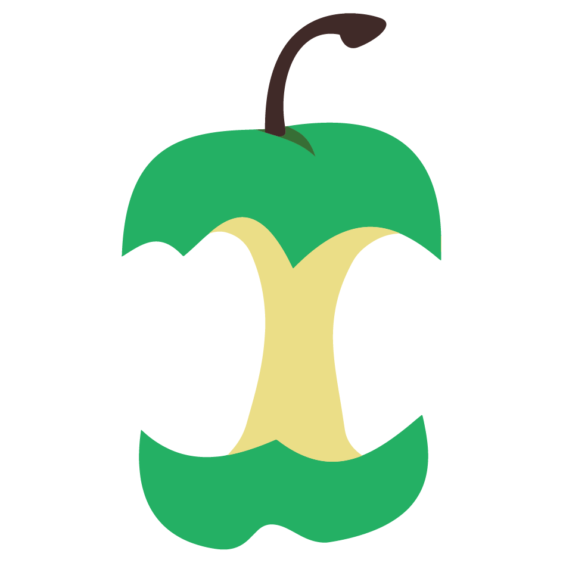

# :material-web: Depictio in the browser <small>(v1.22.0+)</small>

A <a href="../courses/">hands-on course</a> in five episodes, done in the browser on a Depictio server. Each episode is one way people use Depictio: reading a dashboard someone shared, adjusting it, bringing in your own data, following new data as it arrives.

<figure markdown="span" class="ws-media"><video autoplay controls muted loop playsinline poster="../../images/tutorials/workshop/filter.webp" src="../../images/tutorials/workshop/filter.mp4"></video></figure>

:material-account-school-outline: **No Depictio experience needed** :material-web: **A browser, nothing to install** :material-code-tags: **No programming; one optional Python exercise**

## Episodes

-   0 **[Setup](get-started.md)**

    ---

    Everyone

    How do I sign in, and where is everything?

-   1 **[Read a shared dashboard](view.md)**

    ---

    Reader · nf-core/ampliseq

    How do I filter, select and compare samples on a dashboard I did not make?

-   2 **[Make your own copy and edit it](edit-your-copy.md)**

    ---

    Designer · nf-core/ampliseq

    How do I change a dashboard without changing it for others?

-   3 **[Create a project from files](from-a-file.md)**

    ---

    Creator · two CSV files

    How do I start from my own tables, link and join them, and share them?

-   4 **[Create a project from an nf-core run](from-nf-core-run.md)**

    ---

    Creator · run on S3

    How do I turn a pipeline's results folder into a project and a dashboard?

-   5 **[Follow a new run](new-run-and-versions.md)**

    ---

    Creator · the 2009 season

    I added a season: what changed since I last looked, and how do I go back?

## Three roles

After the setup, the episodes take you through three roles, one after the other.

| Role | Episodes | What you do |
|---|---|---|
| :material-account-eye-outline: **Reader** | 1 | Read a shared dashboard: filter, select, comment. You change nothing |
| :material-pencil-outline: **Designer** | 2 | Change a dashboard, in your own copy; never the data |
| :material-plus-box-outline: **Creator** | 3, 4, 5 | Bring data in, from files or a pipeline run; share the project; add new data and follow what changed |

## Two datasets

-   { .ws-logo .off-glb } **nf-core/ampliseq 2.18.0**

    ---

    16S amplicon sequencing, the AWS megatest run: 12 samples from soil, sediment and water. In Depictio: 23 data collections and a dashboard of seven tabs.

    Episodes 1, 2, 4 · [nf-core/ampliseq](https://nf-co.re/ampliseq/2.18.0)

-   :material-penguin: **Palmer Penguins**

    ---

    Penguins from three islands in Antarctica. Two tables, a census and the measurements, linked by `individual_id` and joined into a third: 223 penguins from the 2007 and 2008 seasons in episode 3, then 119 more from 2009 in episode 5, 342 in all.

    Episodes 3, 5 · [palmerpenguins](https://allisonhorst.github.io/palmerpenguins/), CC0

## Requirements

-   :material-laptop: **Technical**

    ---

    - A recent browser: Firefox, Chrome, Edge or Safari. Nothing to install.
    - The workshop server address and a personal account, given by the instructor. Without them, the [workshop Codespace](https://codespaces.new/depictio/depictio?devcontainer_path=.devcontainer/workshop/devcontainer.json&quickstart=1) runs Depictio in a GitHub cloud workspace.
    - Zoom, with a second screen or window for the server.

-   :material-school-outline: **Skills**

    ---

    - Reading a table and a scatter plot.
    - Knowing roughly what a pipeline's results folder holds helps for episode 4; the lesson explains the rest.
    - No programming. Challenge 2.2 shows a few lines of Python; it is optional.

[ReferenceThe words of the lesson](reference.md){ .ws-help .ws-ref }
[InstructorsInstructor notes](facilitators.md){ .ws-help .ws-inst }
[Start here0. Setup](get-started.md){ .ws-go .ws-ep0 }

