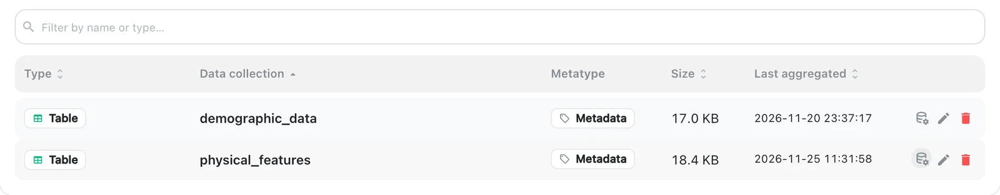
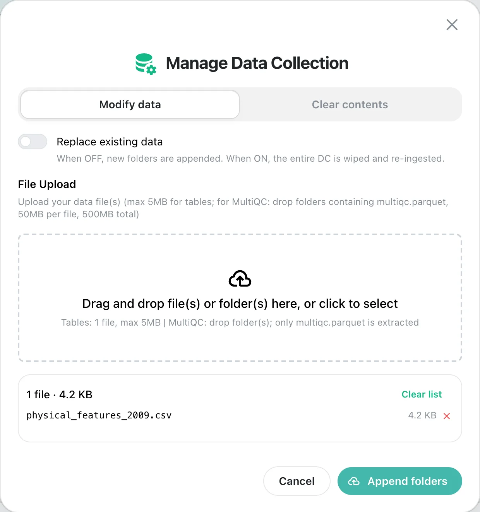
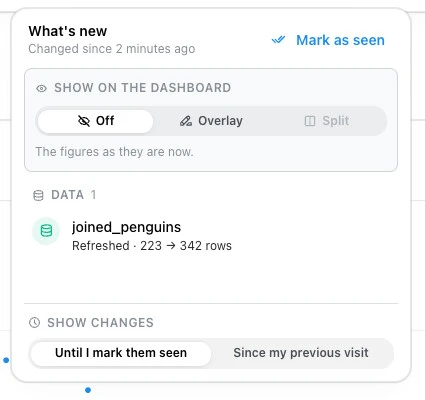

# Optional B · Follow a new run

[**0** Setup](get-started.md){ .ws-ep0 } [**1** Read](view.md){ .ws-ep1 } [**2** Edit](edit-your-copy.md){ .ws-ep2 } [**3** From a run](from-nf-core-run.md){ .ws-ep3 } [**4** Showcases](showcases.md){ .ws-ep6 } [**+** From files](from-a-file.md){ .ws-ep4 } [**+** New run](new-run-and-versions.md){ .ws-ep5 .ws-here }

:material-plus-box-outline: **Creator** :material-database-outline: **Palmer Penguins, the 2009 season** :material-flag-outline: **After Optional A**

!!! note "Optional episode"
    This episode is not done in the live session. Do it after the workshop, on the same server while it runs. You need your Optional A project, with its two tables, the join `joined_penguins` and its dashboard, and the two 2009 files from this page.

!!! overview "Overview"
    **Questions**

    - New data arrived in a project I follow: what changed since I last looked?
    - What happens to a joined table when one of its tables changes?
    - I added the same file twice: how do I go back?

    **Objectives**

    - Append the 2009 season to both tables of your Optional A project, and let the join follow.
    - Read what changed with **What's new**, and compare a figure with **Before | Now**.
    - Restore a table to the version before a mistake.
    - Tell an append from a new run.

A field survey does not stop after two seasons. You add the 2009 season to the two tables of the project you created in [Optional A](from-a-file.md), then ask Depictio what changed.

Download the two files:

| File | Columns | Rows | Goes into |
|---|---|---|---|
| [`physical_features_2009.csv`](physical_features_2009.csv) | `individual_id`, `bill_length_mm`, `bill_depth_mm`, `flipper_length_mm`, `body_mass_g` | 119 | `physical_features` |
| [`demographic_data_2009.csv`](demographic_data_2009.csv) | `individual_id`, `island`, `sex`, `year`, `species` | 119 | `demographic_data` |

You append to the two tables only. `joined_penguins` is rebuilt by Depictio after each append: you do not touch it.

## :material-bookmark-outline: Open your dashboard first { #first-visit }

1. Open **Dashboards**, then the dashboard you made in Optional A.
2. Look at it once. Depictio records your visit: *What's new* compares with what you saw now.

## :material-database-cog-outline: Append the 2009 season

Measurements first, then the census.

1. Open **Projects**, then your Optional A project.
2. In the Data collections table, on the row of `physical_features`, click the icon with a database and a gear, titled **Manage data (append / replace / clear)**. The dialog **Manage Data Collection** opens, on the tab **Modify data**.

    { .ws-shot }

    The shot shows two rows. In your Optional A project the table also has a third row, `joined_penguins`, whose **Manage data** is disabled.

3. Leave the switch **Replace existing data** off: the new rows are appended to the table.
4. Drop `physical_features_2009.csv`: the dialog lists it, *1 file · 4.2 KB*. Then click **Append folders**. The button reads *folders* even for one CSV file.

    { .ws-shot }

5. The same on the row of `demographic_data`, with `demographic_data_2009.csv`.

Append each file **once**. A second append of the same file is accepted without a warning: see [Appended twice?](#appended-twice).

!!! callout "Why the measurements first?"
    The join is a **left** join: it keeps every penguin of the census, `demographic_data`, and adds its measurements. Append the measurements first, and they wait in `physical_features` with no census row to match: `joined_penguins` stays at 223 rows, the Gentoo figure at 80, and **What's new** shows no data change yet. Its badge may already count something else, such as the comments of Optional A. Then append the census: `joined_penguins` goes to 342 rows, every one with its measurements. The other way round, the 119 new penguins enter `joined_penguins` with empty measurements until the second append: the row counts and the filter jump before the figure does.

Depictio rebuilds `joined_penguins` after each append. **Manage data** is disabled on a joined table: append, replace and clear are refused there.

In the project, **Activity → History** lists the two appends as *Ingested · from Add data*; the rebuilds of the join are not listed.

## :material-bell-outline: What's new

1. Reload your dashboard.
2. Click **What's new**: the clock icon with a number, left of the gear in the header. The data change shows once the census is appended. Its panel lists what changed since your visit: under *DATA 1*, *joined_penguins*, *Refreshed · 223 → 342 rows*.
3. Under **Show on the dashboard**, try **Off** and **Overlay**. **Split** is greyed out: it draws new runs beside the runs you had seen, and an append makes no run. For an append, **Before | Now** is the view: see below.

{ .ws-shot }

!!! challenge "Challenge B.1: what arrived?"
    Which table does the **Data** part of the panel list, and with how many rows? Why not `demographic_data` and `physical_features`?

    ??? solution "Solution"
        *DATA 1*: `joined_penguins`, *Refreshed · 223 → 342 rows*: 223 from 2007 and 2008, plus 119 from 2009. The dashboard reads `joined_penguins` only; you appended to the two other tables, and Depictio rebuilt the join from them. The project's own **What's new** lists the two tables you appended to, each *223 → 342*, and not `joined_penguins`.

## :material-compare: Before | Now

!!! warning "Gentoo is still selected"
    Your dashboard opens with *Gentoo* still selected from your last visit: *1 filter active*, a *1* badge and the *Gentoo* chip. Check that the **Species** filter shows *Gentoo*; do not click it again, that clears it. With the filter cleared, the figure shows 342 points and **Before | Now** *+119*.

1. In the filter, check that *Gentoo* is selected; pick it only if it is not.
2. On the figure, click the blue dot: it marks a tile whose data changed. Its menu offers **Mark as seen**, **Compare with last visit** and **Before | Now**: click **Before | Now**. It opens the figure as you last saw it, and as it is now.

!!! challenge "Challenge B.2: how many new Gentoo?"
    How many points does **Before** show, how many **Now**? Where are the new penguins listed?

    ??? solution "Solution"
        80 before, 123 now: *Compared with your last visit: +43*. The table below it, **NEW (43)**, lists the 43 Gentoo penguins of 2009.

Once you have answered, open **What's new** again and click **Mark as seen**. Do it last: marking seen removes the blue dot, and with it the way to **Before | Now**.

## :material-folder-clock-outline: An append is not a run

An append adds rows to a table. It does not add a **run** to the project.

- The project's **Runs** tab does not change: it still holds the two runs of the uploads of Optional A.
- **Activity → History** lists each append to `demographic_data` and `physical_features` as *Ingested · from Add data*, without the table's name; the rebuilds of the join are not listed.
- **Compare** has nothing to show for an append.

A project fed by a pipeline gets one run per batch of results, and **Compare** shows what each run changed. The instructor shows it on a prebuilt project: see [Runs and Compare](#runs-and-compare).

## :material-backup-restore: Appended twice? { #appended-twice }

Dropping the same file twice appends its rows twice, and nothing warns you: the table then holds 461 rows, the 119 ids of 2009 each there twice, and the join follows.

To undo it, restore the table to the version before the second append:

1. On the project page, click the table, then switch **Unlock cell edits**. A locked table answers *Unlock the table to restore a past version*.
2. In the table's **Data** panel, click **Past versions**.
3. Set **At version** to the version with 342 rows, click **Restore vN** (N is that version's number), then **Restore**.

The **Version history** section of the table only lists the versions; the restore is in **Past versions**. Depictio rebuilds `joined_penguins` from the restored table: the join follows. Pick the version by its rows, not by its number. The row counts in the page header may stay at the old value until you reload the page.

Another way: **Manage data** again on the table, with **Replace existing data** switched on. The button then reads **Replace all data**, and the file you drop replaces the whole table.

## :material-presentation-play: Runs and Compare { #runs-and-compare }

On the shared screen, the instructor opens the prebuilt project *Penguin Field Survey*. It received each field season as a **run**, one batch of results: one folder holding that season's census and measurements, the way a new sequencing batch adds a run to a pipeline project.

{ .ws-diagram }
{ .ws-diagram }

- **Runs**: one row per season. Unfolded, `season_2009` lists the files it brought, marked **New**, and under **Produced** what it wrote to each table; **View rows** shows the new rows.
- **Compare** opens the dashboard with what the run changed marked.

More in [Runs and run comparison](../../features/runs.md) and [What's new](../whats-new.md).

!!! further "Going further: earlier data, earlier dashboard"
    Each time a table changes, Depictio keeps the version before. Each time a dashboard is saved, too.

    **Challenge B.3: back to two seasons.** On **Dashboards**, **Duplicate** a dashboard of *Penguin Field Survey* and open your copy. Click **Edit**, then the gear icon at the top right of the header (**Settings**), then **Data version**. Set **physical_features** to **v1 · 223 rows**, the version before the 2009 season (v0 holds 109 rows, v2 the 342 of all three seasons). What do the figures show? Who else sees it?

    ??? solution "Solution"
        The figures drawn from `physical_features` show the 223 penguins of 2007 and 2008. Only you see it, until you reload the page.

    **Challenge B.4: undo a change.** Change a figure of your copy and save. Then bring back the version before.

    ??? solution "Solution"
        In **Edit**, **Settings → History**: click **↺** on the version before your change, then **Restore**. A restore saves the current state first: nothing is lost.

!!! keypoints "Key points"
    - **Manage data** appends rows to a table, or replaces them. Each change makes a new version of the table, and the joins that read it are rebuilt.
    - **What's new** shows what changed since your last visit; **Before | Now** compares one figure with what you saw.
    - Append the measurements before the census: a left join keeps every row of the census.
    - An append is not a run: the **Runs** tab and **Compare** do not show it, and **Split** stays greyed out; **Before | Now** shows what it changed.
    - A second append of the same file is not refused. **Past versions**, on an unlocked table, restores an earlier version.
    - A run is one batch of results; a project fed by a pipeline gets one run per batch, and **Compare** shows what each one changed.

[Stuck?Troubleshooting](troubleshooting.md#optional-b){ .ws-help }
[NextReference: the words of the lesson](reference.md){ .ws-go .ws-ep0 }

