# Reference

:material-book-alphabet: **For learners**

Each concept keeps one colour in every figure of the lesson and of the docs:

{ .ws-diagram }
{ .ws-diagram }

| Word | Meaning | Episode |
|---|---|---|
| :material-jira:{ .ws-ic .ws-ic-project } **Project** | Where the data and its dashboards live, with who can open them. Built from one or more pipeline runs, or from files you add | 0, 3, A |
| :material-table:{ .ws-ic .ws-ic-dc } **Data collection** | One kind of data in a project, read from one file or several. Its type says what it holds: table, MultiQC report, images, phylogenetic tree, genome tracks, GeoJSON… | 0, 3, A |
| :material-link-variant:{ .ws-ic .ws-ic-link } **Link** (Cross-DC link) | Says which identifiers match between two data collections, so that a filter on the source narrows the target. It goes one way. The column names may differ, and a MultiQC report is matched on its sample names. Nothing is copied or merged | 0, A |
| :material-set-center:{ .ws-ic .ws-ic-dc } **Join** | Two table data collections merged, on shared columns, into a new one, `joined_<name>`. The two stay as they are, and the joined table is rebuilt whenever one of them changes. Made in the browser with **Add join**, or written in `project.yaml` (`joins:`) for the command-line client | A, B |
| :material-table-column-plus-after:{ .ws-ic .ws-ic-other } **Add columns** | Copies columns from a file onto an existing table data collection, in place, matched on a column, as a new version of that table. No new table. For owners and editors, on uploaded tables | A |
| :material-view-dashboard:{ .ws-ic .ws-ic-dash } **Dashboard** | A set of components, in tabs, that read the data collections of one project | 1, 2 |
| :material-chart-scatter-plot:{ .ws-ic .ws-ic-other } **Component** | One tile of a dashboard, reading one data collection: figure, table, card, filter, map, text, { .ws-logo .ws-logo-mono .off-glb } MultiQC plot | 2, A |
| :material-folder-play-outline:{ .ws-ic .ws-ic-run } **Run** | One batch of results added to a project: one execution of a pipeline, one upload, one field season. A project can hold several | 3, A, B |
| :material-database-plus-outline:{ .ws-ic .ws-ic-other } **Append** | New rows added to a table with **Manage data**. A new version of the table, not a new run; the joins that read it are rebuilt | B |
| :material-folder-search-outline:{ .ws-ic .ws-ic-other } **Read in place** | Depictio reads the files where they are (S3, a shared folder); nothing is copied | 3 |
| :material-upload:{ .ws-ic .ws-ic-other } **Upload** | The files are copied into Depictio | A |
| :material-file-cog-outline:{ .ws-ic .ws-ic-other } **Template** | What Depictio knows about a pipeline: which outputs to read, how to link them, which dashboard to build | 3 |
| :material-history:{ .ws-ic .ws-ic-version } **Version** | Each change of a table (an edit, an append, **Add columns**) and each save of a dashboard is kept; earlier ones can be shown or restored | A, B |
| :material-clock-outline:{ .ws-ic .ws-ic-you } **What's new** | What changed in a dashboard's data since your last visit | B |
| :material-account-key-outline:{ .ws-ic .ws-ic-other } **Owner, editor, reader** | Who can change a project or dashboard (owner, editor) and who can only open it (reader, *Viewer* on the Permissions page) | 1, 2, A |
| :material-account-multiple-outline:{ .ws-ic .ws-ic-you } **Group** | A named selection of samples, kept in your browser, compared in the cards | 1 |
| :material-account-group-outline:{ .ws-ic .ws-ic-other } **User group** | A set of accounts, created by an administrator. A project shared with it is open to all its members | A |
| :material-earth:{ .ws-ic .ws-ic-other } **Public** | A project every signed-in account can open | A |

## Episode 1: why Depictio, and how a dashboard works { #episode-1 }

The longer explanations behind [episode 1](view.md). Read them when you have time.

### :material-transit-connection-variant: Why Depictio: the step after the pipeline { #why }

A pipeline usually stops at its outputs: files opened one by one, a static HTML report, or an app coded from scratch for one dataset. Depictio is the step after: **one platform, reused and standardised across pipelines**, with the same tools while you build the dashboard and after you share it: with collaborators, with everyone, or as one HTML file that opens without a server, as a MultiQC report does.

{ .ws-diagram }
{ .ws-diagram }

You see each of them in the course: editing in [episode 2](edit-your-copy.md), versions on [Day 2](../workshop-cli/collaborate-and-export.md#versions), sharing in the optional [project from files](from-a-file.md#share-it-your-group-then-everyone), templates in [episode 3](from-nf-core-run.md). 42 nf-core pipelines have a template; the Tools catalog maps 471 outputs of 136 tools to components.

Templates: Depictio documentation; tools and outputs: Depictio code; both November 2026.

### :material-scale-balance: How it compares with a report, a spreadsheet and your own code { #how-it-compares }

An app written with Streamlit, Shiny or Dash is code: you write it, run it and maintain it. A Depictio dashboard is a description of components, which Depictio draws. Two things follow.

**Flexibility**

- You change a dashboard in the interface, or as YAML. Every save is a version you can go back to.
- There is no code to maintain. A filter or a selection reaches the components that read the same data, linked collections included, without callbacks to write.

**Reuse**

- One template per pipeline version builds the same dashboard for any run of that pipeline.
- A dashboard is copied, shared and exported.

Compared, as a reader, with a static report, a spreadsheet and your own code:

| As a reader, you can… | :material-file-document-outline: Static HTML report | :material-table-large: Spreadsheet | :material-code-braces: Your code, an app | 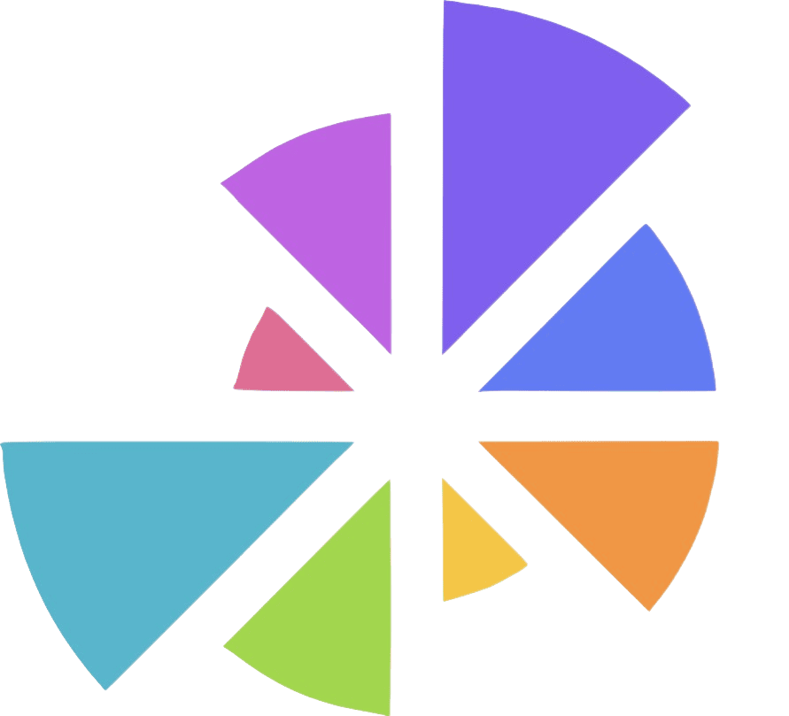{ .ws-logo .off-glb } Depictio | Try it |
|---|:-:|:-:|:-:|:-:|---|
| Filter every view at once: MultiQC, tables, figures | Within some reports | :material-close-thick:{ .ws-no } | If you code it | :material-check-bold:{ .ws-yes } | [Filter](view.md#filter) |
| Pick samples on a table, a figure or a map | :material-close-thick:{ .ws-no } | Rows only | If you code it | :material-check-bold:{ .ws-yes } | [Four ways](#four-ways) |
| Send the filtered view as a link | :material-close-thick:{ .ws-no } | :material-close-thick:{ .ws-no } | If you code it | :material-check-bold:{ .ws-yes } | [Challenge 1.3](#filter-more) |
| Define your own groups and compare them | :material-close-thick:{ .ws-no } | By hand | If you code it | :material-check-bold:{ .ws-yes } | [Analysis mode](view.md#groups) |
| Comment on a figure | :material-close-thick:{ .ws-no } | On cells | If you code it | :material-check-bold:{ .ws-yes } | [Day 2](../workshop-cli/collaborate-and-export.md#comment-and-annotate) |
| Open it as one file, without a server | :material-check-bold:{ .ws-yes } | :material-check-bold:{ .ws-yes } | If you code it | :material-check-bold:{ .ws-yes } | |

### :material-view-dashboard-outline: Anatomy of a dashboard { #anatomy }

A dashboard is made of components, grouped in sections, on tabs. The numbers mark each part on the **Community & Diversity** tab of the nf-core/ampliseq dashboard.

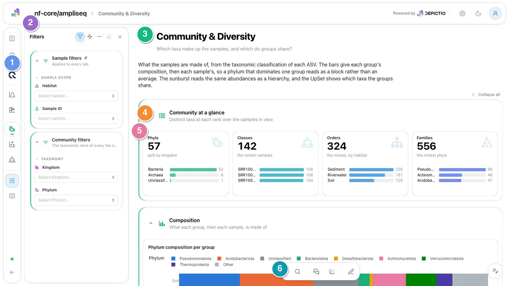{ .ws-shot }

<ol class="ws-ann-legend">
<li><strong>Tabs</strong>: one per question, on the left.</li>
<li><strong>Filters</strong>: pinned sections reach every tab.</li>
<li><strong>The tab's question</strong>: and how to read it.</li>
<li><strong>Sections</strong>: group the components.</li>
<li><strong>Components</strong>: cards, figures, tables, MultiQC.</li>
<li><strong>Bottom bar</strong>: search, comments, Analysis, Edit.</li>
</ol>

### :material-book-open-variant: The Guide in detail { #guide-detail }

Every dashboard comes with a **Guide**: a page that explains how to move around it, filter it and read its components. It answers most of the "where is…?" questions.

The first time you open a dashboard, a box **About this dashboard** asks *First time on this dashboard?*. It shows the dashboard's one-line description and two buttons: **See how this dashboard works** and **Got it**.

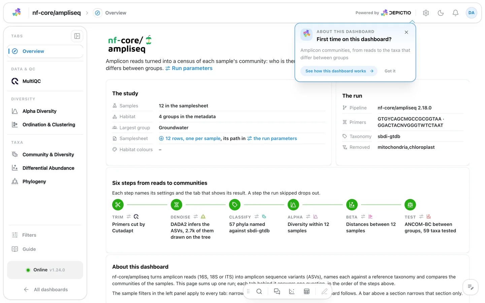{ .ws-shot }

**See how this dashboard works** opens the Guide. You can open it again at any time, from **Guide** in the left sidebar, under **Filters**.

The Guide is one page, *Guide — How to move around this dashboard, filter it and read its components*. It is not a tour: there are no steps and nothing to dismiss. It is a column of parts, listed at the top: About this Guide, Tabs, Sections, Filters, Components, Analysis, Metadata, Comments, Versions, What's new and Settings. A part only appears when the dashboard has what it covers.

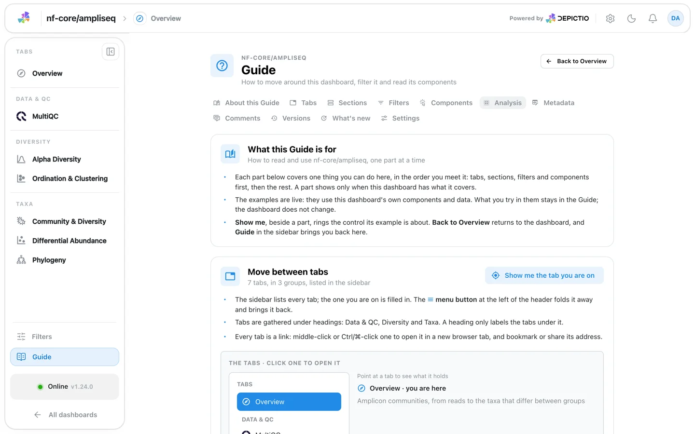{ .ws-shot }

Each part has a short explanation, a small working example built from this dashboard's own components and data, and a **Show me** button, such as **Show me the filter**, that rings the control in the example. What you try in the examples stays in the Guide: the dashboard does not change.

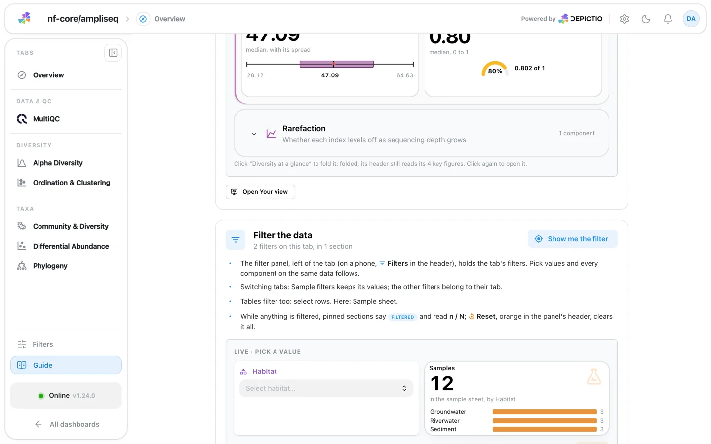{ .ws-shot }

**Back to Overview**, at the top right of the Guide, returns to the dashboard.

!!! challenge "Try it: the Guide"
    Open the **nf-core/ampliseq** dashboard from **Dashboards**, then open the Guide. Go to the part **Filters**, click **Show me**, then click **Back to Overview**. Which two places open the Guide?

    ??? solution "Solution"
        The box shown the first time you open a dashboard (**See how this dashboard works**), and **Guide** in the left sidebar, under **Filters**. If you clicked **Got it** and the box is gone, the sidebar entry is still there.

### :material-account-eye-outline: You are a reader: what is yours, what is shared { #reader }

Someone shared a finished dashboard with you: you are a **reader**. You cannot change the dashboard or its data. You can filter it, select samples and compare groups: that changes only your own view. Your filters and selections are kept for your account, in any browser you sign in on; your groups stay in this browser. Others see your view only if you send them its link.

{ .ws-diagram }
{ .ws-diagram }

<figure markdown="span" class="ws-media"><video autoplay controls muted loop playsinline poster="../../../images/tutorials/workshop/filter.webp" src="../../../images/tutorials/workshop/filter.mp4"></video></figure>

### :material-chart-scatter-plot: Analysis mode in more detail { #analysis-more }

**Analysis**, in the bottom toolbar, keeps selections as named groups and compares them. Groups are kept in your browser: nobody else sees them. Unlike a selection, a group reaches every data collection, even from the PCoA: groups also follow the links backwards. The steps are in [episode 1](view.md#groups).

<figure markdown="span" class="ws-media"><video autoplay controls muted loop playsinline poster="../../../images/tutorials/workshop/groups.webp" src="../../../images/tutorials/workshop/groups.mp4"></video></figure>

In the **Analysis** panel, **Color figures by → A column** picks a column, such as `habitat`: it recolours every figure whose data carries that column. **My groups** colours the figures by the groups you saved.

!!! note "Metadata mode and comments"
    Labelling samples in **Metadata** mode and leaving a **comment** on a figure are part of Day 2: [Work on your dashboard, together](../workshop-cli/collaborate-and-export.md).

## Dashboard tour { #dashboard-tour }

The pages **Dashboards**, **Projects** and your profile, then four ways to pick samples. They come from episode 1.

Three pages hold everything else: **Dashboards** and **Projects**, in the left sidebar, and your **profile**, behind the avatar at the top right. As a reader you look around them; you create and change nothing there. The rest of the course starts from them.

**Dashboards** and **Projects** each offer a short tour of their controls, the first time you open them. **Take the tour of this page**, the compass icon at the top right, plays it again.

### :material-view-dashboard: Dashboards { #reader-dashboards }

A dashboard is tabs of components that read the data of one project. You see a dashboard when it is public, shared with you or with your group, or yours. After you sign in, Depictio opens **Dashboards**, the list of all of them: *Open, pin and organise the dashboards you can access.* There is one row per dashboard: Title, Category, Project, Owner, Created and Modified.

{ .ws-shot }

**Change the view.** The last icon of the toolbar, **Change view**, switches between two views of the same list:

- **Table**: *sortable columns + bulk select*. Click a column title to sort by it.
- **Thumbnails**: *cards with screenshot previews*, grouped in sections: **Owned**, **Accessed**, **Public**, **nf-core dashboards**. A section you have nothing in, like **Owned** before episode 2, shows *No owned dashboards*.

{ .ws-shot }

Hover a card: a larger preview of the dashboard opens beside it, with its tabs and its first page, before you open it.

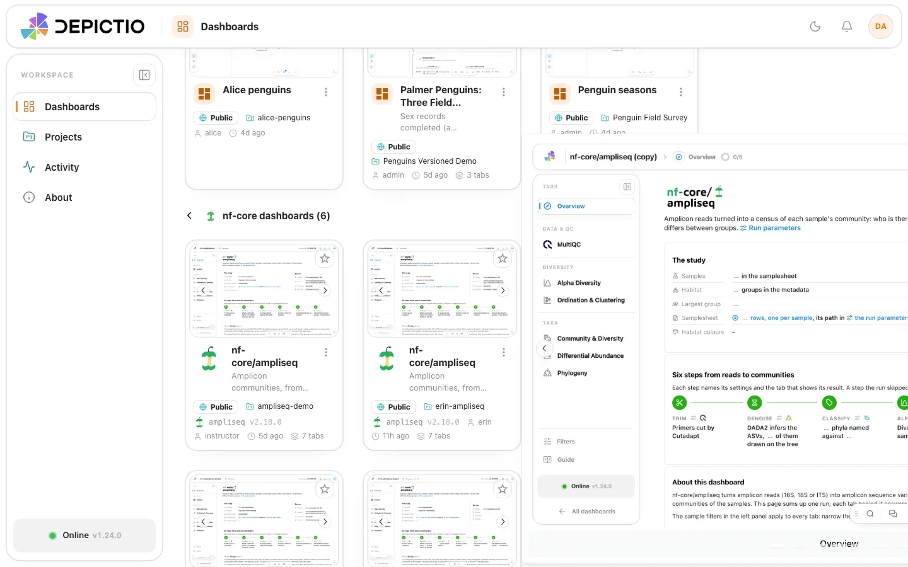{ .ws-shot }

**Find a dashboard.** The toolbar, from left to right:

| Control | What it does |
|---|---|
| Search box | Finds a dashboard by its title |
| **Default sections** | How the list is grouped |
| :material-star-outline: **Toggle favorites filter** | Shows only the dashboards you pinned |
| :material-filter-variant: **Filters** | Narrows the list by template, project, owner, workflow system and visibility |
| :material-link-variant: **Copy a link to this filtered view** | A link to the list as you see it now, to send to someone |
| :material-table-cog: **Table display** | Comfortable or compact rows, and which columns show: 9 of 14 at first |
| **Change view** | Table or Thumbnails |

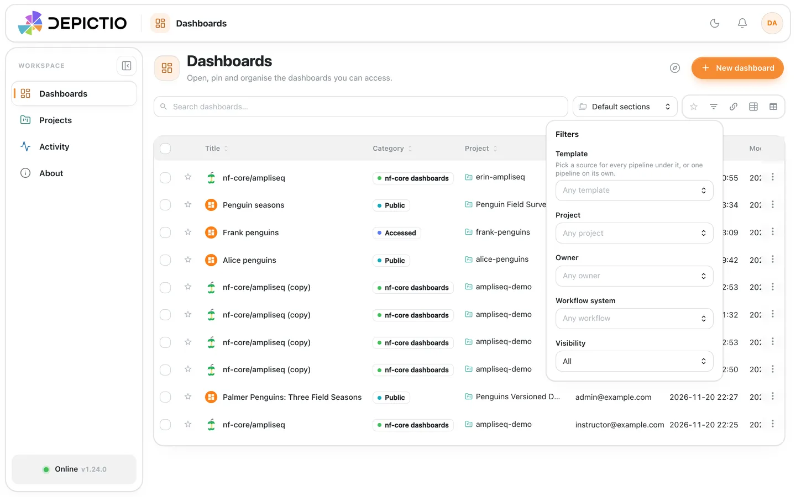{ .ws-shot }

The star at the start of a row, **Pin dashboard**, keeps that dashboard at the top of the list. The **Category** badges you meet as a reader:

| Badge | Meaning |
|---|---|
| **Public** | Anyone can open it |
| **Accessed** | Shared with you or with your group |
| **nf-core dashboards** | Built from an nf-core pipeline template |
| **Owned** | Your own dashboard |

**What you can do with a dashboard.** The menu :material-dots-vertical: at the end of each row, **Dashboard actions**: **Open**, **Edit**, **Duplicate**, **Export JSON** and **Delete**. On a dashboard you do not own, **Edit** and **Delete** are greyed out. **Duplicate** gives you your own copy, which you can edit: that is [episode 2](edit-your-copy.md). **Export JSON** saves the dashboard as a JSON file.

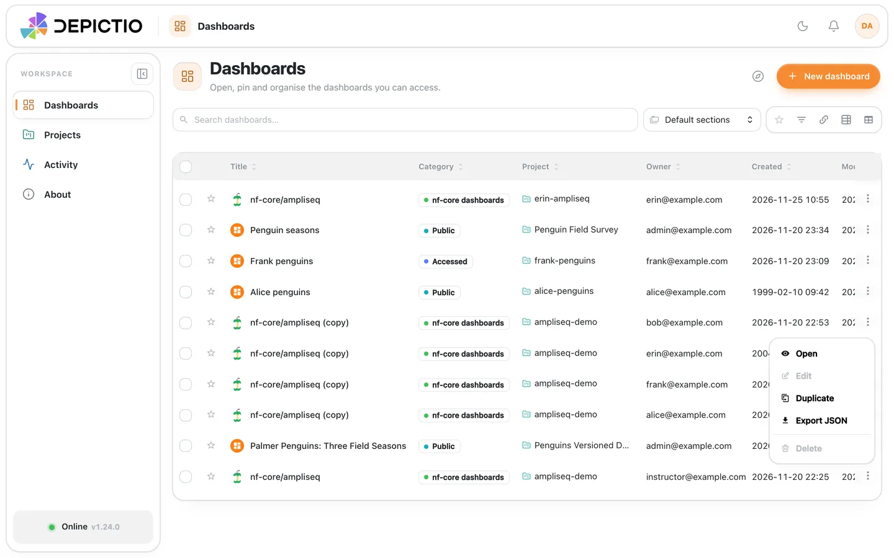{ .ws-shot }

On the workshop server, everyone's copies appear too, named *… (copy)*. Use the search box to find yours, and pin it with the star.

!!! challenge "Try it: the Dashboards page"
    Switch **Dashboards** to **Thumbnails**, then back to **Table**. Pin the **nf-core/ampliseq** dashboard of the project *ampliseq-demo*, then click **Toggle favorites filter**. Which dashboards are left in the list?

    ??? solution "Solution"
        Only the one you pinned. Click **Toggle favorites filter** again to see them all; the pin stays, so this dashboard is now at the top of the list.

### :material-jira: Projects { #reader-projects }

A dashboard reads its data from a **project**: the data of one study, the tables of a pipeline run or of files you upload, with the links between them, the dashboards that read them, and who can use them. One project can have many dashboards. **Projects**, in the left sidebar: *The data behind your dashboards: workflows, data collections and who can use them.* One row per project: Name, Contents (such as *1 run of nf-core/ampliseq 2.18.0 · from S3*), Visibility (**Public** or **Private**), Pipeline and Owner. The first visit offers a short tour, *New to Projects?*, with **Show me around** and **Not now**.

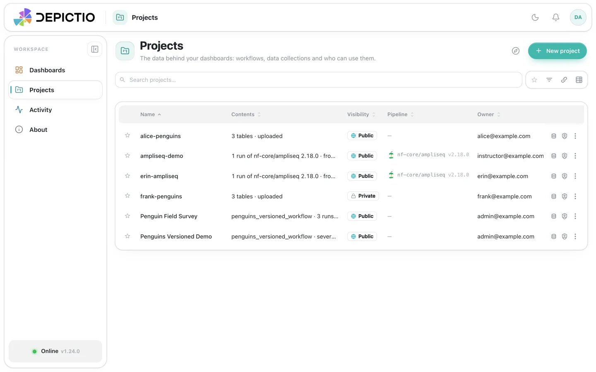{ .ws-shot }

The toolbar works as on **Dashboards**: search, favorites, **Filters** (by visibility and pipeline), a link to the filtered list, and **Table display**, whose columns include **Your role** and **Members**. At the end of each row: **Open data manager**, **Open permissions**, and the menu **Project actions**: **Edit**, **Export as ZIP** and **Delete**. As a reader, only **Export as ZIP** is open to you.

{ .ws-shot }

**Inside a project.** Click a project's name to open its page. Read it now, or come back to it after [episode 3](from-nf-core-run.md), where you build a project like this one yourself. At the top, a summary: the **pipeline** and its version, the **run**, the **data collections** by type (Table 21, MultiQC 1, Phylo tree 1 for *ampliseq-demo*) and the **source** of the data. Below, two parts:

- **Dashboards**: one card per dashboard built on this project. Click one to open it.
- **Data**: the workflows, then four views.

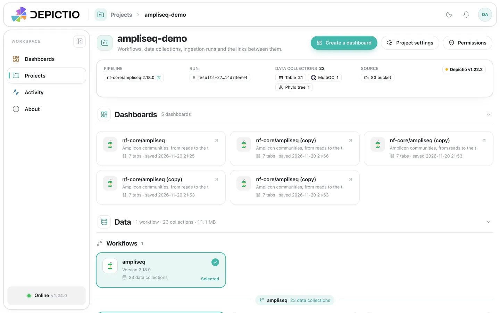{ .ws-shot }

| View | What it shows |
|---|---|
| **Data collections** | Each table of the project: its type, name, size and last update |
| **Cross-DC links** | Which data collections are linked, by which column: a map, or a table |
| **Runs** | Each run and what it holds |
| **Activity** | What happened, and when: the last ingestion and the history |

**Cross-DC links** explains what you will see in the hands-on: one filter reaches every tab. In *ampliseq-demo*, `metadata` has 15 connections: a filter on the sample metadata reaches the 15 data collections linked to it, so every figure that reads one of them follows.

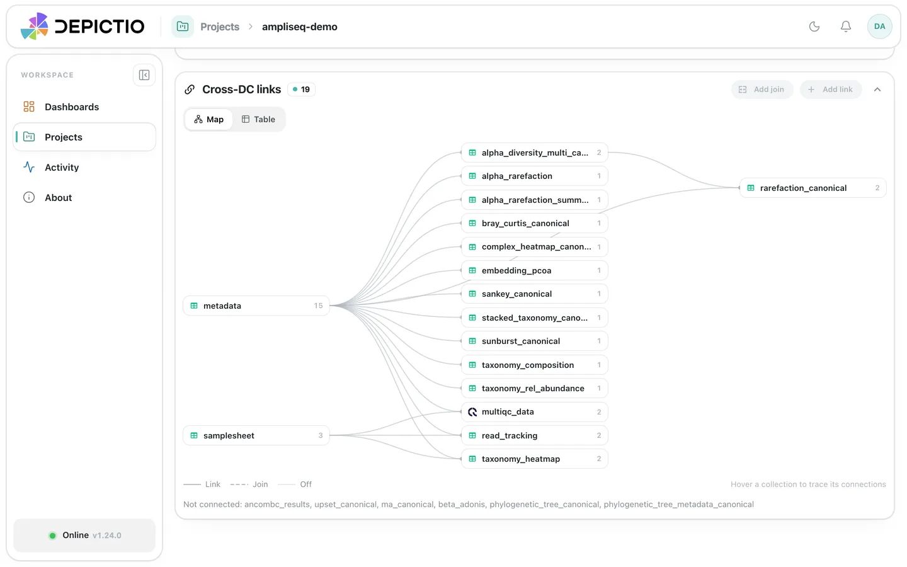{ .ws-shot }

**Activity** shows how the project was filled: here the template of nf-core/ampliseq 2.18.0, **Healthy**, with 11 of 11 required data collections found in the run, and 12 of 12 optional ones. **Runs** reads *This project has no pipeline run yet* for *ampliseq-demo*: it was built from the template, not from a run folder. Episode 3 adds a run.

{ .ws-shot }

As a reader you can look but not change. **Add data**, **Add join**, **Add link** and the actions of each data collection are greyed out, with the tooltip *Owner permission required*. **Project settings** and **Permissions** are for the project's owners. **Create a dashboard** is there for every reader: that is [episode 2](edit-your-copy.md).

{ .ws-shot }

### :material-account-circle: Your profile { #profile }

The avatar at the top right of every page opens **Account settings**: *Your account, password, CLI access and preferences, and the server you are connected to.* Each part has the icon shown here, and opens with a click.

{ .ws-shot }

| Part | What is in it |
|---|---|
| :material-account-circle-outline: **Account** | Your **picture**, email, name, role and **groups**: the groups you are in decide what is shared with you. Click the picture to add or change it; if you sign in with an identity provider such as Google, its picture is used until you add your own. Without one, it shows your initials |
| :material-lock-outline: **Password** | Change the password you sign in with |
| :material-console-line: **CLI agents** | Tokens for the Depictio command line: [Day 2](../workshop-cli/index.md) |
| :material-tune-variant: **Preferences** | **Theme** light or dark; **Look**, *Paper* (panels on a white page, actions in a dock) or *Classic* (a header bar and a tab sidebar); **Font size** of the figures, tables and cards; **Changes since your last visit**, when the marks of what changed clear |
| :material-compass-outline: **Getting started** | **Take the tour** of the page again; **Offer every tour again** |
| :material-server-outline: **Server** | The Depictio version of the server, and links to the documentation and to report an issue |

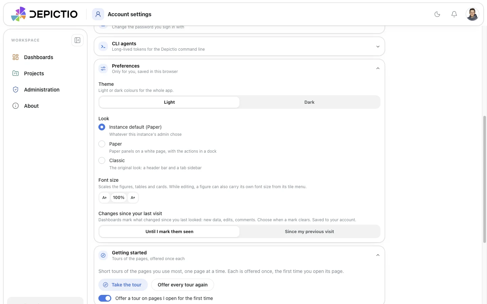{ .ws-shot }

:material-logout: **Sign out** is at the bottom. The **Theme**, **Look** and **Font size** are kept in this browser, for you only; the other settings are kept on your account.

!!! challenge "Try it: your profile"
    Open your profile. Which groups are you in? Which version of Depictio does the server run? Switch the theme to **Dark**, open the **nf-core/ampliseq** dashboard, then come back and switch to **Light**.

    ??? solution "Solution"
        Your groups are listed under **Account**, **Groups**; the optional [project from files](from-a-file.md#share-it-your-group-then-everyone) shares a project with one of them. The version is under **Server**, **Server version**: 1.24.0 on the workshop server. The theme changes the whole app at once, dashboards included. The moon icon at the top right of every page switches it too.

### :material-filter-outline: Pick samples: four ways in { #four-ways }

On this dashboard you pick samples in four ways: the **Filters** panel, rows of a table, points of a figure, markers of a map. The four used here read the sample metadata; the links carry the samples you picked to the other data collections, so every component that reads them follows.

{ .ws-diagram }
{ .ws-diagram }

How links carry a filter: [Cross-DC filtering](../../features/cross-dc-filtering.md).

#### :material-filter-variant: From the Filters panel { #filter-more }

1. Open the **Community & Diversity** tab.
2. The **Filters** panel is open on the left; if it is not, click **Filters**, near the bottom of the left sidebar. Under **Sample filters**, set **Habitat** to *Soil*.
3. Open another tab: the filter is still set. **Sample filters** carries a pin :material-pin:: it is a pinned section, drawn on every tab, so its filters reach every tab. A section without a pin, such as **Community filters** on this tab, belongs to its tab.

To share this view, copy its link: the link icon next to *1 filter active* in the Filters panel, or the gear icon in the header, then **Filters → Share this view**.

!!! challenge "Challenge 1.3: what does the link carry?"
    Copy the link of your filtered view. Clear the filter with the red eraser icon at the top of the Filters panel, then paste the link in a new browser tab. What is filtered?

    ??? solution "Solution"
        *Habitat: Soil* is back, and the Phyla card shows 26 again. The link carries the filters: whoever opens it sees this view, and what they change afterwards does not change yours.

The MultiQC report follows the same filters: a link matches its sample names to the metadata.

1. In **Habitat**, remove *Soil*, then pick *Groundwater*. Habitat takes several values: with *Soil* still in, you get six samples, not three.
2. Open **General Stats** again, with the search. Three samples are left: SRR10070132, the most trimmed sample, beside SRR10070133 and SRR10070141.

#### :material-table: From a table { #select-table }

1. Clear the filter. Open **Overview**, the first tab.
2. At the bottom of Overview, expand the collapsed **Sample sheet** section. Click a row, then hold **Ctrl** (**⌘** on a Mac) and click more rows. The cards at the top follow: **Samples**, **Phyla**, **Shannon diversity**, **Reads kept (%)**. Each reads a different data collection.
3. **Clear selection**, in the table's action row, drops the selection.

The exercise of this section, the least diverse habitat, is a Bonus at the end of [episode 1](view.md).

#### :material-map-marker-multiple: From a map { #select-map }

!!! note "Only if your instructor's dashboard has the Sampling sites map"
    The dashboard built from the nf-core/ampliseq template has seven tabs: Overview, MultiQC, Alpha Diversity, Ordination & Clustering, Community & Diversity, Differential Abundance, Phylogeny. The **Sampling sites** map is only on an extended version of it. Without the map, skip to the next section, [From a figure](#select).

    1. Clear the table's selection. On **Overview**, hover the **Sampling sites** map: its toolbar appears at the top right.
    2. Pick **Lasso Select** and draw around the markers of one site. The cards and **Sample sheet** follow.

    !!! challenge "Challenge 1.5: one site, two habitats"
        Lasso the southernmost site, Pfäffingen. How many samples does the **Samples** card count, and from which habitats?

        ??? solution "Solution"
            4: two *Riverwater* (SRR10070130, SRR10070131) and two *Sediment* (SRR10070149, SRR10070150). The river water and its sediment were sampled at the same place, so their markers sit on top of each other: hovering shows only one.

#### :material-chart-box-outline: From a figure { #select }

!!! note "Only if your instructor's dashboard has the Environment (CTD) tab"
    The **Environment (CTD)** tab is only on the extended version of the dashboard, like the map. Without it, you select points on a figure in the Analysis mode step of [episode 1](view.md#groups), on the PCoA.

    1. Clear any selection. Open **Environment (CTD)**.
    2. On **Temperature × conductivity**, hover the plot, pick **Box Select** in its toolbar and draw a box around a few points. The cards and the **Shannon diversity** figure of the tab follow.

    !!! challenge "Challenge 1.6: the coldest samples"
        Box the three coldest points, near 3 °C. Which habitat are they from, and how diverse?

        ??? solution "Solution"
            *Soil*: SRR10102392, SRR10102393 and SRR10102394, between 3.1 and 3.7 °C. Their Shannon diversity, 8.6 to 8.7, sits between groundwater (about 5.4) and sediment (about 9.4).

!!! callout "Links go one way"
    A link goes from the metadata to the other data collections. A selection on a figure that reads another collection, such as the PCoA on **Ordination & Clustering**, narrows only the components that read that same collection.

!!! callout "How to read a tile"
    The **(i)** next to a tile's title says how to read it and where its data comes from.

{ .ws-shot }

## Episode 3: how a project is built from a run { #episode-3 }

The longer explanations behind [episode 3](from-nf-core-run.md). Read them when you have time.

### :material-sitemap-outline: How it works: template, collections, links { #how-it-works }

1. **Depictio reads `pipeline_info/`.** Every nf-core run writes its own records there. They tell Depictio which pipeline ran, in which version, and how its tasks ended.
2. **It picks the template written for that version.** A **template** is a file that describes the project for one pipeline version. Here it is the template of nf-core/ampliseq 2.18.0. The match is exact, and the checks say so.
3. **The template lists what the project holds.**
    - The **data collections**: for each one, which files of the run it reads. Some are **recipes**: Depictio computes them from several files with a script shipped with the template.
    - The **links** between data collections.
    - The **dashboard**.
4. **Depictio reads the files and builds the project.** Nothing is created before you confirm.

There are two ways to bring the data in:

- **Read in place**: the run stays in its bucket. Depictio stores the tables it builds from it, not the run itself. This is what you do for the run.
- **Upload**: the files are copied into Depictio, and each becomes a data collection. This is what you do for `sampling_sites.tsv`.

You can use both in the same step.

{ .ws-diagram }
{ .ws-diagram }

How Depictio reads remote folders: [Remote data](../../usage/projects/remote-data.md).

### :material-database-import-outline: Where data can come from { #where-data-can-come-from }

In episode 3 you use three ways: a public S3 bucket, an uploaded file and one file by URL. Depictio reads more. The browser and the command line read the same sources: the command line is another interface, not another source (Day 2). The table groups them by where the data is.

| Where the data is | In the browser | From the command line | On the workshop server |
|---|---|---|---|
| **S3 buckets** | | | |
| A public bucket | **Read in place**, **Folder or bucket**: paste the `s3://` location | `depictio ingest s3://bucket/run42` | Used in episode 3: the server is set to read this public bucket |
| A private bucket, with credentials | **Use my own credentials**: access key and secret for that bucket | `depictio ingest`, with the S3 endpoint and keys of the CLI configuration | Not used |
| Another S3-compatible service | Same, with its **Endpoint** | Same, with `endpoint_url` in the CLI configuration | Not used |
| Google Cloud Storage | In progress | In progress | Not used |
| **HTTP** | | | |
| One file, by URL | **Read in place**, **One file URL** | `--bind tag=https://host/data.csv` | Used in the Bonus of episode 3 |
| Many files, listed in a manifest | **From Manifest** | `--manifest <url or path>` | Not used |
| **Your computer** | | | |
| Files or whole folders | **Upload**: drop them, up to 50 MB each | `depictio ingest <folder>` | Used in the Bonus of episode 3 |
| **Command line and pipelines** | | | |
| A results folder, the end of a Nextflow run, or a folder watched for changes | | `depictio ingest`, the Nextflow trigger, `depictio watch` | Day 2 |

!!! note "A folder on the server's own disk"
    Depictio can read a folder on the machine it runs on only when it runs on that machine: `depictio local`, Docker with the disks mounted, or the Python bundle. The workshop server cannot read a folder on its own disk. Use **Upload**, or a bucket.

Details of each case: [Remote data](../../usage/projects/remote-data.md#which-way-to-use).

### :material-hammer-wrench: The Project Builder, for a pipeline with no template { #project-builder }

Day 2 does this hands-on: [Your own tables, no template](../workshop-cli/project-builder.md).

Some pipelines have no template. Then you define the data collections yourself, in the **Project Builder**. The instructor shows it on the shared screen.

1. **Choose how to read the folder.** In **Add data**, under **How should Depictio read this folder?**, pick **Custom workflows**, then click **Open the Project Builder**. A custom workflow has no dashboard to start with.

    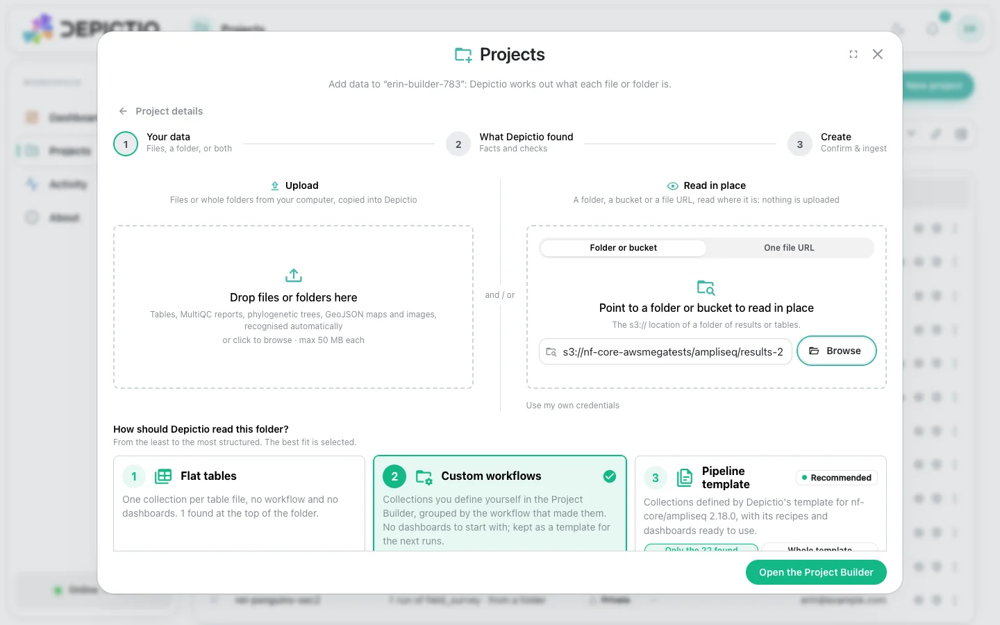{ .ws-shot }

2. **Source & project.** Give the data root: an `s3://` location, with a switch for a bucket that needs credentials. Depictio counts the folders at the top. If it recognises the pipeline, it offers **Start from Ampliseq Microbial Community Analysis**, to keep the template's collections, recipes and dashboards and change only what you need. **Keep building from scratch** ignores the template.

    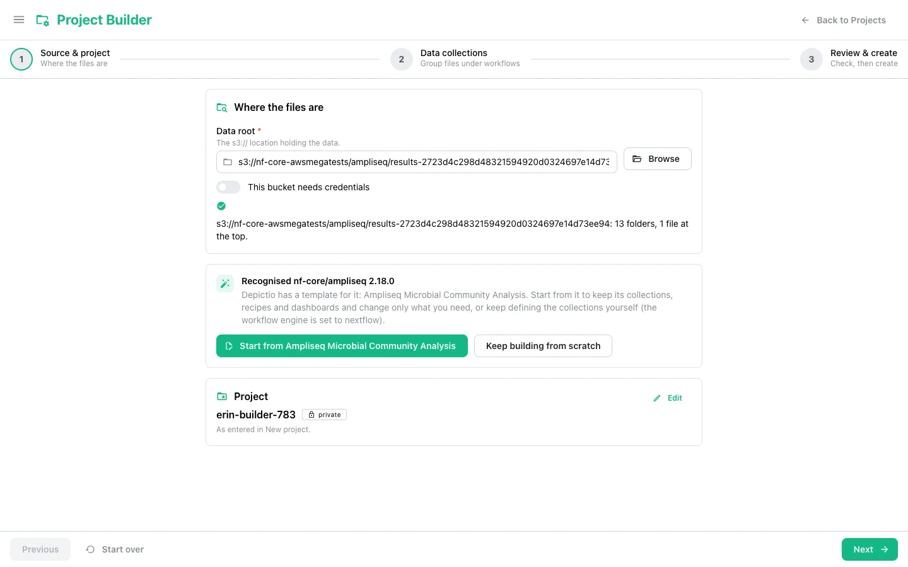{ .ws-shot }

3. **Define a data collection.** The file tree is on the left, the workflows on the right. Click a file, such as `input/Metadata_full.tsv`: its first rows and column types show. Fill in the tag, the workflow and the format, then click **Add to main**. Tick a file's siblings to cover every sample in one scan.

    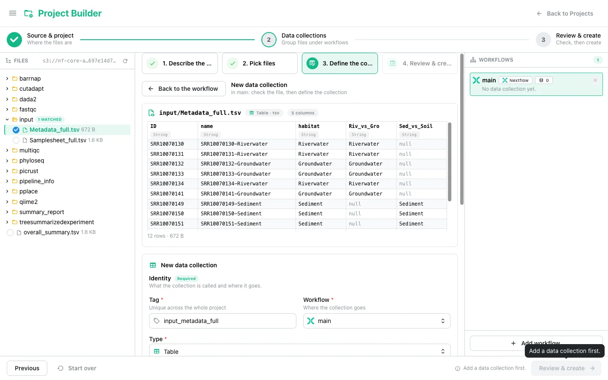{ .ws-shot }

4. **Review and create.** The page lists the data collections per workflow and the links. **Preview the ingestion** is a dry run: nothing is created. **Create project** is available after it. On the right, the project definition as YAML: **Download YAML** saves it, and `depictio ingest <folder or s3://prefix> --template <this file>` reuses it on the next runs. Dashboards are built afterwards, in the editor.

    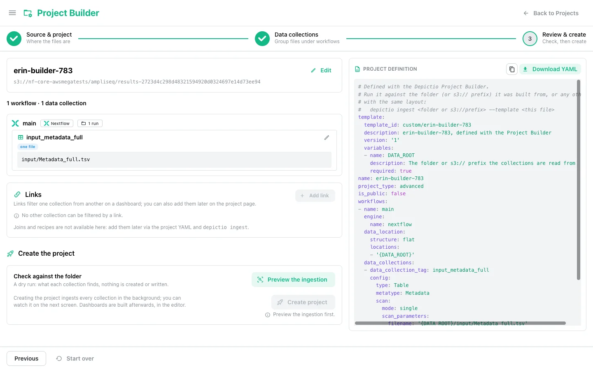{ .ws-shot }

An AI assistant to draft these definitions is planned.

### :material-source-branch: Where your project comes from: template, catalog, Tool Studio { #where-project-comes-from }

The **Differential Abundance** tab of your project comes from two files, which the instructor shows on the shared screen.

| | Where | What it holds |
|---|---|---|
| Template | [`nf-core/ampliseq/2.18.0/template.yaml`](https://github.com/depictio/depictio/blob/main/depictio/projects/nf-core/ampliseq/2.18.0/template.yaml){target=_blank} | The collection `ancombc_results`: which files of the run it reads, and the recipe that reshapes them |
| Tools catalog | [`catalog/qiime2/ancombc.yaml`](https://github.com/depictio/depictio/blob/main/depictio/catalog/qiime2/ancombc.yaml){target=_blank} | The same output, described once for every pipeline that runs ANCOM-BC: the same recipe, and what it renders as |
| Tool Studio | [Tool Studio](../../developer/tool-studio.md) | Where a tool is added to the catalog, in the browser |

More in [Pipeline templates](../../pipeline-templates/nf-core/ampliseq.md) and the [Tools catalog](../../catalog/index.md). To contribute: [a template](../../developer/contributing-templates.md), [a tool](../../developer/contributing-a-tool.md).

### :material-chart-box-multiple-outline: Several MultiQC reports in one collection { #several-multiqc }

Your run in episode 3 has **one** MultiQC report. A MultiQC data collection can hold **several**, for example one per sequencing run or per batch:

- Depictio merges them into **one collection**, and checks that they match: the same modules and the same MultiQC version. If one report differs, it says which one.
- **Linked to the sample sheet** on the sample name, the collection follows the filters of the sheet: a filter on a column of the sheet keeps only those samples in every MultiQC plot, across the reports.
- With a template, nothing changes for you: when the data root holds several run folders, each with its MultiQC report, the template builds one collection from all of them.

Where to read more: [MultiQC in Depictio](../../features/multiqc.md), with [adding reports](../../features/multiqc.md#add-reports), [the link to sample metadata](../../features/multiqc.md#link-to-sample-metadata) and [comparing runs](../../features/multiqc.md#compare-runs).
