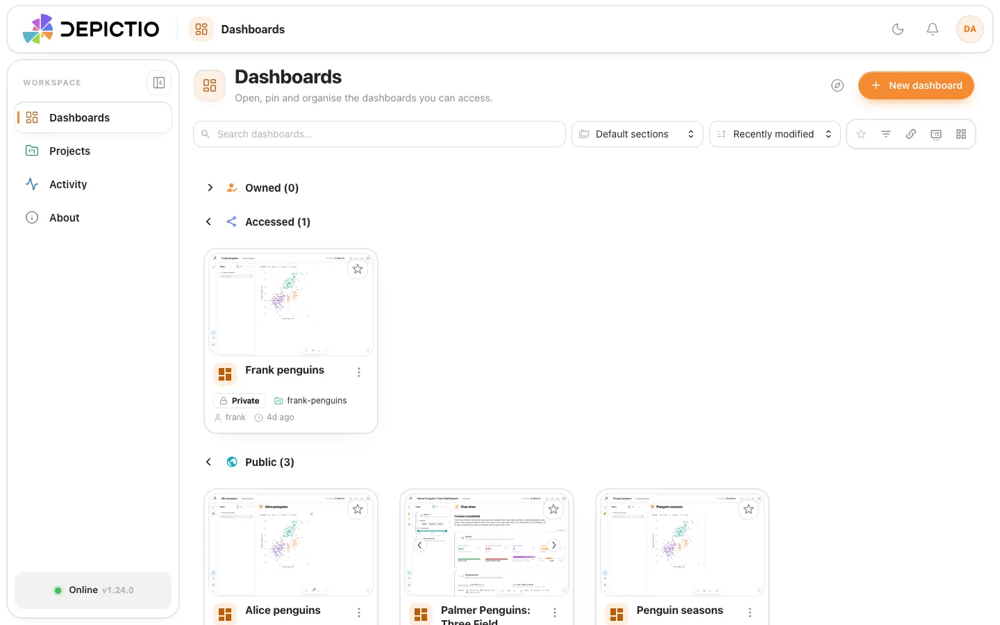
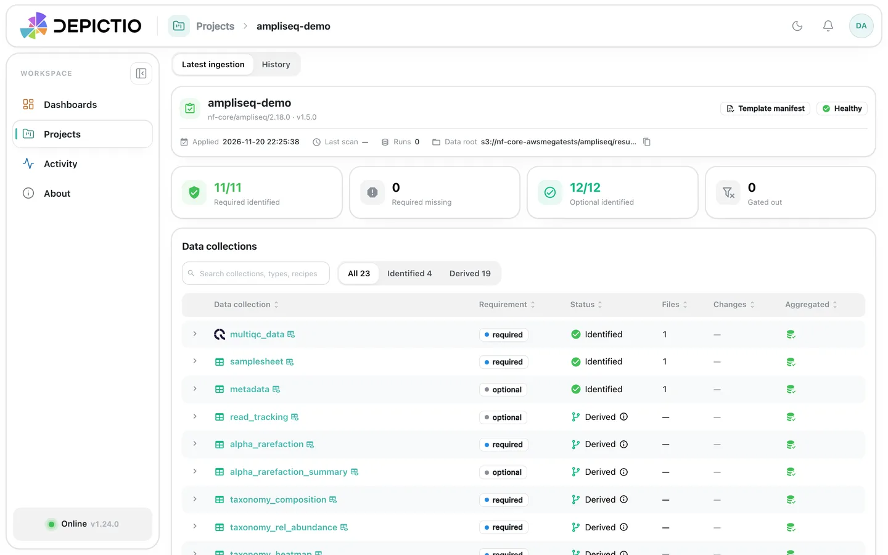
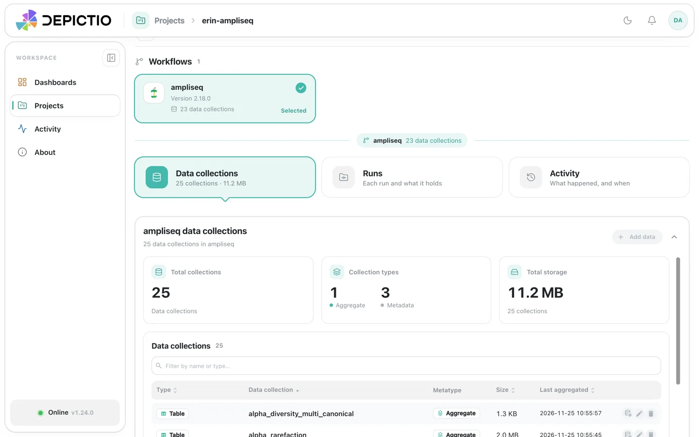
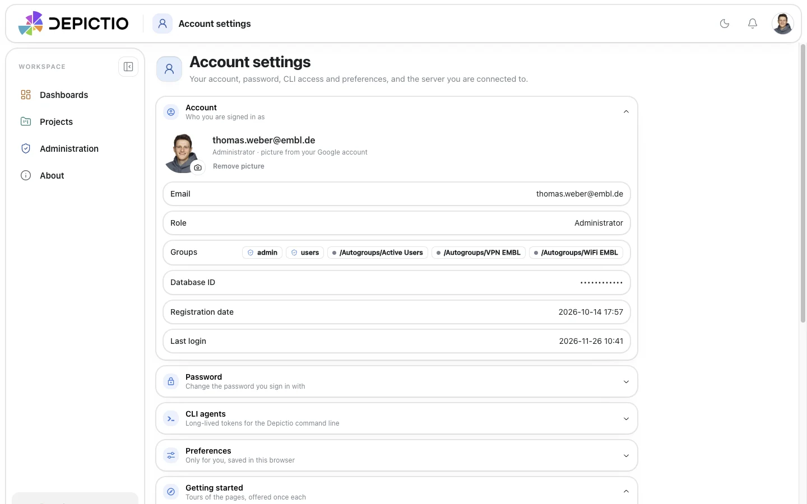
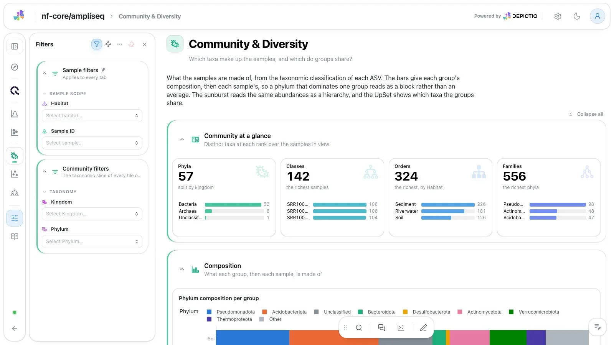

# Reference

:material-book-alphabet: **For learners**

Each concept keeps one colour in every figure of the lesson and of the docs:

{ .ws-diagram }
{ .ws-diagram }

| Word | Meaning | Episode |
|---|---|---|
| :material-jira:{ .ws-ic .ws-ic-project } **Project** | Where the data and its dashboards live, with who can open them. Built from one or more pipeline runs, or from files you add | 0, 3, A |
| :material-table:{ .ws-ic .ws-ic-dc } **Data collection** | One kind of data in a project, read from one file or several. Its type says what it holds: table, MultiQC report, images, phylogenetic tree, genome tracks, GeoJSON… | 0, 3, A |
| :material-link-variant:{ .ws-ic .ws-ic-link } **Link** (Cross-DC link) | Says which identifiers match between two data collections, so that a filter on the source narrows the target. It goes one way. The column names may differ, and a MultiQC report is matched on its sample names. Nothing is copied or merged | 0, A |
| :material-set-center:{ .ws-ic .ws-ic-dc } **Join** | Two table data collections merged, on shared columns, into a new one, `joined_<name>`. The two stay as they are, and the joined table is rebuilt whenever one of them changes. Made in the browser with **Add join**, or written in `project.yaml` (`joins:`) for the command-line client | A, B |
| :material-table-column-plus-after:{ .ws-ic .ws-ic-other } **Add columns** | Copies columns from a file onto an existing table data collection, in place, matched on a column, as a new version of that table. No new table. For owners and editors, on uploaded tables | A |
| :material-view-dashboard:{ .ws-ic .ws-ic-dash } **Dashboard** | A set of components, in tabs, that read the data collections of one project | 1, 2 |
| :material-chart-scatter-plot:{ .ws-ic .ws-ic-other } **Component** | One tile of a dashboard, reading one data collection: figure, table, card, filter, map, text, { .ws-logo .ws-logo-mono .off-glb } MultiQC plot | 2, A |
| :material-folder-play-outline:{ .ws-ic .ws-ic-run } **Run** | One batch of results added to a project: one execution of a pipeline, one upload, one field season. A project can hold several | 3, A, B |
| :material-database-plus-outline:{ .ws-ic .ws-ic-other } **Append** | New rows added to a table with **Manage data**. A new version of the table, not a new run; the joins that read it are rebuilt | B |
| :material-folder-search-outline:{ .ws-ic .ws-ic-other } **Read in place** | Depictio reads the files where they are (S3, a shared folder); nothing is copied | 3 |
| :material-upload:{ .ws-ic .ws-ic-other } **Upload** | The files are copied into Depictio | A |
| :material-file-cog-outline:{ .ws-ic .ws-ic-other } **Template** | What Depictio knows about a pipeline: which outputs to read, how to link them, which dashboard to build | 3 |
| :material-history:{ .ws-ic .ws-ic-version } **Version** | Each change of a table (an edit, an append, **Add columns**) and each save of a dashboard is kept; earlier ones can be shown or restored | A, B |
| :material-clock-outline:{ .ws-ic .ws-ic-you } **What's new** | What changed in a dashboard's data since your last visit | B |
| :material-account-key-outline:{ .ws-ic .ws-ic-other } **Owner, editor, reader** | Who can change a project or dashboard (owner, editor) and who can only open it (reader, *Viewer* on the Permissions page) | 1, 2, A |
| :material-account-multiple-outline:{ .ws-ic .ws-ic-you } **Group** | A named selection of samples, kept in your browser, compared in the cards | 1 |
| :material-account-group-outline:{ .ws-ic .ws-ic-other } **User group** | A set of accounts, created by an administrator. A project shared with it is open to all its members | A |
| :material-earth:{ .ws-ic .ws-ic-other } **Public** | A project every signed-in account can open | A |

## Dashboard tour { #dashboard-tour }

The pages **Dashboards**, **Projects** and your profile, then four ways to pick samples. Both came from episode 1.

Three pages hold everything else: **Dashboards** and **Projects**, in the left sidebar, and your **profile**, behind the avatar at the top right. As a reader you look around them; you create and change nothing there. The rest of the course starts from them.

**Dashboards** and **Projects** each offer a short tour of their controls, the first time you open them. **Take the tour of this page**, the compass icon at the top right, plays it again.

### :material-view-dashboard: Dashboards { #reader-dashboards }

A dashboard is tabs of components that read the data of one project. You see a dashboard when it is public, shared with you or with your group, or yours. After you sign in, Depictio opens **Dashboards**, the list of all of them: *Open, pin and organise the dashboards you can access.* There is one row per dashboard: Title, Category, Project, Owner, Created and Modified.

{ .ws-shot }

**Change the view.** The last icon of the toolbar, **Change view**, switches between two views of the same list:

- **Table**: *sortable columns + bulk select*. Click a column title to sort by it.
- **Thumbnails**: *cards with screenshot previews*, grouped in sections: **Owned**, **Accessed**, **Public**, **nf-core dashboards**. A section you have nothing in, like **Owned** before episode 2, shows *No owned dashboards*.

{ .ws-shot }

Hover a card: a larger preview of the dashboard opens beside it, with its tabs and its first page, before you open it.

{ .ws-shot }

**Find a dashboard.** The toolbar, from left to right:

| Control | What it does |
|---|---|
| Search box | Finds a dashboard by its title |
| **Default sections** | How the list is grouped |
| :material-star-outline: **Toggle favorites filter** | Shows only the dashboards you pinned |
| :material-filter-variant: **Filters** | Narrows the list by template, project, owner, workflow system and visibility |
| :material-link-variant: **Copy a link to this filtered view** | A link to the list as you see it now, to send to someone |
| :material-table-cog: **Table display** | Comfortable or compact rows, and which columns show: 9 of 14 at first |
| **Change view** | Table or Thumbnails |

{ .ws-shot }

The star at the start of a row, **Pin dashboard**, keeps that dashboard at the top of the list. The **Category** badges you meet as a reader:

| Badge | Meaning |
|---|---|
| **Public** | Anyone can open it |
| **Accessed** | Shared with you or with your group |
| **nf-core dashboards** | Built from an nf-core pipeline template |
| **Owned** | Your own dashboard |

**What you can do with a dashboard.** The menu :material-dots-vertical: at the end of each row, **Dashboard actions**: **Open**, **Edit**, **Duplicate**, **Export JSON** and **Delete**. On a dashboard you do not own, **Edit** and **Delete** are greyed out. **Duplicate** gives you your own copy, which you can edit: that is [episode 2](edit-your-copy.md). **Export JSON** saves the dashboard as a JSON file.

{ .ws-shot }

On the workshop server, everyone's copies appear too, named *… (copy)*. Use the search box to find yours, and pin it with the star.

!!! challenge "Try it: the Dashboards page"
    Switch **Dashboards** to **Thumbnails**, then back to **Table**. Pin the **nf-core/ampliseq** dashboard of the project *ampliseq-demo*, then click **Toggle favorites filter**. Which dashboards are left in the list?

    ??? solution "Solution"
        Only the one you pinned. Click **Toggle favorites filter** again to see them all; the pin stays, so this dashboard is now at the top of the list.

### :material-jira: Projects { #reader-projects }

A dashboard reads its data from a **project**: the data of one study, the tables of a pipeline run or of files you upload, with the links between them, the dashboards that read them, and who can use them. One project can have many dashboards. **Projects**, in the left sidebar: *The data behind your dashboards: workflows, data collections and who can use them.* One row per project: Name, Contents (such as *1 run of nf-core/ampliseq 2.18.0 · from S3*), Visibility (**Public** or **Private**), Pipeline and Owner. The first visit offers a short tour, *New to Projects?*, with **Show me around** and **Not now**.

{ .ws-shot }

The toolbar works as on **Dashboards**: search, favorites, **Filters** (by visibility and pipeline), a link to the filtered list, and **Table display**, whose columns include **Your role** and **Members**. At the end of each row: **Open data manager**, **Open permissions**, and the menu **Project actions**: **Edit**, **Export as ZIP** and **Delete**. As a reader, only **Export as ZIP** is open to you.

{ .ws-shot }

**Inside a project.** Click a project's name to open its page. Read it now, or come back to it after [episode 3](from-nf-core-run.md), where you build a project like this one yourself. At the top, a summary: the **pipeline** and its version, the **run**, the **data collections** by type (Table 21, MultiQC 1, Phylo tree 1 for *ampliseq-demo*) and the **source** of the data. Below, two parts:

- **Dashboards**: one card per dashboard built on this project. Click one to open it.
- **Data**: the workflows, then four views.

{ .ws-shot }

| View | What it shows |
|---|---|
| **Data collections** | Each table of the project: its type, name, size and last update |
| **Cross-DC links** | Which data collections are linked, by which column: a map, or a table |
| **Runs** | Each run and what it holds |
| **Activity** | What happened, and when: the last ingestion and the history |

**Cross-DC links** explains what you will see in the hands-on: one filter reaches every tab. In *ampliseq-demo*, `metadata` has 15 connections: a filter on the sample metadata reaches the 15 data collections linked to it, so every figure that reads one of them follows.

{ .ws-shot }

**Activity** shows how the project was filled: here the template of nf-core/ampliseq 2.18.0, **Healthy**, with 11 of 11 required data collections found in the run, and 12 of 12 optional ones. **Runs** reads *This project has no pipeline run yet* for *ampliseq-demo*: it was built from the template, not from a run folder. Episode 3 adds a run.

{ .ws-shot }

As a reader you can look but not change. **Add data**, **Add join**, **Add link** and the actions of each data collection are greyed out, with the tooltip *Owner permission required*. **Project settings** and **Permissions** are for the project's owners. **Create a dashboard** is there for every reader: that is [episode 2](edit-your-copy.md).

{ .ws-shot }

!!! challenge "Challenge: whose project is it?"
    On **Dashboards**, find the nf-core/ampliseq dashboard you will read, and note its **Project**. Open that project from **Projects**. Who owns it? Is it Public or Private? How many data collections does it hold, and which one has the most links?

    ??? solution "Solution"
        The project is *ampliseq-demo*. Its owner is the instructor's account, it is **Public**, and it holds 23 data collections, the ones of the nf-core/ampliseq template. `metadata` has the most links, 15. This is why you can open the dashboard and read its data without owning either.

### :material-account-circle-outline: Your profile { #profile }

The avatar at the top right of every page opens **Account settings**: *Your account, password, CLI access and preferences, and the server you are connected to.* Each part opens with a click.

{ .ws-shot }

| Part | What is in it |
|---|---|
| **Account** | Your **picture**, email, name, role and **groups**: the groups you are in decide what is shared with you. Click the picture to add or change it; if you sign in with an identity provider such as Google, its picture is used until you add your own. Without one, it shows your initials |
| **Password** | Change the password you sign in with |
| **CLI agents** | Tokens for the Depictio command line: [Day 2](../workshop-cli/index.md) |
| **Preferences** | **Theme** light or dark; **Look**, *Paper* (panels on a white page, actions in a dock) or *Classic* (a header bar and a tab sidebar); **Font size** of the figures, tables and cards; **Changes since your last visit**, when the marks of what changed clear |
| **Getting started** | **Take the tour** of the page again; **Offer every tour again** |
| **Server** | The Depictio version of the server, and links to the documentation and to report an issue |

{ .ws-shot }

**Sign out** is at the bottom. The **Theme**, **Look** and **Font size** are kept in this browser, for you only; the other settings are kept on your account.

!!! challenge "Try it: your profile"
    Open your profile. Which groups are you in? Which version of Depictio does the server run? Switch the theme to **Dark**, open the **nf-core/ampliseq** dashboard, then come back and switch to **Light**.

    ??? solution "Solution"
        Your groups are listed under **Account**, **Groups**; the optional [project from files](from-a-file.md#share-it-your-group-then-everyone) shares a project with one of them. The version is under **Server**, **Server version**: 1.24.0 on the workshop server. The theme changes the whole app at once, dashboards included. The moon icon at the top right of every page switches it too.

### :material-filter-outline: Pick samples: four ways in { #four-ways }

On this dashboard you pick samples in four ways: the **Filters** panel, rows of a table, points of a figure, markers of a map. The four used here read the sample metadata; the links carry the samples you picked to the other data collections, so every component that reads them follows.

{ .ws-diagram }
{ .ws-diagram }

How links carry a filter: [Cross-DC filtering](../../features/cross-dc-filtering.md).

#### :material-filter-variant: From the Filters panel { #filter-more }

1. Open the **Community & Diversity** tab.
2. The **Filters** panel is open on the left; if it is not, click **Filters**, near the bottom of the left sidebar. Under **Sample filters**, set **Habitat** to *Soil*.
3. Open another tab: the filter is still set. **Sample filters** carries a pin :material-pin:: it is a pinned section, drawn on every tab, so its filters reach every tab. A section without a pin, such as **Community filters** on this tab, belongs to its tab.

To share this view, copy its link: the link icon next to *1 filter active* in the Filters panel, or the gear icon in the header, then **Filters → Share this view**.

!!! challenge "Challenge 1.3: what does the link carry?"
    Copy the link of your filtered view. Clear the filter with the red eraser icon at the top of the Filters panel, then paste the link in a new browser tab. What is filtered?

    ??? solution "Solution"
        *Habitat: Soil* is back, and the Phyla card shows 26 again. The link carries the filters: whoever opens it sees this view, and what they change afterwards does not change yours.

The MultiQC report follows the same filters: a link matches its sample names to the metadata.

1. In **Habitat**, remove *Soil*, then pick *Groundwater*. Habitat takes several values: with *Soil* still in, you get six samples, not three.
2. Open **General Stats** again, with the search. Three samples are left: SRR10070132, the most trimmed sample, beside SRR10070133 and SRR10070141.

#### :material-table: From a table { #select-table }

1. Clear the filter. Open **Overview**, the first tab.
2. At the bottom of Overview, expand the collapsed **Sample sheet** section. Click a row, then hold **Ctrl** (**⌘** on a Mac) and click more rows. The cards at the top follow: **Samples**, **Phyla**, **Shannon diversity**, **Reads kept (%)**. Each reads a different data collection.
3. **Clear selection**, in the table's action row, drops the selection.

!!! challenge "Challenge 1.4: the least diverse habitat"
    Select the three *Groundwater* rows of **Sample sheet**. What does the **Shannon diversity** card show, before and after?

    ??? solution "Solution"
        About 7.7 for all twelve samples (the card shows the median), about 5.4 for SRR10070132, SRR10070133 and SRR10070141: groundwater is the least diverse habitat of the run.

#### :material-map-marker-multiple: From a map { #select-map }

!!! note "Only if your instructor's dashboard has the Sampling sites map"
    The dashboard built from the nf-core/ampliseq template has seven tabs: Overview, MultiQC, Alpha Diversity, Ordination & Clustering, Community & Diversity, Differential Abundance, Phylogeny. The **Sampling sites** map is only on an extended version of it. Without the map, skip to the next section, [From a figure](#select).

    1. Clear the table's selection. On **Overview**, hover the **Sampling sites** map: its toolbar appears at the top right.
    2. Pick **Lasso Select** and draw around the markers of one site. The cards and **Sample sheet** follow.

    !!! challenge "Challenge 1.5: one site, two habitats"
        Lasso the southernmost site, Pfäffingen. How many samples does the **Samples** card count, and from which habitats?

        ??? solution "Solution"
            4: two *Riverwater* (SRR10070130, SRR10070131) and two *Sediment* (SRR10070149, SRR10070150). The river water and its sediment were sampled at the same place, so their markers sit on top of each other: hovering shows only one.

#### :material-chart-box-outline: From a figure { #select }

!!! note "Only if your instructor's dashboard has the Environment (CTD) tab"
    The **Environment (CTD)** tab is only on the extended version of the dashboard, like the map. Without it, you select points on a figure in the [Analysis mode](view.md#groups) section below, on the PCoA.

    1. Clear any selection. Open **Environment (CTD)**.
    2. On **Temperature × conductivity**, hover the plot, pick **Box Select** in its toolbar and draw a box around a few points. The cards and the **Shannon diversity** figure of the tab follow.

    !!! challenge "Challenge 1.6: the coldest samples"
        Box the three coldest points, near 3 °C. Which habitat are they from, and how diverse?

        ??? solution "Solution"
            *Soil*: SRR10102392, SRR10102393 and SRR10102394, between 3.1 and 3.7 °C. Their Shannon diversity, 8.6 to 8.7, sits between groundwater (about 5.4) and sediment (about 9.4).

!!! callout "Links go one way"
    A link goes from the metadata to the other data collections. A selection on a figure that reads another collection, such as the PCoA on **Ordination & Clustering**, narrows only the components that read that same collection.

!!! callout "How to read a tile"
    The **(i)** next to a tile's title says how to read it and where its data comes from.

{ .ws-shot }
