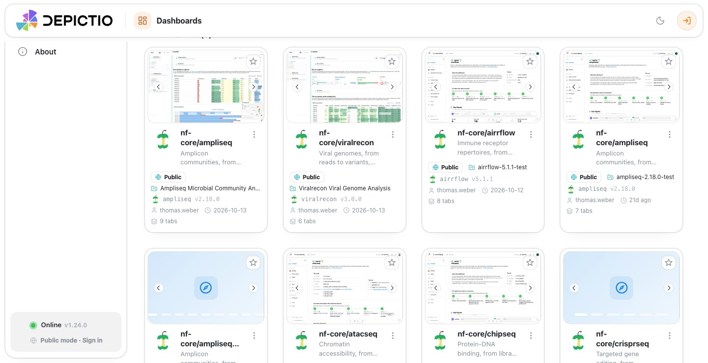

# 4. Showcases

[**0** Setup](get-started.md){ .ws-ep0 } [**1** Read](view.md){ .ws-ep1 } [**2** Edit](edit-your-copy.md){ .ws-ep2 } [**3** From a run](from-nf-core-run.md){ .ws-ep3 } [**4** Showcases](showcases.md){ .ws-ep6 .ws-here } [**+** From files](from-a-file.md){ .ws-ep4 } [**+** New run](new-run-and-versions.md){ .ws-ep5 }

:material-account-eye-outline: **Reader** :material-view-gallery-outline: **42 pipeline templates** :material-timer-outline: **Tour, then 5 min** :material-flag-outline: **After episode 3**

!!! overview "Overview"
    **Objective**: find the dashboard of the nf-core pipeline you use, and read it as you read ampliseq in episode 1.

In episode 3 you built the dashboard of one pipeline, nf-core/ampliseq, from its template. Depictio has a template for **42 nf-core pipelines**, and the **showcases** server shows what each one gives you: a dashboard per pipeline template, built on a test run. The instructor gives a short tour first, then you look for your own pipeline.

## :material-view-gallery-outline: Hands-on 4 · Find your pipeline { #showcases }

1. Open the showcases: [showcases.depictio.embl.org/dashboards](https://showcases.depictio.embl.org/dashboards){target=_blank}. It is the **Dashboards** page you know, in the **Thumbnails** view.
2. Click the search box and type the name of your pipeline, for example `rnaseq`, `sarek` or `ampliseq`.
3. Open its dashboard.
4. Try one filter, as in episode 1: open the **Filters** panel, pick a value, and watch the cards and figures follow.

{ .ws-shot }

!!! question "Check your understanding"
    The dashboards of two different pipelines have the same kinds of components, the same search and the same filters. Why?

    ??? solution "Answer"
        Each dashboard is built from the **template** of a pipeline version: the template lists the data collections, the links between them and the components. Every template uses the same Depictio components, so the interface works the same way for every pipeline.

!!! challenge "Challenge: two MultiQC tabs"
    Open the dashboards of two pipelines. In each, open the **MultiQC** tab. What is the same, and what is different?

    ??? solution "Solution"
        The tab is the same Depictio component, with the same search (**Ctrl+K**) and the same filters. What differs is the content: each pipeline's MultiQC report holds the modules of the tools it ran, so the sections and plots are not the same.

!!! keypoints "Key points"
    - The showcases server has a dashboard for each of the 42 nf-core pipeline templates.
    - A dashboard comes from a template: the same components, filled with the data of one pipeline.
    - You read a showcase as you read ampliseq: search, filters, tabs.

??? note "Bonus · Where the templates come from"
    A template is a file that describes the project of one pipeline version: its data collections, its links and its dashboard. Episode 3 uses the template of nf-core/ampliseq 2.18.0. The showcases use the same mechanism for the other pipelines.

    - The template of ampliseq: [Pipeline templates](../../pipeline-templates/nf-core/ampliseq.md).
    - The outputs of 136 tools that Depictio knows, for pipelines with no template: the [Tools catalog](../../catalog/index.md).
    - To contribute a template: [Contributing a template](../../developer/contributing-templates.md).

[Stuck?Troubleshooting](troubleshooting.md#episode-4){ .ws-help }
[Optional ACreate a project from files](from-a-file.md){ .ws-go .ws-ep4 }

