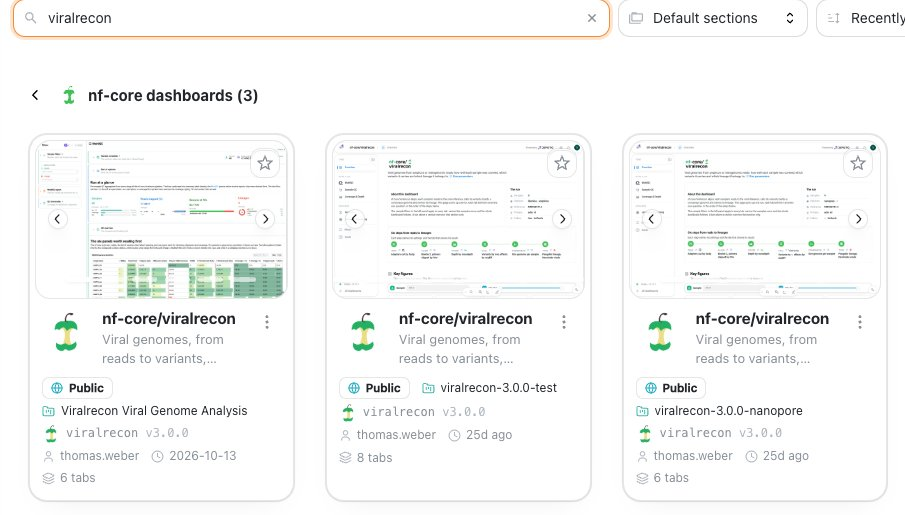
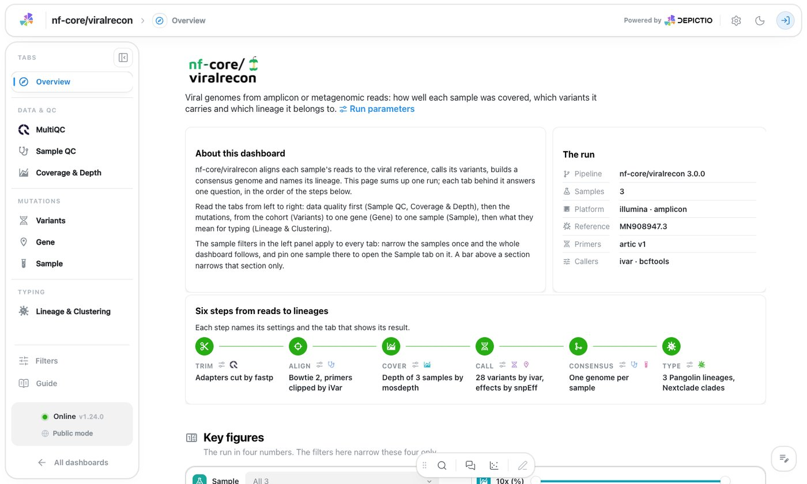
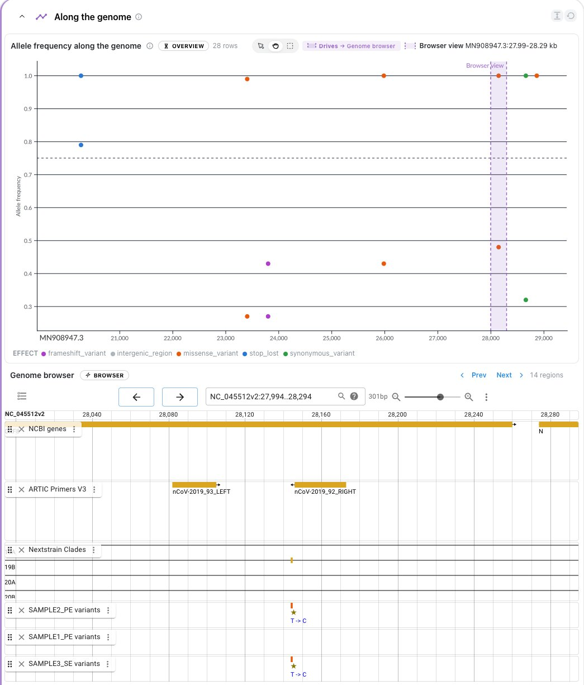
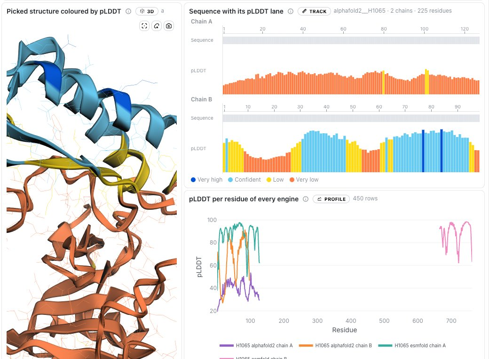
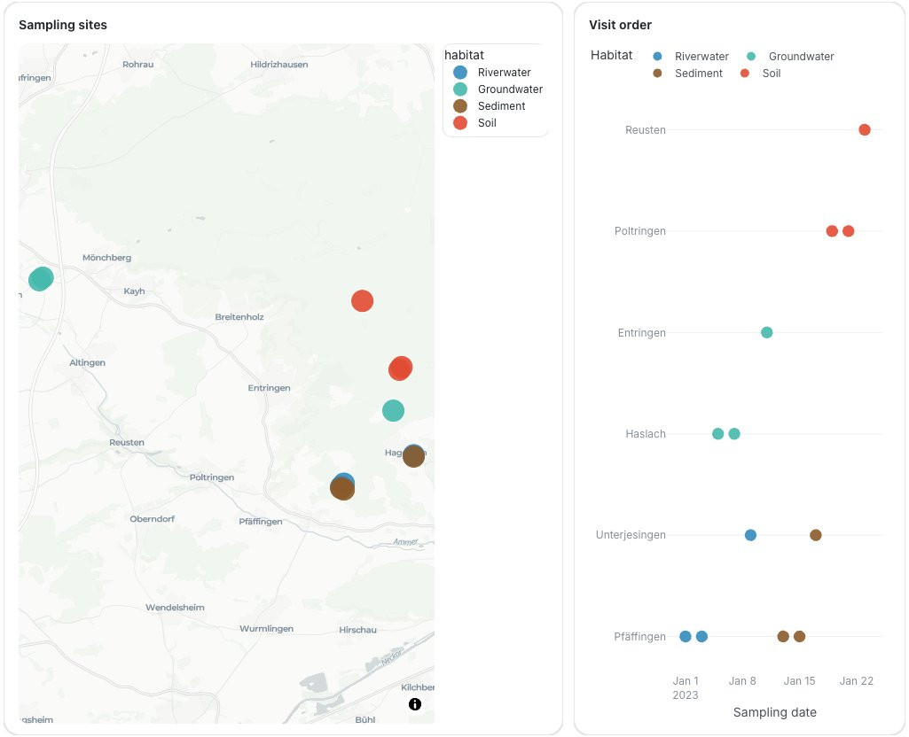
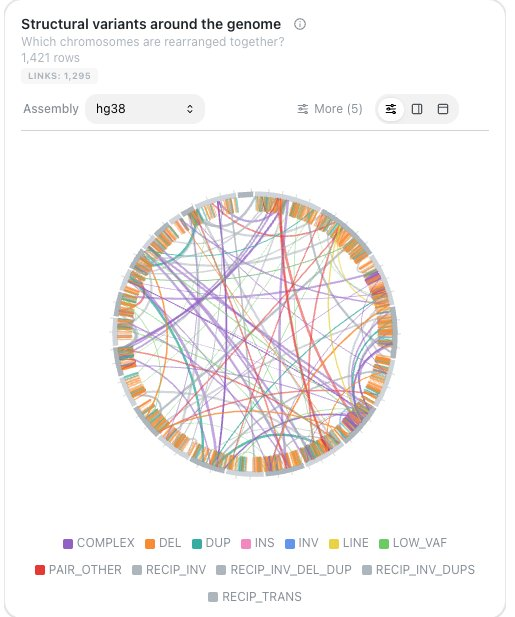
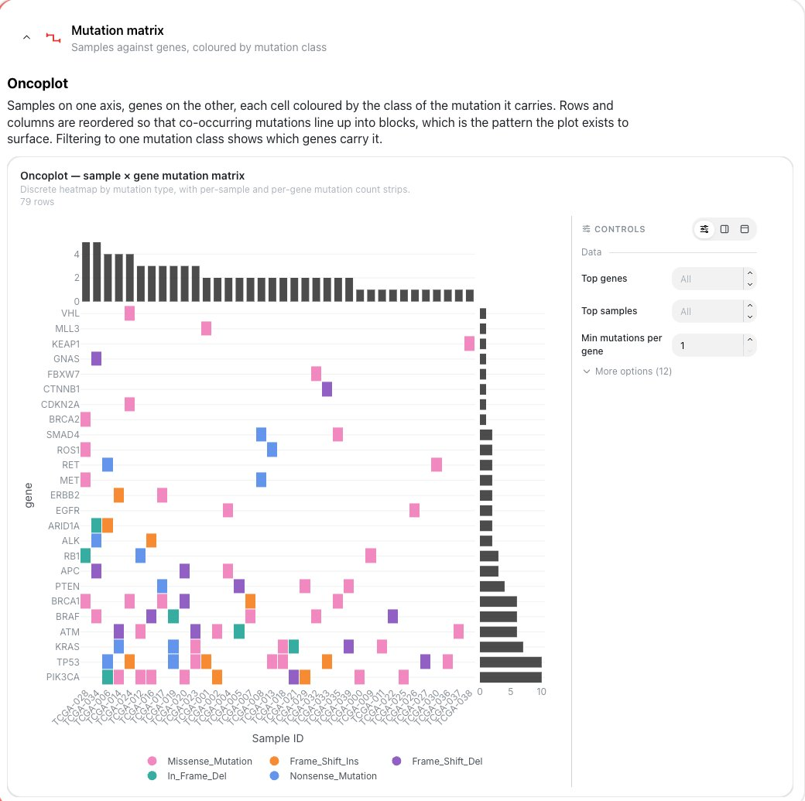
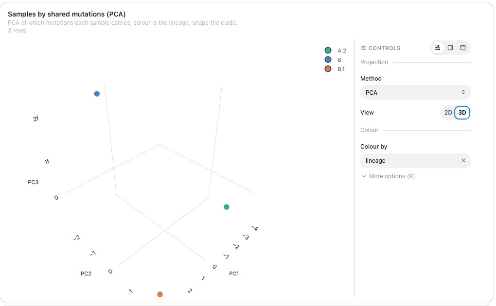

# 4. Showcases

[**0** Setup](get-started.md){ .ws-ep0 } [**1** Read](view.md){ .ws-ep1 } [**2** Edit](edit-your-copy.md){ .ws-ep2 } [**3** From a run](from-nf-core-run.md){ .ws-ep3 } [**4** Showcases](showcases.md){ .ws-ep6 .ws-here } [**+** From files](from-a-file.md){ .ws-ep4 }

:material-account-eye-outline: **Reader** :material-view-gallery-outline: **42 pipeline templates** :material-timer-outline: **Tour, then 5 min** :material-flag-outline: **After episode 3**

!!! overview "Overview"
    **Questions**

    - Is there a dashboard for the pipeline I use?
    - What can a dashboard show beyond bar charts and tables?

    **Objectives**

    - Find a showcase dashboard and explore its tabs.
    - Spot the advanced components: genome browser, 3D structure, map.

In episode 3 you built the dashboard of one pipeline, nf-core/ampliseq, from its template. Depictio has a template for **42 nf-core pipelines**, and the **showcases** server shows what each one gives you: a dashboard per pipeline, built on a test run. The instructor gives a short tour first, then you explore on your own.

## :material-view-gallery-outline: Hands-on 4 · Explore a showcase { #showcases }

**Your task, 5 minutes:** pick a pipeline you have already worked with, for example `rnaseq`, `sarek` or `chipseq`, and explore its showcase. None, or not in the list? Take **nf-core/viralrecon**: the steps below use it. There is no fixed path: open the tabs you like, in the order you like.

1. Open [showcases.depictio.embl.org/dashboards](https://showcases.depictio.embl.org/dashboards){target=_blank} in a new tab. Close the welcome note (**I'll explore on my own**). No sign-in is needed: the server is read-only. At the right of the search box, click the view button and pick **Thumbnails**: one card per dashboard.
2. In the search box, type the name of your pipeline, or `viralrecon`. For viralrecon, open the card of the project **viralrecon-3.0.0-test** (8 tabs).
3. Read the **Overview** tab first: it says what each tab answers. Then open any tab from the left panel. They follow the steps of the pipeline, from quality to results.
4. In each tab, scroll down and play: hover a point, click a row of a table, open the **Filters** panel and try one filter, as in episode 1.
5. Look for what you have not seen in the earlier episodes, and post one in the Zoom chat: the tab and the title of the component.

{ .ws-shot }

{ .ws-shot }

!!! challenge "Challenge: what did you notice?"
    Some components do more than a bar chart or a table. Which ones did you find? In which pipeline and which tab?

    ??? solution "Solution"
        The most advanced ones are a **genome browser**, a **3D structure** and a **map**. Four of them, from the showcases:

        | | |
        |---|---|
        | { .ws-shot } | { .ws-shot } |
        | **Genome browser.** nf-core/viralrecon, tab **Variants**: click a dot of the plot, or a row of the table, and the browser opens that position, with the primers and the variants of each sample. | **3D structure.** nf-core/proteinfold, tab **Structure**: click a row of the table and the structure opens in 3D, coloured by confidence. |
        | { .ws-shot } | { .ws-shot } |
        | **Map.** nf-core/ampliseq (copy), tab **Sampling Campaign**: one marker per sample, and a click on a marker filters the dashboard to that sample. | **Chord diagram.** nf-core/oncoanalyser, tab **Structural variants**: each line joins the two ends of a rearrangement. |

        More of them, by pipeline and tab:

        | Component | Pipeline · tab |
        |---|---|
        | Genome browser | viralrecon · Variants. sarek, atacseq, chipseq, cutandrun, drop · Locus. rnavar · Genome. rnaseq · Gene Explorer. oncoanalyser · Small variants |
        | 3D | proteinfold · Structure, Predicted error. viralrecon · Lineage & Clustering (the PCA: see the Bonus) |
        | Map | ampliseq (copy) · Sampling Campaign |
        | Phylogenetic tree | ampliseq · Phylogeny |
        | Sankey diagram | viralrecon · Lineage & Clustering. mag · Taxonomy |
        | Sunburst | mag · Taxonomy. ampliseq · Community & Diversity |
        | Lollipop plot | viralrecon · Gene. sarek · Protein |
        | UMAP, with lasso | scrnaseq · Embeddings |

        The server also has a dashboard called **Advanced Visualisations**: a gallery of 29 figure types, one per tab, such as Volcano, Manhattan, Oncoplot, ComplexHeatmap, UpSet and Coverage track.

        { .ws-shot }

        We did not find a network graph on the showcases.

!!! keypoints "Key points"
    - The showcases server has a dashboard for each of the 42 nf-core pipeline templates.
    - A dashboard comes from a template: the same interface (tabs, filters, search), filled with the data of one pipeline.
    - Beyond charts and tables, a dashboard can hold a genome browser, a 3D structure or a map, and they follow the filters like any other card.

??? note "Bonus · Make a plot 3D"
    In the **Lineage & Clustering** tab of viralrecon, scroll down to **Samples by shared mutations (PCA)**. In its controls, at the right, switch **View** from **2D** to **3D**. Then drag the plot.

    ??? solution "Solution"
        The same samples are now placed on three axes, PC1, PC2 and PC3, and you can rotate them.

        { .ws-shot }

[OptionalCreate a project from files](from-a-file.md){ .ws-go .ws-ep4 }

