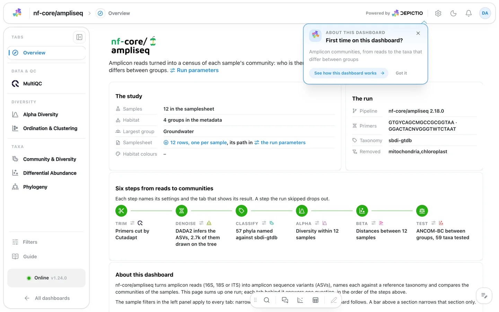
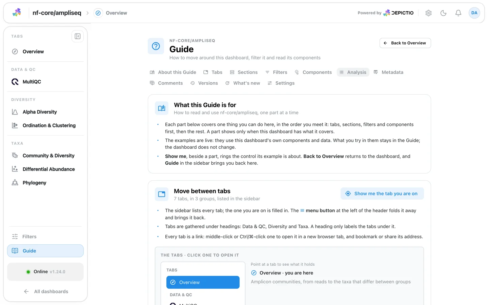

# 1. Read a shared dashboard

[**0** Setup](get-started.md){ .ws-ep0 } [**1** Read](view.md){ .ws-ep1 .ws-here } [**2** Edit](edit-your-copy.md){ .ws-ep2 } [**3** From a run](from-nf-core-run.md){ .ws-ep3 } [**4** Showcases](showcases.md){ .ws-ep6 } [**+** From files](from-a-file.md){ .ws-ep4 }

:material-account-eye-outline: **Reader** :material-database-outline: **nf-core/ampliseq** :material-timer-outline: **Hands-on 1 · 10 min** :material-flag-outline: **After episode 0**

!!! overview "Overview"
    **Questions**

    - How do I check the quality of a run before reading its results?
    - How do I narrow a dashboard to the samples I care about?
    - How do I compare two groups of samples?

    **Objectives**

    - Open the Guide of a dashboard and use its **Show me** buttons.
    - Find a MultiQC value with the dashboard search.
    - Filter the dashboard on a habitat.
    - Save two groups in **Analysis** mode and compare them.

Open **nf-core/ampliseq** from **Dashboards**. You are a **reader**: you cannot change the dashboard or its data, and what you do changes only your own view.

## :material-book-open-variant: Hands-on 1 · Step 1: open the Guide { #guide }

Every dashboard comes with a **Guide**: one page that explains how to move around it, filter it and read its components. We do this step together, live.

1. In the left sidebar, under **Filters**, click **Guide**.
2. In any part, click **Show me**, for example **Show me the filter**: it rings the control in a small working example. What you try there does not change the dashboard.
3. Click **Back to Overview**, at the top right.

{ .ws-shot }

## :material-magnify: Step 2: the quality of the run { #multiqc }

Before reading the results, check the run. The { .ws-logo .ws-logo-mono .off-glb } MultiQC report of the pipeline is on the dashboard.

1. Press **Ctrl+K** (**⌘K** on a Mac), or click the magnifier :material-magnify: **Search this dashboard** in the bottom toolbar. The search covers every tile of every tab and opens the tab that holds what you pick.
2. Type *General Stats* and open it.
3. In the column **Trimmed bases** (cutadapt, % of base pairs trimmed): which sample was trimmed the most?

{ .ws-shot }

??? solution "Answer"
    SRR10070132: 13.9 % of its bases trimmed, against 9.3 to 11.8 % for the other samples. It is a groundwater sample.

## :material-filter-variant: Step 3: filter on a habitat { #filter }

1. Open the **Community & Diversity** tab.
2. The **Filters** panel is open on the left; if it is not, click **Filters**, near the bottom of the left sidebar. Under **Sample filters**, set **Habitat** to *Soil*.
3. Read the **Phyla** card. How many phyla with the filter, and how many without?

{ .ws-shot }

??? solution "Answer"
    26 with *Soil*, 57 without. The card reads the taxonomy, another data collection than the metadata: the link carries the three soil samples to it.

## :material-chart-scatter-plot: Step 4: Analysis mode, two groups, then Compare { #groups .ws-analysis }

**Analysis**, in the bottom toolbar, keeps selections as named groups and compares them. Groups are kept in your browser: nobody else sees them. First clear the Habitat filter (the red eraser icon at the top of the Filters panel).

1. Open **Ordination & Clustering**, then click **Analysis** in the bottom toolbar.
2. On the PCoA, pick **Box select** in the figure's toolbar and box the water samples: the six points on the left (hover a point to read its sample ID). Scroll down the **Analysis** panel to type the group's name, then click **Save group**.
3. Box-select the soil and sediment samples together, and save them as a second group.
4. Turn on **Compare groups in cards**, then open **Alpha Diversity**. Each card now shows one value per group, beside **All**.

{ .ws-shot }

!!! question "Check your understanding"
    You filtered on **Habitat**, a column of the sample metadata, yet the **Phyla** card, which reads the taxonomy, changed. Why? Which of your two actions, the filter or a selection on a figure, reached the other tabs?

    ??? solution "Answer"
        The metadata is linked to the other data collections: the link carries the picked samples to every component that reads them. **Sample filters** carries a pin :material-pin:, so its filters reach every tab. A selection, such as a box on the PCoA, acts on its own tab only.

!!! challenge "Challenge: compare two groups"
    Do your two groups differ in diversity? Read the cards of **Alpha Diversity**, then say which group is the more diverse, and by how much.

    ??? solution "Solution"
        The answer depends on your groups. On **Alpha Diversity**, each card shows one value per group beside **All**: start with the Shannon diversity card. To see why, colour a figure by your groups: the **Analysis** panel does it for every figure at once.

!!! keypoints "Key points"
    - A dashboard is made of components, grouped in sections, on tabs: filters on the left, a bottom bar for search, comments, Analysis and Edit.
    - Check the run first: the dashboard search finds a MultiQC plot on any tab.
    - A filter of a pinned section reaches every tab. From the metadata, the links carry the picked samples to every data collection, MultiQC included.
    - **Analysis** keeps selections as groups and compares them in the cards; groups stay in your browser.
    - As a reader, the dashboard and its data are read only. Others see your view only through a view link.

??? note "Bonus · What this episode covers in full"
    !!! overview "Overview"
        **Questions**

        - What is a dashboard made of, and where do I find how it works?
        - Where are the dashboards and the projects I can read, and my own settings?
        - Why Depictio after a pipeline, rather than a static report or an app coded from scratch?
        - How do I check the quality of the run before reading its results?
        - How do I narrow a dashboard to the samples I care about?
        - How do I compare two groups of samples?
        - What do others see of what I do?

        **Objectives**

        - Name the parts of a dashboard: tabs, filters, sections, components, bottom bar.
        - Open the Guide of a dashboard, and use its **Show me** buttons.
        - Find, pin and open a dashboard in **Dashboards**, in a table or as thumbnails.
        - Read a project in **Projects**: its data collections, the links between them, its activity.
        - Find your groups and your preferences in your profile.
        - Find a MultiQC value with the dashboard search.
        - Filter a dashboard, MultiQC included, and share the filtered view.
        - Pick samples from a table, a map and a figure, and see the other data collections follow.
        - Save two groups and compare them in the cards.
        - Leave a comment on a figure (now on Day 2).

    The timed hands-on is the four steps above. The Bonus blocks below hold the rest: why Depictio comes after a pipeline, how it compares, the anatomy of a dashboard and the Guide in detail. The pages **Dashboards**, **Projects** and your profile, and four ways to pick samples, are in the [Reference](reference.md#dashboard-tour).

??? note "Bonus · Why Depictio: the step after the pipeline"
    ### :material-transit-connection-variant: Why Depictio: the step after the pipeline { #why }

    A pipeline usually stops at its outputs: files opened one by one, a static HTML report, or an app coded from scratch for one dataset. Depictio is the step after: **one platform, reused and standardised across pipelines**, with the same tools while you build the dashboard and after you share it: with collaborators, with everyone, or as one HTML file that opens without a server, as a MultiQC report does.

    { .ws-diagram }
    { .ws-diagram }

    You see each of them today: editing in [episode 2](edit-your-copy.md), versions on [Day 2](../workshop-cli/collaborate-and-export.md#versions), sharing in the optional [project from files](from-a-file.md#share-it-your-group-then-everyone), templates in [episode 3](from-nf-core-run.md). 42 nf-core pipelines have a template; the Tools catalog maps 471 outputs of 136 tools to components.

    
Templates: Depictio documentation; tools and outputs: Depictio code; both November 2026.

??? note "Bonus · How it compares with a report, a spreadsheet and your own code"
    ### :material-scale-balance: How it compares { #how-it-compares }

    An app written with Streamlit, Shiny or Dash is code: you write it, run it and maintain it. A Depictio dashboard is a description of components, which Depictio draws. Two things follow.

    **Flexibility**

    - You change a dashboard in the interface, or as YAML. Every save is a version you can go back to.
    - There is no code to maintain. A filter or a selection reaches the components that read the same data, linked collections included, without callbacks to write.

    **Reuse**

    - One template per pipeline version builds the same dashboard for any run of that pipeline.
    - A dashboard is copied, shared and exported.

    Compared, as a reader, with a static report, a spreadsheet and your own code:

    

    | As a reader, you can… | :material-file-document-outline: Static HTML report | :material-table-large: Spreadsheet | :material-code-braces: Your code, an app | { .ws-logo .off-glb } Depictio | Try it |
    |---|:-:|:-:|:-:|:-:|---|
    | Filter every view at once: MultiQC, tables, figures | Within some reports | :material-close-thick:{ .ws-no } | If you code it | :material-check-bold:{ .ws-yes } | [Filter](#filter) |
    | Pick samples on a table, a figure or a map | :material-close-thick:{ .ws-no } | Rows only | If you code it | :material-check-bold:{ .ws-yes } | [Four ways](reference.md#four-ways) |
    | Send the filtered view as a link | :material-close-thick:{ .ws-no } | :material-close-thick:{ .ws-no } | If you code it | :material-check-bold:{ .ws-yes } | [Challenge 1.3](reference.md#filter-more) |
    | Define your own groups and compare them | :material-close-thick:{ .ws-no } | By hand | If you code it | :material-check-bold:{ .ws-yes } | [Analysis mode](#groups) |
    | Comment on a figure | :material-close-thick:{ .ws-no } | On cells | If you code it | :material-check-bold:{ .ws-yes } | [Day 2](../workshop-cli/collaborate-and-export.md#comment-and-annotate) |
    | Open it as one file, without a server | :material-check-bold:{ .ws-yes } | :material-check-bold:{ .ws-yes } | If you code it | :material-check-bold:{ .ws-yes } | |

    

??? note "Bonus · Anatomy of a dashboard"
    ### :material-view-dashboard-outline: Anatomy of a dashboard { #anatomy }

    A dashboard is made of components, grouped in sections, on tabs. The numbers mark each part on the **Community & Diversity** tab of the nf-core/ampliseq dashboard.

    { .ws-shot }

    <ol class="ws-ann-legend">
    <li><strong>Tabs</strong>: one per question, on the left.</li>
    <li><strong>Filters</strong>: pinned sections reach every tab.</li>
    <li><strong>The tab's question</strong>: and how to read it.</li>
    <li><strong>Sections</strong>: group the components.</li>
    <li><strong>Components</strong>: cards, figures, tables, MultiQC.</li>
    <li><strong>Bottom bar</strong>: search, comments, Analysis, Edit.</li>
    </ol>

??? note "Bonus · The Guide in detail"
    Every dashboard comes with a **Guide**: a page that explains how to move around it, filter it and read its components. Look at it before the hands-on: it answers most of the "where is…?" questions you will have.

    The first time you open a dashboard, a box **About this dashboard** asks *First time on this dashboard?*. It shows the dashboard's one-line description and two buttons: **See how this dashboard works** and **Got it**.

    { .ws-shot }

    **See how this dashboard works** opens the Guide. You can open it again at any time, from **Guide** in the left sidebar, under **Filters**.

    The Guide is one page, *Guide — How to move around this dashboard, filter it and read its components*. It is not a tour: there are no steps and nothing to dismiss. It is a column of parts, listed at the top: About this Guide, Tabs, Sections, Filters, Components, Analysis, Metadata, Comments, Versions, What's new and Settings. A part only appears when the dashboard has what it covers.

    { .ws-shot }

    Each part has a short explanation, a small working example built from this dashboard's own components and data, and a **Show me** button, such as **Show me the filter**, that rings the control in the example. What you try in the examples stays in the Guide: the dashboard does not change.

    { .ws-shot }

    **Back to Overview**, at the top right of the Guide, returns to the dashboard.

    !!! challenge "Try it: the Guide"
        Open the **nf-core/ampliseq** dashboard from **Dashboards**, then open the Guide. Go to the part **Filters**, click **Show me**, then click **Back to Overview**. Which two places open the Guide?

        ??? solution "Solution"
            The box shown the first time you open a dashboard (**See how this dashboard works**), and **Guide** in the left sidebar, under **Filters**. If you clicked **Got it** and the box is gone, the sidebar entry is still there.

The tour of **Dashboards**, **Projects** and your profile, and the four ways to pick samples, are in the [Reference](reference.md#dashboard-tour).

??? note "Bonus · You are a reader: what is yours, what is shared"
    Someone shared a finished dashboard with you: you are a **reader**. You cannot change the dashboard or its data. You can filter it, select samples and compare groups: that changes only your own view. Your filters and selections are kept for your account, in any browser you sign in on; your groups stay in this browser. Others see your view only if you send them its link.

    { .ws-diagram }
    { .ws-diagram }

    <figure markdown="span" class="ws-media"><video autoplay controls muted loop playsinline poster="../../../images/tutorials/workshop/filter.webp" src="../../../images/tutorials/workshop/filter.mp4"></video></figure>

    Open **nf-core/ampliseq** from **Dashboards**.

??? note "Bonus · Analysis mode: the video, and colouring by a column"
    **Analysis**, in the bottom toolbar, keeps selections as named groups and compares them. Groups are kept in your browser: nobody else sees them. Unlike a selection, a group reaches every data collection, even from the PCoA: groups also follow the links backwards.

    <figure markdown="span" class="ws-media"><video autoplay controls muted loop playsinline poster="../../../images/tutorials/workshop/groups.webp" src="../../../images/tutorials/workshop/groups.mp4"></video></figure>

    !!! further "Going further"
        In the **Analysis** panel, **Color figures by → A column → habitat** colours every figure by a column of the sample metadata.

??? note "Bonus · Metadata mode and Comments"
    Labelling samples in **Metadata** mode and leaving a **comment** on a figure are now part of Day 2: [Collaborate and export](../workshop-cli/collaborate-and-export.md).

[Stuck?Troubleshooting](troubleshooting.md#episode-1){ .ws-help }
[Next episode2. Make your own copy and edit it](edit-your-copy.md){ .ws-go .ws-ep2 }

