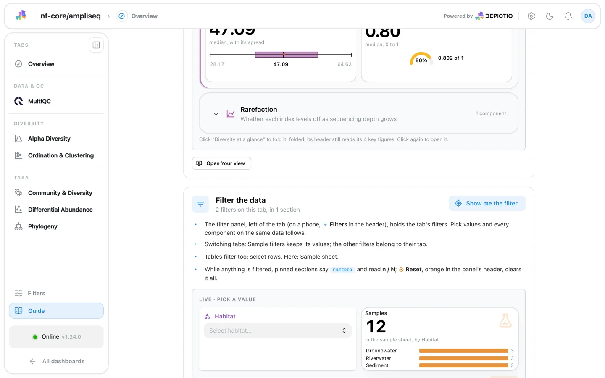
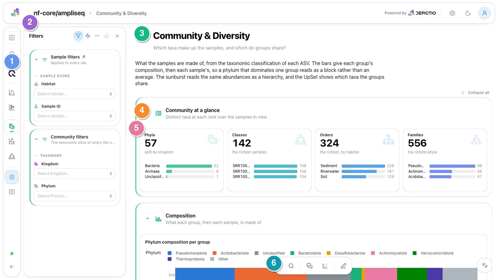
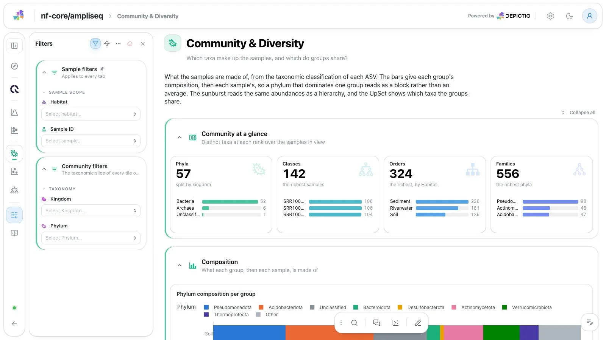
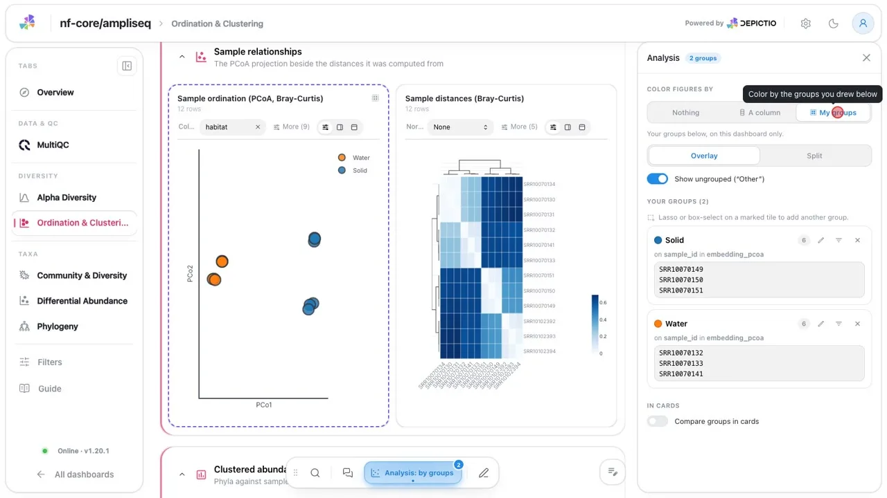
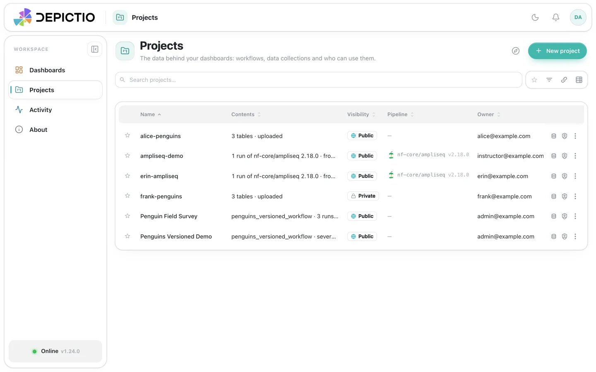
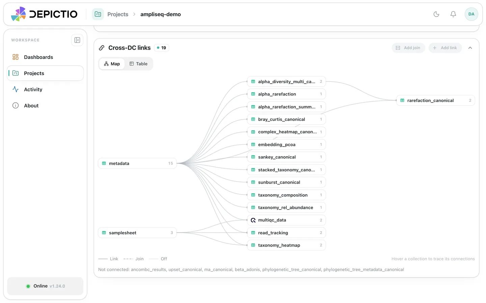
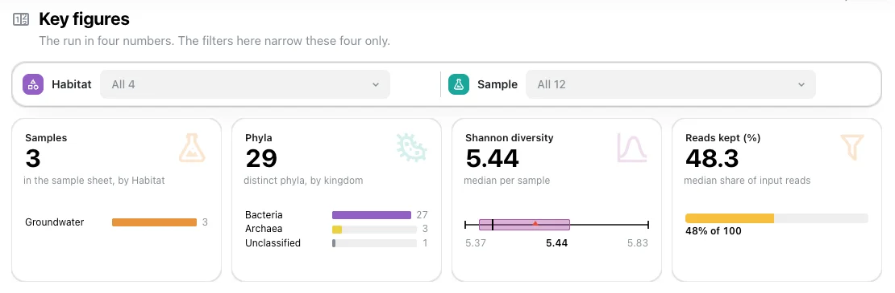

# 1. Read a shared dashboard

[**0** Setup](get-started.md){ .ws-ep0 } [**1** Read](view.md){ .ws-ep1 .ws-here } [**2** Edit](edit-your-copy.md){ .ws-ep2 } [**3** From a run](from-nf-core-run.md){ .ws-ep3 } [**4** Showcases](showcases.md){ .ws-ep6 } [**+** From files](from-a-file.md){ .ws-ep4 }

:material-account-eye-outline: **Reader** :material-database-outline: **nf-core/ampliseq** :material-timer-outline: **Hands-on 1 · 10 min** :material-flag-outline: **After episode 0**

!!! overview "Overview"
    **Questions**

    - How do I check the quality of a run before reading its results?
    - How do I narrow a dashboard to the samples I care about?
    - How do I compare two groups of samples?

    **Objectives**

    - Open the Guide of a dashboard and use its **Show me** buttons.
    - Find a MultiQC value with the dashboard search.
    - Filter the dashboard on a habitat.
    - Save two groups in **Analysis** mode and compare them.

Open **nf-core/ampliseq** from **Dashboards**. You are a **reader**: you cannot change the dashboard or its data, and what you do changes only your own view.

## :material-book-open-variant: Hands-on 1 · Step 1: open the Guide { #guide }

Every dashboard comes with a **Guide**: one page that explains how to move around it, filter it and read its components. We do this step together, live.

1. In the left sidebar, under **Filters**, click **Guide**.
2. In any part, click **Show me**, for example **Show me the filter**: it rings the control in a small working example. What you try there does not change the dashboard.
3. Click **Back to Overview**, at the top right.

{ .ws-shot }

## :material-magnify: Step 2: the quality of the run { #multiqc }

Before reading the results, check the run. The { .ws-logo .ws-logo-mono .off-glb } MultiQC report of the pipeline is on the dashboard.

1. Press **Ctrl+K** (**⌘K** on a Mac), or click the magnifier :material-magnify: **Search this dashboard** in the bottom toolbar. The search covers every tile of every tab and opens the tab that holds what you pick.
2. Type *General Stats* and open it.
3. In the column **Trimmed bases** (cutadapt, % of base pairs trimmed): which sample was trimmed the most?

{ .ws-shot }

??? solution "Answer"
    SRR10070132: 13.9 % of its bases trimmed, against 9.3 to 11.8 % for the other samples. It is a groundwater sample.

## :material-filter-variant: Step 3: filter on a habitat { #filter }

1. Open the **Community & Diversity** tab.
2. The **Filters** panel is open on the left; if it is not, click **Filters**, near the bottom of the left sidebar. Under **Sample filters**, set **Habitat** to *Soil*.
3. Read the **Phyla** card. How many phyla with the filter, and how many without?

{ .ws-shot }

??? solution "Answer"
    26 with *Soil*, 57 without. The card reads the taxonomy, another data collection than the metadata: the link carries the three soil samples to it.

## :material-chart-scatter-plot: Step 4: Analysis mode, two groups, then Compare { #groups .ws-analysis }

**Analysis**, in the bottom toolbar, keeps selections as named groups and compares them. Groups are kept in your browser: nobody else sees them. First clear the Habitat filter (the red eraser icon at the top of the Filters panel).

1. Open **Ordination & Clustering**, then click **Analysis** in the bottom toolbar.
2. On the PCoA, pick **Box select** in the figure's toolbar and box the water samples: the six points on the left (hover a point to read its sample ID). Scroll down the **Analysis** panel to type the group's name, then click **Save group**.
3. Box-select the soil and sediment samples together, and save them as a second group.
4. Turn on **Compare groups in cards**, then open **Alpha Diversity**. Each card now shows one value per group, beside **All**.

{ .ws-shot }

!!! question "Check your understanding"
    You filtered on **Habitat**, a column of the sample metadata, yet the **Phyla** card, which reads the taxonomy, changed. Why? Which of your two actions, the filter or a selection on a figure, reached the other tabs?

    ??? solution "Answer"
        The metadata is linked to the other data collections: the link carries the picked samples to every component that reads them. **Sample filters** carries a pin :material-pin:, so its filters reach every tab. A selection, such as a box on the PCoA, acts on its own tab only.

!!! challenge "Challenge: compare two groups"
    Do your two groups differ in diversity? Read the cards of **Alpha Diversity**, then say which group is the more diverse, and by how much.

    ??? solution "Solution"
        The answer depends on your groups. On **Alpha Diversity**, each card shows one value per group beside **All**: start with the Shannon diversity card. To see why, colour a figure by your groups: the **Analysis** panel does it for every figure at once.

!!! keypoints "Key points"
    - A dashboard is made of components, grouped in sections, on tabs: filters on the left, a bottom bar for search, comments, Analysis and Edit.
    - Check the run first: the dashboard search finds a MultiQC plot on any tab.
    - A filter of a pinned section reaches every tab. From the metadata, the links carry the picked samples to every data collection, MultiQC included.
    - **Analysis** keeps selections as groups and compares them in the cards; groups stay in your browser.
    - As a reader, the dashboard and its data are read only. Others see your view only through a view link.

??? note "Bonus · Whose project is it?"
    You read the dashboard of a project. Find out whose it is. On **Dashboards**, find the nf-core/ampliseq dashboard you read and note its **Project**. Open that project from **Projects**. Who owns it? Is it **Public** or **Private**? How many data collections does it hold, and which one has the most links?

    ??? solution "Solution"
        The project is *ampliseq-demo*. Its owner is the instructor's account, it is **Public**, and it holds 23 data collections, the ones of the nf-core/ampliseq template. `metadata` has the most links, 15. This is why you can open the dashboard and read its data without owning either.

        { .ws-shot }

        { .ws-shot }

??? note "Bonus · Pick samples from a table"
    Here you pick samples in a table instead of a filter, and watch the cards follow.

    1. Open the **Overview** tab. At the bottom, expand the collapsed **Sample sheet** section.
    2. Tick the three samples of the habitat *Groundwater*.
    3. Read the cards at the top: **Samples**, **Phyla**, **Shannon diversity**, **Reads kept (%)**. Each reads a different data collection. **Clear selection**, in the table's action row, drops the selection.

    What does the **Shannon diversity** card show, before and after?

    ??? solution "Solution"
        About 7.7 before (the card shows the median of the twelve samples), and about 5.4 after: groundwater is the least diverse habitat of the run. The **Samples** card counts 3 and the **Phyla** card falls to 29.

        { .ws-shot }

!!! further "Going further"
    - Why Depictio comes after a pipeline, and how it compares with a report, a spreadsheet and your own code: [Why Depictio](reference.md#why), [How it compares](reference.md#how-it-compares).
    - The parts of a dashboard: [Anatomy of a dashboard](reference.md#anatomy).
    - The Guide in detail, with a challenge: [The Guide](reference.md#guide-detail).
    - What is yours and what is shared when you are a reader: [You are a reader](reference.md#reader).
    - The pages **Dashboards**, **Projects** and your profile, and four ways to pick samples: [Dashboard tour](reference.md#dashboard-tour).
    - Metadata mode and comments on a figure are part of Day 2: [Collaborate and export](../workshop-cli/collaborate-and-export.md).

[Stuck?Troubleshooting](troubleshooting.md#episode-1){ .ws-help }
[Next episode2. Make your own copy and edit it](edit-your-copy.md){ .ws-go .ws-ep2 }

