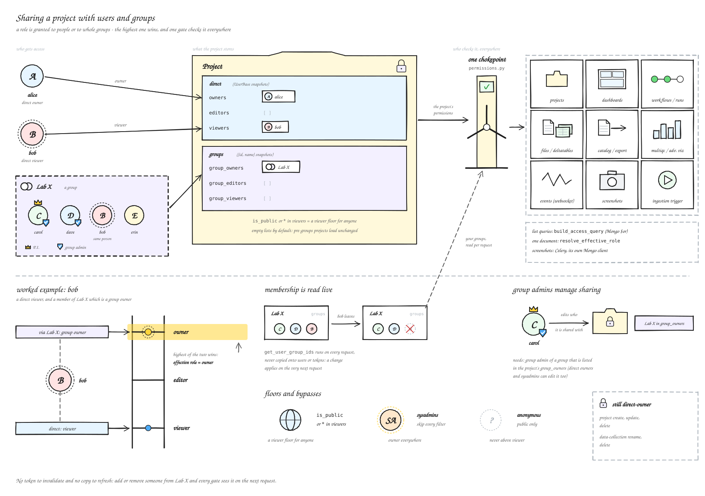
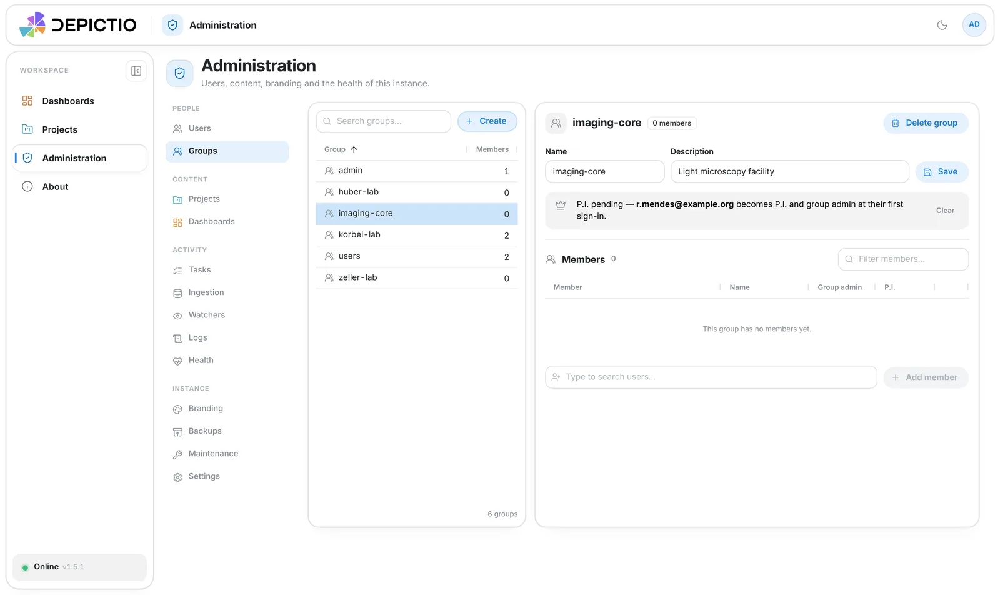
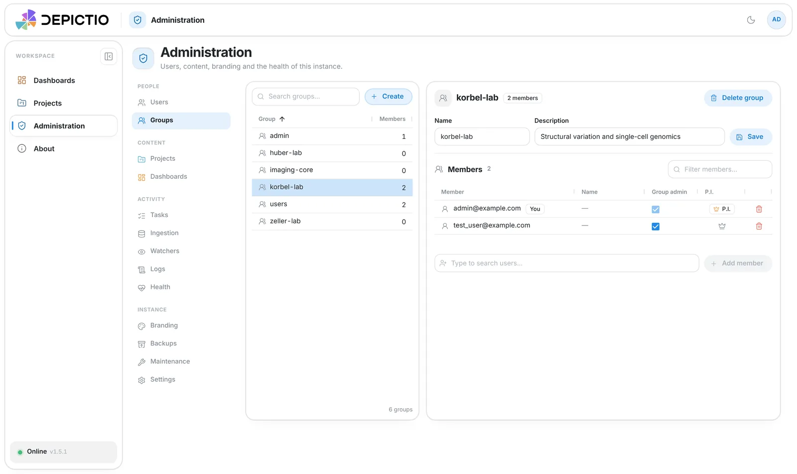
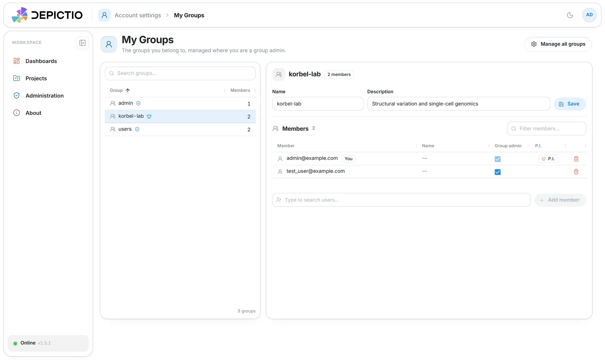

# :material-account-group-outline: Groups <small>(v1.18.0+)</small>

A **group** is a set of users a project can be shared with in one go, such as a lab with
its P.I. A user can be in several groups, and a project can be shared with people, with
groups, or both, as owner, editor or viewer.

A user's role on a project is the **highest** of their own role and the roles of their
groups: a direct viewer whose lab owns the project is an owner.

<figure markdown="span">
  {target=_blank}
  <figcaption><strong>Sharing with users and groups.</strong> Every access check goes through one module, and the highest role wins. Names are illustrative.</figcaption>
</figure>

---

## Who runs a group

| Role | Can |
|------|-----|
| **System admin** | Create, rename and delete any group, name its P.I., manage its members and admins |
| **Group admin** | Rename the group, add and remove members, promote or demote admins. A group keeps at least one admin, and an admin cannot demote themselves |
| **P.I.** | A group admin by default, shown with a crown |
| **Member** | See the group and its members |

### The P.I. { #pi }

A system admin names a group's P.I.; they become a group admin. When the address has no
account yet, the group shows a banner and waits: that person becomes its P.I.,
group admin and member when they first sign in, by password, Google or SAML. On a group
mirrored from SAML, the claim waits until the identity provider asserts the membership.

{target=_blank}

---

## Managing a group { #managing-a-group }

**Administration → People → Groups** lists every group, with search, sortable columns and
a Manual / SSO source filter. The selected group opens beside the list: inline name and
description, a members grid with a **Group admin** checkbox and the P.I. crown, an add row
and, except for the built-in `admin` and `users` groups, a delete action.

{target=_blank}

### My groups { #my-groups }

`/groups` is the same workspace limited to your own groups: read-only where you are a
member, manageable where you are a group admin, so running a lab does not need a system
admin. It is opened from the group badges in
[Account settings](../guides/web_ui.md#account-settings) (crown for P.I., shield for group
admin), which also show the name and title an identity provider gives.

{target=_blank}

<small>Screenshots use mocked data.</small>

---

## Sharing with a group { #sharing-with-a-group }

A project's **Permissions** page has a **Groups** section beside the people: add a group by
name and give it one role. Users and groups are saved together.

- An admin of a group that owns the project manages its sharing and its public switch, like
  an owner.
- A project always keeps an owner; an owning group counts.
- Deleting a group removes it from every project it was shared with.

See [Project permissions](../projects/guide.md#project-permissions).

---

## Groups from the identity provider { #sso-managed-groups }

With `DEPICTIO_AUTH_SAML_ATTRIBUTE_GROUPS` set, each SAML sign-in mirrors the user's groups
as **SSO-managed** groups, badged *SSO*: created when first seen, membership synced both
ways at every sign-in. Groups created by hand are never touched. See
[Group and profile sync](../../installation/sso.md#group-and-profile-sync).
