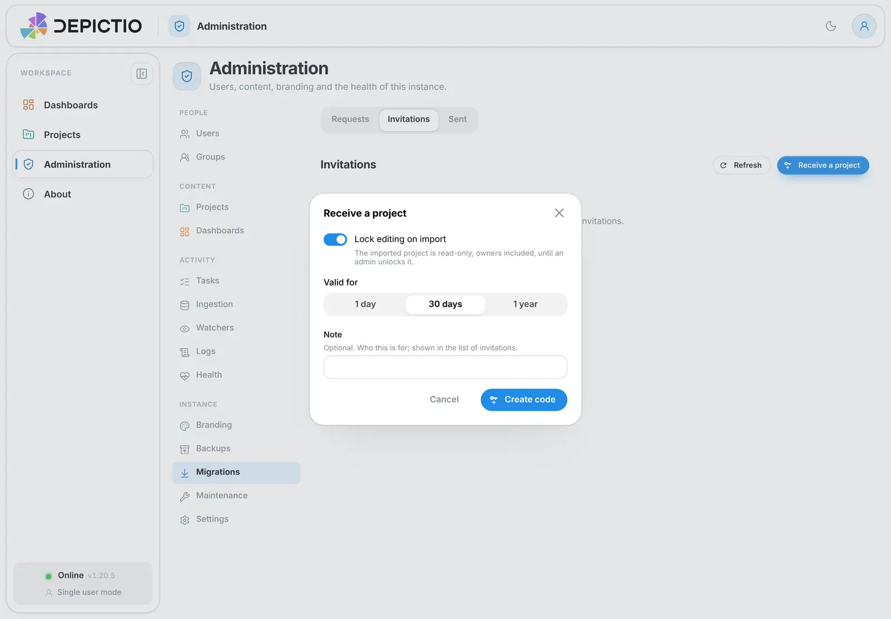
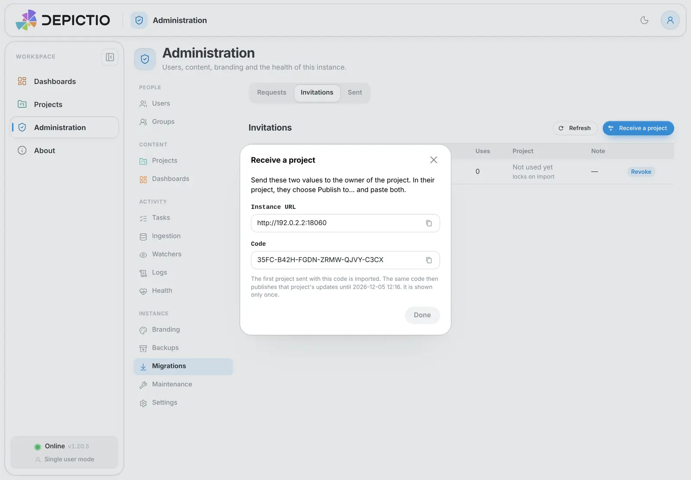
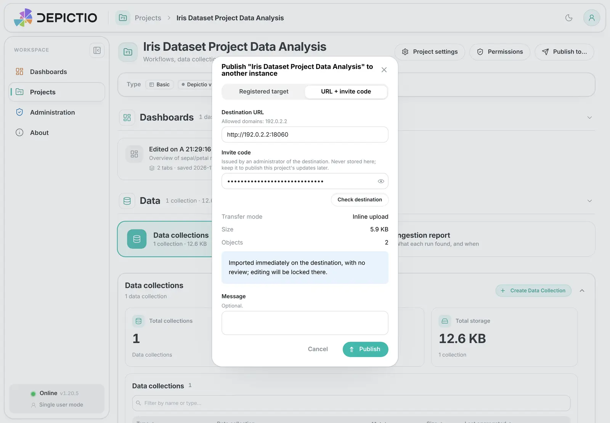
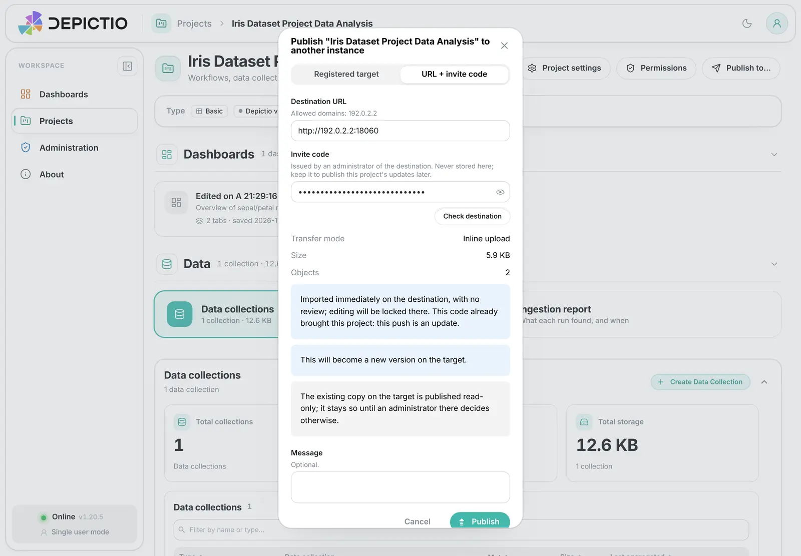
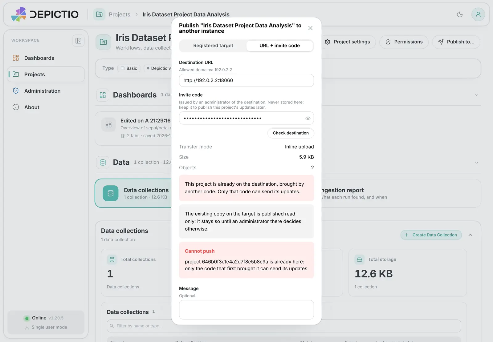
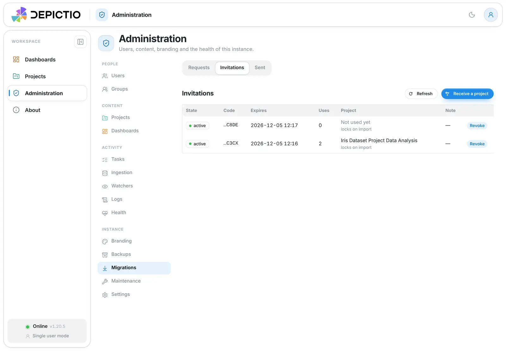
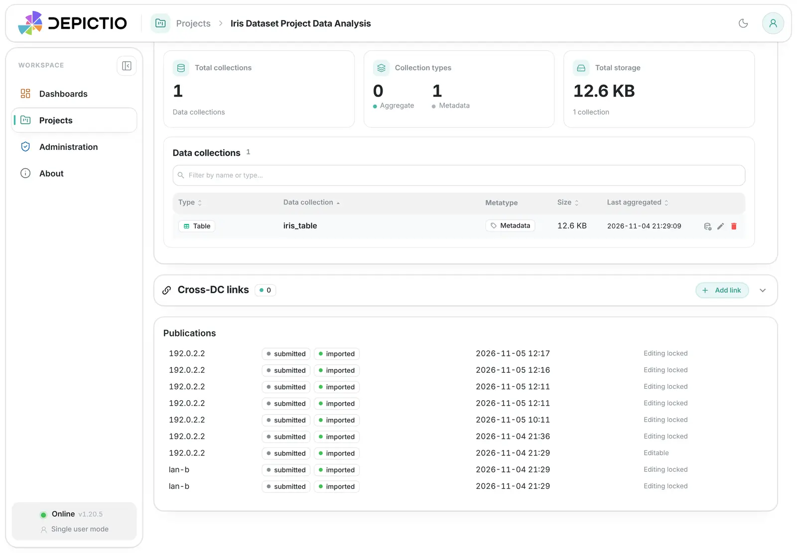
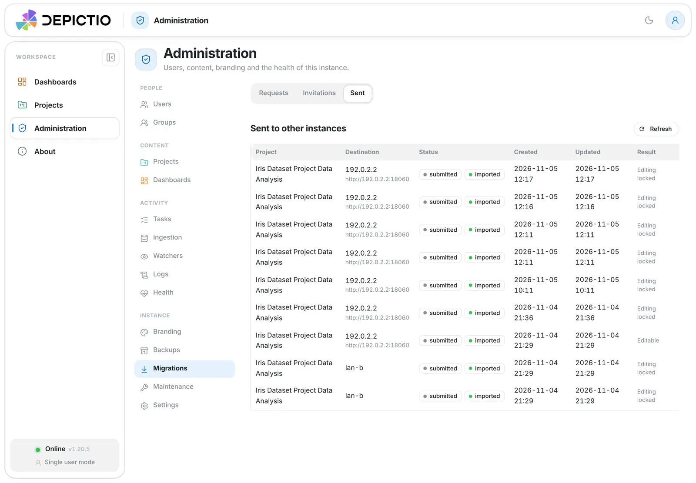
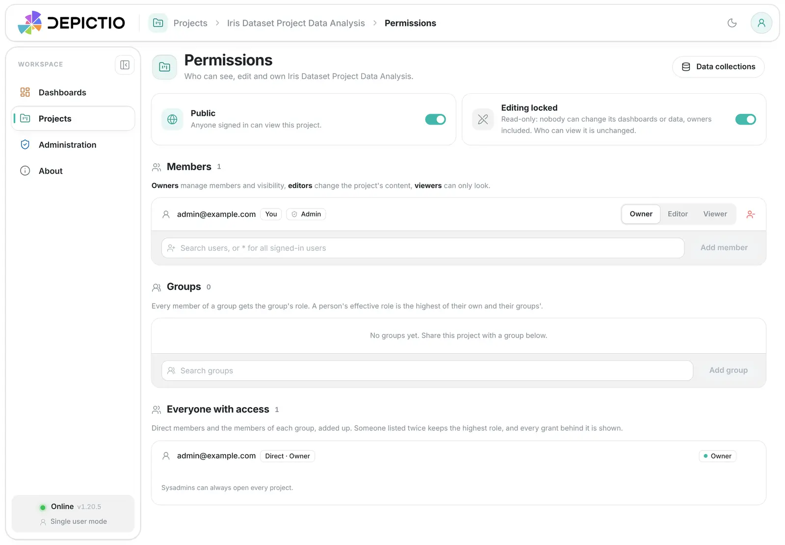

# :material-send-circle: Publishing to another instance

One Depictio instance (the **source**) can send a project to another (the
**destination**). The destination serves it, typically read-only and public.

Publishing is **non-destructive**. The source keeps its project, and nothing
else on the destination is touched.

This page is for project owners and instance admins. Operators will find the
settings in [Configuration](#configuration).

<!-- prettier-ignore -->
!!! info "Related pages"
    To move a project with the CLI or a ZIP file, see
    [Project Migration](migrate.md). Publishing uses the same bundle format,
    but needs no file handling.

---

## Quick start { #quick-start }

Publishing takes two gestures: one on each instance.

**1. On the destination, an admin creates an invite.**
Open *Administration → Migrations → Invitations* (or the *Projects* page
header) and click *Receive a project*. Copy the *Instance URL* and the *Code*,
and send both to the project owner.

[](../../images/guides/publishing/02-c-receive-modal.webp){target=_blank}

The code is **shown once**. Copy it before you click *Done*.

[](../../images/guides/publishing/03-c-receive-code-shown-once.webp){target=_blank}

*The destination in this screenshot is a local test instance, so its URL uses
http. In real use the URL is https (see [Security](#security)).*

**2. On the source, the project owner publishes.**

1. Open the project page and click *Publish to…*.
2. Choose the *URL + invite code* tab.
3. Paste the *Destination URL* and the *Invite code*.
4. Click *Check destination*. Depictio shows the transfer mode, the size and
   what will happen.
5. Add a *Message* if you like, then click *Publish*.

[](../../images/guides/publishing/06-a-publish-url-code-checked.webp){target=_blank}

The destination imports the project at once. No one needs to approve it: the
admin approved it in advance by issuing the code.

<!-- prettier-ignore -->
!!! note "The button may be missing"
    *Publish to…*, *Receive a project* and *Administration → Migrations* only
    appear when the instance has the feature switched on. See
    [Configuration](#configuration). Typed destinations also need the
    destination's domain on the source's allow-list.

---

## Invite codes { #invite-codes }

There is **one kind of code**.

- The first project sent with a code is imported at once, and the code is then
  **bound to that project**.
- Until it expires, the same code publishes **that project's updates**. Each
  update becomes a new version on the destination.
- Any other project is refused.

The rule to remember: **a project can only be updated with the code that first
brought it.** A new code for a project that is already on the destination is
refused.

[](../../images/guides/publishing/07a-a-same-code-update.webp){target=_blank}

[](../../images/guides/publishing/07b-a-fresh-code-refused.webp){target=_blank}

*Top: the same code, so the push is an update. Bottom: a fresh code, so the
push is refused.*

### Options when creating a code

| Option | Choices | Default |
|--------|---------|---------|
| *Valid for* | 1 day, 30 days, 1 year | 30 days |
| *Lock editing on import* | on or off | on |
| *Note* | free text, optional | empty |

Turn *Lock editing on import* off only if the owner still needs to adjust the
project on the destination.

### Listing and revoking codes

*Administration → Migrations → Invitations* lists every code with its state,
its last four characters, its expiry, how many times it was used and the
project it brought. Click *Revoke* to stop a code.

[](../../images/guides/publishing/11-c-invitation-used.webp){target=_blank}

### Security { #security }

- The code is 24 characters (120 bits). It is shown **once**. Depictio stores
  only a hash and the last four characters, so nobody can read it back.
- The source **never stores the code**. It keeps the code in memory for the
  upload only. Keep the code yourself if you want to publish updates later.
- A code works until it expires or is revoked. **Revoking stops it
  everywhere.**
- Codes work only while the destination has receiving switched on. Without a
  valid code or pairing key, every inbound call is refused.
- Destinations typed into the dialog must be on an allowed domain and use
  https. The exception is a host the operator has put on the LAN allow-list,
  which may use http.
- The source gets a per-request token to read the status of its own push. The
  token cannot do anything else.

---

## Following a publication { #following }

**On the project page**, the *Publications* card lists the pushes of that
project. Owners see their own pushes.

[](../../images/guides/publishing/08-a-project-publications.webp){target=_blank}

**For admins**, *Administration → Migrations → Sent* lists every push with its
destination, status, dates and result.

[](../../images/guides/publishing/09-a-admin-sent.webp){target=_blank}

Each row shows two statuses: the local one, then the one reported by the
destination.

| Status | Meaning |
|--------|---------|
| *building* | The source is building the bundle |
| *uploading* | The source is sending the bundle |
| *submitted* | The destination received the bundle |
| *pending* | (destination) waiting for an admin to approve |
| *importing* | (destination) the import is running |
| *imported* | (destination) the project is on the destination |
| *failed* | The push or the import failed. The row shows the reason |

The page refreshes while a push is running or still importing.

- **Retry.** A failed push has a *Retry* action. It starts a new push with the
  same project, destination and message. A push to a typed destination asks for
  the code again, because the source does not keep it.
- **One at a time.** A project can have only one push in flight. A second push
  while one is *building* or *uploading* is refused with a 409.
- **Restarts.** If the source restarts during a push, or the destination
  during an import, the entry becomes *failed* with the reason
  `interrupted by a restart` after an hour (configurable). Retry it.

---

## Making a published project read-only and public { #read-only-public }

Publishing does not make a project public. Do these steps on the destination,
in this order:

1. **Publish** the project.
2. **Lock** it. This is on already if *Lock editing on import* was on.
3. **Make it public.**

Both switches are on the project's *Permissions* page.

[](../../images/guides/publishing/13-c-permissions-locked-public.webp){target=_blank}

| Switch | Who can use it | What it does |
|--------|----------------|--------------|
| *Editing locked* | Admins only | Nobody can change the project's dashboards or data, owners included. The project shows a *Read-only* badge |
| *Public* | Owners; admins when locked | Controls who can view the project |

The two are independent. A published project is usually both public and locked.

An admin can still change the visibility of a locked project. An owner who is
not an admin cannot, and gets a 409.

### What the lock blocks

- Dashboards: edit, save, tabs, appearance, logo, import, delete and version
  restore.
- Data collections, Delta tables, MultiQC, files, runs and links.
- Project edit and project delete.
- Visibility changes by non-admins.

A viewer's **own copy** of a locked dashboard stays editable. Only the
published dashboards are locked.

The only thing that can write past the lock is an accepted publication, which
records the previous state as a version first. Only an admin can lift the lock.

<!-- prettier-ignore -->
!!! warning "The lock is an API guarantee"
    Anyone holding the storage keys can still change the underlying files.

---

## Approval mode with pairing keys { #approval-mode }

Operators who connect two instances **permanently** can use a pairing key
instead of invite codes. Both instances hold the same key. Nothing is imported
until an admin approves.

1. The operator adds the key to the source (*Registered target*) and to the
   destination (see [Configuration](#configuration)).
2. The owner publishes to the registered target.
3. The push waits in *Administration → Migrations → Requests* on the
   destination.
4. An admin **approves** it, with the options *Lock editing (read-only)* and
   *Make public*, or **rejects** it with a reason.

Pending requests expire after 14 days by default, and their staged bundle is
deleted.

When both instances use the **same S3 endpoint**, the destination can copy the
data itself instead of receiving it in the bundle (*server-side copy*). This
needs the source's bucket to be allowed on the destination, and read-only
access for the destination to that bucket. Invite pushes always send their data
inside the bundle.

---

## Configuration { #configuration }

All settings use the `DEPICTIO_MIGRATION_` prefix and are **off by default**.
List values are JSON.

| Variable | Side | Default | Meaning |
|----------|------|---------|---------|
| `UI_ENABLED` | both | `false` (Helm: `true`) | Shows the controls: *Publish to…*, *Receive a project*, *Administration → Migrations*. Hiding them does not close the API |
| `INBOUND_ENABLED` | destination | `false` (Helm: `true`) | Accepts pushes from pairing keys and valid invite codes. When off, every inbound route answers 404 |
| `DESTINATION_DOMAINS` | source | `[]` | Domain suffixes an owner may publish to with URL + code, for example `["example.org"]`. A host matches the suffix or any subdomain. Empty disables typed destinations |
| `TARGETS` | source | `[]` | Registered targets: `[{"name", "url", "pairing_key"}]` |
| `ALLOW_UI_TARGETS` | source | `false` | Lets admins add targets in *Administration → Settings* |
| `UI_TARGET_HOST_ALLOWLIST` | source | `[]` | Hosts that may use http or a private address (LAN use) |
| `INBOUND_SOURCES` | destination | `[]` | Accepted pairing keys: `[{"name", "pairing_key", ...}]` |
| `LOCK_IMPORTED_DEFAULT` | destination | `true` | Initial state of the lock switch on import |
| `INVITE_TTL_DAYS` | destination | `30` | Default lifetime of an invite code |
| `INVITE_MAX_TTL_DAYS` | destination | `365` | Longest lifetime an admin may give a code |
| `INTERRUPTED_AFTER_MINUTES` | both | `60` | After a restart, running pushes and imports older than this become *failed* |
| `MAX_BUNDLE_BYTES` | both | 10 GiB | Largest bundle accepted. Larger ones get a 413 |
| `PENDING_TTL_DAYS` | destination | `14` | Pending requests older than this expire |
| `INSTANCE_LABEL` | both | public URL host | Name recorded in the project's history |
| `HTTP_TIMEOUT_S` | source | `60` | Timeout for calls to a destination |

Two more settings, `STAGING_PREFIX` and `SPOOL_DIR`, set where bundles are
staged. They rarely need a change.

**Helm chart.** The chart turns `INBOUND_ENABLED` and `UI_ENABLED` on by
default. This is safe: the destination accepts nothing without a pairing key or
a valid invite code, and the code defaults stay off.

**Secrets.** `TARGETS` and `INBOUND_SOURCES` hold pairing keys (32 characters
or more). Put them in a Secret, not in a ConfigMap. The chart does not forward
them from `backend.env`.

**Ingress body size.** A bundle can be large. Raise the body-size limit on the
destination's ingress to at least `MAX_BUNDLE_BYTES`: `client_max_body_size`
for nginx, or `nginx.ingress.kubernetes.io/proxy-body-size` for ingress-nginx.

Example, destination with a permanent source:

```bash
DEPICTIO_MIGRATION_INBOUND_ENABLED=true
DEPICTIO_MIGRATION_INBOUND_SOURCES='[{"name": "lab", "pairing_key": "<64 hex>"}]'
```

Example, source allowed to publish by URL + code:

```bash
DEPICTIO_MIGRATION_UI_ENABLED=true
DEPICTIO_MIGRATION_DESTINATION_DOMAINS='["example.org"]'
```

---

## Troubleshooting { #troubleshooting }

| Message or symptom | Meaning and fix |
|--------------------|-----------------|
| Domain not allowed | The destination's host is not under `DESTINATION_DOMAINS` on the source. Ask the operator to add it |
| The URL is refused | Destinations must use https and a public address. Only hosts on `UI_TARGET_HOST_ALLOWLIST` may use http |
| Code expired or revoked | Ask the destination admin for a new code. A new code cannot update a project the old one brought |
| This code already brought another project | A code is bound to its first project. Ask for another code for this project |
| Only the code that first brought it can send its updates | The project is already on the destination. Use the original code, or ask an admin there to import through an approval |
| 409 in progress | This project already has a push in flight. Wait for it to finish |
| 409 on the destination when editing | The project is locked. An admin can unlock it |
| Bundle too large (413) | The bundle exceeds `MAX_BUNDLE_BYTES`, or the ingress body-size limit is too low |
| `interrupted by a restart` | A restart cut the push or import. Use *Retry* |
| No *Publish to…* or *Migrations* | `UI_ENABLED` is off on that instance |
