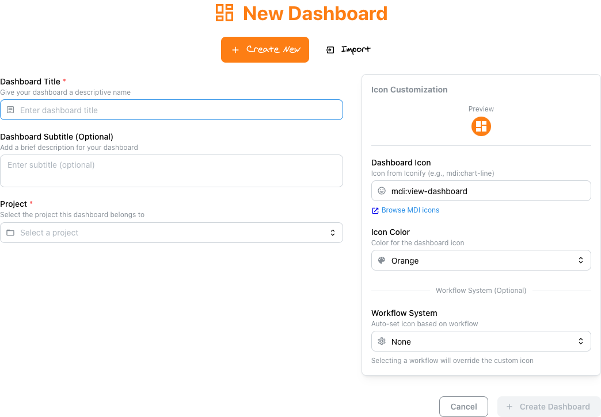

# <span style="color: #9966CC;">:material-rocket-launch:</span> Getting Started with Depictio

This guide will help you get started with Depictio after installation. It covers the basic concepts and workflows to help you begin visualizing your data.

## <span style="color: #45B8AC;">:material-play-circle:</span> First Steps

### <span style="color: #6495ED;">:material-download:</span> Installation

If you haven't installed Depictio yet, please refer to the [installation guide](../installation/README.md) for detailed instructions on how to set up Depictio using Docker Compose, or Helm.

### <span style="color: #F68B33;">:material-web:</span> Accessing the Web Interface

After installation [see the installation guide](../installation/README.md), you can access the Depictio web interface. If you used Docker Compose or the helm chart with a local setup, the default port is `5080`. Open your web browser and navigate to:

```bash
http://localhost:5080
```

### <span style="color: #8BC34A;">:material-login:</span> Logging In

When you first access Depictio, you'll be prompted to log in with the admin credentials you set before starting the service.

!!! info "Admin credentials are set at installation time"
    The initial admin account is created from two environment variables that must be configured **before the first start**:

    - `DEPICTIO_BOOTSTRAP_ADMIN_EMAIL` — the admin email address
    - `DEPICTIO_BOOTSTRAP_ADMIN_PASSWORD` — the admin password (≥ 16 characters; the server refuses to start if this is absent or too short)

    See the [installation configuration guide](../installation/configuration.md) for details on where and how to set these variables.

### <span style="color: #E6779F;">:material-database-eye:</span> Use existing demo data

If you want to explore Depictio with existing demo data, you can use the provided registered iris dataset. A demo dashboard is also already created for you to explore. You can access it by clicking on the **"Iris Dashboard"** on the landing page.

[](../images/guides/web-ui/dashboards_light.webp){target=_blank}
[](../images/guides/web-ui/dashboards_dark.webp){target=_blank}

### <span style="color: #45B8AC;">:material-folder-plus:</span> Register your first project

#### <span style="color: #F68B33;">:material-web:</span> Using the Web Interface

1. **Open the Projects section**: Click on the **"Projects"** link in the sidebar.
2. **Click on "Create Project"**: This will open the project creation form.
3. **Select Basic Project and enter project details**:

    - **Project Name**: Enter a name for your project.
    - **Description**: Optionally, provide a description for your project.

        - **Advanced**: For workflow-based projects with multiple data collections.

4. **Navigate to the "Data Collections" tab**: This is where you will add your data.
5. **Add Data Collections**:

    - Click on the **"Create Data Collection"** button.
    - Enter a name for your data collection.
    - Fill in required information such as:
        - **Data Collection Name**: A unique name for your data collection.
        - **Description**: Optionally, provide a description for your data collection.
        - **File format**: Choose the format of your data (e.g., CSV, Parquet).

6. **Upload Data**:

    - Drag and drop your data files or use the file picker to select files from your local system.
    - Supported formats include CSV, TSV, Excel, Parquet, and Feather.

<div style="max-width: 1200px; margin: 1rem auto 2rem auto;">
  <div style="padding: 56.25% 0 0 0; position: relative">
    <iframe
      src="https://player.vimeo.com/video/1108747290?badge=0&amp;autopause=0&amp;player_id=0&amp;app_id=58479"
      frameborder="0"
      allow="autoplay; fullscreen; picture-in-picture; clipboard-write; encrypted-media; web-share"
      referrerpolicy="strict-origin-when-cross-origin"
      style="position: absolute; top: 0; left: 0; width: 100%; height: 100%"
      title="Creating Your First Basic Project - Step by Step Walkthrough"
    ></iframe>
  </div>
  <p style="text-align: center; margin-top: 0.5rem; font-style: italic; color: #666;">🎬 <strong>Basic Project Creation:</strong> Watch how to create a basic project from scratch - upload data, configure settings, and start visualizing in minutes</p>
</div>
<script src="https://player.vimeo.com/api/player.js"></script>

#### Using the CLI

<span style="color: #6495ED;">:octicons-terminal-24:</span> Use the command-line interface to programmatically manage your Depictio projects and data.

##### <span style="color: #8BC34A;">:material-download:</span> Install the CLI

Depictio provides a command-line interface (CLI), the `depictio` command, for managing data ingestion and other tasks. You can install it by following the [CLI installation guide](../installation/cli.md).

##### <span style="color: #F9CB40;">:material-cog:</span> Create a CLI configuration

Once you have installed the CLI tool, you need a configuration file to interact with Depictio. It holds the address of your Depictio instance and a long-lived token that signs the CLI in as you.

1. Open **Account settings** with your avatar in the top bar, and the **CLI agents** section <small>(v1.17.0+; before, a separate CLI agents page)</small>.

    [](../images/guides/web-ui/cli_agents_light.webp){target=_blank}
    [](../images/guides/web-ui/cli_agents_dark.webp){target=_blank}

2. Click **Add configuration**, give the configuration a name that tells it apart, such as the machine it runs on, and click **Create**.

    [](../images/guides/web-ui/cli_new_light.webp){target=_blank}
    [](../images/guides/web-ui/cli_new_dark.webp){target=_blank}

3. **Save it**: **Download** the file, or **Copy** it, as `~/.depictio/CLI.yaml`. The token is shown only once, and it signs the CLI in as you: keep the file private.
4. **Check the connection** from the machine you saved it on:

    ```bash
    depictio config check
    ```

The file looks like this (abridged):

```yaml
# ~/.depictio/CLI.yaml
api_base_url: http://localhost:8058
user:
  id: 67658ba033c8b59ad489d7c7
  email: admin@example.com
  is_admin: true
  token:
    access_token: >-
      eyJhbGciOiJSUzI1NiIsInR5cCI6IkpXVCJ9...
    token_type: bearer
    token_lifetime: long-lived
    expire_datetime: '2027-10-12 13:59:59'
    name: laptop
s3_storage:
  service_name: localhost
  service_port: 9000
  external_host: localhost
  external_port: 9000
  external_protocol: http
  bucket: depictio-bucket
  root_user: minio
  root_password: minio123
```

##### <span style="color: #7A5DC7;">:material-play:</span> Use the CLI tool

You can now use the CLI tool to interact with your Depictio instance. For example, you can list available workflows, upload data collections, and manage your projects. Refer to the [CLI usage documentation](../depictio-cli/usage.md) for detailed usage instructions.

Saved as `~/.depictio/CLI.yaml`, the configuration is the one every command uses by default, so none of them needs `--server`. See [Which server a command uses](../depictio-cli/usage.md#choosing-a-server) for the other ways to name a server.

With no `~/.depictio/CLI.yaml`, the CLI uses the [local server](../installation/local.md): here pipeline results are previewed, then ingested into it:

<div class="asciinema-cast" data-cast="assets/casts/depictio-ingest-detect.cast" data-poster="npt:0:51" data-idle-time-limit="2.5"></div>

In that get started guide, you can use the **palmer penguins dataset** to test the CLI tool. This dataset mimics the [palmer penguins dataset](https://allisonhorst.github.io/palmerpenguins/), which is a popular dataset for testing data visualization tools.

```bash
depictio ingest \
    --project-config-path ../api/v1/configs/penguins_dataset/penguins_project.yaml
```

This command will run the CLI tool with the default configuration file and the specified project configuration file. This will create a new project in Depictio with the palmer penguins dataset, including 2 data collections: `physical_features` and `demographic_data`.

Once the data ingested into the system, you can go to the web interface and see the project created in the **Project Management** section.

##### <span style="color: #E53935;">:material-video:</span> Video Tutorial

<div style="padding: 64.29% 0 0 0; position: relative">
  <iframe
    src="https://player.vimeo.com/video/1105745104?badge=0&amp;autopause=0&amp;player_id=0&amp;app_id=58479"
    frameborder="0"
    allow="autoplay; fullscreen; picture-in-picture; clipboard-write; encrypted-media; web-share"
    referrerpolicy="strict-origin-when-cross-origin"
    style="position: absolute; top: 0; left: 0; width: 100%; height: 100%"
    title="depictio-cli-registration-1753809368201"
  ></iframe>
</div>
<script src="https://player.vimeo.com/api/player.js"></script>

#### <span style="color: #F68B33;">:material-view-dashboard:</span> Creating Your First Dashboard

To create your first dashboard using the palmer penguins dataset, click on **+ New Dashboard** in the top right corner of the web interface.

[](../images/guides/web-ui/dashboards_light.webp){target=_blank}
[](../images/guides/web-ui/dashboards_dark.webp){target=_blank}

This will open the dashboard creation modal. Pick the **Palmer Penguins Species Comparison** project, give the dashboard a name, and confirm.

<div style="border: 1px solid grey; width: 602px; padding: 1px;">
    <a href="../../images/react/new_dashboard_modal.png" target="_blank">
        
    </a>
</div>

You will land in the editor for the new dashboard, where you can add components. The screenshot below shows the editor against an existing ampliseq dashboard for reference.

[](../images/guides/web-ui/editor_light.webp){target=_blank}
[](../images/guides/web-ui/editor_dark.webp){target=_blank}

 Then follow the [dashboard creation guide](guides/dashboard_creation.md) and [dashboard usage guide](guides/dashboard_usage.md). These guides will walk you through the process of designing a dashboard, adding components, and configuring interactivity.

## <span style="color: #45B8AC;">:material-arrow-right-circle:</span> Next Steps

Now that you understand the basics, you can:

- <span style="color: #F68B33;">:material-view-dashboard:</span> [Learn more about dashboard creation](guides/dashboard_creation.md)
- <span style="color: #6495ED;">:material-widgets:</span> [Explore the dashboard components](guides/dashboard_usage.md)
- <span style="color: #7A5DC7;">:octicons-terminal-24:</span> [Set up the CLI for your own data](../depictio-cli/usage.md)
- <span style="color: #8BC34A;">:material-api:</span> [Understand the API for integration](../api/overview.md)

## <span style="color: #E53935;">:material-help-circle:</span> Troubleshooting

If you encounter issues:

- <span style="color: #F9CB40;">:material-frequently-asked-questions:</span> Check the [FAQ](../FAQ/general.md) for common problems and solutions
- <span style="color: #E6779F;">:material-file-document:</span> Review the logs for error messages
- <span style="color: #9966CC;">:material-file-check:</span> Ensure your data is in a supported format
- <span style="color: #45B8AC;">:material-server:</span> Verify that all services are running correctly
- <span style="color: #6495ED;">:material-github:</span> [Report an issue on GitHub](https://github.com/depictio/depictio/issues) for bugs or feature requests
