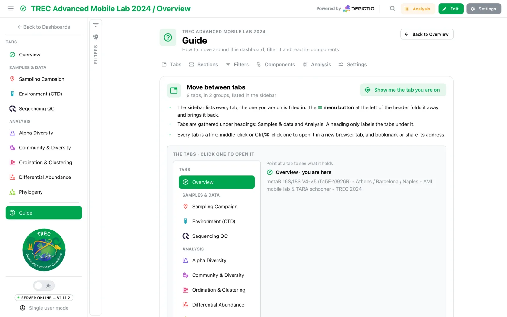

# :material-help-circle-outline: The dashboard Guide <small>(v1.14.0+)</small>

Every dashboard has a **Guide**: a short page on how to move around it, filter it and
read its components. It is opened from the **Guide** entry at the bottom of the sidebar's
tab list. It is not a walkthrough to click through once, but a page to come back to, and
it is built from the dashboard it sits on: its tabs, its sections, its filters, its
components.

[](../../images/guides/dashboard-guide/guide-tabs.webp){target=_blank}

---

## What it covers

Each part is a card with a short text, a live demo and a **Show me** button that rings
the thing it is about inside the demo. A row of links at the top jumps to each part.

| Part | What it shows |
|------|---------------|
| **Tabs** | The sidebar's own tab list, with its groups and the tab you are on. Pointing at a tab shows what it holds; clicking opens it |
| **Sections** | The tab's own sections (else pinned ones, or a sibling tab's), drawn by the dashboard itself: headers, folding, the numbers a folded section of cards still shows, **Collapse all** |
| **Filters** | A real card and filter from the dashboard. Picking a value changes the number without touching the dashboard's own filters |
| **Components** | Pick a kind: one of the dashboard's own components of it, from this tab or a sibling, with its full action row, so every icon can be tried. A kind the dashboard lacks shows a stand-in. *In the editor* adds the grip, the resize corner and the ⋮ menu, whose items only describe what they would do |
| **Analysis** | Select, save as a group and compare, overlaid or split, on the dashboard's own figure, table and card. See [Analysis](../../features/interactive-selection-filtering.md#analysis-panel) |
| **Settings** | The reader's own page width and text size (*Settings → Your view*), and light or dark (the sidebar's sun / moon). **Show me what they do** plays them on the demo, then puts them back |
| **Comments** <small>(v1.17.4+)</small> | Threads and annotations on one of the dashboard's own figures, through the real comment controls. It works without an account and writes nothing. See [Comments and Annotations](../../features/comments-annotations.md) |
| **Versions** <small>(v1.17.4+)</small> | A component's real history, read-only for any reader (no **Restore**). A dashboard with no saved version gets a sample list. See [Component history](../../features/versioning.md#component-history) |

Everything the demos do stays in the Guide: no filter, group or setting of the dashboard
changes.

---

## Landing hint <small>(v1.17.4+)</small> { #landing-hint }

A public-mode guest opening a dashboard (demo mode keeps its tour) gets a small note under
the *Powered by Depictio* credit: what Depictio is, what this dashboard is, and a button to the Guide. It shows once
per browser, on the main tab, and goes away with its close button or when the Guide is
opened. It takes over from the public tour, which now stays on the dashboards list and
ends by picking a dashboard. A dashboard with `show_guide: false` gets no hint.

---

## The address

The Guide opens as `?guide=1` on the tab it was opened from, so it can be bookmarked or
shared. The tab stays loaded underneath: **Back to …** (at the top right and at the foot
of the page), **Esc**, the browser's Back, or the tab or the **Guide** entry clicked again
in the sidebar returns to it at once.

---

## For authors

The Guide is on by default for every dashboard. Two settings change it, set on the main
tab for the whole dashboard, from **Settings → Guide** in the editor or in YAML:

| Key | Default | Effect |
|-----|---------|--------|
| `show_guide` | `true` | `false` removes the Guide entry from the sidebar; a `?guide=1` link then opens the tab |
| `guide_intro` | `""` | A markdown note shown at the top of the Guide, such as where to start reading |

```yaml
title: TREC Advanced Mobile Lab 2024
guide_intro: Start with **Key figures** on the Overview, then follow the tabs in order.
```

See also [Landing tabs](../../features/dashboards.md#landing-tabs) for the authoring side of
a dashboard's first page, and [Spotlight search](spotlight-search.md) for finding one
component.
